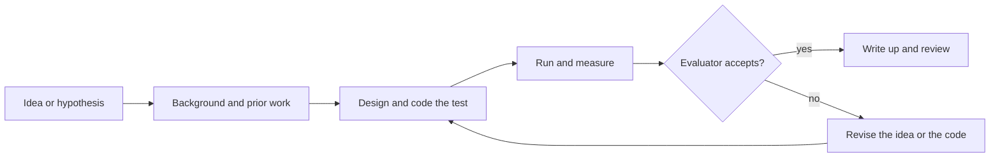

# AI for AI Research

AI systems are increasingly used to do parts of the research process itself: reading the literature, designing and running experiments, writing code and, in a few experiments, improving the AI systems that do this work. This page covers the applied side and the debate about whether such automation could lead to recursive self-improvement.

## Overview

Using machines to help design machines is older than large language models. [Neural architecture search](../../theory/deep-learning/nas-automl/index.md) used search algorithms to choose network structures that people had once chosen by hand. In 1966 I. J. Good argued that a machine able to design machines better than people could design its own successors, which would lead to an "intelligence explosion" (Good, 1966).

What is new is that language-model agents can carry out many of the steps a researcher takes, so the whole loop can now be automated. Most results come from narrow tasks, such as machine-learning competitions or replicating one paper, and the broader claims are contested. Other sciences are covered on the [Scientific Discovery](../science/index.md) page, and formal mathematics on the [Mathematics and Formal Proof](../mathematics/index.md) page.

## Key concepts

- **Research loop**: the cycle of forming a question, reviewing prior work, designing a test, running it, interpreting the result and choosing what to try next.
- **Agent scaffold**: the program around a language model that supplies tools, a shell, memory and a way to check its own output. The scaffold often matters as much as the model. See [agent engineering](../../engineering/agents/index.md).
- **Evaluator**: an automatic check that scores a result, such as a test suite, a metric or a grader. Automated research is only as reliable as its evaluators. See [LLM-as-judge](../../engineering/evaluation/llm-as-judge.md).
- **Time horizon**: the length of task, in human working time, that an agent can finish with a given success rate (Kwa et al., 2025).
- **Recursive self-improvement**: a system that improves the process that produces its own improvements, so each gain can make the next one easier.

## How it works

Most systems in this area run some form of the loop below. A language model proposes a hypothesis or a change, the system implements and runs it, and an evaluator decides whether the result is kept. The outcome informs the next proposal.

Systems differ in how much of the loop they cover. End-to-end pipelines, such as [The AI Scientist](ai-scientist/index.md), attempt the whole cycle from idea to paper. Component tools handle one step, such as literature synthesis or code search. Self-improving systems apply the loop to the agent itself. The output is only as reliable as the evaluator: an agent can overfit a benchmark, and an automated reviewer can reward papers that resemble its training data.

## Key methods

Three landmark methods cover the main approaches. Each has its own page.

| Method | Stage | What separates it | Page |
|---|---|---|---|
| The AI Scientist (Lu et al., 2024) | Whole pipeline, from idea to paper | Writes full papers at low cost and scores them with an automated reviewer | [The AI Scientist](ai-scientist/index.md) |
| OpenScholar (Asai et al., 2024) | Literature review | Retrieves from 45 million open-access papers and cites its sources | [OpenScholar](openscholar/index.md) |
| Darwin Gödel Machine (Zhang et al., 2025) | Self-improvement of agent code | Keeps an archive of coding agents and tests each self-modification empirically | [Darwin Gödel Machine](darwin-godel-machine/index.md) |

## Connections

- **Agents.** The tools behind research automation are language-model agents. See [AI agents](../../theory/models/agents/index.md) for the concept. [Agent evaluation](../../engineering/agents/agent-evaluation/index.md) covers testing them, and [sandboxing](../../engineering/agents/sandboxing-and-computer-use/index.md) covers running code they write.
- **Mathematics.** [FunSearch](../mathematics/funsearch/index.md) and [AlphaProof](../mathematics/alphaproof/index.md) apply similar search to programs and proofs.
- **Synthetic data.** [Model collapse](../../engineering/synthetic-data/model-collapse.md) is central to the debate below.
- **Evaluation.** Research benchmarks are useful only if their tasks are absent from training data. See [contamination](../../engineering/evaluation/contamination.md).
- **Brain and mind.** The link is indirect. Human scientists also hold and revise several hypotheses, as [cognitive architectures](../../brain-mind/cognitive-architectures/index.md) describe. No evidence shows that current systems reason the same way, so the comparison is an analogy.

## Applications

- **Literature review.** Retrieval-augmented systems search large collections of papers and write answers with citations. [OpenScholar](openscholar/index.md) is the landmark example here.
- **Experiment design and lab automation.** Coscientist (Boiko et al., 2023) used GPT-4 with tools for web search, code execution and control of lab equipment to plan and carry out chemical reactions. A-Lab (Szymanski et al., 2023) used computation, literature data and active learning to plan and interpret syntheses of inorganic powders.
- **Agentic coding for research.** Coding agents write and run the code that experiments need. SWE-agent (Yang et al., 2024) showed that the interface an agent uses to read and edit code strongly affects its results.
- **Algorithm discovery.** AlphaEvolve (Novikov et al., 2025) is an evolutionary coding agent. Its authors report gains in data-centre scheduling and hardware circuits, and that it accelerated training of the language model underlying it, the nearest published example of a system improving part of its own development.
- **Benchmarks of research ability.** MLE-bench (Chan et al., 2024) uses 75 Kaggle competitions, and the best agent setup reached at least bronze level in 16.9% of them. PaperBench (Starace et al., 2025) asks agents to replicate 20 ICML 2024 papers; the best agent averaged 21.0%.[^1] RE-Bench (Wijk et al., 2024) finds agents ahead of experts at two hours per task but behind them at longer budgets. The time-horizon study (Kwa et al., 2025) reports that the 50% time horizon of frontier models has doubled roughly every seven months since 2019.

## Open questions

### The recursive-improvement debate

The question is whether AI systems that help build AI could produce gains that compound quickly enough to matter. Positions differ on the answer and on what evidence would settle it.

| View | Main sources | Core claim |
|---|---|---|
| Intelligence explosion | Good (1966) | A machine that designs better machines could design better successors, so gains compound and speed up |
| Formal self-improvement | Schmidhuber (2003); Zhang et al. (2025) | Change code only when a proof shows benefit; such proofs are impractical, so test changes empirically |
| Empirical, narrow self-improvement | Zhang et al. (2025); Zelikman et al. (2023); Novikov et al. (2025) | Systems already improve parts of their own code or algorithms on benchmarked tasks, with bounded gains |
| Bottlenecks | Aghion, Jones and Jones (2017) | Automating idea production can raise growth, but bottlenecks in parts of the process that stay human-dependent limit the speed-up |
| Data constraints | Shumailov et al. (2024) | Repeated training on model-generated data loses the rare cases of the original data, so naive self-training loops degrade |
| Caution about evidence and risk | Messeri and Crockett (2024); Kinniment et al. (2023) | Benchmark gains do not show research judgement; AI can create an illusion of understanding; autonomous capabilities need evaluation |

Supporters of the intelligence-explosion view disagree about how fast the process would be. The authors of the empirical systems describe their work as steps toward self-improving AI, not as an explosion. Zelikman et al. (2023) state that their system is "not full recursive self-improvement", because the language model's own parameters are not changed; only the scaffold improves. Aghion, Jones and Jones (2017) see automated research as potentially important but expect bottlenecks to limit it. Shumailov et al. (2024) show a concrete constraint on one route to self-improvement. Those who stress caution point to the gap between benchmark success and research judgement, and to the risk that automated results are trusted more than they deserve.

### Other open questions

- **Transfer.** Do gains on benchmarks such as MLE-bench carry over to research that requires choosing a good question?
- **Evaluator quality.** Can automated reviewers approximate expert peer review, and how would we know?
- **Safe self-modification.** How should self-modifying systems be sandboxed and monitored so that their changes can be audited?

[^1]: The best agent in the paper used Claude 3.5 Sonnet with open-source scaffolding.

## References

### Seminal papers

- Good, I. J. (1966). Speculations Concerning the First Ultraintelligent Machine. *Advances in Computers*. https://doi.org/10.1016/S0065-2458(08)60418-0 — The classic statement of the argument that a machine able to design machines could trigger rapid gains.
- Schmidhuber, J. (2003). Goedel Machines: Self-Referential Universal Problem Solvers Making Provably Optimal Self-Improvements. arXiv. https://arxiv.org/abs/cs/0309048 — Proposes a self-referential solver that rewrites its own code once it has proof that the rewrite helps.
- Boiko, D. A. et al. (2023). Autonomous chemical research with large language models. *Nature*. https://doi.org/10.1038/s41586-023-06792-0 — Describes Coscientist, a GPT-4 system that plans and performs chemistry experiments using tools.
- Lu, C. et al. (2024). The AI Scientist: Towards Fully Automated Open-Ended Scientific Discovery. arXiv. https://arxiv.org/abs/2408.06292 — Introduces a pipeline that generates ideas, runs experiments and writes papers, with an automated reviewer.
- Zhang, J. et al. (2025). Darwin Godel Machine: Open-Ended Evolution of Self-Improving Agents. arXiv. https://arxiv.org/abs/2505.22954 — Self-modifying coding agents validated on benchmarks, raising SWE-bench performance from 20.0% to 50.0%.

### Articles and documentation

- Messeri, L. & Crockett, M. J. (2024). Artificial intelligence and illusions of understanding in scientific research. *Nature*. https://doi.org/10.1038/s41586-024-07146-0 — Commentary on how AI tools can make researchers feel they understand more than they do, and on monocultures of method.
- Aghion, P., Jones, B. F. & Jones, C. I. (2017). Artificial Intelligence and Economic Growth. NBER Working Paper 23928. https://doi.org/10.3386/w23928 — Economic model of how automating idea production could change growth, and why bottlenecks could limit it.
- Shumailov, I. et al. (2024). AI models collapse when trained on recursively generated data. *Nature*. https://doi.org/10.1038/s41586-024-07566-y — Shows that recursive training on model output loses the tails of the original distribution.
- Kinniment, M. et al. (2023). Evaluating Language-Model Agents on Realistic Autonomous Tasks. arXiv. https://arxiv.org/abs/2312.11671 — Proposes testing whether language-model agents can acquire resources, copy themselves and adapt.
- Chan, J. S. et al. (2024). MLE-bench: Evaluating Machine Learning Agents on Machine Learning Engineering. arXiv. https://arxiv.org/abs/2410.07095 — Benchmark of 75 Kaggle competitions for measuring agents on engineering tasks.
- Starace, G. et al. (2025). PaperBench: Evaluating AI's Ability to Replicate AI Research. arXiv. https://arxiv.org/abs/2504.01848 — Benchmark of 20 ICML 2024 papers with graded rubrics for replication.
- Wijk, H. et al. (2024). RE-Bench: Evaluating frontier AI R&D capabilities of language model agents against human experts. arXiv. https://arxiv.org/abs/2411.15114 — Compares agents with human experts on open-ended machine-learning research-engineering tasks.
- Kwa, T. et al. (2025). Measuring AI Ability to Complete Long Software Tasks. arXiv. https://arxiv.org/abs/2503.14499 — Introduces the 50% time-horizon metric and reports its doubling trend.
- Asai, A. et al. (2024). OpenScholar: Synthesizing Scientific Literature with Retrieval-augmented LMs. arXiv. https://arxiv.org/abs/2411.14199 — Retrieval-augmented model that writes citation-backed answers from 45 million open-access papers.
- Szymanski, N. J. et al. (2023). An autonomous laboratory for the accelerated synthesis of inorganic materials. *Nature*. https://doi.org/10.1038/s41586-023-06734-w — Describes A-Lab, which plans and interprets solid-state syntheses with machine learning and active learning.
- Yang, J. et al. (2024). SWE-agent: Agent-Computer Interfaces Enable Automated Software Engineering. arXiv. https://arxiv.org/abs/2405.15793 — Shows how the interface given to an agent changes its performance on software tasks.
- Novikov, A. et al. (2025). AlphaEvolve: A coding agent for scientific and algorithmic discovery. arXiv. https://arxiv.org/abs/2506.13131 — White paper on an evolutionary coding agent applied to Google's infrastructure and to mathematics.
- Zelikman, E. et al. (2023). Self-Taught Optimizer (STOP): Recursively Self-Improving Code Generation. arXiv. https://arxiv.org/abs/2310.02304 — A language model improves the scaffolding program that calls it, and the authors discuss the limits of that step.
