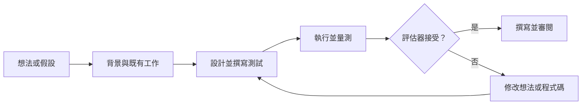

# AI 用於 AI 研究

AI 系統越來越多地被用來執行研究過程的部分工作：閱讀文獻、設計並執行實驗、撰寫程式碼，並且在少數實驗中，改進那些執行這些工作的 AI 系統本身。本頁涵蓋應用面，以及這類自動化是否可能導致遞迴自我改進的爭論。

## 概述

用機器協助設計機器，比大型語言模型更早出現。[神經架構搜尋](../../theory/deep-learning/nas-automl/index.md)以搜尋演算法來選擇網路結構，這些結構過去是由人手工選定的。1966 年，I. J. Good 主張，一台能設計出比人更好的機器的機器，可以設計出它自己的後繼者，並因此引發「智能爆炸」（Good，1966）。

新的是，語言模型代理人現在能完成研究者的許多步驟，因此整個循環都可以自動化。多數成果來自狹窄的任務，例如機器學習競賽，或複現單一篇論文，而更廣泛的主張仍有爭議。其他科學領域見[科學發現](../science/index.md)頁，形式化數學見[數學與形式證明](../mathematics/index.md)頁。

## 關鍵概念

- **研究循環**：提出問題、回顧既有工作、設計測試、執行測試、解讀結果並選擇下一步嘗試什麼的循環。
- **代理人鷹架**：包在語言模型外圍的程式，提供工具、命令列介面、記憶，以及檢查自身輸出的方法。鷹架的重要性往往與模型本身相當。參見[代理人工程](../../engineering/agents/index.md)。
- **評估器**：為結果評分的自動檢查，例如測試套件、指標或評分程式。自動化研究的可靠程度，取決於它的評估器。參見 [LLM 作為評審](../../engineering/evaluation/llm-as-judge.md)。
- **時間範圍**：代理人能以既定成功率完成的任務長度，以人類工作時間計算（Kwa 等人，2025）。
- **遞迴自我改進**：系統改進那個產生自身改進的過程，因此每一次進步都可能讓下一次進步更容易。

## 運作方式

本領域多數系統都執行下面循環的某種形式。語言模型提出假設或修改，系統實作並執行它，然後評估器決定結果是否保留。結果會為下一次提議提供資訊。

各系統涵蓋循環的範圍並不相同。端到端的流程，例如 [The AI Scientist](ai-scientist/index.md)，會嘗試從想法到論文的完整循環。元件工具則只處理其中一步，例如文獻綜整或程式搜尋。自我改進系統則把這個循環套用在代理人本身上。輸出的可靠度只取決於評估器：代理人可能對基準測試過度擬合，而自動審稿人可能獎勵與其訓練資料相似的論文。

## 關鍵方法

三種里程碑式的方法涵蓋了主要的途徑。每一種都有自己的頁面。

| 方法 | 階段 | 區別之處 | 頁面 |
|---|---|---|---|
| The AI Scientist（Lu 等人，2024） | 完整流程，從想法到論文 | 以低成本撰寫完整論文，並由自動審稿人評分 | [The AI Scientist](ai-scientist/index.md) |
| OpenScholar（Asai 等人，2024） | 文獻回顧 | 從 4,500 萬篇開放取用論文中檢索，並標註引用來源 | [OpenScholar](openscholar/index.md) |
| Darwin Gödel Machine（Zhang 等人，2025） | 代理人程式的自我改進 | 保存一個程式代理人的檔案庫，並以實證方式測試每一次自我修改 | [Darwin Gödel Machine](darwin-godel-machine/index.md) |

## 相關連結

- **代理人。** 研究自動化背後的工具是語言模型代理人。概念參見 [AI 代理人](../../theory/models/agents/index.md)。[代理人評估](../../engineering/agents/agent-evaluation/index.md)說明如何測試它們，而[沙箱](../../engineering/agents/sandboxing-and-computer-use/index.md)則說明如何執行它們所撰寫的程式碼。
- **數學。** [FunSearch](../mathematics/funsearch/index.md) 與 [AlphaProof](../mathematics/alphaproof/index.md) 對程式與證明套用類似的搜尋。
- **合成資料。** [模型崩潰](../../engineering/synthetic-data/model-collapse.md)是下文爭論的核心。
- **評估。** 研究基準只有在其任務未出現於訓練資料時才有用。參見[污染](../../engineering/evaluation/contamination.md)。
- **大腦與心智。** 這種連結是間接的。人類科學家同樣會持有並修正數個假設，[認知架構](../../brain-mind/cognitive-architectures/index.md)對此過程有所描述。目前沒有證據顯示，現有系統的推理方式與人類研究者相同，因此這種比較只是類比。

## 應用

- **文獻回顧。** 檢索增強系統搜尋大量論文，並撰寫附帶引用的答案。[OpenScholar](openscholar/index.md) 是此處的代表性範例。
- **實驗設計與實驗室自動化。** Coscientist（Boiko 等人，2023）使用 GPT-4，並搭配網路搜尋、程式執行與實驗設備控制等工具，規劃並執行化學反應。A-Lab（Szymanski 等人，2023）則運用計算、文獻資料與主動學習，規劃並解讀無機粉末的合成。
- **用於研究的代理式程式設計。** 程式設計代理人撰寫並執行實驗所需的程式碼。SWE-agent（Yang 等人，2024）顯示，代理人用來讀取與編輯程式碼的介面，會大幅影響其結果。
- **演算法發現。** AlphaEvolve（Novikov 等人，2025）是一種演化式程式碼代理人。作者報告它在資料中心排程與硬體電路上有所改進，並且加速了作為其基礎的語言模型之訓練，這是目前已發表的、系統改進自身部分開發流程的最接近例子。
- **研究能力的基準測試。** MLE-bench（Chan 等人，2024）使用 75 場 Kaggle 競賽，最佳的代理人設定在其中 16.9% 的競賽中至少達到銅牌水準。PaperBench（Starace 等人，2025）要求代理人複現 20 篇 ICML 2024 的論文；最佳代理人的平均分數為 21.0%。[^1] RE-Bench（Wijk 等人，2024）發現，在每項任務兩小時的情況下代理人領先專家，但在較長時間預算下則落後於專家。時間範圍研究（Kwa 等人，2025）報告，前沿模型的 50% 時間範圍自 2019 年以來約每七個月加倍一次。

## 開放問題

### 遞迴自我改進的爭論

問題在於：協助建造 AI 的 AI 系統，能否產生足以複利成長、並因此重要的進步。各方對答案，以及什麼樣的證據能解決這個問題，看法並不一致。

| 立場 | 主要來源 | 核心主張 |
|---|---|---|
| 智能爆炸 | Good（1966） | 能設計更好機器的機器，可以設計出更好的後繼者，因此進步會複利成長並加速 |
| 形式化的自我改進 | Schmidhuber（2003）；Zhang 等人（2025） | 只有在證明修改有益時才改寫程式碼；但這類證明並不實際，因此改動必須以實證方式測試 |
| 經驗性的、狹窄的自我改進 | Zhang 等人（2025）；Zelikman 等人（2023）；Novikov 等人（2025） | 系統已能在有基準的任務上改進自身程式碼或演算法的部分，但收益有限 |
| 瓶頸 | Aghion、Jones 與 Jones（2017） | 將想法的產生自動化可以提高成長率，但仍需人力的流程環節會形成瓶頸，限制加速的幅度 |
| 資料限制 | Shumailov 等人（2024） | 反覆以模型生成的資料訓練，會流失原始資料中罕見的情況，因此單純的自我訓練迴圈會退化 |
| 對證據與風險的審慎 | Messeri 與 Crockett（2024）；Kinniment 等人（2023） | 基準上的進步並不代表研究判斷力；AI 可能造成理解的錯覺；自主能力在發布前需要評估 |

智能爆炸的支持者對於這個過程會有多快，看法並不一致。經驗性系統的作者則把自己的工作描述為邁向自我改進 AI 的步驟，而非一場爆炸。Zelikman 等人（2023）明確表示，其系統「並非完整的遞迴自我改進」，因為語言模型本身的參數沒有改變，只有鷹架得到改進。Aghion、Jones 與 Jones（2017）認為自動化研究可能相當重要，但預期瓶頸會限制其效果。Shumailov 等人（2024）則指出一條自我改進路徑上的具體限制。強調審慎的人則指出，基準上的成功與研究判斷力之間存在落差，也指出自動化結果被信任的程度可能超過其應得的程度。

### 其他開放問題

- **遷移。** 在 MLE-bench 等基準上的進步，能否延伸到需要挑選好問題的研究？
- **評估器品質。** 自動審稿人能否接近專家同儕審查？我們要如何得知？
- **安全的自我修改。** 自我修改系統應如何設置沙箱並加以監控，使其改動可以被稽核？

[^1]: 論文中表現最佳的代理人使用 Claude 3.5 Sonnet 與開源鷹架。

## 參考文獻

### 開創性論文

- Good, I. J.（1966）。Speculations Concerning the First Ultraintelligent Machine。*Advances in Computers*。https://doi.org/10.1016/S0065-2458(08)60418-0 — 經典論述，主張能設計機器的機器可能引發快速進步。
- Schmidhuber, J.（2003）。Goedel Machines: Self-Referential Universal Problem Solvers Making Provably Optimal Self-Improvements。arXiv。https://arxiv.org/abs/cs/0309048 — 提出一種自我參照的求解器，只有在證明改寫有益後才改寫自身程式碼。
- Boiko, D. A. 等人（2023）。Autonomous chemical research with large language models。*Nature*。https://doi.org/10.1038/s41586-023-06792-0 — 介紹 Coscientist，一個以 GPT-4 驅動、使用工具規劃並執行化學實驗的系統。
- Lu, C. 等人（2024）。The AI Scientist: Towards Fully Automated Open-Ended Scientific Discovery。arXiv。https://arxiv.org/abs/2408.06292 — 提出一套流程，可產生想法、執行實驗並撰寫論文，並以自動審稿人評分。
- Zhang, J. 等人（2025）。Darwin Godel Machine: Open-Ended Evolution of Self-Improving Agents。arXiv。https://arxiv.org/abs/2505.22954 — 能自我修改的程式代理人，經基準驗證後，將 SWE-bench 的表現從 20.0% 提升至 50.0%。

### 文章與文件

- Messeri, L. & Crockett, M. J.（2024）。Artificial intelligence and illusions of understanding in scientific research。*Nature*。https://doi.org/10.1038/s41586-024-07146-0 — 評論文章，探討 AI 工具如何讓研究者以為自己理解得比實際更多，以及方法單一化的問題。
- Aghion, P., Jones, B. F. & Jones, C. I.（2017）。Artificial Intelligence and Economic Growth。NBER Working Paper 23928。https://doi.org/10.3386/w23928 — 經濟學模型，說明將想法產生自動化會如何改變經濟成長，以及瓶頸為何可能加以限制。
- Shumailov, I. 等人（2024）。AI models collapse when trained on recursively generated data。*Nature*。https://doi.org/10.1038/s41586-024-07566-y — 指出以模型輸出進行遞迴訓練，會流失原始分布的尾部。
- Kinniment, M. 等人（2023）。Evaluating Language-Model Agents on Realistic Autonomous Tasks。arXiv。https://arxiv.org/abs/2312.11671 — 提出測試語言模型代理人是否能取得資源、複製自身並適應環境的方法。
- Chan, J. S. 等人（2024）。MLE-bench: Evaluating Machine Learning Agents on Machine Learning Engineering。arXiv。https://arxiv.org/abs/2410.07095 — 以 75 場 Kaggle 競賽衡量代理人工程能力的基準。
- Starace, G. 等人（2025）。PaperBench: Evaluating AI's Ability to Replicate AI Research。arXiv。https://arxiv.org/abs/2504.01848 — 以 20 篇 ICML 2024 論文建立的基準，附有分級評分標準，用於評估複現能力。
- Wijk, H. 等人（2024）。RE-Bench: Evaluating frontier AI R&D capabilities of language model agents against human experts。arXiv。https://arxiv.org/abs/2411.15114 — 在開放式的機器學習研究工程任務上，比較代理人與人類專家。
- Kwa, T. 等人（2025）。Measuring AI Ability to Complete Long Software Tasks。arXiv。https://arxiv.org/abs/2503.14499 — 提出 50% 時間範圍的指標，並報告其加倍趨勢。
- Asai, A. 等人（2024）。OpenScholar: Synthesizing Scientific Literature with Retrieval-augmented LMs。arXiv。https://arxiv.org/abs/2411.14199 — 檢索增強模型，從 4,500 萬篇開放取用論文中撰寫附帶引用的答案。
- Szymanski, N. J. 等人（2023）。An autonomous laboratory for the accelerated synthesis of inorganic materials。*Nature*。https://doi.org/10.1038/s41586-023-06734-w — 介紹 A-Lab，以機器學習與主動學習規劃並解讀固態合成。
- Yang, J. 等人（2024）。SWE-agent: Agent-Computer Interfaces Enable Automated Software Engineering。arXiv。https://arxiv.org/abs/2405.15793 — 說明提供給代理人的介面，如何改變其在軟體任務上的表現。
- Novikov, A. 等人（2025）。AlphaEvolve: A coding agent for scientific and algorithmic discovery。arXiv。https://arxiv.org/abs/2506.13131 — 關於一套演化式程式碼代理人的白皮書，應用於 Google 的基礎設施與數學問題。
- Zelikman, E. 等人（2023）。Self-Taught Optimizer (STOP): Recursively Self-Improving Code Generation。arXiv。https://arxiv.org/abs/2310.02304 — 語言模型改進呼叫它的鷹架程式，作者並討論這一步的限制。
