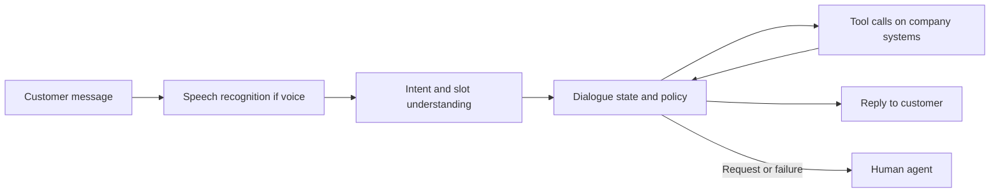

# Customer Service and Conversational Systems

Customer service is one of the largest everyday uses of conversational AI. Systems that answer questions, take orders or change bookings have moved from touch-tone phone menus and keyword scripts, through intent classifiers and dialogue managers, to language-model agents that call a company's own tools.

## Overview

Dialogue systems that serve a business task are called task-oriented, to distinguish them from open-domain chatbots, which only converse. A customer wants something specific, such as a refund, a password reset or a changed flight. The system must understand the request, collect the facts it needs, act on company systems and confirm the result. A standard review of statistical spoken dialogue systems sets out the core framing (Young et al., 2013).

The earliest well-known program of this kind, ELIZA, matched keywords in typed input to scripted rules and reflected the user's words back as questions (Weizenbaum, 1966). It had no model of meaning, yet users attributed understanding to it. Telephone customers met a different design in interactive voice response (IVR) systems, which offered spoken or keypad menus and routed each call to a queue.

For most of the 2010s, deployed systems were pipelines of separately built parts. Language models can now replace much of that pipeline with one model that reads a policy, calls tools and writes the reply. Benchmarks show that such agents still fail often, so the design question has shifted from "can the system respond?" to "when can it be trusted to finish the task, and when must a person take over?"

## Key concepts

- **Intent**: the purpose of a customer's message, such as "change my flight". Intent detection assigns each message one of a fixed set of labels. Modern detectors need only a few examples per label (Casanueva et al., 2020).
- **Slot**: a piece of information a task needs, such as a date, an order number or a city. Slot filling labels the words that carry each value.
- **Dialogue state**: the system's running record of the goal and the slot values confirmed so far. Dialogue state tracking updates it every turn.
- **Policy**: the decision about what to do next, such as asking a question, calling a tool, or handing over to a person.
- **Tool call**: an action on a company system, such as looking up an order or issuing a refund.
- **Deflection rate**: the share of contacts the automated channel completes without transfer to a person. The figure depends on what counts as "completed".
- **Resolution rate**: the share of issues actually solved. A contact can be deflected and still unresolved, so the two are reported separately.
- **Customer satisfaction (CSAT)**: usually a survey score given after a contact. Estimating it automatically from the conversation is a research area of its own (Kim et al., 2020).
- **Escalation, or handoff**: transfer of the conversation to a human agent, ideally with the context gathered so far.

## How it works

**Pipeline systems.** The classical design runs the stages in sequence and fills a response template at the end. Each stage can be trained and audited on its own. Its weakness is error propagation: a wrong intent sends the conversation down the wrong branch, and no later stage can recover. Joint models that predict intent and slots together reduced this problem; see [Joint intent detection and slot filling](joint-intent-slot-filling/index.md).

**Hybrid systems.** Hybrid Code Networks combine a recurrent network that tracks the dialogue with software and action templates written by domain designers. The designers supply part of the structure, so the model needs far less training data. The authors report that it outperformed two commercially deployed customer-facing dialogue systems (Williams et al., 2017).

**End-to-end systems.** [SimpleTOD](simpletod/index.md) turns the whole task-oriented turn into one sequence, so a single language model writes the dialogue state, the action and the reply. Hudeček and Dušek (2023) found that instruction-tuned language models lagged specialised systems at tracking the belief state, although they could steer a conversation to a successful end when given the correct slot values.

**LLM agents.** An agent receives a policy document and a set of tools, then chooses its own sequence of calls and replies. The reasoning-and-acting pattern of [ReAct](../../engineering/agents/react/index.md) interleaves written reasoning with tool actions (Yao et al., 2022). The outcome of such a conversation lies in a database, so [τ-bench](../../engineering/agents/agent-evaluation/tau-bench/index.md) simulates a customer and grades the final database state. Its authors report that a leading function-calling model succeeded on fewer than half of the tasks and was inconsistent across repeated trials.[^1]

### Measuring success

Deflection is the most visible number, and it rises easily if escalation is made hard. Resolution and satisfaction need outcome data. A study using data from 5,172 customer-support agents found that a generative-AI assistant raised issues resolved per hour by 15 percent on average, with the largest gains for less experienced workers (Brynjolfsson et al., 2023).[^2]

## Key methods

Two landmark methods mark the two ends of the historical arc. Each has its own page.

- [Joint intent detection and slot filling](joint-intent-slot-filling/index.md) (Liu and Lane, 2016): one network that classifies the intent and tags the slots together, the workhorse of the understanding stage for years.
- [SimpleTOD](simpletod/index.md) (Hosseini-Asl et al., 2020): one causal language model that writes the dialogue state, the action and the response as a single sequence.

The first keeps separate, typed outputs that can be checked. The second gives up that structure in exchange for the general knowledge of a pretrained language model.

## Connections

- **Agents.** Customer service is an early setting where [AI agents](../../theory/models/agents/index.md) meet real rules and customers; see also [agent evaluation](../../engineering/agents/agent-evaluation/index.md).
- **Language and speech.** The understanding stage is a problem in [natural language processing](../../theory/models/nlp/index.md), and voice channels add a [speech model](../../theory/models/speech/index.md) in front.
- **Brain and mind.** The ELIZA effect is psychological: people attribute understanding to a program that only mirrors their words (Weizenbaum, 1966). Trust and reluctance are covered in [human-AI interaction](../../society/human-ai-interaction/index.md) and [automation bias](../../society/human-ai-interaction/automation-bias.md). The [language in the brain](../../brain-mind/language-in-brain/index.md) page covers how people extract meaning from speech.
- **Security.** Customer-facing agents read untrusted text and take actions, so they need [guardrails](../../engineering/llm-security/guardrails.md) and face [indirect prompt injection](../../engineering/llm-security/indirect-prompt-injection.md).

## Applications

- **Retail, travel and banking.** Order changes, returns, rebooking and banking queries are standard test cases. The two domains of τ-bench, retail and airline, reflect this.
- **Monitoring contacts.** Wen (2020) describes a model, developed at Amazon, that scores each turn of bot-handled and human-handled customer-service contacts for monitoring and offline evaluation.
- **Gatekeeping and adoption.** Experiments show that customers use chatbots less often than simple time-saving models predict, and that transparency about limits and displayed waiting times raise uptake (Kagan et al., 2025).[^3]

## Open questions

- **Reliable completion.** An agent that succeeds once may fail on a repeated attempt. How many trials a deployment needs before it is trusted is not settled (Yao et al., 2024).
- **Escalation design.** How to hand over to a person without making customers feel trapped in a gatekeeping process is unresolved.
- **Who gains from assistance.** In the 2023 study the gains were largest for the least experienced workers. Whether assistance that drafts replies slows the building of skill is open, and one study of a period of work does not show long-run effects on employment.
- **Measuring satisfaction.** Survey scores are sparse, and automatic estimates are still being tested (Kim et al., 2020).
- **Simulated customers.** A language model playing the customer may not behave like a real one, so benchmark results need checking against recorded human conversations.
- **Accountability.** When an agent gives wrong refund information, responsibility is unclear. The [governance](../../society/governance/index.md) section covers these questions.

## References

### Seminal papers

- Weizenbaum, J. (1966). ELIZA—A Computer Program For the Study of Natural Language Communication Between Man and Machine. *Communications of the ACM*. https://doi.org/10.1145/365153.365168 — Describes ELIZA, a keyword-rule program that reflects the user's words back.
- Williams, J. D., Asadi, K. & Zweig, G. (2017). Hybrid Code Networks: practical and efficient end-to-end dialog control with supervised and reinforcement learning. https://arxiv.org/abs/1702.03274 — Combines a recurrent network with domain software and action templates, reducing the training data needed.
- Liu, B. & Lane, I. (2016). Attention-Based Recurrent Neural Network Models for Joint Intent Detection and Slot Filling. https://arxiv.org/abs/1609.01454 — Joint attention-based model that classifies intent and tags slots in one network, evaluated on ATIS.
- Budzianowski, P. et al. (2018). MultiWOZ -- A Large-Scale Multi-Domain Wizard-of-Oz Dataset for Task-Oriented Dialogue Modelling. https://arxiv.org/abs/1810.00278 — Crowd-sourced corpus of about 10,000 multi-domain dialogues with belief-state labels, the standard benchmark for the field.
- Hosseini-Asl, E. et al. (2020). A Simple Language Model for Task-Oriented Dialogue. https://arxiv.org/abs/2005.00796 — Recasts the whole task-oriented dialogue as one sequence for a causal language model, reporting state-of-the-art results on MultiWOZ.
- Casanueva, I. et al. (2020). Efficient Intent Detection with Dual Sentence Encoders. https://arxiv.org/abs/2003.04807 — Intent detectors built on pretrained sentence encoders that work in few-shot settings and train quickly on a single CPU.
- Yao, S. et al. (2022). ReAct: Synergizing Reasoning and Acting in Language Models. https://arxiv.org/abs/2210.03629 — Interleaves language-model reasoning with actions such as tool calls, so the model can plan and react to feedback.

### Surveys and textbooks

- Young, S. et al. (2013). POMDP-Based Statistical Spoken Dialog Systems: A Review. *Proceedings of the IEEE*. https://doi.org/10.1109/JPROC.2012.2225812 — Reviews statistical spoken dialogue systems that treat dialogue management as a decision problem under uncertainty.
- Zhang, Z. et al. (2020). Recent Advances and Challenges in Task-oriented Dialog System. https://arxiv.org/abs/2003.07490 — Survey of data efficiency, dialogue-policy learning and evaluation for task-oriented systems.

### Articles and documentation

- Brynjolfsson, E., Li, D. & Raymond, L. (2023). Generative AI at Work. https://arxiv.org/abs/2304.11771 — Staggered rollout of a generative-AI assistant to 5,172 customer-support agents, with productivity, learning and customer-experience results.
- Kagan, E., Hathaway, B. & Dada, M. (2025). Deploying Chatbots in Customer Service: Adoption Hurdles and Simple Remedies. https://arxiv.org/abs/2504.06145 — Incentivised experiments on why customers under-use chatbots and which service-design choices raise uptake.
- Yao, S. et al. (2024). τ-bench: A Benchmark for Tool-Agent-User Interaction in Real-World Domains. https://arxiv.org/abs/2406.12045 — Simulated-customer benchmark with domain tools and policies, graded by database state, which introduces pass^k.
- Hudeček, V. & Dušek, O. (2023). Are LLMs All You Need for Task-Oriented Dialogue? https://arxiv.org/abs/2304.06556 — Tests instruction-tuned language models on task-oriented benchmarks, finding weaker belief tracking but good task completion given correct slots.
- Wen, R. (2020). Turn-level Dialog Evaluation with Dialog-level Weak Signals for Bot-Human Hybrid Customer Service Systems. https://arxiv.org/abs/2011.06395 — Describes a model that scores each turn of bot and human customer-service contacts, for monitoring and evaluation.
- Kim, Y., Levy, J. & Liu, Y. (2020). Speech Sentiment and Customer Satisfaction Estimation in Socialbot Conversations. https://arxiv.org/abs/2008.12376 — Estimates customer satisfaction automatically from acoustic and lexical signals, so explicit surveys are not needed.

[^1]: Yao et al. (2024), abstract: state-of-the-art function-calling agents, including gpt-4o, succeed on fewer than 50% of tasks, and pass^8 is below 25% in the retail domain. https://arxiv.org/abs/2406.12045

[^2]: Brynjolfsson, Li and Raymond (2023), abstract: a 15% average increase in issues resolved per hour, with larger gains for less experienced and lower-skilled workers. https://arxiv.org/abs/2304.11771

[^3]: Kagan, Hathaway and Dada (2025), abstract: a key driver of low uptake is "gatekeeper aversion", and uptake rises when customers see average waiting times and information about chatbot limitations. https://arxiv.org/abs/2504.06145
