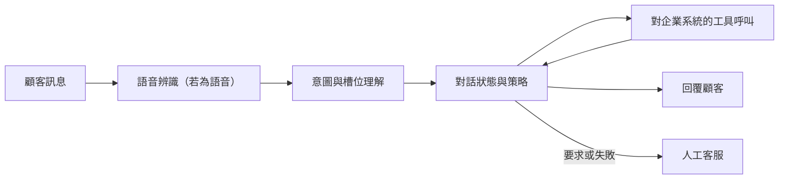

# 客戶服務與對話系統

客戶服務是對話式 AI 最大宗的日常應用之一。能回答問題、接受訂單或更改預約的系統，已經從按鍵式電話選單與關鍵字腳本，發展到意圖分類器與對話管理器，再到會呼叫企業自有工具的語言模型代理人。

## 概述

服務於商業任務的對話系統稱為任務導向（task-oriented）系統，用來與只負責閒聊的開放領域聊天機器人區分。顧客想要的是特定的事，例如退款、重設密碼或改班機。系統必須理解請求、蒐集所需的資訊、在企業系統上採取行動，並確認結果。一篇關於統計式口語對話系統的標準綜述，說明了這個問題的核心框架（Young et al., 2013）。

最早廣為人知的此類程式是 ELIZA，它把使用者輸入的文字與腳本規則比對，再把使用者的話以問句反映回去（Weizenbaum, 1966）。它並沒有語意模型，使用者卻仍把理解歸給它。電話客戶則遇到另一種設計：互動式語音回應（IVR）系統，提供語音或按鍵選單，再把來電轉入佇列。

在 2010 年代的大部分時間裡，已部署的系統是由各自獨立建造的部件組成的管線。語言模型如今可以取代其中大部分的管線：由一個模型閱讀政策、呼叫工具並寫出回覆。基準測試顯示，這類代理人仍然經常失敗，因此設計的問題已從「系統能不能回應？」轉為「什麼時候可以信任它完成任務，什麼時候必須由人接手？」

## 關鍵概念

- **意圖（intent）**：顧客訊息背後的目的，例如「改班機」。意圖偵測會把每則訊息歸入一組固定標籤之一。現代的偵測器每個標籤只需要少量範例（Casanueva et al., 2020）。
- **槽位（slot）**：任務所需的一項資訊，例如日期、訂單編號或城市。槽位填充會標記出承載每個值的詞。
- **對話狀態（dialogue state）**：系統對目前為止的目標與已確認槽位值的運行紀錄。對話狀態追蹤會在每一輪更新它。
- **策略（policy）**：決定下一步做什麼，例如提問、呼叫工具，或轉交給真人。
- **工具呼叫（tool call）**：對企業系統採取的動作，例如查詢訂單或發放退款。
- **自動處理率（deflection rate）**：自動化管道在不轉接真人的情況下完成的聯絡比例。這個數字取決於什麼算「完成」。
- **解決率（resolution rate）**：實際被解決的問題比例。一次聯絡可能已被自動處理卻仍未解決，因此兩者要分開回報。
- **顧客滿意度（CSAT）**：通常是聯絡後的問卷分數。從對話中自動估計滿意度，本身就是一個研究領域（Kim et al., 2020）。
- **升級或轉接（escalation／handoff）**：把對話轉給人工客服，最好連同已蒐集的脈絡一併轉交。

## 運作方式

**管線式系統。** 古典設計依序執行各階段，最後再填入回覆範本。每個階段都可以單獨訓練與稽核。它的弱點是錯誤傳遞：一個錯誤的意圖會把對話導向錯誤的分支，之後的階段無法復原。同時預測意圖與槽位的聯合模型降低了這個問題；參見[聯合意圖偵測與槽位填充](joint-intent-slot-filling/index.md)。

**混合式系統。** Hybrid Code Networks 結合了追蹤對話的循環網路，以及由領域設計師撰寫的軟體與動作範本。設計師提供了一部分結構，因此模型所需的訓練資料少得多。作者報告，它的表現優於兩個已商用部署、面向顧客的對話系統（Williams et al., 2017）。

**端到端系統。** [SimpleTOD](simpletod/index.md) 把整個任務導向的回合轉為一個序列，因此單一語言模型同時寫出對話狀態、動作與回覆。Hudeček 與 Dušek（2023）發現，經指令微調的語言模型在追蹤信念狀態上落後於專門系統，但在被給定正確槽位值時，能把對話引導至成功結束。

**LLM 代理人。** 代理人接收政策文件與一組工具，然後自行決定呼叫的順序與回覆內容。[ReAct](../../engineering/agents/react/index.md) 的推理與行動模式，把書寫的推理與工具行動交錯進行（Yao et al., 2022）。這類對話的結果在資料庫中，因此 [τ-bench](../../engineering/agents/agent-evaluation/tau-bench/index.md) 會模擬一位顧客，並評分最終的資料庫狀態。其作者報告，一個領先的函式呼叫模型在不到一半的任務上成功，且在重複試驗中表現不穩定。[^1]

### 衡量成效

自動處理率是最醒目的數字，若刻意把轉接做得困難，它很容易被拉高。解決率與滿意度則需要實際結果的資料。一項使用 5,172 位客服人員資料的研究發現，生成式 AI 助理使每小時解決的問題數平均提高 15%，其中經驗較少的員工獲益最多（Brynjolfsson et al., 2023）。[^2]

## 關鍵方法

兩種代表性方法標出了歷史脈絡的兩端。每種方法都有自己的頁面。

- [聯合意圖偵測與槽位填充](joint-intent-slot-filling/index.md)（Liu and Lane, 2016）：以同一個網路同時分類意圖並標記槽位，多年來是理解階段的主力。
- [SimpleTOD](simpletod/index.md)（Hosseini-Asl et al., 2020）：以單一的因果語言模型，把對話狀態、動作與回覆寫成一個序列。

前者保留了可以檢查的、有型別的獨立輸出；後者則放棄這種結構，換取預訓練語言模型的通用知識。

## 相關連結

- **代理人。** 客戶服務是 [AI 代理人](../../theory/models/agents/index.md)最早接觸真實規則與顧客的領域之一；另見[代理人評估](../../engineering/agents/agent-evaluation/index.md)。
- **語言與語音。** 理解階段屬於[自然語言處理](../../theory/models/nlp/index.md)的問題，語音管道則在前面加上[語音模型](../../theory/models/speech/index.md)。
- **腦與心智。** ELIZA 效應是心理層面的現象：人們會把理解歸給一個只是反映自己話語的程式（Weizenbaum, 1966）。對自動化答案的信任，以及不願被轉給機器的心態，在[人機互動](../../society/human-ai-interaction/index.md)與[自動化偏誤](../../society/human-ai-interaction/automation-bias.md)中有所討論。[大腦中的語言](../../brain-mind/language-in-brain/index.md)頁面則說明人如何從語音中擷取意義。
- **安全。** 面向顧客的代理人會讀取不可信的文字並採取行動，因此需要[護欄](../../engineering/llm-security/guardrails.md)，並會面臨[間接提示注入](../../engineering/llm-security/indirect-prompt-injection.md)。

## 應用

- **零售、旅遊與銀行。** 訂單更改、退貨、改期與銀行查詢，都是標準的測試情境。τ-bench 的兩個領域（零售與航空）正反映了這一點。
- **監控聯絡。** Wen（2020）描述了一個在亞馬遜開發的模型，能為機器人處理與人工處理的客服聯絡中的每一輪打分，用於即時監控與離線評估。
- **閘門與採用。** 實驗顯示，顧客使用聊天機器人的頻率低於單純省時模型的預測；而對能力限制的透明度，以及顯示的等候時間，能提高採用率（Kagan et al., 2025）。[^3]

## 開放問題

- **可靠完成。** 一個代理人成功一次，不代表重複嘗試時也會成功。部署前需要多少次試驗才值得信任，尚無定論（Yao et al., 2024）。
- **升級設計。** 如何轉交給真人，同時不讓顧客覺得被困在閘門流程中，仍未解決。
- **誰從協助中獲益。** 在 2023 年的研究中，獲益最大的是經驗最少的員工。協助撰寫回覆是否會拖慢技能的養成，仍是開放的問題；而一項針對某段工作期間的研究，也無法說明長期的就業影響。
- **衡量滿意度。** 問卷分數稀少，而從對話中自動估計滿意度的方法仍在測試中（Kim et al., 2020）。
- **模擬的顧客。** 扮演顧客的語言模型，行為未必與真人相同，因此基準結果需要與真人對話紀錄對照檢驗。
- **責任歸屬。** 當代理人給出錯誤的退款資訊時，責任並不清楚。[治理](../../society/governance/index.md)一節討論了這些問題。

## 參考文獻

### 奠基性論文

- Weizenbaum, J. (1966). ELIZA—A Computer Program For the Study of Natural Language Communication Between Man and Machine. *Communications of the ACM*. https://doi.org/10.1145/365153.365168 — 描述 ELIZA，一個把使用者的話以關鍵字規則反映回去的程式。
- Williams, J. D., Asadi, K. & Zweig, G. (2017). Hybrid Code Networks: practical and efficient end-to-end dialog control with supervised and reinforcement learning. https://arxiv.org/abs/1702.03274 — 把循環網路與領域軟體及動作範本結合，減少任務導向對話所需的訓練資料。
- Liu, B. & Lane, I. (2016). Attention-Based Recurrent Neural Network Models for Joint Intent Detection and Slot Filling. https://arxiv.org/abs/1609.01454 — 以注意力機制為基礎的聯合模型，在同一網路中分類意圖並標記槽位，並在 ATIS 上評估。
- Budzianowski, P. et al. (2018). MultiWOZ -- A Large-Scale Multi-Domain Wizard-of-Oz Dataset for Task-Oriented Dialogue Modelling. https://arxiv.org/abs/1810.00278 — 眾包收集、約一萬則多領域對話的語料，附有信念狀態標籤，是該領域的標準基準。
- Hosseini-Asl, E. et al. (2020). A Simple Language Model for Task-Oriented Dialogue. https://arxiv.org/abs/2005.00796 — 把整段任務導向對話改寫為一個序列，交給因果語言模型處理，並在 MultiWOZ 上取得最先進的結果。
- Casanueva, I. et al. (2020). Efficient Intent Detection with Dual Sentence Encoders. https://arxiv.org/abs/2003.04807 — 以預訓練句子編碼器為基礎的意圖偵測器，能在少樣本情境下運作，並可在單一 CPU 上快速訓練。
- Yao, S. et al. (2022). ReAct: Synergizing Reasoning and Acting in Language Models. https://arxiv.org/abs/2210.03629 — 把語言模型的推理與呼叫工具等行動交錯進行，使模型能規劃並依回饋調整。

### 綜述與教科書

- Young, S. et al. (2013). POMDP-Based Statistical Spoken Dialog Systems: A Review. *Proceedings of the IEEE*. https://doi.org/10.1109/JPROC.2012.2225812 — 回顧統計式口語對話系統，把對話管理視為不確定條件下的決策問題。
- Zhang, Z. et al. (2020). Recent Advances and Challenges in Task-oriented Dialog System. https://arxiv.org/abs/2003.07490 — 綜述任務導向系統在資料效率、對話策略學習與評估方面的進展。

### 文章與文件

- Brynjolfsson, E., Li, D. & Raymond, L. (2023). Generative AI at Work. https://arxiv.org/abs/2304.11771 — 分階段向 5,172 位客服人員推出生成式 AI 助理，並報告生產力、學習與顧客體驗的結果。
- Kagan, E., Hathaway, B. & Dada, M. (2025). Deploying Chatbots in Customer Service: Adoption Hurdles and Simple Remedies. https://arxiv.org/abs/2504.06145 — 以誘因式實驗探討顧客為何較少使用聊天機器人，以及哪些服務設計能提高採用率。
- Yao, S. et al. (2024). τ-bench: A Benchmark for Tool-Agent-User Interaction in Real-World Domains. https://arxiv.org/abs/2406.12045 — 模擬顧客的基準，代理人在其中呼叫領域工具，並以資料庫狀態評分；並提出 pass^k。
- Hudeček, V. & Dušek, O. (2023). Are LLMs All You Need for Task-Oriented Dialogue? https://arxiv.org/abs/2304.06556 — 在任務導向基準上測試經指令微調的語言模型，發現信念追蹤較弱，但在給定正確槽位時任務完成度良好。
- Wen, R. (2020). Turn-level Dialog Evaluation with Dialog-level Weak Signals for Bot-Human Hybrid Customer Service Systems. https://arxiv.org/abs/2011.06395 — 描述一個為機器人與人工客服聯絡的每一輪打分的模型，用於監控與評估。
- Kim, Y., Levy, J. & Liu, Y. (2020). Speech Sentiment and Customer Satisfaction Estimation in Socialbot Conversations. https://arxiv.org/abs/2008.12376 — 從聲學與詞彙訊號自動估計顧客滿意度，因此不必依賴明確的問卷。

[^1]: Yao et al. (2024)，摘要：包括 gpt-4o 在內的先進函式呼叫代理人，成功完成的任務不到 50%；在零售領域，pass^8 低於 25%。https://arxiv.org/abs/2406.12045

[^2]: Brynjolfsson, Li and Raymond (2023)，摘要：每小時解決的問題數平均增加 15%，經驗較少、技能較低的員工獲益較大。https://arxiv.org/abs/2304.11771

[^3]: Kagan, Hathaway and Dada (2025)，摘要：採用率偏低的主要原因是「閘門規避」（gatekeeper aversion）；當顧客看到平均等候時間與聊天機器人限制的資訊時，採用率會提高。https://arxiv.org/abs/2504.06145
