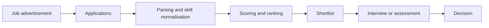

# Human Resources and Recruiting

AI now helps employers find, screen, rank and assess job candidates, from résumé parsers to systems that score recorded interviews. These tools can cut the time recruiters spend on large applicant pools, but they learn from past hiring decisions, and so they can repeat the patterns of those decisions at scale.

## Overview

Recruiting is a funnel. A vacancy is advertised, applications arrive, a shortlist is chosen, candidates are interviewed, and an offer is made or refused. A popular role at a large employer can attract thousands of applications, which makes automation attractive. Vendors sell tools for almost every stage: sourcing candidates, parsing résumés, matching skills to job descriptions, scheduling, chatbot pre-screening and interview analysis. The same technology also appears in internal mobility, performance review and retention, but this page concentrates on hiring.

The stakes are personal and legal. A rejected applicant rarely learns why, and a faulty screen can end a job search without a second look. In many jurisdictions, employment law forbids discrimination on protected characteristics such as race and sex, so a biased screen is also a compliance risk. This is why hiring is one of the first areas that AI regulators single out (see [Law, Policy & Governance](../../society/governance/index.md)).

## Key concepts

- **Résumé parsing**: extracting structured fields, such as job titles, employers, dates, education and skills, from documents written in free text.
- **Skills matching**: scoring how well a candidate's profile fits a vacancy, often by comparing learned vector representations of the two texts. Skills are usually mapped onto a shared taxonomy such as the European ESCO classification.
- **Automated employment decision tool (AEDT)**: the term used by New York City's bias-audit law for software that substantially assists or replaces discretionary hiring decisions.
- **Selection rate and impact ratio**: the share of applicants from one group who advance, and that share divided by the rate of the most-selected group. Audits compare these ratios across groups; a long-standing US rule of thumb, the four-fifths rule, treats a ratio below 0.8 as a warning sign.
- **Target bias**: a model is trained to predict a label such as "was hired" or "received a high performance rating". If that label already reflects past discrimination, the model learns the discrimination even when the inputs look neutral.
- **Structured interview**: an interview in which every candidate receives the same questions and is scored against the same rubric. Automated interview analysis often claims to bring this consistency to the process.

## How it works

Most hiring pipelines are a chain of decisions, and each step may be automated:

**Normalisation** maps messy text onto a standard vocabulary. Job titles such as "data ninja" and "analytics specialist" may describe the same work, so a model that represents titles by the skills they involve can group them. Decorte et al. (2021) show that representing titles this way improves on generic sentence encoders.[^1]

**Scoring** is where most of the risk lies. A system may be trained on past applications and their outcomes, may compare résumé and job-advertisement embeddings with no training on hiring outcomes, or may prompt a large language model to rate each candidate. Each design makes different assumptions about what a good hire looks like, and vendors rarely publish those assumptions. The [Person-Job Fit](person-job-fit/index.md) page describes a neural model of this kind.

**Assessment** adds interviews, tests and recorded video. Automated analysis of interviews is discussed on its [own page](interview-analysis/index.md).

The most important design question is the target. Hiring outcomes are seen only for the people who were hired, so a model trained on past decisions learns the decisions, not the job. This is the core lesson of the Amazon résumé-screening system, which is described in [Algorithmic Bias Case Studies](../../society/ethics/bias-case-studies.md).

## Key methods

Two landmark methods show the range of approaches. Each has its own page.

- [Person-job fit (Zhu et al. 2018)](person-job-fit/index.md): a neural network that learns joint representations of candidates and job requirements, and estimates which requirements a candidate satisfies.
- [Automated interview analysis (Naim et al. 2015)](interview-analysis/index.md): a regression framework that predicts interviewer ratings from language, facial expression and prosody.

## Connections

The human side of hiring is well studied. Bertrand and Mullainathan sent fictitious résumés to job advertisements and found that résumés with White-sounding names received about 50 percent more callbacks than otherwise similar résumés with African-American-sounding names.[^2] Such results come from [human judgement under uncertainty](../../brain-mind/cognitive-science/heuristics-and-biases/index.md), in which people rely on quick impressions and on similarity to themselves. Naim et al. found that candidates rated highly on the first interview question were also rated highly overall, which suggests that first impressions carry weight in interviews.[^3] Automated systems trained on such ratings can inherit the same pattern.

Automation can also make people over-trust a score, which is a form of automation bias. The social-science side of this is covered in [Human-AI Interaction](../../society/human-ai-interaction/index.md), and the broader ethics in [Ethics & Fairness](../../society/ethics/index.md).

The technical foundations are the same as in other applications. Résumé and job matching uses [large language models](../../theory/models/llm/index.md) and [retrieval-augmented generation](../../engineering/rag/index.md) when a model must read a long document against a job description. Embedding search relies on [vector databases](../../engineering/vector-databases/index.md). Fairness claims depend on the definitions in [Fairness Definitions](../../society/ethics/fairness-definitions.md) and on the evaluation methods in [Evaluation and Validation](../../theory/paradigms/supervised/evaluation-and-validation/index.md).

## Applications

### CV screening and ranking

Employers use keyword filters, ranking models and, increasingly, language models that read résumés against job descriptions. Wilson and Caliskan (2024) audited several text-embedding models used for this kind of retrieval. Across nine occupations, using more than 500 résumés and 500 job descriptions, the models significantly favoured White-associated names in 85.1 percent of comparisons and female-associated names in only 11.1 percent. For some comparisons, Black male names were disadvantaged in up to 100 percent of cases.[^4] The authors also found that document length and the frequency of names in the training corpus affected the results, so the bias is not only a question of the training labels.

### Skills matching and job titles

Skills-based hiring tries to match people to work through the skills they have, rather than the titles they held. Skills taxonomies and title normalisation are the infrastructure for this. JobBERT (Decorte et al. 2021) learns representations of job titles from the skills co-occurring in vacancies, and reports clear gains over generic text encoders on title normalisation.[^1] Taxonomy-based matching is easier to explain than an opaque score, but it still depends on which skills the taxonomy records and how they are weighted.

### Interview analysis

Video and audio interviews can be scored automatically. Naim et al. (2015) analysed 138 recorded interview sessions with 69 MIT undergraduates seeking internships, and predicted interviewer ratings from words, facial expressions and voice features.[^3] Hickman et al. (2022) examined automated video-interview personality assessments across three samples totalling 1,073 participants. They found stronger validity when models were trained on interviewer ratings than on self-reports, but the reliability evidence was mixed.[^5] Both studies used research samples, so their results do not show how such tools perform on real applicants.

### Bias audits and the Amazon case

The best-known failure is Amazon's experimental résumé ranker, which learned to penalise résumés that signalled a woman applicant; the case and its lessons are covered in [Algorithmic Bias Case Studies](../../society/ethics/bias-case-studies.md). Raghavan et al. (2020) reviewed the claims of vendors of pre-employment assessments and found that disclosure of validation and bias testing was limited, and that vendors made consequential choices about training data and prediction targets.[^6] Audit methods, including disaggregated error rates and impact ratios, are explained in [Algorithmic Auditing and Impact Assessment](../../society/ethics/algorithmic-auditing.md).

### Regulation: New York City Local Law 144

New York City's Local Law 144 has applied since July 2023. It requires employers and employment agencies that use an AEDT in hiring or promotion to commission an independent bias audit each year, publish a summary of the results, and notify candidates that the tool is used. Groves et al. (2024) interviewed 16 experts and practitioners involved in the regime. They concluded that it has not yet built an effective auditing system, because key terms such as AEDT and independent auditor are not clearly defined.[^7]

### Regulation: EU AI Act

The EU AI Act treats AI used for recruitment and selection as high-risk. Its high-risk category lists employment tools that filter job applications and evaluate candidates. The obligations include risk management, data governance, technical documentation, logging, human oversight and conformity assessment. The Act also prohibits emotion recognition in the workplace, which bears on video-interview tools. Veale and Zuiderveen Borgesius (2021) analysed the Commission's draft and its classification of employment systems as high-risk.[^8] A later package of amendments, the so-called digital omnibus, was proposed to postpone some of these obligations, so the current dates should be checked on the [governance page](../../society/governance/index.md) before any compliance decision.

## Open questions

- **Can audits see target bias?** Metrics on the outcomes of a biased process may look fair while the process itself is unfair. Better labels, such as job-based performance measures, are costly to build.
- **Do language-model screens behave differently across languages, occupations and regions?** Evidence so far comes mainly from English-language studies.
- **Does automation reduce human bias or move it?** Evidence comparing human and machine decisions in the same applicant pool is still limited.
- **Who is accountable?** Vendors, employers and the people who configure a tool may each hold part of the responsibility, and the law is still settling the division.

[^1]: Decorte et al. (2021), JobBERT. The reported gains are the authors' own results on their benchmark.
[^2]: Bertrand and Mullainathan (2004) report that White-sounding names received 50 percent more callbacks than African-American-sounding names, uniformly across occupations and employer sizes.
[^3]: Naim et al. (2015) report that interviewer ratings of excitement, friendliness and engagement could be predicted with correlation coefficients of 0.75 or higher, and that a candidate's rating on the first question predicted overall ratings. The sample is small and drawn from one university.
[^4]: Wilson and Caliskan (2024). The percentages refer to the comparisons in their audit, not to real hiring decisions.
[^5]: Hickman et al. (2022). Reliability was mixed when models were cross-validated across samples; models trained on self-reports showed little evidence of either reliability or validity.
[^6]: Raghavan et al. (2020). The paper is a study of vendor claims, not a test of the tools themselves.
[^7]: Groves et al. (2024). The findings come from interviews with participants rather than from a review of audit reports.
[^8]: Veale and Zuiderveen Borgesius (2021) analyse the draft, so their classification should be checked against the adopted text.

## References

### Seminal papers

- Bertrand, M. & Mullainathan, S. (2004). *Are Emily and Greg More Employable Than Lakisha and Jamal? A Field Experiment on Labor Market Discrimination*. American Economic Review. https://doi.org/10.1257/0002828042002561 — Field experiment that sent matched fictitious résumés with different racially associated names to job advertisements, measuring callbacks.
- Zhu, C. et al. (2018). *Person-Job Fit: Adapting the Right Talent for the Right Job with Joint Representation Learning*. arXiv preprint. https://arxiv.org/abs/1810.04040 — Neural model that learns joint representations of candidate qualifications and job requirements from historical applications.
- Naim, I. et al. (2015). *Automated Analysis and Prediction of Job Interview Performance*. arXiv preprint. https://arxiv.org/abs/1504.03425 — Framework that predicts interviewer ratings of MIT mock-interview videos from language, facial and prosodic features.
- Wilson, K. & Caliskan, A. (2024). *Gender, Race, and Intersectional Bias in Resume Screening via Language Model Retrieval*. arXiv preprint. https://arxiv.org/abs/2407.20371 — Audit of text-embedding models ranking résumés against job descriptions across nine occupations, reporting systematic name-based differences.

### Surveys and textbooks

- Mehrabi, N. et al. (2019). *A Survey on Bias and Fairness in Machine Learning*. arXiv preprint. https://arxiv.org/abs/1908.09635 — Survey of sources of bias, fairness definitions and application domains, including hiring.

### Articles and documentation

- Raghavan, M., Barocas, S., Kleinberg, J. & Levy, K. (2020). *Mitigating Bias in Algorithmic Hiring: Evaluating Claims and Practices*. FAT* 2020. https://arxiv.org/abs/1906.09208 — Examines what vendors of algorithmic pre-employment assessments disclose about validation and bias testing.
- Groves, L. et al. (2024). *Auditing Work: Exploring the New York City algorithmic bias audit regime*. FAccT 2024. https://arxiv.org/abs/2402.08101 — Interview study of the early operation of New York City's Local Law 144 bias-audit requirement.
- Hickman, L. et al. (2022). Automated video interview personality assessments: Reliability, validity, and generalizability investigations. *Journal of Applied Psychology*. https://doi.org/10.1037/apl0000695 — Tests machine-learning personality assessments from mock video interviews across three samples, comparing interviewer-rated and self-reported training labels.
- Veale, M. & Zuiderveen Borgesius, F. (2021). Demystifying the Draft EU Artificial Intelligence Act. *Computer Law Review International*. https://doi.org/10.9785/cri-2021-220402 — Legal analysis of the Commission's 2021 draft, including its high-risk classification of employment systems; the final text differs in detail.
- Decorte, J.-J. et al. (2021). *JobBERT: Understanding Job Titles through Skills*. arXiv preprint. https://arxiv.org/abs/2109.09605 — Represents job titles through the skills in vacancies, improving title normalisation over generic sentence encoders.
