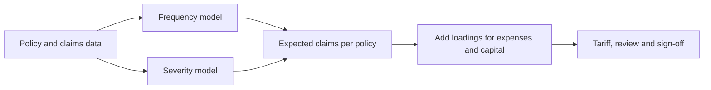

# Insurance and Actuarial Science

Insurance pools many people's uncertain losses so that each person pays a predictable premium. Actuarial science supplies the statistics behind those premiums and the reserves held for claims not yet paid. Machine learning now enters pricing, claims handling and fraud detection, and each of these uses raises questions of fairness and of regulatory scrutiny.

## Overview

An insurer promises to pay for losses that have not yet happened, so its central task is to estimate them in advance. For one policy, the expected cost is the claim frequency (how often claims occur) multiplied by the claim severity (how much a claim costs on average). The premium adds loadings for expenses, profit and capital. Separately, the insurer holds reserves for losses that have already happened but are not yet settled.

Actuaries have built these estimates with tables and regression for more than a century. Classical generalised linear models remain the standard tool for tariffs, and boosted trees and neural networks are increasingly used beside them. Insurance pricing is more constrained than many other applications. Prices must be explainable to regulators and customers, and they must not discriminate on protected characteristics. For the general financial context see [Finance](../finance/index.md). The fairness questions link to [Ethics & Fairness](../../society/ethics/index.md).

## Key concepts

- **Pure premium**: the expected claim cost of a policy. It is the core of the price, before loadings.
- **Frequency and severity**: the number of claims per unit of exposure, and the average cost of each claim.
- **Rating factor**: a policyholder or vehicle characteristic, such as age, vehicle type or region, used to set different prices.
- **Adverse selection and moral hazard**: applicants usually know more about their own risk than the insurer does, and cover can change how people behave.
- **Proxy discrimination**: a model can infer a protected characteristic from correlated features, even when that characteristic is never an input.
- **Usage-based insurance**: premiums based partly on measured behaviour, usually recorded by a telematics device or a phone app.

## How it works

A pricing team typically fits one model for claim counts and another for claim costs, then combines them into a tariff. The steps are shown below.

If claim counts and claim costs are independent, the pure premium equals $\mathbb{E}[N]\,\mathbb{E}[X]$, the expected number of claims times the expected cost of one claim. Many insurers instead model the total cost directly with a Tweedie distribution. Its point mass at zero covers policies with no claims, and its continuous part covers the cost of claims that do occur. The [generalised linear model](glm-pricing/index.md) page explains this in detail.

Claims handling is a second pipeline. After a loss is reported, the insurer decides whether to settle quickly, send the file to a specialist, or investigate possible fraud. Models score each claim for expected cost and suspicion, so that staff time goes where it matters most. Fraud detection is a long-standing statistical problem. Bolton and Hand's review surveys the statistical tools used for it and stresses that fraudsters are adaptive, so detectors must keep being updated.

## Key methods

Three landmark methods are compared below. Each has its own page.

| Method | Role in insurance | What separates it |
|---|---|---|
| [Generalised linear models](glm-pricing/index.md) | Standard tariff model for claim counts and costs | Transparent multiplicative effects, limited to linear terms on the link scale |
| [LocalGLMnet](localglmnet/index.md) | Neural network that keeps a GLM-like, interpretable form | Coefficients vary with the policy; on one dataset it gave up a little accuracy against a plain network |
| [CARE-GNN](care-gnn/index.md) | Fraud detection on networks of reviews, users or claims | Learns to ignore neighbours that a fraudster uses as camouflage |

## Connections

- **Tree ensembles.** Gradient-boosted trees are widely used on the tabular data that insurers hold. See [Trees and Ensembles](../../theory/paradigms/supervised/trees-and-ensembles/index.md). Chen and Guestrin's XGBoost paper describes one of the best-known implementations.
- **Linear models.** The generalised linear model is the link between classical actuarial practice and modern machine learning. See [Linear and Generalised Linear Models](../../theory/paradigms/supervised/linear-models/index.md).
- **Interpretability.** Rudin argues that high-stakes decisions should use models that are interpretable by design, instead of explaining opaque ones afterwards. See [Interpretability](../../society/interpretability/index.md).
- **Graphs.** Fraud rings and shared-attribute networks are graphs, which is why [Graph Neural Networks](../../theory/models/gnn/index.md) appear in the claims section.
- **Brain and mind.** Insurance is a setting where human decisions under risk matter daily. Kahneman and Tversky's prospect theory describes systematic departures from expected-value reasoning, including the overweighting of small probabilities. This bears on how buyers judge small risks and premium changes. See [Heuristics and biases](../../brain-mind/cognitive-science/heuristics-and-biases/index.md).

## Applications

### Pricing

Motor, home and life insurance have long been priced with tariffs built from generalised linear models, fitted to policy-level records and reviewed by pricing actuaries. Machine learning is used to test and improve these tariffs, and to find interactions that a hand-built model misses.

### Telematics and usage-based insurance

Telematics data, such as mileage, speed, braking and time of day, lets an insurer price on measured driving behaviour rather than on proxies such as age. Huang and Meng use telematics driving data for automobile ratemaking, and Li and colleagues apply interpretable machine learning to telematics data to study driving risk. Telematics also raises privacy and consent questions about continuous location data.

### Claims triage and fraud detection

Triage models route claims by expected cost and suspicion. Fraud detectors combine supervised classifiers with network analysis, because organised fraud forms connections between claimants, repairers and intermediaries. The CARE-GNN method is tested on review-fraud data rather than insurance data, so its use on claims networks is an extrapolation.

### Fairness and anti-discrimination constraints

Insurance prices can differ between groups for legitimate risk reasons, or through proxies. Removing a protected attribute from the inputs does not remove the proxy effect. Lindholm and colleagues propose a multi-task neural network that produces prices free from proxy discrimination, and that can be trained when protected characteristics are only partly recorded. Kleinberg and colleagues show that several fairness criteria cannot all hold at once when groups have different base rates. The formal results are on the [Fairness Definitions](../../society/ethics/fairness-definitions.md) page. Charpentier's book covers biases, discrimination and fairness in insurance as a whole.

### Regulatory scrutiny of pricing models

Regulators in many jurisdictions review rating factors and pricing models. They ask insurers to justify each differentiation, and to show that it does not rest on protected characteristics. Two tensions follow. A model complex enough to be accurate can be hard to explain. And testing a model for group disparities may require protected-attribute data that insurers are not allowed to collect. Rules differ by country and by line of business, so pricing teams usually design for the strictest local requirement they face.

## Open questions

- How should accuracy and fairness be traded off when protected characteristics are missing? The partial-information approach of Lindholm and colleagues is one answer, and its costs are not yet well measured.
- Can interpretable architectures such as LocalGLMnet match black-box accuracy on routine tariff data, and will regulators accept their explanations as sufficient?
- Fraud labels are scarce, and fraudsters adapt. How should a detector be evaluated when a false accusation falls on an honest claimant?
- Large losses are rare, so their distributions depend on tail assumptions that the data rarely test.

## References

### Seminal papers

- Nelder, J. A. & Wedderburn, R. W. M. (1972). Generalized Linear Models. *Journal of the Royal Statistical Society, Series A*. https://doi.org/10.2307/2344614 — Introduces generalised linear models, the framework on which most insurance tariffs are built.
- Smyth, G. K. & Jørgensen, B. (2002). Fitting Tweedie's Compound Poisson Model to Insurance Claims Data: Dispersion Modelling. *ASTIN Bulletin*. https://doi.org/10.2143/ast.32.1.1020 — Applies double generalised linear models to Tweedie claims data, modelling the dispersion as well as the mean.
- Richman, R. & Wüthrich, M. V. (2021). LocalGLMnet: interpretable deep learning for tabular data. arXiv. https://arxiv.org/abs/2107.11059 — A neural network with a GLM-like additive structure whose coefficients depend on the input, tested on motor insurance data.
- Lindholm, M. et al. (2022). A multi-task network approach for calculating discrimination-free insurance prices. arXiv. https://arxiv.org/abs/2207.02799 — Proposes a neural network that avoids proxy discrimination and can be trained with partly missing protected attributes.
- Kleinberg, J., Mullainathan, S. & Raghavan, M. (2016). Inherent Trade-Offs in the Fair Determination of Risk Scores. arXiv. https://arxiv.org/abs/1609.05807 — Shows that calibration and balance across groups cannot hold together in general when base rates differ, a result central to risk-based pricing.
- Dou, Y. et al. (2020). Enhancing Graph Neural Network-based Fraud Detectors against Camouflaged Fraudsters. *CIKM*. https://arxiv.org/abs/2008.08692 — Introduces CARE-GNN, a fraud detector that filters camouflaged neighbours before aggregation.
- Chen, T. & Guestrin, C. (2016). XGBoost: A Scalable Tree Boosting System. *KDD*. https://arxiv.org/abs/1603.02754 — Describes a widely used system for gradient-boosted trees on tabular data.
- Kahneman, D. & Tversky, A. (1979). Prospect Theory: An Analysis of Decision under Risk. *Econometrica*. https://doi.org/10.2307/1914185 — Proposes that people weigh outcomes relative to a reference point and overweight small probabilities.

### Surveys and textbooks

- Ohlsson, E. & Johansson, B. (2010). *Non-Life Insurance Pricing with Generalized Linear Models*. Springer. https://doi.org/10.1007/978-3-642-10791-7 — Practitioner-oriented textbook on building non-life tariffs with GLMs.
- Wüthrich, M. V. & Merz, M. (2023). *Statistical Foundations of Actuarial Learning and its Applications*. Springer. https://doi.org/10.1007/978-3-031-12409-9 — Covers GLMs, neural networks and tree methods for actuarial work, with code.
- Wüthrich, M. V. & Buser, C. (2017). Data Analytics for Non-Life Insurance Pricing. SSRN. https://doi.org/10.2139/ssrn.2870308 — Lecture notes on pricing data, GLMs and tree-based models for non-life insurance.
- Charpentier, A. (2024). *Insurance, Biases, Discrimination and Fairness*. Springer. https://doi.org/10.1007/978-3-031-49783-4 — Book-length treatment of how bias and discrimination arise in insurance pricing and how fairness can be assessed.
- Bolton, R. J. & Hand, D. J. (2002). Statistical Fraud Detection: A Review. *Statistical Science*. https://doi.org/10.1214/ss/1042727940 — Review of statistical tools for fraud detection, covering credit card, telecoms and computer-intrusion fraud and how adaptive fraudsters evade detectors.

### Articles and documentation

- Huang, Y. & Meng, S. (2019). Automobile insurance classification ratemaking based on telematics driving data. *Decision Support Systems*. https://doi.org/10.1016/j.dss.2019.113156 — Uses telematics driving records to classify policyholders for automobile ratemaking.
- Li, H.-J. et al. (2023). Driving risk prevention in usage-based insurance services based on interpretable machine learning and telematics data. *Decision Support Systems*. https://doi.org/10.1016/j.dss.2023.113985 — Applies interpretable machine learning to telematics data for usage-based insurance risk.
- Rudin, C. (2018). Stop Explaining Black Box Machine Learning Models for High Stakes Decisions and Use Interpretable Models Instead. arXiv. https://arxiv.org/abs/1811.10154 — Argues that high-stakes decisions should use inherently interpretable models, with examples from criminal justice and healthcare.
