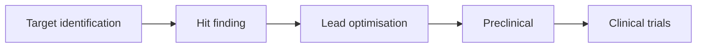

---
related:
- theory/models/generative
- theory/models/gnn
- applications/science
- applications/healthcare
---

# Life Sciences & Drug Discovery

## Protein structure: the AlphaFold moment

- **CASP14 (2020)**: AlphaFold 2 predicted protein structures with accuracy competitive with experiment for most targets, solving a 50-year grand challenge
- **AlphaFold Protein Structure Database**: over 200 million predicted structures, freely available
- **AlphaFold 3 (2024)**: predicts complexes of proteins with DNA, RNA, ligands and ions
- **2024 Nobel Prize in Chemistry**: David Baker (computational protein design) and Demis Hassabis & John Jumper (protein structure prediction)
- Open alternatives: RoseTTAFold, OpenFold, ESMFold (from a protein language model), Boltz, Chai

## Protein design

| Tool | Approach |
|---|---|
| RFdiffusion | Diffusion model generating new protein backbones for binders, enzymes, symmetric assemblies |
| ProteinMPNN | Designs sequences that fold into a given backbone |
| ESM-family protein language models | Learn evolutionary constraints from millions of sequences; ESM3 generated a novel fluorescent protein |
| Inverse folding, binder design pipelines | Combined with high-throughput lab testing |

## Genomics and molecular biology

- **Variant effect prediction**: AlphaMissense classified tens of millions of missense variants; SpliceAI predicts splicing effects
- **DNA language models**: Enformer (gene expression from sequence), Evo and Evo 2 (genome-scale models across life), Nucleotide Transformer
- **Single-cell biology**: foundation models on tens of millions of cells (scGPT, Geneformer) for cell-type annotation and perturbation prediction — though simple baselines are sometimes competitive
- **Spatial transcriptomics** and imaging: segmentation (Cellpose), morphology profiling (Cell Painting)
- **Virtual cell** initiatives aim to simulate cell behaviour under perturbations

## Drug discovery pipeline

| Stage | AI methods |
|---|---|
| Target identification | Knowledge graphs, genetics, literature mining with LLMs |
| Hit finding | Virtual screening with docking + ML, generative chemistry, DNA-encoded library analysis |
| Lead optimisation | Property prediction (ADMET), multi-objective generative design, active learning with lab loops |
| Preclinical | Toxicity prediction, digital pathology |
| Clinical | Patient stratification, trial design, site selection, synthetic control arms |

- **Insilico Medicine**'s rentosertib (for idiopathic pulmonary fibrosis), with an AI-identified target and AI-designed molecule, reported positive phase 2a results (2025, *Nature Medicine*)
- **Antibiotic discovery**: deep learning found halicin (Stokes et al., 2020, *Cell*) and abaucin; generative models designed new antibiotic candidates
- Reality check: AI-discovered molecules have shown high phase 1 success, but no AI-designed drug had yet completed phase 3 approval as of 2025; biology, not chemistry, remains the main bottleneck

## Lab automation and agents

- Self-driving labs combine robotics, Bayesian optimisation and [active learning](../../theory/paradigms/active/index.md)
- LLM agents plan experiments, write lab protocols and analyse data (see [Scientific Discovery](../science/index.md))

## Biosecurity

The same tools could help design harmful agents. Responses: screening of DNA synthesis orders, evaluation of models for biological-misuse uplift, and responsible-release policies (see [Safety & Alignment](../../society/safety-alignment/index.md)).

## Resources

- Jumper et al. (2021), AlphaFold 2, *Nature*; Abramson et al. (2024), AlphaFold 3
- [AlphaFold DB](https://alphafold.ebi.ac.uk/), [RCSB PDB](https://www.rcsb.org/)
- [DeepChem](https://deepchem.io/), [RDKit](https://www.rdkit.org/), [TDC — Therapeutics Data Commons](https://tdcommons.ai/)
- "Machine learning for drug discovery" courses from MIT (6.S897-style) and the Valence Labs community
