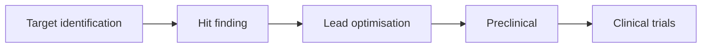

---
related:
- theory/paradigms/unsupervised/density-and-generative-models/generative-models
- theory/models/gnn
- applications/science
- applications/healthcare
aliases:
  - 生命科學
  - 藥物發現
---

# Life Sciences & Drug Discovery

## Protein structure: the AlphaFold moment

- **Method page**: [AlphaFold 2](alphafold-2.md) (Jumper et al., 2021), with its algorithm, confidence score and limitations
- **CASP14 (2020)**: AlphaFold 2 predicted protein structures with accuracy competitive with experiment for most targets, solving a 50-year grand challenge
- **AlphaFold Protein Structure Database**: over 214 million predicted structures, freely available ([Varadi et al., 2024](https://doi.org/10.1093/nar/gkad1011))
- **AlphaFold 3 (2024)**: predicts complexes of proteins with DNA, RNA, ligands and ions
- **2024 Nobel Prize in Chemistry**: David Baker (computational protein design) and Demis Hassabis & John Jumper (protein structure prediction)
- Open alternatives: RoseTTAFold, OpenFold, ESMFold (from a protein language model), Boltz, Chai

## Protein design

| Tool | Approach |
|---|---|
| [RFdiffusion](rfdiffusion/index.md) | Diffusion model generating new protein backbones for binders, enzymes, symmetric assemblies |
| ProteinMPNN | Designs sequences that fold into a given backbone |
| [ESM-2 and ESMFold](esm/index.md), ESM-family protein language models | Learn evolutionary constraints from millions of sequences; ESM3 generated a novel fluorescent protein |
| Inverse folding, binder design pipelines | Combined with high-throughput lab testing |

## Genomics and molecular biology

- **Variant effect prediction**: AlphaMissense classified tens of millions of missense variants; SpliceAI predicts splicing effects
- **DNA language models**: Enformer (gene expression from sequence), Evo and Evo 2 (genome-scale models across life), Nucleotide Transformer
- **Single-cell biology**: foundation models on tens of millions of cells (scGPT, Geneformer) for cell-type annotation and perturbation prediction — though simple baselines are sometimes competitive
- **Spatial transcriptomics** and imaging: segmentation (Cellpose), morphology profiling (Cell Painting)
- **Virtual cell** initiatives aim to simulate cell behaviour under perturbations

## Drug discovery pipeline

| Stage | AI methods |
|---|---|
| Target identification | Knowledge graphs, genetics, literature mining with LLMs |
| Hit finding | Virtual screening with docking + ML, generative chemistry, DNA-encoded library analysis |
| Lead optimisation | Property prediction (ADMET), multi-objective generative design, active learning with lab loops |
| Preclinical | Toxicity prediction, digital pathology |
| Clinical | Patient stratification, trial design, site selection, synthetic control arms |

- **Insilico Medicine**'s rentosertib (for idiopathic pulmonary fibrosis), with an AI-identified target and AI-designed molecule, reported positive phase 2a results (2025, *Nature Medicine*)
- **Antibiotic discovery**: deep learning found halicin (Stokes et al., 2020, *Cell*) and abaucin; generative models designed new antibiotic candidates
- Reality check: AI-discovered molecules have shown high phase 1 success, but no AI-designed drug had yet completed phase 3 approval as of 2025; biology, not chemistry, remains the main bottleneck

## Lab automation and agents

- Self-driving labs combine robotics, Bayesian optimisation and [active learning](../../theory/paradigms/active/index.md)
- LLM agents plan experiments, write lab protocols and analyse data (see [Scientific Discovery](../science/index.md))

## Biosecurity

The same tools could help design harmful agents. Responses: screening of DNA synthesis orders, evaluation of models for biological-misuse uplift, and responsible-release policies (see [Safety & Alignment](../../society/safety-alignment/index.md)).

## Key methods

Three methods underlie most of the protein and genomics tools above. Each links to the page that explains it.

- [Transformer](../../theory/models/transformer/attention-is-all-you-need/index.md): self-attention over sequences. Protein language models such as ESM apply it to amino-acid sequences (Vaswani et al., 2017; Lin et al., 2023).
- [Denoising diffusion](../../theory/paradigms/unsupervised/density-and-generative-models/diffusion/ddpm.md): a model learns to reverse a gradual noising process, and sampling from it produces new data. RFdiffusion uses diffusion to generate protein backbones (Ho et al., 2020; Watson et al., 2023).
- [Graph neural networks](../../theory/models/gnn/message-passing/gin/index.md): message passing over atoms and bonds. GIN is the variant that the paper shows is as discriminative as the Weisfeiler–Leman graph test (Xu et al., 2019).

## References

### Seminal papers

- Vaswani, A. et al. (2017). *Attention Is All You Need*. NeurIPS. https://arxiv.org/abs/1706.03762 — Introduces the Transformer, built on multi-head self-attention.
- Jumper, J. et al. (2021). Highly accurate protein structure prediction with AlphaFold. *Nature*. https://doi.org/10.1038/s41586-021-03819-2 — AlphaFold 2, competitive with experimental methods on most targets at CASP14.
- Abramson, J. et al. (2024). Accurate structure prediction of biomolecular interactions with AlphaFold 3. *Nature*. https://doi.org/10.1038/s41586-024-07487-w — Extends structure prediction to complexes with DNA, RNA, ligands and ions.
- Watson, J. L. et al. (2023). De novo design of protein structure and function with RFdiffusion. *Nature*. https://doi.org/10.1038/s41586-023-06415-8 — RFdiffusion, a diffusion model that generates new protein backbones.
- Lin, Z. et al. (2023). Evolutionary-scale prediction of atomic-level protein structure with a language model. *Science*. https://doi.org/10.1126/science.ade2574 — The ESM language model with ESMFold, predicting structure from a single sequence.
- Ho, J., Jain, A. & Abbeel, P. (2020). Denoising Diffusion Probabilistic Models. NeurIPS. https://arxiv.org/abs/2006.11239 — The DDPM paper behind the diffusion method page linked above.
- Xu, K. et al. (2019). How Powerful are Graph Neural Networks? ICLR. https://arxiv.org/abs/1810.00826 — GIN, shown to be as discriminative as the Weisfeiler–Leman graph test.
- Stokes, J. M. et al. (2020). A Deep Learning Approach to Antibiotic Discovery. *Cell*. https://doi.org/10.1016/j.cell.2020.01.021 — A deep-learning screen that identified halicin as an antibiotic candidate.

## Further learning

- [AlphaFold DB](https://alphafold.ebi.ac.uk/) — Free database of predicted protein structures from AlphaFold.
- [RCSB PDB](https://www.rcsb.org/) — Archive of experimentally determined macromolecular structures.
- [DeepChem](https://deepchem.io/) — Open-source toolkit for deep learning in chemistry and drug discovery.
- [RDKit](https://www.rdkit.org/) — Open-source cheminformatics toolkit for handling molecules.
- [TDC — Therapeutics Data Commons](https://tdcommons.ai/) — Benchmark datasets and tasks for AI in drug discovery.
