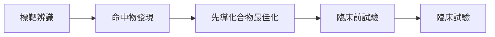

# 生命科學與藥物發現

## 蛋白質結構：AlphaFold 時刻

- **CASP14（2020）**：AlphaFold 2 對多數目標預測的蛋白質結構，精確度已可與實驗結果並駕齊驅，解決了困擾業界 50 年的重大挑戰
- **AlphaFold 蛋白質結構資料庫**：收錄超過 2 億筆預測結構，免費開放
- **AlphaFold 3（2024）**：可預測蛋白質與 DNA、RNA、配體及離子所形成的複合物
- **2024 年諾貝爾化學獎**：David Baker（計算蛋白質設計），以及 Demis Hassabis 與 John Jumper（蛋白質結構預測）
- 開放的替代方案：RoseTTAFold、OpenFold、ESMFold（源自蛋白質語言模型）、Boltz、Chai

## 蛋白質設計

| 工具 | 方法 |
|---|---|
| [RFdiffusion](rfdiffusion/index.md) | 擴散模型，生成新的蛋白質骨架，用於結合子、酵素與對稱組裝體 |
| ProteinMPNN | 設計能摺疊成指定骨架的胺基酸序列 |
| [ESM-2 與 ESMFold](esm/index.md)，ESM 系列蛋白質語言模型 | 從數百萬條序列中學習演化限制；ESM3 生成了一種新的螢光蛋白 |
| 反向摺疊、結合子設計流程 | 與高通量的實驗室測試結合使用 |

## 基因組學與分子生物學

- **變異效應預測**：AlphaMissense 對數千萬個錯義變異進行分類；SpliceAI 預測剪接效應
- **DNA 語言模型**：Enformer（由序列預測基因表現）、Evo 與 Evo 2（跨生命的基因組尺度模型）、Nucleotide Transformer
- **單細胞生物學**：在數千萬個細胞上訓練的基礎模型（scGPT、Geneformer），用於細胞類型標註與擾動預測——不過簡單的基準方法有時也很有競爭力
- **空間轉錄組與影像**：分割（Cellpose）、形態特徵分析（Cell Painting）
- **虛擬細胞**計畫的目標，是模擬細胞在各種擾動下的行為

## 藥物發現流程

| 階段 | AI 方法 |
|---|---|
| 標靶辨識 | 知識圖譜、遺傳學、以 LLM 進行文獻探勘 |
| 命中物發現 | 結合對接與機器學習的虛擬篩選、生成式化學、DNA 編碼文庫分析 |
| 先導化合物最佳化 | 性質預測（ADMET）、多目標生成式設計、結合實驗室迴圈的主動學習 |
| 臨床前試驗 | 毒性預測、數位病理 |
| 臨床試驗 | 病患分層、試驗設計、試驗點選擇、合成對照組 |

- **Insilico Medicine** 的 rentosertib（用於特發性肺纖維化）：標靶與分子都由 AI 找出與設計，2025 年在第二期 a 階段試驗中報告正向結果（*Nature Medicine*）
- **抗生素發現**：深度學習找到了 halicin（Stokes et al., 2020, *Cell*）與 abaucin；生成式模型設計出新的抗生素候選分子
- 現實檢驗：AI 發現的分子在第一期試驗的成功率很高，但截至 2025 年，尚無 AI 設計的藥物完成第三期試驗並獲得核准；主要瓶頸仍在生物學，而非化學

## 實驗室自動化與代理人

- 自動駕駛實驗室結合機器人、貝氏最佳化與[主動學習](../../theory/paradigms/active/index.md)
- LLM 代理人規劃實驗、撰寫實驗室流程並分析資料（見[科學發現](../science/index.md)）

## 生物安全

同樣的工具也可能被用來設計有害的製劑。目前的因應包括：篩檢 DNA 合成訂單、評估模型對生物濫用的助長程度，以及負責任的釋出政策（見[安全與對齊](../../society/safety-alignment/index.md)）。

## 學習資源

- Jumper et al. (2021), AlphaFold 2, *Nature*；Abramson et al. (2024), AlphaFold 3
- [AlphaFold DB](https://alphafold.ebi.ac.uk/)、[RCSB PDB](https://www.rcsb.org/)
- [DeepChem](https://deepchem.io/)、[RDKit](https://www.rdkit.org/)、[TDC — Therapeutics Data Commons](https://tdcommons.ai/)
- MIT 的藥物發現機器學習課程（風格類似 6.S897），以及 Valence Labs 社群
