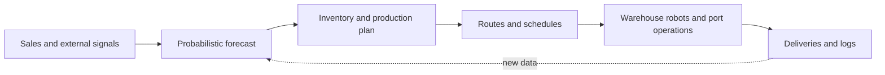

# Logistics and Supply Chain

AI is used along the movement of goods: forecasting the demand that starts a supply chain, routing trucks, coordinating robots in warehouses, running port operations and warning of shortages before they reach customers. These problems are large, interdependent and uncertain, and operations research (OR) studied them for decades before machine learning joined the effort.

## Overview

A supply chain is the network of suppliers, factories, warehouses, carriers and stores that turns raw materials into goods on a shelf. Its decisions come on several time scales. Network design and capacity are set for years, inventory and production plans for weeks, and routes, dispatches and warehouse picks for hours or minutes. A decision at one level depends on forecasts made at another, so a poor forecast spreads into poor stock levels, wasted trips and missed deliveries.

Three features make the problem hard. Demand is uncertain and often erratic, with new products and intermittent sales. The combinatorial choices, such as which vehicle visits which stop and in what order, grow faster than any exhaustive search can handle. And the environment changes during execution: orders arrive, vehicles break down and ports congest. Classical OR answers these with mathematical programming, heuristics and simulation. Machine learning adds forecasts learned from large histories, routing heuristics learned from solved instances or from trial and error, and control policies for robots that act on local observations.

Learned methods are most developed for forecasting, routing and warehouse robotics. Port operations still rely mainly on OR, and resilience is the least settled area.

## Key concepts

- **Demand forecast**: an estimate of future sales for each item and location. Forecasts are often needed at several levels of aggregation, such as by item, store and region.
- **Bullwhip effect**: the tendency of order variability to grow as one moves upstream from the customer. Lee et al. (1997) traced it to four sources: demand signal processing, rationing games, order batching and price variation.[^1]
- **Vehicle routing problem (VRP)**: assigning delivery stops to vehicles, subject to capacity, time windows and other rules, so that total cost is low. It generalises the travelling salesman problem.
- **Dynamic routing**: a routing problem in which information, such as new orders, arrives during execution and the plan must be revised. Psaraftis (1995) reviewed this setting.
- **Multi-agent path finding (MAPF)**: finding collision-free paths for many robots that share one map, such as the robots moving stock through a warehouse.
- **Viability and resilience**: the ability of a supply chain to absorb disruption and recover. Ivanov (2020) treats it together with agility and sustainability.

## How it works

The loop above has a different method at each stage. A forecast is most useful as a distribution rather than a single number, because stock levels depend on how likely high demand is, not only on the average. Petropoulos et al. (2020) review forecasting methods across fields, from classical statistics to machine learning. [DeepAR](deepar/index.md) produces distributions by training one recurrent model on many series at once. Transformer-based forecasters, such as the Temporal Fusion Transformer, accept static covariates and known future inputs, such as planned promotions, alongside the historical series (Lim et al., 2019). The M5 accuracy competition, a large benchmark of hierarchical retail sales, compared many forecasting methods and reported the findings (Makridakis et al., 2022).

Routing takes a plan and turns it into vehicle routes. Exact solvers and metaheuristics remain the standard tools. Neural approaches learn a policy that builds a route one stop at a time. Nazari et al. (2018) trained such a policy with policy gradients on the VRP. The [attention model](attention-model-routing/index.md) of Kool et al. (2018) improved on it and was applied to several routing variants with one set of hyperparameters. Learned policies run quickly once trained, but they are judged against strong solvers and do not yet replace them.

Warehouse robotics is a multi-agent path-finding problem. Fleets of robots move shelves or totes across a grid, and the core task is giving every robot a path without collisions or deadlocks. [PRIMAL](primal/index.md) trains one shared policy per robot, combining reinforcement learning with imitation of a central expert planner, so that robots re-plan online from what they can see locally.

Port and freight operations involve planning berths, quay cranes, yard equipment and trucks. A review of OR for container terminals classifies these planning problems and the methods used for them (Voß et al., 2004). Optimisation remains central here, and learning enters mainly through forecasts of ship and truck arrivals.

Resilience and shortage prediction compares incoming signals, such as orders, shipments, supplier lead times and news, against the patterns expected in normal operation. Departures from those patterns are a form of [anomaly detection](../../theory/paradigms/unsupervised/anomaly-detection/index.md). The OR literature models supply chains under disruption (Snyder et al., 2015). Ivanov (2020) proposes a viable supply chain model that adapts network structure through defined mechanisms.

## Key methods

Three landmark methods cover the main stages. Each has its own page.

| Method | Problem | Core idea | Page |
|---|---|---|---|
| DeepAR (Salinas et al., 2020) | Demand forecasting | One autoregressive LSTM trained on many related series, outputting a predictive distribution | [DeepAR](deepar/index.md) |
| Attention model (Kool et al., 2018) | Vehicle routing | Attention-based encoder-decoder that builds a route stop by stop, trained with REINFORCE against a greedy-rollout baseline | [Attention model](attention-model-routing/index.md) |
| PRIMAL (Sartoretti et al., 2019) | Warehouse path finding | Decentralised policies trained by reinforcement and imitation learning, planning online from local views | [PRIMAL](primal/index.md) |

The three address different decisions. DeepAR estimates what will be needed, the attention model decides which stops a vehicle visits and in what order, and PRIMAL decides how robots move without colliding.

## Connections

- **Reinforcement learning and planning.** Routing and multi-robot path finding are sequential decision problems. The [reinforcement learning](../../theory/paradigms/reinforcement-learning/index.md) page covers the policy-gradient methods used by the learned routers. The classical alternative, which searches over explicit models of the problem, is described in [automated planning](../../theory/paradigms/symbolic-ai/planning/index.md) and [A* search](../../theory/paradigms/symbolic-ai/search/a-star/index.md).
- **Changing data.** Demand shifts with seasons, trends and new products. That is the setting of [streaming and concept drift](../../theory/paradigms/online/streaming-and-concept-drift/index.md).
- **Calibrated uncertainty.** Forecast intervals and shortage alarms are only useful if their stated probabilities are reliable, a problem treated in [conformal prediction](../../theory/machine-learning/uncertainty-and-calibration/conformal-prediction/index.md).
- **Robots and simulation.** Warehouse policies are often trained in simulators, which raises the [sim-to-real transfer](../../theory/paradigms/transfer/sim-to-real/index.md) problem when they are deployed on physical robots.
- **Brain and mind.** Animals plan routes with internal maps of their surroundings, described in [spatial navigation and cognitive maps](../../brain-mind/navigation-cognitive-maps/index.md). Choosing between planning with a learned internal model and acting on learned habits is discussed in [model-based vs model-free control](../../brain-mind/decision-reward/model-based-vs-model-free/index.md). The [predictive coding](../../brain-mind/predictive-coding/index.md) view, in which the brain continually predicts its inputs and corrects the prediction with errors, is a loose analogy to the forecasting loop above.
- **Related applications.** [Autonomous driving and transport](../autonomous-driving/index.md), [robotics](../robotics/index.md) and [manufacturing](../manufacturing/index.md) share many of these methods.
- **Society.** Automation of warehouses and transport affects work, covered in [economics and work](../../society/economics/index.md). Freight emissions connect to [climate and energy](../climate-energy/index.md).

## Applications

- **Retail demand.** Retailers forecast item sales to set replenishment. DeepAR was designed for this setting, and two of its five evaluation datasets are weekly sales of items at Amazon (Salinas et al., 2020).
- **Last-mile delivery.** Parcel and food delivery companies solve routing problems every day. Open solvers such as Google's OR-Tools are common baselines, and learned routers are compared against them (Kool et al., 2018).
- **Warehouse automation.** Mobile robots now move stock in many warehouses. PRIMAL was motivated by this setting and was tested in a factory mockup with physical and simulated robots (Sartoretti et al., 2019).
- **Ports and freight.** Container terminals plan berths, cranes and yards around ship and truck schedules (Voß et al., 2004).

## Open questions

- **Accuracy versus cost.** A forecast with a low error score can still lead to poor stock decisions, and the bullwhip effect shows how small errors can grow upstream. Measuring the value of a forecast in cost terms is harder than measuring its error.
- **Learned heuristics versus solvers.** Learned routing policies are fast, but their gap to strong solvers grows with problem size, and real constraints such as time windows, dynamic orders and stochastic demand are harder to learn.
- **Decentralised control at scale.** Learned robot policies handle large open areas well but struggle in dense, cluttered layouts, where centralised planners remain stronger.
- **Visibility beyond the first tier.** Companies often see little of their suppliers' suppliers, which limits the data available for shortage prediction.
- **Rare events.** Historical data contain few disruptions, so benchmarks may not reflect shocks such as pandemics or port closures.

[^1]: The four sources are listed in the abstract of Lee, Padmanabhan & Whang (1997), the first entry under Seminal papers.

## References

### Seminal papers

- Lee, H. L., Padmanabhan, V. & Whang, S. (1997). Information distortion in a supply chain: the bullwhip effect. *Management Science*. https://doi.org/10.1287/mnsc.43.4.546 — Analyses how order variability grows upstream in a supply chain and names four sources of the distortion.
- Nazari, M. et al. (2018). Reinforcement learning for solving the vehicle routing problem. arXiv. https://arxiv.org/abs/1802.04240 — Trains an end-to-end policy with policy gradients to build vehicle routes, using only reward signals and feasibility rules.
- Salinas, D. et al. (2020). DeepAR: probabilistic forecasting with autoregressive recurrent networks. *International Journal of Forecasting*. https://doi.org/10.1016/j.ijforecast.2019.07.001 — Trains one recurrent model across many related series to output full predictive distributions, tested on retail sales data.
- Kool, W., van Hoof, H. & Welling, M. (2018). Attention, learn to solve routing problems! arXiv. https://arxiv.org/abs/1803.08475 — Attention-based model trained with REINFORCE for the travelling salesman problem and several vehicle-routing variants.
- Sartoretti, G. et al. (2019). PRIMAL: Pathfinding via reinforcement and imitation multi-agent learning. *IEEE Robotics and Automation Letters*. https://doi.org/10.1109/lra.2019.2903261 — Decentralised multi-robot path-finding policies trained by combining reinforcement learning with demonstrations from an expert planner.
- Lim, B. et al. (2019). Temporal fusion transformers for interpretable multi-horizon time series forecasting. arXiv. https://arxiv.org/abs/1912.09363 — Transformer-based forecaster for several horizons that combines static covariates, known future inputs and historical series.

### Surveys and textbooks

- Psaraftis, H. N. (1995). Dynamic vehicle routing: status and prospects. *Annals of Operations Research*. https://doi.org/10.1007/bf02098286 — Early review of routing problems in which information arrives while vehicles are already moving.
- Voß, S., Stahlbock, R. & Steenken, D. (2004). Container terminal operation and operations research - a classification and literature review. *OR Spectrum*. https://doi.org/10.1007/s00291-003-0157-z — Classifies the planning problems of container terminal operation and reviews the operations research methods used for them.
- Snyder, L. V. et al. (2015). OR/MS models for supply chain disruptions: a review. *IIE Transactions*. https://doi.org/10.1080/0740817x.2015.1067735 — Reviews operations research models that plan supply chains against disruption risk.
- Petropoulos, F. et al. (2020). Forecasting: theory and practice. arXiv. https://arxiv.org/abs/2012.03854 — Non-systematic review of forecasting theory and practice across fields, from classical statistics to machine learning.
- Makridakis, S., Spiliotis, E. & Assimakopoulos, V. (2022). M5 accuracy competition: results, findings, and conclusions. *International Journal of Forecasting*. https://doi.org/10.1016/j.ijforecast.2021.11.013 — Reports the results of a forecasting benchmark on hierarchical retail sales.

### Articles and documentation

- Ivanov, D. (2020). Viable supply chain model: integrating agility, resilience and sustainability perspectives. *Annals of Operations Research*. https://doi.org/10.1007/s10479-020-03640-6 — Proposes a framework for supply chains that adapt to change and absorb shocks, written after the COVID-19 pandemic.
