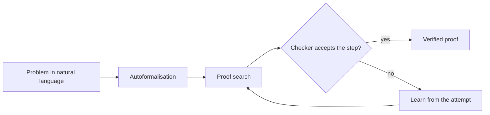

# Mathematics and Formal Proof

AI systems now take part in mathematics in three ways: they answer competition problems, they search for new mathematical objects and constructions, and they write proofs that a computer checks line by line in a formal language such as Lean. This page covers the applied side: benchmark results, the systems that reached olympiad level, and how working mathematicians use these tools. The theory of automated proof is covered under [Symbolic AI](../../theory/symbolic-ai/index.md).

## Overview

Mathematics is a demanding test of reasoning because the answer can be checked and every step must be exact. Early language models did poorly on it. Hendrycks et al. (2021) introduced the MATH dataset of 12,500 competition problems and reported that accuracy stayed low even for large Transformers. Later work narrowed the gap. Minerva, trained further on technical content, reached state-of-the-art results on quantitative benchmarks without external tools (Lewkowycz et al., 2022). A 7-billion-parameter open model trained on mathematics-rich web data later reached 51.7% on MATH (Shao et al., 2024).[^1]

Two strands run through the field. In the **informal** strand, a model writes a proof in ordinary language and a human or a grader judges it. In the **formal** strand, the model writes a proof in a proof assistant such as Lean, which accepts or rejects every step. Formal proofs are harder to produce, but the checker supplies automatic feedback, which makes reinforcement learning on millions of attempts possible. The most capable systems below rely on this. [Formal Mathematical Reasoning](https://arxiv.org/abs/2412.16075) (Yang et al., 2024) argues that this formal route is indispensable for AI mathematics to reach its next level.

## Key concepts

- **Competition mathematics**: problems from contests such as the International Mathematical Olympiad (IMO), which are short to state but need long, original chains of reasoning.
- **Proof assistant**: software, such as Lean, in which a proof is a program that the computer checks against axioms and definitions. Lean 4 is both a proof assistant and a programming language (de Moura and Ullrich, 2021).
- **Mathlib**: the community library of formalised mathematics that Lean proofs build on (Mathlib Community, 2020).
- **Autoformalisation**: translating a mathematical statement written in natural language into a formal one. Wu et al. (2022) found that language models translated about a quarter of competition problems into formal statements in Isabelle/HOL.
- **Test-time search**: spending more computation on one hard problem at inference time, for example by sampling many candidate steps.
- **Evolutionary program search**: proposing many candidate programs with a language model, scoring them automatically and keeping the best ones for the next round.

## How it works

The formal pipeline has four stages. A natural-language problem is first translated into a formal statement. A search procedure then proposes proof steps, and the proof assistant checks each one. Attempts that fail are used as training signal, so the system improves on the next round.

The checker is the source of trust. It confirms that a proof is valid for the formal statement, but not that the formal statement matches the problem a person meant. Autoformalisation errors are therefore a central risk, discussed under open questions.

Formal benchmarks such as MiniF2F and PutnamBench can be checked automatically. DeepSeek-Prover-V2 reported 88.9% on the MiniF2F test split and solved 49 of 658 PutnamBench problems (Ren et al., 2025). Informal benchmarks compare final answers or grade written proofs by hand, which is slower.

## Key methods

Three landmark systems show the main approaches. Each has its own page.

| Method | Domain | Core idea | Page |
|---|---|---|---|
| AlphaGeometry (Trinh et al., 2024) | Euclidean geometry | A language model trained on synthetic data proposes auxiliary constructions, and a symbolic engine derives consequences | [AlphaGeometry](alphageometry/index.md) |
| AlphaProof (Hubert et al., 2025) | Algebra, number theory and other formal domains | An AlphaZero-inspired agent learns Lean proofs by reinforcement learning on auto-formalised problems | [AlphaProof](alphaproof/index.md) |
| FunSearch (Romera-Paredes et al., 2024) | Combinatorics and algorithms | An evolutionary loop in which an LLM writes programs that are scored by an automatic evaluator | [FunSearch](funsearch/index.md) |

AlphaGeometry and AlphaProof are provers: each produces a proof of a stated result. FunSearch is a discoverer: it produces a construction or an algorithm that scores well, which a mathematician then examines.

## Connections

- **Symbolic AI.** Interactive theorem proving, SAT solvers and proof search are classical symbolic methods. The formal strand of this page is the meeting point of those methods with learned models. See [Symbolic AI, Search & Planning](../../theory/symbolic-ai/index.md).
- **Reasoning models.** Competition mathematics is the standard test bed for [reasoning models and test-time compute](../../theory/models/reasoning/index.md), because answers and proofs can be checked automatically.
- **Mathematics for AI.** The [mathematics that underpins machine learning](../../theory/math/index.md) is a different subject: there, mathematics explains models; here, models do mathematics.
- **Evaluation.** Competition benchmarks are useful only if they measure reasoning rather than recall. See [evaluation and benchmarks](../../engineering/evaluation/index.md).
- **Brain and mind.** Amalric and Dehaene (2016) found that professional mathematicians' advanced reasoning uses prefrontal, parietal and inferior temporal regions that overlap with number and space circuits, and makes little use of classical language areas. Whether a language model's proof search resembles that process is an open question. See [language in the brain](../../brain-mind/language-in-brain/index.md) and [cognitive architectures](../../brain-mind/cognitive-architectures/index.md).

## Applications

- **Olympiad problem solving.** AlphaGeometry solved 25 of 30 olympiad geometry problems in its evaluation set (Trinh et al., 2024). Its successor, AlphaGeometry 2, raised the solving rate on 25 years of IMO-style geometry problems to 84%, from 54% for the earlier system (Chervonyi et al., 2025). At IMO 2024, AlphaProof and AlphaGeometry 2 together reached a score equivalent to a silver medallist, which the authors report as the first medal-level performance by an AI system (Hubert et al., 2025).
- **Discovery.** FunSearch found cap sets larger than the best known ones, in finite and asymptotic cases, and new heuristics for online bin packing (Romera-Paredes et al., 2024). A follow-up system, AlphaEvolve, was applied to 67 problems in analysis, combinatorics, geometry and number theory. It matched the best known results in most cases and improved several (Georgiev et al., 2025).
- **Research mathematics.** Davies et al. (2021) used machine learning to suggest patterns that led to a new connection in knot theory and a candidate algorithm for the combinatorial invariance conjecture. Their framework has the machine propose patterns, attribution techniques explain them, and the mathematician turns them into conjectures.

## Open questions

- **Final answers or full proofs.** Frieder et al. (2023) built graduate-level datasets to test whether LLMs can help professional mathematicians. Petrov et al. (2025) graded full written proofs for the 2025 USA Mathematical Olympiad and found that only the best model reached a non-trivial score, with the others below 5%. Scores on final-answer benchmarks may overstate what models can prove.
- **Faithful formalisation.** A proof is only as useful as its statement. If the formal statement is weaker or different from the intended problem, the checker will still accept a valid proof of the wrong result. Checking statements is an unsolved part of the workflow.
- **Cost.** AlphaProof's IMO result used multi-day computation (Hubert et al., 2025). Whether such search becomes practical for routine research is unknown.
- **Coverage.** Formal libraries cover some areas of mathematics well and others poorly. The areas where machine proof is easiest may not be the areas where mathematicians most need help.
- **Credit and trust.** When a machine finds a construction or a proof, who should be credited, and how should a community judge a result it has not read line by line?

## References

### Seminal papers

- Hendrycks, D. et al. (2021). *Measuring Mathematical Problem Solving With the MATH Dataset*. arXiv. https://arxiv.org/abs/2103.03874 — Introduces 12,500 competition problems with worked solutions, and shows scaling alone was not solving them.
- Lewkowycz, A. et al. (2022). *Solving Quantitative Reasoning Problems with Language Models*. arXiv. https://arxiv.org/abs/2206.14858 — Presents Minerva, a model trained on technical content that reached state-of-the-art quantitative results without tools.
- Shao, Z. et al. (2024). *DeepSeekMath: Pushing the Limits of Mathematical Reasoning in Open Language Models*. arXiv. https://arxiv.org/abs/2402.03300 — Pretrains a 7-billion-parameter model on mathematics-rich web data, reaching 51.7% on MATH.
- Wu, Y. et al. (2022). *Autoformalization with Large Language Models*. arXiv. https://arxiv.org/abs/2205.12615 — Shows language models can translate many competition problems into formal Isabelle/HOL statements.
- de Moura, L. & Ullrich, S. (2021). *The Lean 4 Theorem Prover and Programming Language*. CADE-28, Lecture Notes in Computer Science. https://doi.org/10.1007/978-3-030-79876-5_37 — Describes Lean 4, a proof assistant that is also a general programming language.
- Davies, A. et al. (2021). *Advancing mathematics by guiding human intuition with AI*. Nature. https://doi.org/10.1038/s41586-021-04086-x — Uses machine learning to find patterns leading to a new knot-theory connection and a symmetric-group conjecture.
- Amalric, M. & Dehaene, S. (2016). *Origins of the brain networks for advanced mathematics in expert mathematicians*. PNAS. https://doi.org/10.1073/pnas.1603205113 — Scans professional mathematicians, finding advanced reasoning uses number and space circuits with little use of language areas.
- Trinh, T. H. et al. (2024). *Solving olympiad geometry without human demonstrations*. Nature. https://doi.org/10.1038/s41586-023-06747-5 — Introduces AlphaGeometry, which solves 25 of 30 test olympiad geometry problems.
- Romera-Paredes, B. et al. (2024). *Mathematical discoveries from program search with large language models*. Nature. https://doi.org/10.1038/s41586-023-06924-6 — Introduces FunSearch, an evolutionary search over LLM-written programs scored by an evaluator.
- Hubert, T. et al. (2025). *Olympiad-level formal mathematical reasoning with reinforcement learning*. Nature. https://doi.org/10.1038/s41586-025-09833-y — Introduces AlphaProof, which learns Lean proofs by reinforcement learning and, combined with AlphaGeometry 2, reaches silver-medal-equivalent performance at IMO 2024.

### Surveys and textbooks

- Yang, K. et al. (2024). *Formal Mathematical Reasoning: A New Frontier in AI*. arXiv. https://arxiv.org/abs/2412.16075 — Position paper summarising theorem proving and autoformalisation, with open challenges.

### Articles and documentation

- Mathlib Community (2020). *The Lean Mathematical Library*. CPP 2020, ACM SIGPLAN. https://doi.org/10.1145/3372885.3373824 — Describes Mathlib, the community library of formalised mathematics that Lean proofs build on.
- Frieder, S. et al. (2023). *Mathematical Capabilities of ChatGPT*. arXiv. https://arxiv.org/abs/2301.13867 — Builds graduate-level datasets written by working researchers to test LLMs as assistants.
- Petrov, I. et al. (2025). *Proof or Bluff? Evaluating LLMs on 2025 USA Math Olympiad*. arXiv. https://arxiv.org/abs/2503.21934 — Expert grading of full proofs for the 2025 USAMO, where only the best model scored non-trivially.
- Chervonyi, Y. et al. (2025). *Gold-medalist Performance in Solving Olympiad Geometry with AlphaGeometry2*. arXiv. https://arxiv.org/abs/2502.03544 — Reports AlphaGeometry 2 and its solving rate on 25 years of IMO geometry.
- Georgiev, B. et al. (2025). *Mathematical exploration and discovery at scale*. arXiv. https://arxiv.org/abs/2511.02864 — Applies AlphaEvolve to 67 mathematical problems, with mathematicians including Terence Tao.
- Ren, Z. Z. et al. (2025). *DeepSeek-Prover-V2: Advancing Formal Mathematical Reasoning via Reinforcement Learning for Subgoal Decomposition*. arXiv. https://arxiv.org/abs/2504.21801 — Open-weight Lean prover that decomposes problems into subgoals, reported on MiniF2F and PutnamBench.

[^1]: The 51.7% figure is reported in Shao et al. (2024) for MATH, without external toolkits or voting. Scores on this benchmark have risen considerably since, so the figure is a historical marker, not a current result.
