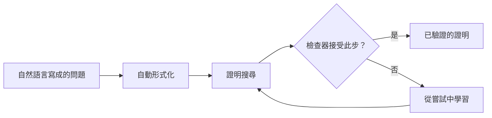

# 數學與形式證明

AI 系統如今以三種方式參與數學：解答競賽題目、搜尋新的數學對象與構造，以及撰寫能被電腦以 Lean 等形式語言逐行檢查的證明。本頁聚焦於應用面：基準測試的結果、達到奧林匹亞水準的系統，以及數學家如何使用這些工具。自動證明的理論則在[符號 AI](../../theory/symbolic-ai/index.md)下討論。

## 概述

數學是對推理能力的嚴格考驗，因為答案可以檢查，而每一步都必須精確。早期的語言模型在這方面表現不佳。Hendrycks 等人（2021）推出了包含 12,500 道競賽題目的 MATH 資料集，並指出即使是大型 Transformer，準確率仍然偏低。之後的研究縮小了差距。Minerva 在技術內容上進一步訓練，在量化推理基準上達到最先進的結果，且不借助外部工具（Lewkowycz 等人，2022）。一個在數學素材豐富的網路資料上訓練、擁有 70 億參數的開源模型，後來在 MATH 上達到 51.7%（Shao 等人，2024）。[^1]

這個領域有兩條主要路線。在**非形式**路線中，模型以日常語言撰寫證明，由人或評分者判斷。在**形式**路線中，模型在 Lean 等證明助理中撰寫證明，助理會逐步接受或拒絕每一步。形式證明較難產生，但檢查器提供自動回饋，使得以數百萬次嘗試進行強化學習成為可能。下文最強的系統都依賴這一點。[Formal Mathematical Reasoning](https://arxiv.org/abs/2412.16075)（Yang 等人，2024）主張，若要讓 AI 數學更上一層樓，形式路線不可或缺。

## 關鍵概念

- **競賽數學**：來自國際數學奧林匹亞（IMO）等競賽的題目。題目敘述簡短，但需要冗長而原創的推理鏈。
- **證明助理**：如 Lean 之類的軟體，其中的證明是一段程式，電腦會依公理與定義檢查它。Lean 4 同時是證明助理與程式語言（de Moura 與 Ullrich，2021）。
- **Mathlib**：由社群維護、以形式化方式表述的數學函式庫，Lean 證明建立於其上（Mathlib Community，2020）。
- **自動形式化**：把自然語言寫成的數學陳述翻譯為形式陳述。Wu 等人（2022）發現，語言模型能把約四分之一的競賽題目翻譯為 Isabelle/HOL 中的形式陳述。
- **測試時搜尋**：在推論時對一道困難題目投入更多運算，例如抽樣許多候選步驟。
- **演化式程式搜尋**：以語言模型提出許多候選程式，自動評分，並保留最佳者進入下一輪。

## 運作方式

形式路線分為四個階段。自然語言寫成的問題，首先被翻譯為形式陳述。接著，搜尋程序提出證明步驟，由證明助理逐步檢查。失敗的嘗試會被當作訓練信號，使系統在下一輪改進。

信任的來源是檢查器。它確認證明對於所給的形式陳述是有效的，但無法確認形式陳述與人所想的問題相符。因此，自動形式化的錯誤是一項核心風險，將於開放問題中討論。

MiniF2F、PutnamBench 等形式基準可以自動檢查。DeepSeek-Prover-V2 報告其在 MiniF2F 測試集上達到 88.9%，並解出 PutnamBench 中 658 題裡的 49 題（Ren 等人，2025）。非形式基準則是比較最終答案，或由人工批改完整的書面證明，速度較慢。

## 關鍵方法

三個里程碑式的系統代表了主要的做法。每個系統都有自己的頁面。

| 方法 | 領域 | 核心想法 | 頁面 |
|---|---|---|---|
| AlphaGeometry（Trinh 等人，2024） | 歐氏幾何 | 以合成資料訓練的語言模型提出輔助構造，符號引擎推導其後果 | [AlphaGeometry](alphageometry/index.md) |
| AlphaProof（Hubert 等人，2025） | 代數、數論及其他形式領域 | 受 AlphaZero 啟發的代理人，以強化學習在自動形式化的問題上學習 Lean 證明 | [AlphaProof](alphaproof/index.md) |
| FunSearch（Romera-Paredes 等人，2024） | 組合數學與演算法 | 演化迴圈，由 LLM 撰寫程式，再由自動評估器評分 | [FunSearch](funsearch/index.md) |

AlphaGeometry 與 AlphaProof 是證明器：它們各自證明一個給定的結果。FunSearch 則是發現器：它產生分數良好的構造或演算法，再由數學家加以檢視。

## 相關連結

- **符號 AI。** 互動式定理證明、SAT 求解器與證明搜尋都是經典的符號方法。本頁的形式路線，正是這些方法與學習模型的交會點。請見[符號 AI、搜尋與規劃](../../theory/symbolic-ai/index.md)。
- **推理模型。** 競賽數學是[推理模型與測試時運算](../../theory/models/reasoning/index.md)的標準測試場域，因為答案與證明都能自動檢查。
- **數學於 AI 中的角色。** [支撐機器學習的數學](../../theory/math/index.md)是另一門主題：在那裡，數學用來解釋模型；在這裡，模型用來做數學。
- **評估。** 競賽基準只有在衡量的是推理而非記憶時才有用。請見[評估與基準](../../engineering/evaluation/index.md)。
- **大腦與心智。** Amalric 與 Dehaene（2016）發現，專業數學家進行高階推理時，會動用前額葉、頂葉與下顳葉區域，這些區域與數字和空間的迴路重疊，且很少使用經典的語言區。語言模型的證明搜尋是否與此過程相似，仍是開放問題。請見[大腦中的語言](../../brain-mind/language-in-brain/index.md)與[認知架構](../../brain-mind/cognitive-architectures/index.md)。

## 應用

- **奧林匹亞解題。** AlphaGeometry 在其評估集中解出 30 道奧林匹亞幾何題中的 25 題（Trinh 等人，2024）。其後繼系統 AlphaGeometry 2，把 25 年間 IMO 風格幾何題的解題率從早期系統的 54% 提高到 84%（Chervonyi 等人，2025）。在 2024 年 IMO 中，AlphaProof 與 AlphaGeometry 2 合計達到銀牌得分的水準，作者稱這是 AI 系統首次取得獎牌水準的表現（Hubert 等人，2025）。
- **發現。** FunSearch 找到比已知更大的 cap set（在有限維與漸近情形皆然），並為線上裝箱問題找到新的啟發式演算法（Romera-Paredes 等人，2024）。後續系統 AlphaEvolve 應用於 67 道分析、組合、幾何與數論的題目，多數情況下匹配了已知最佳結果，並改進了其中數題（Georgiev 等人，2025）。
- **研究數學。** Davies 等人（2021）利用機器學習提出的模式，促成了一項關於紐結理論的新連結，以及對組合不變性猜想的候選演算法。其架構是：機器提出模式，歸因技術加以解釋，數學家再把它們轉化為猜想。

## 開放問題

- **最終答案還是完整證明。** Frieder 等人（2023）建立了研究生程度的資料集，用以測試 LLM 能否協助專業數學家。Petrov 等人（2025）人工批改了 2025 年美國數學奧林匹亞的完整書面證明，發現只有最好的模型得到非平凡的分數，其餘模型都低於 5%。在最終答案基準上的分數，可能高估了模型實際能證明的範圍。
- **忠實的形式化。** 證明的價值取決於其陳述。若形式陳述比原題弱，或與原題不同，檢查器仍會接受一個對錯誤結果的有效證明。檢查陳述本身，是工作流程中尚未解決的部分。
- **成本。** AlphaProof 在 IMO 的結果動用了多日的運算（Hubert 等人，2025）。這類搜尋能否在日常研究中變得可行，目前仍不清楚。
- **涵蓋範圍。** 形式函式庫對某些數學領域涵蓋得很好，對其他領域則很差。機器證明最容易的領域，未必是數學家最需要協助的領域。
- **功勞與信任。** 當機器找到一個構造或一個證明時，應該歸功於誰？社群又該如何評判一個沒有人逐行讀過的結果？

## 參考文獻

### 開創性論文

- Hendrycks, D. 等人（2021）。*Measuring Mathematical Problem Solving With the MATH Dataset*。arXiv。https://arxiv.org/abs/2103.03874 — 介紹 12,500 道附有完整解答的競賽題目，並指出單靠擴大規模尚不能解決這些題目。
- Lewkowycz, A. 等人（2022）。*Solving Quantitative Reasoning Problems with Language Models*。arXiv。https://arxiv.org/abs/2206.14858 — 提出 Minerva，一個在技術內容上訓練的模型，在不借助工具的情況下於量化基準上達到最先進結果。
- Shao, Z. 等人（2024）。*DeepSeekMath: Pushing the Limits of Mathematical Reasoning in Open Language Models*。arXiv。https://arxiv.org/abs/2402.03300 — 在數學素材豐富的網路資料上對 70 億參數模型進行預訓練，並在 MATH 上達到 51.7%。
- Wu, Y. 等人（2022）。*Autoformalization with Large Language Models*。arXiv。https://arxiv.org/abs/2205.12615 — 說明語言模型能把許多競賽題目翻譯為 Isabelle/HOL 中的形式陳述。
- de Moura, L. & Ullrich, S.（2021）。*The Lean 4 Theorem Prover and Programming Language*。CADE-28, Lecture Notes in Computer Science。https://doi.org/10.1007/978-3-030-79876-5_37 — 說明 Lean 4，一個同時也是通用程式語言的證明助理。
- Davies, A. 等人（2021）。*Advancing mathematics by guiding human intuition with AI*。Nature。https://doi.org/10.1038/s41586-021-04086-x — 利用機器學習找出模式，進而促成紐結理論中的新連結與一個關於對稱群的猜想。
- Amalric, M. & Dehaene, S.（2016）。*Origins of the brain networks for advanced mathematics in expert mathematicians*。PNAS。https://doi.org/10.1073/pnas.1603205113 — 掃描專業數學家的大腦，發現高階推理使用數字與空間迴路，較少使用語言區。
- Trinh, T. H. 等人（2024）。*Solving olympiad geometry without human demonstrations*。Nature。https://doi.org/10.1038/s41586-023-06747-5 — 介紹 AlphaGeometry，它在 30 道測試奧林匹亞幾何題中解出 25 題。
- Romera-Paredes, B. 等人（2024）。*Mathematical discoveries from program search with large language models*。Nature。https://doi.org/10.1038/s41586-023-06924-6 — 介紹 FunSearch，一種對 LLM 撰寫的程式進行演化搜尋、由評估器評分的方法。
- Hubert, T. 等人（2025）。*Olympiad-level formal mathematical reasoning with reinforcement learning*。Nature。https://doi.org/10.1038/s41586-025-09833-y — 介紹 AlphaProof，它以強化學習學習 Lean 證明；與 AlphaGeometry 2 結合後，在 2024 年 IMO 達到銀牌等價的表現。

### 綜述與教科書

- Yang, K. 等人（2024）。*Formal Mathematical Reasoning: A New Frontier in AI*。arXiv。https://arxiv.org/abs/2412.16075 — 立場論文，總結定理證明與自動形式化的進展，並提出開放挑戰。

### 文章與文件

- Mathlib Community（2020）。*The Lean Mathematical Library*。CPP 2020, ACM SIGPLAN。https://doi.org/10.1145/3372885.3373824 — 介紹 Mathlib，即 Lean 證明所建立其上的社群形式化數學函式庫。
- Frieder, S. 等人（2023）。*Mathematical Capabilities of ChatGPT*。arXiv。https://arxiv.org/abs/2301.13867 — 由在職研究者撰寫研究生程度的資料集，用以測試 LLM 作為助手的能力。
- Petrov, I. 等人（2025）。*Proof or Bluff? Evaluating LLMs on 2025 USA Math Olympiad*。arXiv。https://arxiv.org/abs/2503.21934 — 對 2025 年美國數學奧林匹亞完整證明的專家批改，只有最好的模型得到非平凡的分數。
- Chervonyi, Y. 等人（2025）。*Gold-medalist Performance in Solving Olympiad Geometry with AlphaGeometry2*。arXiv。https://arxiv.org/abs/2502.03544 — 報告 AlphaGeometry 2 及其在 25 年 IMO 幾何題上的解題率。
- Georgiev, B. 等人（2025）。*Mathematical exploration and discovery at scale*。arXiv。https://arxiv.org/abs/2511.02864 — 將 AlphaEvolve 應用於 67 道數學問題，作者包括數學家 Terence Tao。
- Ren, Z. Z. 等人（2025）。*DeepSeek-Prover-V2: Advancing Formal Mathematical Reasoning via Reinforcement Learning for Subgoal Decomposition*。arXiv。https://arxiv.org/abs/2504.21801 — 開放權重的 Lean 證明器，將問題分解為子目標，並在 MiniF2F 與 PutnamBench 上報告結果。

[^1]: 51.7% 的數字見於 Shao 等人（2024）在 MATH 上的結果，未使用外部工具或投票。此後該基準的分數已大幅提升，因此這個數字只是歷史上的標記，不代表目前的結果。
