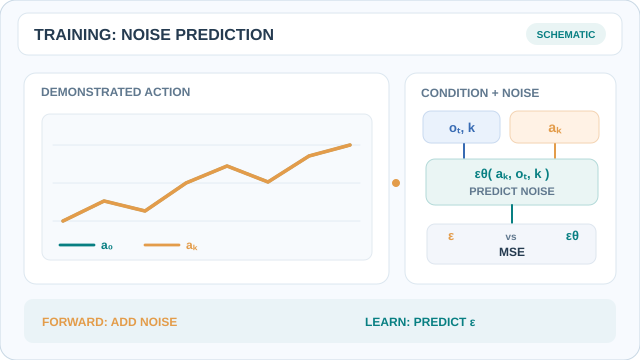
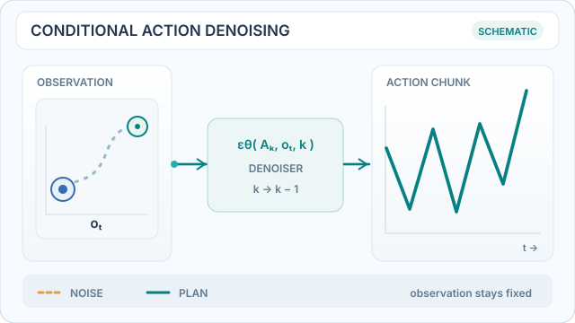

# Diffusion Policy (Chi et al. 2023)

Chi and colleagues proposed generating robot behaviour with a denoising diffusion model. Instead of predicting one action from an observation, the policy turns noise into a sequence of actions, guided by what the robot sees. This page covers that paper; the parent topic is [Robotics](../index.md).

## Problem

Robot action prediction is hard for three reasons, which the paper lists as multimodal action distributions, sequential correlation, and the need for high precision (Sec. 1). A regression policy that predicts a single action averages over the demonstrated choices, and the average can be a poor action. Energy-based implicit policies handle multimodality, but they need negative sampling to estimate a normalisation constant, which makes training unstable (Sec. 1, Sec. 4.4, Fig. 6).

## Core idea

The paper models the visuomotor policy as a conditional denoising diffusion process over action sequences, p(A_t | O_t) (Sec. 2.3, Eqs. 4–5). Observations condition the denoiser but are not themselves denoised. Starting from Gaussian noise, the model repeatedly removes noise, and each step sees the current observations. The sampled action sequence stays close to one of the demonstrated modes rather than their average.

## Procedure

1. **Demonstrations:** collect demonstrations, pairing each observation window with the action sequence that follows it.
2. **Training:** train a noise-prediction network on the demonstrated action sequences, conditioned on the observations. The denoising procedure is the one from [diffusion models](../../../theory/paradigms/unsupervised/density-and-generative-models/diffusion/index.md).
3. **Inference:** sample an action sequence from noise with the denoising steps, then execute only part of it. This is receding-horizon control: the policy predicts a sequence, runs its first actions, and predicts again.

Table 7 gives the CNN variant's horizons for most simulated tasks as an observation horizon of 2, a prediction horizon of 16 and an execution horizon of 8. The paper finds an execution horizon of 8 best for most tasks, which trades temporal consistency against responsiveness (Sec. 5.3, Fig. 5).

## Animated process walkthroughs

### Forward noising and noise-prediction training

*Original instructional animation (CC BY-SA 4.0).* The teal sequence is a clean demonstrated action chunk \(A^{(0)}\); the amber sequence depicts increasing corruption at a sampled diffusion timestep \(k\). The model receives the noisy chunk, observation \(O_t\), and timestep \(k\), and predicts the injected noise \(\epsilon\) with a mean-squared-error objective:

$
A^{(k)}=\sqrt{\bar{\alpha}_k}A^{(0)}+\sqrt{1-\bar{\alpha}_k}\epsilon,\qquad
\mathcal L=\mathbb E_{A^{(0)},O_t,k,\epsilon}
\left[\|\epsilon-\epsilon_\theta(A^{(k)},O_t,k)\|_2^2\right].
$

The animated curve is an **illustrative perturbation**, not a numerically exact noise schedule, training trace, or measured model output. Training predicts noise added to the **action sequence**, whereas inference starts from noise and denoises actions. On MkDocs use Play/Pause; the [GitHub-readable still](../../../assets/concept-animations/diffusion-policy-noise-training-still.svg) shows the two signals. See [Chi et al. (2023)](https://arxiv.org/abs/2303.04137), Sec. 2.3.

### Observation-conditioned action denoising

*Original instructional animation (CC BY-SA 4.0).* The dashed amber candidate is an artificial high-noise action vector; the turquoise curve changes gradually as the denoiser conditions on the **same observation**. The observation is input context, **not** part of the state being denoised. This schematic interpolates illustrative trajectories and is **not a model-generated sample, a measured noise schedule, or a performance trace**. On the MkDocs site use Play/Pause; the [GitHub-readable still](../../../assets/concept-animations/diffusion-policy-denoising-still.svg) compares the initial noisy and final action trajectories. Based on [Chi et al. (2023)](https://arxiv.org/abs/2303.04137), Sec. 2.3.

### Receding-horizon plan, execute, observe, replan

*Original instructional animation (CC BY-SA 4.0).* Each row predicts **8** future actions, but only the **first 3** (turquoise cells) execute before the observation is refreshed and the plan is recomputed. Grey cells are discarded, not queued for later execution; the moving dot illustrates closed-loop progress. The 8/3 horizons are **schematic**, selected for legibility, **not a reported benchmark configuration**. The paper's common CNN setup is observation horizon 2, prediction horizon 16, execution horizon 8 (Table 7). On MkDocs use Play/Pause; the [GitHub-readable still](../../../assets/concept-animations/diffusion-policy-receding-horizon-still.svg) shows all three rolling windows. See [Chi et al. (2023)](https://arxiv.org/abs/2303.04137), Secs. 2.3 and 5.3.

### Multimodal actions versus a pointwise regression mean

*Original instructional animation (CC BY-SA 4.0).* Two demonstrated paths avoid the obstacle in different ways. Their **constructed pointwise mean** (red dashed) passes through the obstacle; averaging the action trajectories is therefore not necessarily safe or representative. On the right, one sample progressively traces an upper mode, followed by a distinct lower-mode sample—**the two modes are not continuously interpolated into each other**. This is a deliberately simplified illustration of multimodality, **not a measured action distribution, a run of Diffusion Policy, or a guarantee that all diffusion samples are feasible**. On MkDocs use Play/Pause; the [GitHub-readable still](../../../assets/concept-animations/diffusion-policy-multimodal-actions-still.svg) shows both modes. See [Chi et al. (2023)](https://arxiv.org/abs/2303.04137), Sec. 1.

## Architectures

- **CNN:** a 1D temporal convolutional network with FiLM conditioning on the observation and denoising step (Sec. 3.1). The paper recommends starting here.
- **Transformer:** a minGPT-style decoder with causal attention, where observations enter through cross-attention (Sec. 3.1). It performs better when actions change quickly, but it is more sensitive to hyperparameters.
- **Vision encoder:** ResNet-18 without pretraining, with spatial softmax in place of global average pooling and GroupNorm in place of BatchNorm, trained end to end (Sec. 3.2).

## Results

The paper reports an average improvement of 46.9% over the baselines, computed with the best checkpoint per task (Sec. 5, App. B.2). The paper evaluates 15 tasks across simulation and the real world (Sec. 10). Selected visual-policy results from Table 2, against the best LSTM-GMM variant as the baseline:

| Task | LSTM-GMM | Diffusion Policy |
|---|---|---|
| Square (proficient human) | 0.82 | 0.98 |
| Transport (proficient human) | 0.88 | 1.00 |
| Transport (multi-human) | 0.44 | 0.89 |
| ToolHang (proficient human) | 0.68 | 0.95 |
| Push-T (proficient human) | 0.69 | 0.91 |

On the real robot (Sec. 6–7), Push-T reaches 0.95 success against 0.20 for the best LSTM-GMM variant. Mug flipping reaches 0.90 against 0.0, sauce pouring reaches an IoU of 0.74 against 0.06, and sauce spreading reaches 1.00 against 0.00. Three bimanual tasks (egg beater, mat unrolling and shirt folding) reach 55%, 75% and 75%, and they have no baselines.

The text of Sec. 5.3 gives a 213% improvement on Kitchen p4, but Table 4 gives 0.96 against 0.44 for BET, which is about 118%. The table figures are the ones to quote.

## Limitations

- **Compute and latency:** the paper states that Diffusion Policy "has higher computational costs and inference latency compared to simpler methods like LSTM-GMM" (Sec. 9). The denoising step count also differs between the text (Sec. 3.4) and the tables (Tables 7–8), so the latency figure should be checked against the appendix.
- **Demonstration data:** the policy inherits the limits of behaviour cloning, and performs poorly with inadequate demonstrations (Sec. 9).
- **Control rate:** predicting action sequences "may not suffice for tasks requiring high rate control" (Sec. 9).
- **Architecture choice:** the transformer is harder to tune (Sec. 3.1), and the CNN over-smooths fast velocity signals (Sec. 3.1). Frozen pretrained encoders performed poorly, and training a ViT from scratch was hard with limited data (Sec. 5.4).
- **Sensing:** force and tactile sensing are neither discussed nor tested.
- **Action space:** position control consistently outperforms the velocity-control variant (Sec. 4.2, Sec. 5.3). The authors attribute this to compounding error, which they present as a hypothesis.

## Connections

- The imitation-learning setting is covered in [Imitation Learning](../../../theory/paradigms/imitation/index.md).
- The method it builds on is [diffusion models](../../../theory/paradigms/unsupervised/density-and-generative-models/diffusion/index.md).
- A transformer-based policy for similar bimanual tasks is [ALOHA and ACT](../aloha/index.md).

## References

### Seminal papers

- Chi, C. et al. (2023). Diffusion Policy: Visuomotor Policy Learning via Action Diffusion. arXiv. https://arxiv.org/abs/2303.04137 — Models a visuomotor policy as conditional denoising diffusion over action sequences, with results on 15 tasks across simulation and the real world.
- Ho, J., Jain, A. & Abbeel, P. (2020). Denoising Diffusion Probabilistic Models. arXiv. https://arxiv.org/abs/2006.11239 — The denoising diffusion probabilistic model whose training and sampling procedure the policy builds on.
- Zhao, T. Z. et al. (2023). Learning Fine-Grained Bimanual Manipulation with Low-Cost Hardware. arXiv. https://arxiv.org/abs/2304.13705 — The ACT policy, a transformer-based competing approach for bimanual manipulation.

### Surveys and textbooks

- Hussein, A. et al. (2017). Imitation Learning: A Survey of Learning Methods. *ACM Computing Surveys* 50(2). https://doi.org/10.1145/3054912 — Survey of imitation learning methods, the setting that demonstration-based policies such as Diffusion Policy belong to.
- Kober, J., Bagnell, J. A. & Peters, J. (2013). Reinforcement learning in robotics: A survey. *The International Journal of Robotics Research* 32(11). https://doi.org/10.1177/0278364913495721 — Survey of reinforcement learning applied to robots.
