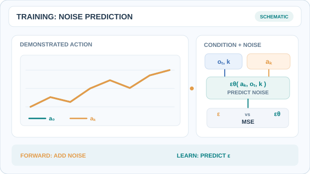
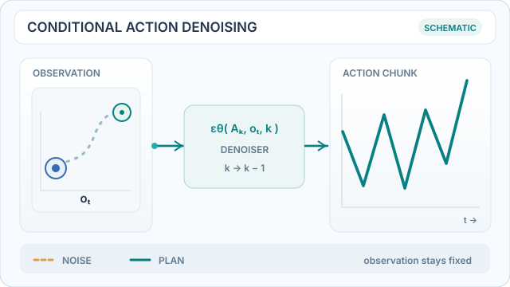

# Diffusion Policy（Chi 等人，2023）

Chi 等人提出以去噪擴散模型生成機器人行為。策略不是從觀察直接預測一個動作，而是從雜訊出發，在觀察的引導下逐步生成一段動作序列。本頁說明這篇論文；上層主題是[機器人](../index.md)。

## 問題

機器人的動作預測有三個困難，論文列為：多模態的動作分布、序列上的相關性，以及對精度的高要求（第 1 節）。只預測單一動作的迴歸策略會平均掉示範中的各種選擇，而平均結果可能是很差的動作。基於能量的隱式策略可以處理多模態，但需要負採樣來估計正規化常數，使訓練不穩定（第 1 節、第 4.4 節、圖 6）。

## 核心想法

論文把視覺運動策略建模為動作序列上的條件式去噪擴散過程，即 p(A_t | O_t)（第 2.3 節，式 4–5）。觀察作為去噪器的條件，本身不被去噪。模型從高斯雜訊開始，反覆去除雜訊，每一步都看到當前觀察。取樣出的動作序列會貼近某個示範模式，而不是各模式的平均。

## 程序

1. **示範**：收集示範，把每個觀察窗口與其後的動作序列配對。
2. **訓練**：在觀察的條件下，訓練一個網路預測示範動作序列中的雜訊。去噪程序沿用[擴散模型](../../../theory/paradigms/unsupervised/density-and-generative-models/diffusion/index.md)中的方法。
3. **推論**：從雜訊出發，經過去噪步驟取樣出一段動作序列，然後只執行其中一部分。這是接收視界控制：策略預測一段序列，執行前幾個動作，再重新預測。

表 7 給出 CNN 變體在多數模擬任務上的視界設定：觀察視界為 2、預測視界為 16、執行視界為 8。論文發現執行視界為 8 對多數任務最佳，這是在時間一致性與反應速度之間的取捨（第 5.3 節，圖 5）。

## 動態運作示範

### 正向加噪與雜訊預測訓練

*原創教學動畫（CC BY-SA 4.0）。* 青綠色為乾淨的示範動作序列 \(A^{(0)}\)，琥珀色表示在取樣擴散時間步 \(k\) 下受到擾動的動作。模型接收含雜訊序列、觀察 \(O_t\) 與步數 \(k\)，透過均方誤差學習預測注入的 \(\epsilon\)：

$
A^{(k)}=\sqrt{\bar{\alpha}_k}A^{(0)}+\sqrt{1-\bar{\alpha}_k}\epsilon,\qquad
\mathcal L=\mathbb E_{A^{(0)},O_t,k,\epsilon}
\left[\|\epsilon-\epsilon_\theta(A^{(k)},O_t,k)\|_2^2\right].
$

曲線變化是**人工擾動示意**，並未精確重現擴散雜訊排程，也不是訓練過程或模型量測結果。訓練階段學習預測**動作序列**中加入的雜訊；推論則由雜訊開始逐步產生動作。網站可播放／暫停；[GitHub 靜態預覽](../../../assets/concept-animations/diffusion-policy-noise-training-still.svg)呈現乾淨與含雜訊序列。參見 [Chi 等人（2023）](https://arxiv.org/abs/2303.04137)第 2.3 節。

### 觀察條件下的動作序列去噪

*原創教學動畫（CC BY-SA 4.0）。* 琥珀色虛線代表人工設定的高雜訊動作軌跡，青綠色曲線則隨去噪步驟逐漸調整；**觀察資訊始終固定，作為條件輸入，而不是被去噪的資料**。所有曲線、變化幅度及時間比例都是**教學示意**，不是實際模型輸出、量測所得雜訊排程或效能數據。在 MkDocs 網站可使用播放／暫停控制；[GitHub 靜態預覽](../../../assets/concept-animations/diffusion-policy-denoising-still.svg)呈現初始雜訊與最終動作規劃的差異。依據 [Chi 等人（2023）](https://arxiv.org/abs/2303.04137)第 2.3 節。

### 滾動視界：規劃、執行、重新觀察

*原創教學動畫（CC BY-SA 4.0）。* 每次規劃 **8** 個未來動作，但只執行**最前面 3** 個青綠色格子，接著取得新觀察並重新規劃。灰色的剩餘動作會捨棄，不會排入佇列等待執行；移動圓點表示機器人的閉迴路進展。圖中的 **8/3 是為便於理解而設的示意數值，不是論文的實驗設定**。原論文對多數模擬任務的 CNN 設定為觀察視界 2、預測視界 16、執行視界 8（表 7）。網站可使用播放／暫停；[GitHub 靜態預覽](../../../assets/concept-animations/diffusion-policy-receding-horizon-still.svg)可直接閱讀重疊的三次規劃。參見 [Chi 等人（2023）](https://arxiv.org/abs/2303.04137)第 2.3、5.3 節。

### 多模態動作與逐點迴歸平均

*原創教學動畫（CC BY-SA 4.0）。* 左側兩條示範路徑從不同方向繞過障礙物，其**人工構造的逐點平均**（紅色虛線）卻會穿過障礙。直接平均動作序列不一定安全，也可能無法代表任一示範模式。右側先逐步繪出上方模式，再顯示另一個下方模式的取樣結果；**動畫沒有在兩種模式之間連續內插**。這僅是便於理解多模態的幾何示意，**不是 Diffusion Policy 實際產生的取樣分布、機器人實測軌跡，也不保證生成動作均可行**。網站可播放／暫停；[GitHub 靜態預覽](../../../assets/concept-animations/diffusion-policy-multimodal-actions-still.svg)可直接比較兩條模式。參見 [Chi 等人（2023）](https://arxiv.org/abs/2303.04137)第 1 節。

## 架構

- **CNN**：以觀察與去噪步驟為條件（FiLM）的一維時間卷積網路（第 3.1 節）。論文建議由此開始。
- **Transformer**：以因果注意力實作的 minGPT 風格解碼器，觀察經由交叉注意力輸入（第 3.1 節）。動作變化快速時表現較好，但對超參數較敏感。
- **視覺編碼器**：未經預訓練的 ResNet-18，以空間 softmax 取代全域平均池化，以 GroupNorm 取代 BatchNorm，端到端訓練（第 3.2 節）。

## 結果

論文報告，相較於基線平均提升 46.9%，計算時每個任務取最佳檢查點（第 5 節、附錄 B.2）。論文在模擬與真實世界中共評估 15 項任務（第 10 節）。表 2 中的部分視覺策略結果，基線為最佳的 LSTM-GMM 變體：

| 任務 | LSTM-GMM | Diffusion Policy |
|---|---|---|
| Square（熟練人類示範） | 0.82 | 0.98 |
| Transport（熟練人類示範） | 0.88 | 1.00 |
| Transport（多人示範） | 0.44 | 0.89 |
| ToolHang（熟練人類示範） | 0.68 | 0.95 |
| Push-T（熟練人類示範） | 0.69 | 0.91 |

在真實機器人上（第 6–7 節），Push-T 成功率為 0.95，最佳 LSTM-GMM 變體為 0.20。翻杯子為 0.90 對 0.0，倒醬為 IoU 0.74 對 0.06，抹醬為 1.00 對 0.00。三項雙臂任務（打蛋器、展開墊子與摺衣服）分別達到 55%、75% 與 75%，且沒有基線。

第 5.3 節的文字給出 Kitchen p4 上提升 213%，但表 4 的數字為 0.96 對 BET 的 0.44，約為 118%。引用時應以表格數字為準。

## 限制

- **運算與延遲**：論文指出，Diffusion Policy「與 LSTM-GMM 等較簡單的方法相比，運算成本與推論延遲較高」（第 9 節）。去噪步數在正文（第 3.4 節）與表格（表 7–8）中也不一致，因此延遲數字應與附錄對照。
- **示範資料**：策略繼承了行為克隆的限制，示範不足時表現不佳（第 9 節）。
- **控制頻率**：預測動作序列「可能不足以應付需要高頻率控制的任務」（第 9 節）。
- **架構選擇**：transformer 較難調校（第 3.1 節），CNN 會平滑掉快速的速度訊號（第 3.1 節）。凍結的預訓練編碼器表現不佳，在資料有限時從頭訓練 ViT 也很困難（第 5.4 節）。
- **感測**：力與觸覺感測既未討論也未測試。
- **動作空間**：位置控制一致地優於速度控制變體（第 4.2、5.3 節）。作者將其歸因於誤差累積，但這只是假說。

## 連結

- 模仿學習的設定見[模仿學習](../../../theory/paradigms/imitation/index.md)。
- 本方法所依據的方法是[擴散模型](../../../theory/paradigms/unsupervised/density-and-generative-models/diffusion/index.md)。
- 針對類似雙臂任務、以 transformer 為基礎的策略見[ALOHA 與 ACT](../aloha/index.md)。

## 參考文獻

### 開創性論文

- Chi, C. et al. (2023). Diffusion Policy: Visuomotor Policy Learning via Action Diffusion. arXiv. https://arxiv.org/abs/2303.04137 — 把視覺運動策略建模為動作序列上的條件去噪擴散，並在模擬與真實世界的 15 項任務上報告結果。
- Ho, J., Jain, A. & Abbeel, P. (2020). Denoising Diffusion Probabilistic Models. arXiv. https://arxiv.org/abs/2006.11239 — 本策略的訓練與取樣流程所依據的去噪擴散機率模型。
- Zhao, T. Z. et al. (2023). Learning Fine-Grained Bimanual Manipulation with Low-Cost Hardware. arXiv. https://arxiv.org/abs/2304.13705 — ACT 策略，是針對雙臂操作的以 transformer 為基礎的競爭方法。

### 教科書與綜述

- Hussein, A. et al. (2017). Imitation Learning: A Survey of Learning Methods. *ACM Computing Surveys* 50(2). https://doi.org/10.1145/3054912 — 模仿學習方法的綜述，是 Diffusion Policy 這類示範式策略所屬的領域。
- Kober, J., Bagnell, J. A. & Peters, J. (2013). Reinforcement learning in robotics: A survey. *The International Journal of Robotics Research* 32(11). https://doi.org/10.1177/0278364913495721 — 強化學習應用於機器人的綜述。
