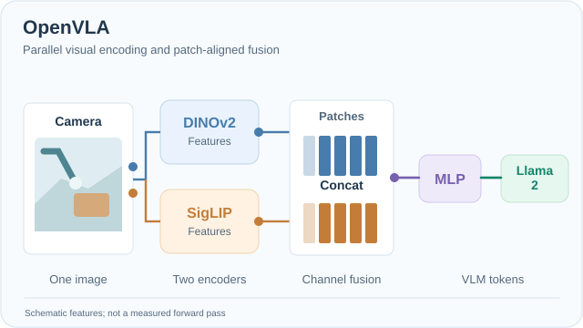
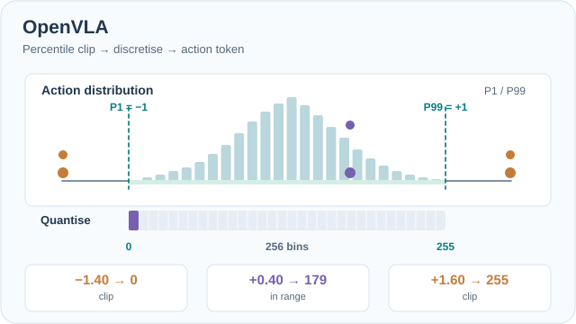

# OpenVLA (Kim et al. 2024)

Kim and colleagues released OpenVLA, an open-source vision-language-action model with 7 billion parameters. The aim was a model that researchers can inspect, fine-tune and run, not only a closed system. This page covers that paper; the parent topic is [Robotics](../index.md).

## Problem

The strongest robot vision-language-action models were closed, so most labs could not study, adapt or serve them. The question was whether an open model could match a much larger closed one.

## Core idea

OpenVLA is built on the Prismatic-7B vision-language model. Its visual encoder concatenates DINOv2 and SigLIP features channel-wise, a two-layer MLP projects them into the language model, and a 7B Llama 2 backbone generates the action tokens (Sec. 3.1). The paper compares it with RT-2-X, which has 55 billion parameters, and reports that OpenVLA achieves a 16.5% higher absolute success rate across 29 tasks (abstract).

## Visual walkthrough: perception fusion and action discretisation

*Original instructional animation (CC BY-SA 4.0).* **One camera observation** supplies both DINOv2 and SigLIP feature branches. Corresponding patch features are **concatenated along the channel dimension**, then a two-layer MLP projects the visual representation into tokens processed by the Llama 2 backbone. The moving markers indicate information flow, not measured network activations or identical feature values from the two encoders. Use the site's Play/Pause button (Enter or Space when focused), or examine the [GitHub static fusion preview](../../../assets/concept-animations/openvla-dual-encoder-fusion-still.svg). This is a schematic architecture, **not a recorded model forward pass**. See [Kim et al. (2024)](https://arxiv.org/abs/2406.09246), Section 3.1.

*Original instructional animation (CC BY-SA 4.0).* **Each of the seven continuous action dimensions is discretised independently.** For one dimension, first clamp to its training-data 1st- and 99th-percentile bounds and divide that interval into **256 equal-width bins**. The repeated short ticks in the drawing are a visual shorthand; **they do not indicate only 32 bins**. With *illustrative* bounds $[-1,+1]$, scalar examples $-1.40$, $+0.40$ and $+1.60$ map to indices $0$, $179$ and $255$: use $b=\min(255,\lfloor 256(a_{\mathrm{clip}}+1)/2\rfloor)$. The original model repurposes 256 least-used Llama tokenizer entries for action tokens, training their next-token prediction with cross entropy. **All values, histogram bars and outputs in the diagram are hand-crafted teaching examples, not measurements or actual OpenVLA outputs.** Use the site's Play/Pause button, or view the [GitHub static quantisation example](../../../assets/concept-animations/openvla-percentile-action-bins-still.svg). See [Kim et al. (2024)](https://arxiv.org/abs/2406.09246), Section 3.2.

## Procedure

1. **Data:** curate 970k real-world robot demonstrations from Open X-Embodiment, which had more than 2 million trajectories across 70+ datasets at the time. Only manipulation datasets with a third-person camera and single-arm end-effector control are kept. The final mixture has 27 datasets (Sec. 3.3, Table 3). DROID is included at 10% weight and removed for the final third of training.
2. **Action representation:** each of the 7 action dimensions is discretised into 256 bins, spread uniformly between the 1st and 99th action quantiles. The Llama tokenizer has too few spare tokens, so the 256 least-used tokens are overwritten with action tokens. Training uses next-token cross-entropy on the action tokens only (Sec. 3.2).
3. **Training:** 27 epochs at a fixed learning rate of 2e-5 with no warmup, batch size 2048, on 64 A100 GPUs for 14 days, about 21,500 A100-hours (Sec. 3.4, 3.5).
4. **Fine-tuning and serving:** for a new robot or task, LoRA with rank 32 reaches about the same success as full fine-tuning while training about 1.4% of the parameters. Quantised weights can then be served with less memory (Sec. 5.2, 5.4).

## Results

On BridgeData V2 WidowX (17 tasks, 170 rollouts), mean success rates are 18.5 ± 2.7% for RT-1-X, 20.0 ± 2.6% for Octo, 50.6 ± 3.5% for RT-2-X (55B) and 70.6 ± 3.2% for OpenVLA (Table 4, Fig. 3). Across 29 tasks, 17 on WidowX and 12 on the Google robot, OpenVLA leads RT-2-X by 16.5 points in absolute success rate (abstract, Sec. 1). On the Google robot the text says the two models perform comparably (Fig. 4, Table 6).

RT-2-X is higher only on semantic generalisation, which the authors attribute to its co-training with web data (Sec. 5.1). On fine-tuning tasks the abstract reports an advantage of 20.4% over Diffusion Policy (Sec. 5.2).

Fine-tuning on Franka-Tabletop tasks (Tables 1 and 2):

| Strategy | Success |
|---|---|
| Full fine-tuning (about 7.19B trainable parameters) | 69.7 ± 7.2% |
| LoRA, rank 32 (97.6M trainable parameters, 1.4%) | 68.2 ± 7.5% |
| Sandwich | 62.1 ± 7.9% |
| Frozen vision | 47.0 ± 6.9% |
| Last layer only | 30.3 ± 6.1% |

LoRA training takes 10–15 hours on a single A100, which the authors describe as an 8x compute reduction against full fine-tuning (Sec. 5.3). In the quantisation test on 8 BridgeData tasks (80 rollouts, Table 2), bfloat16 reaches 71.3 ± 4.8% at 16.8 GB, int8 reaches 58.1 ± 5.1% at 10.2 GB, and int4 reaches 71.9 ± 4.7% at 7.0 GB.

## Limitations

- **Input:** the model takes a single image. Multiple images, proprioception and observation history are left to future work (Sec. 6).
- **Speed:** about 6 Hz on an RTX 4090 in bfloat16, without compilation or speculative decoding (Sec. 3.5). That is too slow for high-frequency bimanual setups such as ALOHA at 50 Hz (Sec. 6). On an A5000, 8-bit inference runs at 1.2 Hz and hurts performance, while 4-bit runs at about 3 Hz (Sec. 5.4).
- **Reliability:** the authors say the model typically achieves "<90% success rate" on the tasks tested (Sec. 6).
- **Behaviour:** Diffusion Policy produces smoother, more precise trajectories on narrow, dexterous tasks (Sec. 5.2). RT-2-X leads on semantic generalisation (Sec. 5.1).
- **Scope:** the results are on the benchmarks and robots the authors tested, and the paper notes that many design questions remain unexplored (Sec. 6).

## Connections

- The closed model it is compared with is [RT-2](../rt-2/index.md).
- The diffusion-based policy it is compared with is [Diffusion Policy](../diffusion-policy/index.md).
- The vision-language side is covered in [Multimodal Models](../../../theory/models/multimodal/index.md).
- The language-model backbone is covered in [Large Language Models](../../../theory/models/llm/index.md).

## References

### Seminal papers

- Kim, M. J. et al. (2024). OpenVLA: An Open-Source Vision-Language-Action Model. arXiv. https://arxiv.org/abs/2406.09246 — A 7-billion-parameter open vision-language-action model, compared with the closed 55B RT-2-X.
- Brohan, A. et al. (2023). RT-2: Vision-Language-Action Models Transfer Web Knowledge to Robotic Control. arXiv. https://arxiv.org/abs/2307.15818 — The closed vision-language-action model that OpenVLA is compared with.
- Open X-Embodiment Collaboration (2023). Open X-Embodiment: Robotic Learning Datasets and RT-X Models. arXiv. https://arxiv.org/abs/2310.08864 — A shared robot dataset covering 22 robot embodiments, the source of the training data OpenVLA curates.
- Black, K. et al. (2024). π0: A Vision-Language-Action Flow Model for General Robot Control. arXiv. https://arxiv.org/abs/2410.24164 — A later generalist robot policy built on a vision-language model and described as a vision-language-action flow model.

### Surveys and textbooks

- Bommasani, R. et al. (2021). On the Opportunities and Risks of Foundation Models. arXiv. https://arxiv.org/abs/2108.07258 — Report on the capabilities, technical principles and risks of foundation models, with robotics among the application areas.
