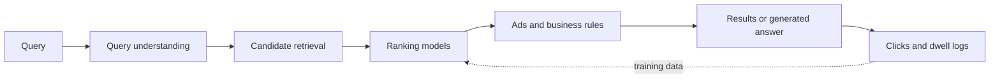

# Search Engines and Information Retrieval

A search engine finds the few documents, passages or items that answer a request among billions of candidates, and puts them in order. The same problem, predicting what a person wants and ranking items accordingly, sits behind recommendation feeds, advertising and, more recently, answer engines that write a reply with citations.

## Overview

Information retrieval (IR) is the field that studies this problem. Classical systems matched query words against an inverted index, a table that maps each word to the documents containing it, and scored the matches with hand-designed formulas such as BM25. Two developments changed the field. The first was learning to rank: ranking functions were fitted to relevance labels or to user clicks instead of being tuned by hand. The second was neural matching, which compares the meaning of a query with a document rather than only the words they share. Pretrained transformers later became the standard reranker, and language models now write answers over retrieved sources.

The objective differs by setting. Web search aims to satisfy an information need. Advertising and recommendation aim to predict whether a person will click, buy or watch, which is related to relevance but not identical to it. [Retrieval-Augmented Generation](../../engineering/rag/index.md) and [vector databases](../../engineering/vector-databases/index.md) already describe the building blocks of modern retrieval, so this page concentrates on ranking, query understanding and the products built on them.

## Key concepts

- **Query and document**: the request, and the item being ranked. Items may be web pages, passages, products, ads or videos.
- **Relevance judgement**: a human label for how well an item answers a query, often graded on a scale.
- **Click-through rate (CTR)**: the fraction of impressions that receive a click. Clicks are a noisy signal of relevance, because users click top positions more often whatever their quality. This is called position bias.
- **Two-stage ranking**: a cheap first stage selects hundreds or thousands of candidates from millions of items, and a costlier second stage orders them.
- **Pointwise, pairwise and listwise learning**: pointwise models predict a grade for each item, pairwise models learn which of two items should rank higher, and listwise models optimise a score defined on the whole list.
- **Query understanding**: the processing that interprets a request before retrieval, including spelling correction, segmentation, intent classification, entity recognition and query rewriting.
- **Evaluation**: offline metrics such as normalised discounted cumulative gain (nDCG), mean reciprocal rank (MRR) and precision at k are computed on labelled data. Online A/B tests measure what users actually do.

## How it works

Each stage has its own budget. Retrieval scans an index of millions or billions of items using inverted lists or approximate nearest-neighbour search. Ranking models score only the survivors, so they can afford to be far more expensive per item. Business rules and advertising auctions then mix organic and sponsored items. Logged feedback returns to training.

Learning to rank treats ordering as a learning problem. In the pointwise view, the model predicts a relevance grade for each item. In the pairwise view, which is the basis of [RankNet](ranknet/index.md), the model learns from pairs and is penalised whenever it places a less relevant item above a more relevant one. The listwise view optimises a measure defined on the whole list, such as nDCG, which needs an approximation because the measure is not smooth. Gradient-boosted tree ensembles, such as LambdaMART, were long among the strongest rankers for tabular features (Burges, 2010), and neural rankers now compete with them.

Neural retrieval replaces word overlap with learned representations. A dual encoder, as in [DSSM](dssm/index.md), encodes queries and documents separately and compares them with a similarity score, so documents can be indexed in advance. A cross-encoder reads the query and the document together. It is more accurate and much slower, which is why it reranks a short list; BERT rerankers are the standard example (Nogueira and Cho, 2019). Learned sparse methods such as SPLADE keep an inverted-index form while learning the term weights and expansions (Formal et al., 2021).

Generative answer engines add a final step. A retrieval system selects sources, and a language model writes an answer that cites them. This is the retrieval-augmented pattern. WebGPT (Nakano et al., 2021) trained GPT-3 to search and browse the web and to collect references for its answers. Whether the citations support the claims is a separate question. A 2023 human audit of four commercial generative search engines found that, on average, 51.5% of generated sentences were fully supported by their citations, and 74.5% of citations supported the sentence they were attached to (Liu et al., 2023).

Query understanding sits between the user and retrieval. The central problem is vocabulary mismatch: users and authors describe the same thing in different words. Query rewriting and expansion address it from the query side, and document expansion addresses it from the index side.

## Key methods

Three landmark methods cover the main families. Each has its own page.

| Method | Stage | Core idea | Page |
|---|---|---|---|
| RankNet (Burges et al., 2005) | Ranking | A neural network trained on pairs of items with a probabilistic pairwise cost | [RankNet](ranknet/index.md) |
| DSSM (Huang et al., 2013) | Retrieval and matching | Query and document networks map text into one space, trained on clicks | [DSSM](dssm/index.md) |
| Wide & Deep (Cheng et al., 2016) | Ads and recommendation | A linear model over feature crosses, trained jointly with a deep network | [Wide & Deep](wide-and-deep/index.md) |

The three address different stages. RankNet orders a candidate list, DSSM decides which candidates match a query by meaning, and Wide & Deep predicts clicks for ads and app recommendations.

## Connections

- **Building blocks.** [Retrieval-Augmented Generation](../../engineering/rag/index.md) uses retrieval to ground a language model, and [vector databases](../../engineering/vector-databases/index.md) store and search the embeddings.
- **Models.** Modern rerankers and answer engines are built on the [transformer](../../theory/models/transformer/index.md) and on [large language models](../../theory/models/llm/index.md).
- **Bandits.** A recommender must balance showing items known to work against trying new ones. The [contextual bandits](../../theory/paradigms/online/contextual-bandits/index.md) page describes that trade-off.
- **Brain and mind.** Human memory is also searched by cue rather than by address. The hippocampus is often described as a fast, content-addressable store, the analogy that the RAG page draws and that the [complementary learning systems](../../brain-mind/memory-learning/index.md) page explains in detail. A similar bias toward the top of a list is familiar from human attention, which is covered in the [attention](../../brain-mind/attention-brain-machine/index.md) pages.
- **Society.** Answer engines can repeat errors in a confident tone, which links to the [misinformation](../../society/misinformation/index.md) page. Retrieved web pages can carry hidden instructions that steer the model, see [indirect prompt injection](../../engineering/llm-security/indirect-prompt-injection.md). Ranking and advertising raise questions of [economics](../../society/economics/index.md), query logs raise [privacy](../../society/privacy/index.md) concerns, and publishers whose text feeds answers raise [copyright](../../society/copyright/index.md) questions.

## Applications

- **Web search.** Learning to rank, query understanding and answer engines are central to general web search, and the citation audit above applies directly to it.
- **Advertising.** Click prediction decides which ads are shown. Richardson et al. (2007) studied predicting click-through rates for new ads, where little click history exists. Wide & Deep was deployed in a commercial app store, and the Deep Interest Network (Zhou et al., 2017) was deployed in Alibaba's display advertising.
- **Recommendation.** Video, music, shopping and news feeds use two-stage pipelines like the one above. Covington et al. (2016) describe the candidate-generation and ranking networks used for YouTube recommendations.
- **Specialist search.** [Legal research](../law/index.md), literature search in [science](../science/index.md) and code search in [software development](../software/index.md) use the same pipeline over different collections.

## Open questions

- **Offline versus online.** In the Wide & Deep experiment, the offline AUC of the two models differed only slightly (0.726 for the wide-only control and 0.728 for Wide & Deep), while the online gain in app acquisitions was 3.9%. Metrics computed on fixed logs do not always predict behaviour in live traffic.
- **Whose objective.** Clicks and engagement are easier to measure than satisfaction. Optimising them can reward content that attracts attention rather than content that helps.
- **Feedback loops.** A ranker trained on clicks produced by its own earlier ranking learns mainly what it already shows. Exploration and counterfactual estimation try to break the loop, but they are costly.
- **Citation faithfulness.** Whether answer engines can cite accurately at scale, and how to define a supported claim, are still being measured.
- **Traffic and incentives.** If answers replace visits to source pages, the economic basis of the open web may change. This is unresolved.

## References

### Seminal papers

- Burges, C. et al. (2005). Learning to rank using gradient descent. ICML. https://doi.org/10.1145/1102351.1102363 — Introduces RankNet, a neural ranker trained with a probabilistic cost on pairs of documents.
- Joachims, T. (2002). Optimizing search engines using clickthrough data. KDD. https://doi.org/10.1145/775047.775067 — Shows how user clicks can be turned into pairwise preference data for training a ranking function.
- Huang, P.-S. et al. (2013). Learning deep structured semantic models for web search using clickthrough data. CIKM. https://doi.org/10.1145/2505515.2505665 — Trains query and document networks on clickthrough data so that clicked documents score higher in a shared semantic space.
- Formal, T. et al. (2021). SPLADE: Sparse lexical and expansion model for first stage ranking. https://arxiv.org/abs/2107.05720 — Learns sparse representations for queries and documents that can be served from an inverted index.
- Nogueira, R. & Cho, K. (2019). Passage re-ranking with BERT. https://arxiv.org/abs/1901.04085 — Applies BERT as a passage reranker and reports the top entry on the MS MARCO passage ranking leaderboard.
- Cheng, H.-T. et al. (2016). Wide & Deep learning for recommender systems. https://arxiv.org/abs/1606.07792 — Jointly trains a linear model over cross-product features and a deep network, deployed for app recommendations on Google Play.
- Richardson, M., Dominowska, E. & Ragno, R. (2007). Predicting clicks. WWW. https://doi.org/10.1145/1242572.1242643 — Estimates click-through rates for new sponsored-search ads, where little click history exists yet.
- Covington, P., Adams, J. & Sargin, E. (2016). Deep neural networks for YouTube recommendations. RecSys. https://doi.org/10.1145/2959100.2959190 — Describes two-stage candidate-generation and ranking networks for video recommendation at scale.
- Zhou, G. et al. (2017). Deep interest network for click-through rate prediction. https://arxiv.org/abs/1706.06978 — Uses attention over a user's past behaviour to build an interest vector for each candidate ad, deployed in Alibaba display advertising.
- Nakano, R. et al. (2021). WebGPT: Browser-assisted question-answering with human feedback. https://arxiv.org/abs/2112.09332 — Fine-tunes GPT-3 to search and browse the web, collect references, and answer long-form questions.

### Surveys and textbooks

- Liu, T.-Y. (2009). Learning to rank for information retrieval. Foundations and Trends in Information Retrieval. https://doi.org/10.1561/1500000016 — Survey that organises learning-to-rank methods into pointwise, pairwise and listwise approaches.
- Burges, C. J. C. (2010). From RankNet to LambdaRank to LambdaMART: An overview. Microsoft Research Technical Report MSR-TR-2010-82. https://www.microsoft.com/en-us/research/publication/from-ranknet-to-lambdarank-to-lambdamart-an-overview/ — Self-contained account of how RankNet became LambdaRank and LambdaMART, the boosted-tree ranker that won the 2010 Yahoo! Learning to Rank Challenge.
- Lin, J., Nogueira, R. & Yates, A. (2020). Pretrained transformers for text ranking: BERT and beyond. https://arxiv.org/abs/2010.06467 — Survey of transformer-based text ranking, covering rerankers and dense and sparse retrieval.

### Articles and documentation

- Liu, N. F., Zhang, T. & Liang, P. (2023). Evaluating verifiability in generative search engines. https://arxiv.org/abs/2304.09848 — Human audit of four generative search engines, measuring how often statements and their citations are supported.
