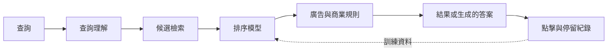

# 搜尋引擎與資訊檢索

搜尋引擎能從數十億個候選項目中，找出少數能回答請求的文件、段落或項目，並把它們排好順序。同一個問題——預測人們想要什麼，並據此為項目排序——也是推薦動態、廣告，以及近年來附上引用來源寫出答案的答案引擎背後的核心。

## 概述

資訊檢索（Information Retrieval, IR）是研究這個問題的領域。傳統系統把查詢的字詞與倒排索引比對；倒排索引是一張把每個字詞對應到含有該字詞之文件的表格。系統再以人工設計的公式（例如 BM25）為比對結果評分。這個領域有兩項重大發展。第一是學習排序：排序函數不再靠人工調整，而是依據相關性標籤或使用者點擊來擬合。第二是神經網路匹配，它比較的是查詢與文件的語意，而不只是兩者共享的字詞。之後，預訓練 Transformer 成為標準的重新排序器，如今語言模型則會根據檢索到的來源撰寫答案。

不同情境的排序目標並不相同。網頁搜尋的目標是滿足資訊需求。廣告與推薦的目標則是預測一個人會點擊、購買或觀看什麼，這與相關性有關，但並不等同。[檢索增強生成](../../engineering/rag/index.md)與[向量資料庫](../../engineering/vector-databases/index.md)已經介紹了現代檢索的基本組件，因此本頁聚焦在排序、查詢理解，以及建立在它們之上的產品。

## 關鍵概念

- **查詢與文件**：請求，以及被排序的項目。項目可以是網頁、段落、商品、廣告或影片。
- **相關性判斷**：人類對某個項目回答查詢之好壞所給的標籤，通常是分級的。
- **點擊率（CTR）**：收到點擊的曝光比例。點擊是相關性的雜訊信號，因為使用者不論品質如何，都較常點擊前面的位置。這稱為位置偏差。
- **兩階段排序**：第一階段以低成本從數百萬個項目中挑出數百到數千個候選，第二階段以較高成本為它們排序。
- **逐點、成對與逐列學習**：逐點模型為每個項目預測一個等級；成對模型學習兩個項目之中哪一個應排在前面；逐列模型則最佳化定義在整個清單上的分數。
- **查詢理解**：檢索之前解讀請求的處理過程，包括拼字校正、斷詞、意圖分類、實體辨識與查詢改寫。
- **評估**：離線指標如正規化折損累積增益（nDCG）、平均倒數排名（MRR）與前 k 名精確率，都在有標籤的資料上計算。線上 A/B 測試則衡量使用者實際的行為。

## 運作方式

每個階段都有自己的運算預算。檢索使用倒排列表或近似最近鄰搜尋，掃描數百萬或數十億個項目的索引。排序模型只為留下來的項目評分，因此每個項目可以承擔更高的成本。接著，商業規則與廣告競價會把自然結果與贊助項目混合在一起。記錄下來的回饋則回到訓練中。

學習排序把排序視為一個學習問題。在逐點的觀點中，模型為每個項目預測相關性等級。在成對的觀點中——也是 [RankNet](ranknet/index.md) 的基礎——模型從成對資料中學習，只要它把較不相關的項目排在較相關的項目之前，就會受到懲罰。逐列的觀點則最佳化定義在整個清單上的量，例如 nDCG；由於該量不平滑，需要近似或巧妙的梯度。梯度提升樹集成，例如 LambdaMART，多年來都是表格式特徵上最強的排序器之一（Burges, 2010），而神經網路排序器如今也能與之競爭。

神經網路檢索以學習到的表示取代字詞重疊。雙編碼器（如 [DSSM](dssm/index.md)）分別編碼查詢與文件，再以相似度分數比較，因此文件可以事先建立索引。交叉編碼器則同時讀取查詢與文件。它較為精準，但速度慢得多，因此只用來重新排序一份短清單；BERT 重新排序器是標準的例子（Nogueira and Cho, 2019）。SPLADE 等學習型稀疏方法則保留倒排索引的形式，同時學習詞項權重與擴充（Formal et al., 2021）。

生成式答案引擎會再加上最後一個步驟。檢索系統先選出來源，再由語言模型撰寫引用這些來源的答案。這就是檢索增強的模式。WebGPT（Nakano et al., 2021）訓練 GPT-3 去搜尋與瀏覽網頁，並為答案收集參考來源。但引用是否支持論述，又是另一個問題。2023 年一項對四個商用生成式搜尋引擎的人工稽核發現，平均只有 51.5% 的生成句子被其引用完整支持，而只有 74.5% 的引用支持它所附著的句子（Liu et al., 2023）。

查詢理解位於使用者與檢索之間。核心問題是詞彙不匹配：使用者與作者會以不同的字詞描述同一件事。查詢改寫與擴充從查詢端處理這個問題，文件擴充則從索引端處理。

## 關鍵方法

三個具代表性的方法涵蓋了主要的幾個系列，各自有獨立的頁面。

| 方法 | 階段 | 核心想法 | 頁面 |
|---|---|---|---|
| RankNet（Burges et al., 2005） | 排序 | 以機率式成對損失，在成對項目上訓練的神經網路 | [RankNet](ranknet/index.md) |
| DSSM（Huang et al., 2013） | 檢索與匹配 | 查詢與文件網路把文字映射到同一空間，以點擊資料訓練 | [DSSM](dssm/index.md) |
| Wide & Deep（Cheng et al., 2016） | 廣告與推薦 | 對特徵交叉做線性記憶，並與深層網路聯合訓練 | [Wide & Deep](wide-and-deep/index.md) |

三者處理的是不同階段。RankNet 為候選清單排序，DSSM 依語意決定哪些候選與查詢相符，Wide & Deep 則為廣告與應用程式推薦預測點擊。

## 相關連結

- **基本組件。**[檢索增強生成](../../engineering/rag/index.md)用檢索來為語言模型提供依據，[向量資料庫](../../engineering/vector-databases/index.md)則儲存並搜尋嵌入。
- **模型。**現代的重新排序器與答案引擎建立在 [Transformer](../../theory/models/transformer/index.md) 與[大型語言模型](../../theory/models/llm/index.md)之上。
- **賭博機。**推薦系統必須在展示已知有效的項目與嘗試新項目之間取得平衡。[上下文賭博機](../../theory/paradigms/online/contextual-bandits/index.md)頁面說明了這種取捨。
- **大腦與心智。**人類記憶也是靠線索而非位址來搜尋。海馬迴常被描述為快速、以內容定址的儲存區，這也是 RAG 頁面所引用的類比，[互補學習系統](../../brain-mind/memory-learning/index.md)頁面對此有詳細說明。人類注意力也有類似偏向清單頂端的傾向，相關內容見[注意力](../../brain-mind/attention-brain-machine/index.md)的頁面。
- **社會。**答案引擎可能以肯定的語氣重複錯誤，這與[不實資訊](../../society/misinformation/index.md)頁面相關。被檢索的網頁可能夾帶隱藏指令，引導模型的行為，請見[間接提示注入](../../engineering/llm-security/indirect-prompt-injection.md)。排序與廣告涉及[經濟](../../society/economics/index.md)問題，查詢紀錄涉及[隱私](../../society/privacy/index.md)問題，而其文字被用於答案的出版者則涉及[著作權](../../society/copyright/index.md)問題。

## 應用

- **網頁搜尋。**學習排序、查詢理解與答案引擎是一般網頁搜尋的核心，上述的引用稽核也直接適用於此。
- **廣告。**點擊預測決定顯示哪些廣告。Richardson et al.（2007）研究了為新廣告預測點擊率，這類廣告幾乎沒有點擊歷史。Wide & Deep 曾部署於商業應用程式商店，Deep Interest Network（Zhou et al., 2017）則部署於阿里巴巴的展示廣告系統。
- **推薦。**影片、音樂、購物與新聞動態都使用與上述類似的兩階段管線。Covington et al.（2016）描述了 YouTube 推薦所用的候選生成與排序網路。
- **專業搜尋。**[法律研究](../law/index.md)、[科學](../science/index.md)的文獻搜尋，以及[軟體開發](../software/index.md)中的程式碼搜尋，都在不同的語料上使用相同的管線。

## 開放問題

- **離線與線上。**在 Wide & Deep 的實驗中，兩個模型的離線 AUC 只有些微差異（對照的寬模型為 0.726，Wide & Deep 為 0.728），但應用程式安裝量的線上增益達 3.9%。在固定紀錄上計算的指標，並不總能預測即時流量中的行為。
- **誰的目標。**點擊與參與度比滿意度容易衡量。最佳化它們可能獎勵吸引注意的內容，而非真正有幫助的內容。
- **回饋迴路。**以自身先前排序所產生的點擊來訓練的排序器，主要學到的是它已經展示過的東西。探索與反事實估計試圖打破這個迴路，但成本不低。
- **引用的忠實度。**答案引擎能否大規模準確地引用，以及如何定義「被支持的論述」，目前仍在衡量中。
- **流量與誘因。**如果答案取代了對來源網頁的造訪，開放網路的經濟基礎可能會改變。這個問題尚無定論。

## 參考文獻

### 開創性論文

- Burges, C. et al. (2005). Learning to rank using gradient descent. ICML. https://doi.org/10.1145/1102351.1102363 — 提出 RankNet，一種以文件配對的機率式成本訓練的神經網路排序器。
- Joachims, T. (2002). Optimizing search engines using clickthrough data. KDD. https://doi.org/10.1145/775047.775067 — 說明如何把使用者點擊轉換為成對偏好資料，以訓練排序函數。
- Huang, P.-S. et al. (2013). Learning deep structured semantic models for web search using clickthrough data. CIKM. https://doi.org/10.1145/2505515.2505665 — 以點擊資料訓練查詢與文件網路，使被點擊的文件在共享的語意空間中得分較高。
- Formal, T. et al. (2021). SPLADE: Sparse lexical and expansion model for first stage ranking. https://arxiv.org/abs/2107.05720 — 學習可以由倒排索引提供服務的查詢與文件稀疏表示。
- Nogueira, R. & Cho, K. (2019). Passage re-ranking with BERT. https://arxiv.org/abs/1901.04085 — 把 BERT 用作段落重新排序器，並報告它在 MS MARCO 段落排序排行榜上名列第一。
- Cheng, H.-T. et al. (2016). Wide & Deep learning for recommender systems. https://arxiv.org/abs/1606.07792 — 聯合訓練作用於交叉乘積特徵的線性模型與深層網路，部署於 Google Play 的應用程式推薦。
- Nakano, R. et al. (2021). WebGPT: Browser-assisted question-answering with human feedback. https://arxiv.org/abs/2112.09332 — 微調 GPT-3 使其搜尋與瀏覽網頁、收集參考來源，並回答長篇問題。
- Richardson, M., Dominowska, E. & Ragno, R. (2007). Predicting clicks. WWW. https://doi.org/10.1145/1242572.1242643 — 為贊助搜尋中的新廣告估計點擊率，而這些廣告當時還沒有點擊歷史。
- Covington, P., Adams, J. & Sargin, E. (2016). Deep neural networks for YouTube recommendations. RecSys. https://doi.org/10.1145/2959100.2959190 — 說明大規模影片推薦中兩階段的候選生成與排序網路。
- Zhou, G. et al. (2017). Deep interest network for click-through rate prediction. https://arxiv.org/abs/1706.06978 — 以對使用者過去行為的注意力，為每個候選廣告建立興趣向量，部署於阿里巴巴的展示廣告。

### 綜述與教科書

- Liu, T.-Y. (2009). Learning to rank for information retrieval. Foundations and Trends in Information Retrieval. https://doi.org/10.1561/1500000016 — 綜述，把學習排序方法組織為逐點、成對與逐列三類。
- Burges, C. J. C. (2010). From RankNet to LambdaRank to LambdaMART: An overview. Microsoft Research Technical Report MSR-TR-2010-82. https://www.microsoft.com/en-us/research/publication/from-ranknet-to-lambdarank-to-lambdamart-an-overview/ — 完整說明 RankNet 如何發展為 LambdaRank 與基於樹的 LambdaMART，後者贏得 2010 年 Yahoo! Learning to Rank Challenge。
- Lin, J., Nogueira, R. & Yates, A. (2020). Pretrained transformers for text ranking: BERT and beyond. https://arxiv.org/abs/2010.06467 — 以 Transformer 為基礎的文字排序綜述，涵蓋重新排序器與密集、稀疏檢索。

### 文章與文件

- Liu, N. F., Zhang, T. & Liang, P. (2023). Evaluating verifiability in generative search engines. https://arxiv.org/abs/2304.09848 — 對四個生成式搜尋引擎進行人工稽核，衡量陳述與其引用被支持的比例。
