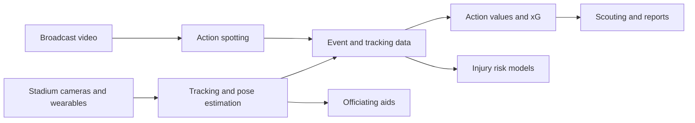

# Sports Analytics and Performance

Sports analytics uses data from cameras, wearable sensors and match logs to describe how players and teams perform, to predict injuries, to support scouting and broadcasting, and increasingly to check officials' decisions. Its methods range from simple counts of shots and passes to computer vision systems that estimate the position and posture of every athlete in every frame.

## Overview

Box scores and goal counts describe outcomes but say little about why they occurred. A pass that missed and a pass that was never attempted look alike in a season total. Since the 2010s, three sources of data have made finer analysis possible. Optical tracking systems installed in stadiums record the position of players and the ball many times a second. Wearable devices record loads, speeds and heart rates in training. Human annotators, or semi-automatic pipelines, label discrete events such as passes, tackles and shots across whole seasons.

Coaches, clubs, medical staff, broadcasters and officiating bodies all use these data, but they ask different questions and tolerate different error rates, and that difference shapes much of the field.

## Key concepts

- **Tracking data**: time-stamped positions of players and the ball, usually in pitch coordinates. Its raw form is a stream of coordinates; much of the work is in cleaning and interpreting it.
- **Event data**: a discrete log of actions, such as passes, shots and tackles, each with a time, a location and a label. Event data are coarser than tracking data but cover far more matches.
- **Pose estimation**: detecting the positions of body joints in an image or video. It turns video into a description of posture, which is used in biomechanics and motion analysis.
- **Expected goals (xG)**: the probability that a shot becomes a goal, estimated from features of the shot such as its distance, angle and the defensive setup. Summing the xG of a team's shots gives a measure of the chances it created, separate from the goals it scored by luck or finishing.
- **Action value**: an estimate of how much a single action changes a team's chance of scoring or conceding. Action-value models extend xG from shots to every kind of action.
- **Training load and injury risk**: the stress placed on the body by training and competition, and the statistical relation between that stress and injury.
- **Action spotting**: locating the time of a labelled event in a long broadcast video.

## How it works

Most sports analysis is a pipeline with three stages. The first stage turns sensor output into structured data. A computer vision system detects players and the ball in each frame, links detections into tracks and, where needed, estimates each player's pose. Wearables record accelerations and distances on the same time axis, and annotators add event labels to match video.

The second stage builds models on these data. Expected goals are usually estimated with a probabilistic classifier trained on past shots, and it is the simplest of the widely used value models. More general action-value models estimate how each on-the-ball action changes the chance that a team scores or concedes in the next few actions. Injury models use training and match loads, often over rolling windows, to estimate the probability of an injury in a coming period. These are supervised learning problems, and their outputs are probabilities, not verdicts.

The third stage turns model output into decisions such as a player valuation, a tactical report, a training change or a ruling. A model that ranks players well on past seasons may still mislead a club that uses it without understanding its limits.

## Key methods

Two landmark methods are summarised here. Each has its own page.

| Method | Problem | Core idea | Page |
|---|---|---|---|
| OpenPose (Cao et al., 2017) | Multi-person pose estimation from images | Bottom-up detection of joints, linked to people by part affinity fields | [OpenPose](openpose/index.md) |
| VAEP (Decroos et al., 2019) | Valuing every on-the-ball action in soccer | Estimates the change in the probability of scoring and conceding caused by each action | [VAEP](vaep/index.md) |

Pose estimation answers the question of where each body part of each athlete is. VAEP answers the question of what a single action was worth. Expected goals is the older and narrower relative of VAEP: it values only shots. Rathke (2017) examines expected goals and shot efficiency in soccer, the shot-based measure that action-value models later extended.

## Connections

- **Computer vision.** Detection, tracking and pose estimation are standard problems of [computer vision](../../theory/models/computer-vision/index.md), and [video models](../../theory/models/computer-vision/video/index.md) carry the same tools to frames over time. Players are small in broadcast video, occlude one another and move quickly, which makes sport a demanding test (Thomas et al., 2017).
- **Probability and calibration.** Expected goals and injury risks are probabilities. Their value depends on being calibrated, which is discussed in [probabilistic and Bayesian methods](../../theory/paradigms/probabilistic/index.md) and in [uncertainty and calibration](../../theory/machine-learning/uncertainty-and-calibration/index.md).
- **Evaluation.** The true value of an action is never observed, so player-value models are hard to check; see [evaluation and validation](../../theory/paradigms/supervised/evaluation-and-validation/index.md).
- **Brain and mind.** People are very good at reading other people's motion. Johansson (1973) showed that observers recognise human movement from a few points of light placed on the joints, and Blake and Shiffrar (2007) review how that perception supports the understanding of others' actions. Pose estimation attempts to give machines a similar ability. Motor skill, the way athletes learn to coordinate their bodies, is covered in [motor control](../../brain-mind/motor-control/index.md). Valuing an action by its expected outcome resembles the reward-prediction account in [decision and reward](../../brain-mind/decision-reward/index.md), although the analogy is loose.
- **Other applications.** The same tracking methods appear in [autonomous driving](../autonomous-driving/index.md) and [robotics](../robotics/index.md), and rare-failure prediction resembles [manufacturing](../manufacturing/index.md) maintenance.

## Applications

- **Tracking and tactics.** Clubs use tracking data to measure space, pressing and team shape, and Gudmundsson and Horton (2017) survey the methods for doing so.
- **Broadcast and video.** Broadcasters and analysts use automatic detection to find events in match video. SoccerNet is a benchmark of broadcast soccer video with annotated events, built to test action spotting at scale (Giancola et al., 2018).[^1] A later version adds further tasks (Deliège et al., 2020).
- **Scouting and recruitment.** Event data let analysts compare players across leagues. VAEP was used in use cases on scouting and playing style in top European competitions, and PlayeRank ranked players by role and compared its ratings with scouts' evaluations (Decroos et al., 2019; Pappalardo et al., 2019). A public dataset of match events lets other researchers test such methods (Pappalardo et al., 2019).
- **Injury prediction.** Rossi et al. (2018) used GPS training data and machine learning to forecast injuries in a soccer squad. Prediction studies are usually paired with work on injury mechanisms, which explains how injuries happen (Bahr and Krosshaug, 2005). The link between training load and injury is contested. Gabbett (2016) describes a paradox in which training can both protect against injury and cause it.
- **Officiating.** Video assistant referee systems review contested decisions from several camera angles. Held et al. (2024) propose a semi-automated system that classifies fouls from multi-view video and reports that it recognises the type of foul in about half of the test cases.[^2] Desai (2025) proposes detecting offside from a single broadcast camera, as a lower-cost alternative to multi-camera systems.

## Open questions

- **Event data quality.** Action values depend on how events are labelled. Different providers define actions differently, and errors in the labels pass into every value.
- **Ground truth.** There is no observed value for a pass or a tackle, so models are judged by proxies such as the agreement with scouts or with later outcomes.
- **Injury prediction.** Injuries are rare, so models face strong class imbalance, and the link between load measures and injury is still disputed.
- **Off-ball value.** Most value models score the player who touches the ball. Valuing movement without the ball, which is much of football, needs tracking data and remains hard.
- **Privacy and data ownership.** Tracking data about athletes raise questions about consent, the use of health data and who may sell or analyse it, which are discussed in [surveillance](../../society/surveillance/index.md) and [ethics and fairness](../../society/ethics/index.md).
- **Automated decisions.** Automatic officiating promises consistency, but errors in close calls are costly, and the human role in review is unsettled.

[^1]: The arXiv abstract of Giancola et al. (2018) reports 500 complete matches from six European leagues, covering 764 hours of video.
[^2]: The arXiv abstract of Held et al. (2024) reports that the system recognises the foul type in 50% of instances and the sanction in 46%, for the SoccerNet-MVFoul dataset.

## References

### Seminal papers

- Cao, Z. et al. (2017). Realtime multi-person 2D pose estimation using part affinity fields. *CVPR*. https://doi.org/10.1109/CVPR.2017.143 — Introduces part affinity fields for linking body joints to people in real time, the basis of OpenPose.
- Johansson, G. (1973). Visual perception of biological motion and a model for its analysis. *Perception & Psychophysics*. https://doi.org/10.3758/BF03212378 — Shows that observers recognise human motion from a few points of light placed on the joints.
- Decroos, T. et al. (2019). Actions speak louder than goals: valuing player actions in soccer. *KDD*. https://doi.org/10.1145/3292500.3330758 — Proposes VAEP, a framework that values each on-the-ball soccer action by its effect on scoring and conceding.
- Rossi, A. et al. (2018). Effective injury forecasting in soccer with GPS training data and machine learning. *PLOS ONE*. https://doi.org/10.1371/journal.pone.0201264 — Uses GPS-based training data and machine learning to forecast injuries in a professional soccer squad.
- Giancola, S. et al. (2018). SoccerNet: a scalable dataset for action spotting in soccer videos. *CVPRW*. https://doi.org/10.1109/CVPRW.2018.00223 — Introduces a large benchmark of annotated broadcast soccer matches for finding events in video.
- Stein, M. et al. (2018). Bring it to the pitch: combining video and movement data to enhance team sport analysis. *IEEE Transactions on Visualization and Computer Graphics*. https://doi.org/10.1109/TVCG.2017.2745181 — Describes a visual analytics system that links match footage with plots of extracted player trajectories, tested with analysts.

### Surveys and textbooks

- Gudmundsson, J. & Horton, M. (2017). Spatio-temporal analysis of team sports. *ACM Computing Surveys*. https://doi.org/10.1145/3054132 — Surveys methods for analysing the movement of players and teams in invasion sports from tracking data.
- Thomas, G. et al. (2017). Computer vision for sports: current applications and research topics. *Computer Vision and Image Understanding*. https://doi.org/10.1016/j.cviu.2017.04.011 — Reviews computer vision applications in sport, including broadcast production, player tracking and officiating.
- Blake, R. & Shiffrar, M. (2007). Perception of human motion. *Annual Review of Psychology*. https://doi.org/10.1146/annurev.psych.57.102904.190152 — Reviews how people perceive the movements and actions of others, from biological motion to social perception.
- Bahr, R. & Krosshaug, T. (2005). Understanding injury mechanisms: a key component of preventing injuries in sport. *British Journal of Sports Medicine*. https://doi.org/10.1136/bjsm.2005.018341 — Argues that injury prevention depends on understanding how injuries happen, and sets out a framework for injury mechanisms.
- Gabbett, T. J. (2016). The training-injury prevention paradox: should athletes be training smarter and harder? *British Journal of Sports Medicine*. https://doi.org/10.1136/bjsports-2015-095788 — Discusses how training load can both protect against and cause injury, and how to balance the two.

### Articles and documentation

- Rathke, A. (2017). An examination of expected goals and shot efficiency in soccer. *Journal of Human Sport and Exercise*. https://doi.org/10.14198/jhse.2017.12.Proc2.05 — Examines expected goals as a measure of chances created and how it relates to shot efficiency in soccer.
- Pappalardo, L. et al. (2019). PlayeRank: data-driven performance evaluation and player ranking in soccer via a machine learning approach. *ACM Transactions on Intelligent Systems and Technology*. https://doi.org/10.1145/3343172 — Ranks soccer players by role using millions of match events and compares the ranking with scouts' evaluations.
- Pappalardo, L. et al. (2019). A public data set of spatio-temporal match events in soccer competitions. *Scientific Data*. https://doi.org/10.1038/s41597-019-0247-7 — Releases a public dataset of spatio-temporal match events from soccer competitions for research use.
- Deliège, A. et al. (2020). SoccerNet-v2: a dataset and benchmarks for holistic understanding of broadcast soccer videos. arXiv. https://arxiv.org/abs/2011.13367 — Extends the SoccerNet benchmark with more annotations and tasks for understanding broadcast soccer video.
- Held, J. et al. (2024). Towards AI-powered video assistant referee system (VARS) for association football. arXiv. https://arxiv.org/abs/2407.12483 — Presents a semi-automated multi-view system for classifying fouls and their sanctions in football, compared with human performance on the same task.
- Desai, S. (2025). Real time offside detection using a single camera in soccer. arXiv. https://arxiv.org/abs/2502.16030 — Proposes offside detection from one broadcast camera using image processing, as a lower-cost alternative to multi-camera systems.
