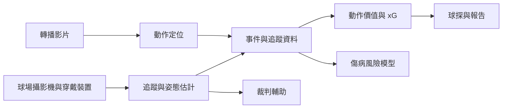

# 運動分析與表現

運動分析利用來自攝影機、穿戴式感測器與比賽紀錄的資料，描述球員與球隊的表現，預測傷病，支援球探與轉播工作，近年來也越來越多地用來檢視裁判的判決。它的方法從簡單的射門與傳球次數統計，一直到能在每一幀畫面中估計每位運動員位置與姿態的電腦視覺系統。

## 概述

比賽數據表與進球數描述的是結果，卻很少說明結果為何發生。一次傳丟的傳球與一次根本沒有嘗試的傳球，在整季的總數中看起來可能完全相同。2010 年代以來，有三種資料來源讓更細緻的分析成為可能。安裝在球場中的光學追蹤系統，每秒可記錄球員與球的位置許多次。穿戴式裝置則記錄訓練中的負荷、速度與心率。人工標註者，或半自動化的流程，則在整季的比賽中為傳球、抄截與射門等離散事件加上標籤。

教練、俱樂部、醫療團隊、轉播單位與裁判機構都會使用這些資料，但他們提出的問題不同，能容忍的誤差率也不同，而這種差異塑造了這個領域的大部分面貌。

## 關鍵概念

- **追蹤資料（tracking data）**：球員與球在時間上標記的位置，通常以球場座標表示。原始形式是一連串座標，大部分工作在於清理與解讀這些資料。
- **事件資料（event data）**：傳球、射門、抄截等動作的離散紀錄，每筆都有時間、位置與標籤。事件資料比追蹤資料粗略，但涵蓋的場次多得多。
- **姿態估計（pose estimation）**：在影像或影片中偵測身體關節的位置。它把影片轉換為對姿勢的描述，用於生物力學與動作分析。
- **期望進球（expected goals, xG）**：一次射門成為進球的機率，依射門的特徵估計，例如距離、角度與防守陣型。把某隊所有射門的 xG 加總，可以衡量它創造的得分機會，並與因運氣或射門效率而得到的進球區分開來。
- **動作價值（action value）**：估計單一動作如何改變球隊得分或失球的機會。動作價值模型把 xG 的概念從射門延伸到所有類型的動作。
- **訓練負荷與傷病風險**：訓練與比賽對身體造成的壓力，以及這種壓力與傷病之間的統計關係。
- **動作定位（action spotting）**：在一段長的轉播影片中，找出某個已標記事件發生的時間點。

## 運作方式

大部分的運動分析是一條包含三個階段的流程。第一階段把感測器的輸出轉換為結構化資料。電腦視覺系統在每一幀中偵測球員與球，把偵測結果串連成軌跡，並在需要時估計每位球員的姿態。穿戴裝置記錄加速度與距離，並與同一條時間軸對齊；標註者則為影片加上事件標籤。

第二階段在這些資料上建立模型。期望進球通常以在過去射門上訓練的機率分類器估計，它是最簡單、也最被廣泛使用的價值模型。較一般的動作價值模型則估計每一次在球動作，如何改變球隊在接下來幾個動作中得分或失球的機會。傷病模型利用訓練與比賽負荷，常以滾動的時間窗口估計未來一段期間發生傷病的機率。這些都是監督式學習問題，而它們的輸出是機率，而不是定論。

第三階段把模型輸出轉換為決策，例如球員評價、戰術報告、訓練調整或判決。在過去賽季排名很好的模型，若俱樂部在不了解其限制的情況下使用，仍可能造成誤導。

## 關鍵方法

這裡摘要介紹兩種里程碑式的方法，每一種都有自己的頁面。

| 方法 | 所解決的問題 | 核心想法 | 頁面 |
|---|---|---|---|
| OpenPose（Cao 等人，2017） | 從影像進行多人姿態估計 | 由下而上偵測關節，並以部位親和場將關節連到各人身上 | [OpenPose](openpose/index.md) |
| VAEP（Decroos 等人，2019） | 為足球中每一次在球動作評定價值 | 估計每次動作所造成的得分與失球機率變化 | [VAEP](vaep/index.md) |

姿態估計回答的是每位運動員身體各部位在哪裡的問題。VAEP 回答的則是單一動作的價值。期望進球是 VAEP 較早、範圍較窄的前身：它只為射門評價。Rathke（2017）檢視了足球中的期望進球與射門效率，這是動作價值模型後來所延伸的、以射門為基礎的衡量方式。

## 相關連結

- **電腦視覺。** 偵測、追蹤與姿態估計是[電腦視覺](../../theory/models/computer-vision/index.md)的標準問題，而[影片模型](../../theory/models/computer-vision/video/index.md)則把同樣的工具延伸到隨時間變化的畫面。在轉播影片中，球員體積小、彼此遮擋且移動迅速，使運動成為一項困難的測試（Thomas 等人，2017）。
- **機率與校準。** 期望進球與傷病風險都是機率。它們的價值取決於是否經過校準，這在[機率與貝氏方法](../../theory/probabilistic/index.md)以及[不確定性與校準](../../theory/machine-learning/uncertainty-and-calibration/index.md)中有所討論。
- **評估。** 動作的真實價值從來不會被觀測到，因此球員價值模型很難檢驗；參見[評估與驗證](../../theory/paradigms/supervised/evaluation-and-validation/index.md)。
- **大腦與心智。** 人類非常擅長讀取他人的動作。Johansson（1973）顯示，觀察者只需看見關節上幾個發光點，就能辨識人的動作；Blake 與 Shiffrar（2007）則回顧了這種知覺如何支撐我們對他人行動的理解。姿態估計試圖讓機器具備類似的能力。運動技能，也就是運動員如何學會協調身體，在[運動控制](../../brain-mind/motor-control/index.md)中有所說明。以預期結果來評估一個動作，類似於[決策與獎賞](../../brain-mind/decision-reward/index.md)中的獎賞預測理論，不過這個類比只是粗略的。
- **其他應用。** 同樣的追蹤方法也出現在[自動駕駛](../autonomous-driving/index.md)與[機器人](../robotics/index.md)中，而罕見故障的預測則與[製造](../manufacturing/index.md)的維護相似。

## 應用

- **追蹤與戰術。** 俱樂部利用追蹤資料衡量空間、逼搶與球隊陣型，Gudmundsson 與 Horton（2017）則綜述了進行這類分析的方法。
- **轉播與影片。** 轉播單位與分析師使用自動偵測在比賽影片中找出事件。SoccerNet 是一套具有事件標註的轉播足球影片基準，用來大規模測試動作定位（Giancola 等人，2018）。[^1] 後續版本增加了更多任務（Deliège 等人，2020）。
- **球探與球員發掘。** 事件資料讓分析師能跨聯賽比較球員。VAEP 在歐洲頂級賽事中，被用於球探與踢球風格的案例；PlayeRank 則依球員位置為其排名，並將評分與球探的評價相比較（Decroos 等人，2019；Pappalardo 等人，2019）。一套公開的比賽事件資料集讓其他研究者也能測試這類方法（Pappalardo 等人，2019）。
- **傷病預測。** Rossi 等人（2018）利用 GPS 訓練資料與機器學習，預測職業足球隊中的傷病。預測研究通常會與傷病機制的研究並行，後者說明傷病如何發生（Bahr 與 Krosshaug，2005）。訓練負荷與傷病之間的關係仍有爭議。Gabbett（2016）描述了一種悖論：訓練既可能預防傷病，也可能造成傷病。
- **裁判。** 影像輔助裁判系統會從數個鏡位檢視有爭議的判決。Held 等人（2024）提出一套半自動系統，從多視角影片中判斷犯規類型，並報告它在測試案例中約有一半能正確辨識犯規的類型。[^2] Desai（2025）則提出以單一轉播攝影機偵測越位，作為多攝影機系統的低成本替代方案。

## 開放問題

- **事件資料的品質。** 動作價值取決於事件如何標註。不同的資料供應商對動作的定義不同，標籤中的錯誤會傳遞到每一個價值。
- **真實值（ground truth）。** 傳球或抄截並沒有可觀測的真實價值，因此模型只能以替代指標來評斷，例如與球探評價的一致程度，或與之後結果的吻合程度。
- **傷病預測。** 傷病很罕見，因此模型面臨嚴重的類別不平衡問題，而負荷指標與傷病之間的關係仍有爭議。
- **無球價值。** 大多數價值模型只評價碰到球的球員。要評價沒有球時的移動，例如佔足球比賽大部分時間的跑位，需要追蹤資料，而且仍然困難。
- **隱私與資料所有權。** 有關運動員的追蹤資料引發了同意、健康資料的使用，以及誰可以販售或分析這些資料的問題，這些議題在[監控](../../society/surveillance/index.md)與[倫理與公平](../../society/ethics/index.md)中有所討論。
- **自動化判決。** 自動化裁判承諾一致性，但在接近的判決中出錯代價高昂，而審查中人類的角色仍未有定論。

## 參考文獻

### 開創性論文

- Cao, Z. 等人（2017）。Realtime multi-person 2D pose estimation using part affinity fields。*CVPR*。https://doi.org/10.1109/CVPR.2017.143 — 提出部位親和場，以即時方式把身體關節連結到各人身上，是 OpenPose 的基礎。
- Johansson, G.（1973）。Visual perception of biological motion and a model for its analysis。*Perception & Psychophysics*。https://doi.org/10.3758/BF03212378 — 顯示觀察者能從關節上幾個發光點辨識人體的動作。
- Decroos, T. 等人（2019）。Actions speak louder than goals: valuing player actions in soccer。*KDD*。https://doi.org/10.1145/3292500.3330758 — 提出 VAEP，依每一次足球在球動作對得分與失球的影響為其評定價值。
- Rossi, A. 等人（2018）。Effective injury forecasting in soccer with GPS training data and machine learning。*PLOS ONE*。https://doi.org/10.1371/journal.pone.0201264 — 利用以 GPS 為基礎的訓練資料與機器學習，預測一支職業足球隊的傷病。
- Giancola, S. 等人（2018）。SoccerNet: a scalable dataset for action spotting in soccer videos。*CVPRW*。https://doi.org/10.1109/CVPRW.2018.00223 — 提出一套規模龐大、附有標註的轉播足球比賽基準，用來在影片中找出事件。
- Stein, M. 等人（2018）。Bring it to the pitch: combining video and movement data to enhance team sport analysis。*IEEE Transactions on Visualization and Computer Graphics*。https://doi.org/10.1109/TVCG.2017.2745181 — 描述一套視覺分析系統，把比賽影像與萃取出的球員軌跡圖連結在一起，並與分析師一同測試。

### 綜述與教科書

- Gudmundsson, J. 與 Horton, M.（2017）。Spatio-temporal analysis of team sports。*ACM Computing Surveys*。https://doi.org/10.1145/3054132 — 綜述以追蹤資料分析進攻型團隊運動中球員與球隊移動的方法。
- Thomas, G. 等人（2017）。Computer vision for sports: current applications and research topics。*Computer Vision and Image Understanding*。https://doi.org/10.1016/j.cviu.2017.04.011 — 回顧電腦視覺在運動中的應用，包括轉播製作、球員追蹤與裁判工作。
- Blake, R. 與 Shiffrar, M.（2007）。Perception of human motion。*Annual Review of Psychology*。https://doi.org/10.1146/annurev.psych.57.102904.190152 — 回顧人們如何知覺他人的動作與行為，從生物運動到社會知覺。
- Bahr, R. 與 Krosshaug, T.（2005）。Understanding injury mechanisms: a key component of preventing injuries in sport。*British Journal of Sports Medicine*。https://doi.org/10.1136/bjsm.2005.018341 — 主張傷病預防有賴於理解傷病如何發生，並提出傷病機制的架構。
- Gabbett, T. J.（2016）。The training-injury prevention paradox: should athletes be training smarter and harder?。*British Journal of Sports Medicine*。https://doi.org/10.1136/bjsports-2015-095788 — 討論訓練負荷如何既能預防傷病，又可能造成傷病，以及如何在兩者之間取得平衡。

### 文章與文件

- Rathke, A.（2017）。An examination of expected goals and shot efficiency in soccer。*Journal of Human Sport and Exercise*。https://doi.org/10.14198/jhse.2017.12.Proc2.05 — 把期望進球當作衡量創造機會的指標來檢視，並分析它與足球射門效率的關係。
- Pappalardo, L. 等人（2019）。PlayeRank: data-driven performance evaluation and player ranking in soccer via a machine learning approach。*ACM Transactions on Intelligent Systems and Technology*。https://doi.org/10.1145/3343172 — 利用數百萬筆比賽事件，依位置為足球員排名，並將排名與球探的評價相比較。
- Pappalardo, L. 等人（2019）。A public data set of spatio-temporal match events in soccer competitions。*Scientific Data*。https://doi.org/10.1038/s41597-019-0247-7 — 為研究用途公開足球比賽中具時空資訊的比賽事件資料集。
- Deliège, A. 等人（2020）。SoccerNet-v2: a dataset and benchmarks for holistic understanding of broadcast soccer videos。arXiv。https://arxiv.org/abs/2011.13367 — 以更多標註與任務擴充 SoccerNet 基準，用於整體理解轉播足球影片。
- Held, J. 等人（2024）。Towards AI-powered video assistant referee system (VARS) for association football。arXiv。https://arxiv.org/abs/2407.12483 — 提出一套半自動的多視角系統，用於判斷足球犯規與其處罰，並與人類裁判的表現相比較。
- Desai, S.（2025）。Real time offside detection using a single camera in soccer。arXiv。https://arxiv.org/abs/2502.16030 — 提出以單一轉播攝影機、利用影像處理偵測越位的方法，作為多攝影機系統的低成本替代方案。

[^1]: Giancola 等人（2018）的 arXiv 摘要報告了來自六個歐洲聯賽、共 500 場完整比賽，總計 764 小時的影片。
[^2]: Held 等人（2024）的 arXiv 摘要報告，在 SoccerNet-MVFoul 資料集上，該系統辨識犯規類型的正確率為 50%，判處的處罰則為 46%。
