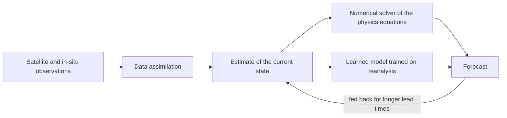

# Weather Forecasting and Earth Observation

Weather forecasting and Earth observation are two sides of one question: what is the state of the planet now, and how will it change? This page covers machine learning for medium-range weather forecasting and for interpreting satellite and other remote-sensing data. Reducing emissions is a separate topic, covered on the [Climate & Energy](../climate-energy/index.md) page.

## Overview

Weather prediction has been a computational problem since the first numerical models of the atmosphere. Operational forecasting centres run *numerical weather prediction* (NWP) systems. These represent the atmosphere on a grid, step its physical equations forward in time, and start each run from an estimate of the current state built by combining observations with a short forecast. Bauer, Thorpe and Brunet (2015) review how these systems improved over decades through better models, more observations, better data assimilation and more computing.

Earth observation covers the other half of the problem. Satellites, aircraft and ground sensors measure land, ocean and atmosphere, and the measurements become maps of land cover, crop type, floods and building damage. In forecasting, learned models trained on decades of archived weather data now match or exceed the best NWP systems on many medium-range scores, while producing a 10-day forecast in about a minute on one accelerator. In observation, neural networks classify and segment imagery at a scale that manual interpretation cannot reach.

## Key concepts

- **Numerical weather prediction (NWP)**: forecasting by solving the equations of atmospheric physics numerically on a grid. It is the reference method against which AI forecasts are judged.
- **Data assimilation**: the procedure that merges a short forecast with new observations to estimate the atmospheric state from which the next forecast starts.
- **Reanalysis**: a consistent reconstruction of past weather, produced by running a fixed forecasting system with data assimilation over decades. ERA5 (Hersbach et al., 2020) is the reanalysis that most learned forecasting models are trained on.
- **Lead time and medium range**: the lead time is the gap between the start of a forecast and the time it predicts. Medium-range forecasts cover roughly the next two weeks.
- **Autoregressive rollout**: running a model on its own output to reach longer lead times, one time step at a time.
- **Ensemble forecast**: many forecasts from slightly different starting states. Together they describe the range of likely outcomes rather than a single prediction.
- **Nowcasting**: very short-range forecasting, usually from radar or satellite data, covering the next few hours.
- **Remote sensing and multispectral imagery**: measuring the Earth from a distance, typically from satellites, with sensors that record reflected sunlight, emitted heat or radar echoes. Multispectral imagery records several wavelength bands, not only visible colour.

## How it works

Both families of method turn a current atmospheric state into a future one. They differ in how the transition is computed.

In NWP the transition comes from a numerical solver run on a supercomputer, at a cost that rises steeply with resolution. A learned forecaster replaces the solver with a function fitted to historical data. GraphCast, for example, takes the current state and the state six hours earlier, both on a 0.25-degree latitude–longitude grid, and predicts the state six hours ahead. Feeding its output back in produces a forecast of up to 10 days. Its training error is averaged over several autoregressive steps, which rewards accuracy over time and so helps at longer lead times.[^1] Pangu-Weather uses a three-dimensional transformer and trains separate models for several lead times.

Earth-observation models work on image-like data instead. Because labelled imagery is expensive, many systems are first pretrained on large unlabelled archives with self-supervised objectives, such as hiding part of the input and predicting it ([masked prediction](../../theory/paradigms/self-supervised/masked-prediction/index.md)). SatMAE adapted this masked-autoencoder approach to satellite imagery, masking patches across time and across spectral bands (Cong et al., 2022). Prithvi was pretrained on more than a terabyte of multispectral imagery and then fine-tuned for several Earth-observation tasks (Jakubik et al., 2023).

## Key methods

Two landmark forecasting systems show the main approaches. Each has its own page.

| Method | Venue | Architecture | Output |
|---|---|---|---|
| [GraphCast](graphcast/index.md) | *Science*, 2023 | Encoder–processor–decoder graph neural network on a multi-mesh covering the globe | Deterministic forecasts to 10 days at 0.25° |
| [Pangu-Weather](pangu-weather/index.md) | *Nature*, 2023 | 3D Earth-Specific Transformer over pressure levels, with separate models for several lead times | Deterministic forecasts to one week; ensemble use also reported |

Other systems in the same family are discussed in the text: GenCast, a probabilistic model that produces ensembles (Price et al., 2024); FourCastNet, which uses adaptive Fourier neural operators (Pathak et al., 2022); NeuralGCM, which combines a differentiable atmospheric solver with learned components (Kochkov et al., 2024); and Aurora, a large foundation model for the Earth system (Bodnar et al., 2024).

## Connections

- **Brain and mind.** Clark (2013) summarises the view that the brain is a prediction machine, matching sensory input against top-down expectations and correcting the mismatch with prediction error. Forecasting is a formal example of predicting a dynamical system from an imperfect estimate of its state. That shared mathematics says nothing about whether the brain uses weather-like models; it is a common problem, not a common mechanism. See [Predictive Coding](../../brain-mind/predictive-coding/index.md).
- **Architectures.** GraphCast relies on message passing over a graph ([Graph Neural Networks](../../theory/models/gnn/index.md)). Pangu-Weather adapts the vision transformer, with windowed attention ([Vision Transformer](../../theory/models/transformer/vision-transformer/index.md)). Satellite models draw on [Computer Vision](../../theory/models/computer-vision/index.md) methods.
- **Uncertainty.** Forecasts that describe a range of outcomes connect to [Generative Models](../../theory/generative/index.md) and to [Uncertainty Quantification and Calibration](../../theory/machine-learning/uncertainty-and-calibration/index.md).
- **Distribution shift.** A model trained on one period may fail in another climate regime, and satellite sensors change between missions and seasons. See [Domain Adaptation](../../theory/paradigms/transfer/domain-adaptation/index.md).
- **Science and climate.** Forecasting models act as fast surrogates for expensive simulations; see [Scientific Discovery](../science/index.md). Emissions and mitigation are on the [Climate & Energy](../climate-energy/index.md) page, and crop mapping on the [Agriculture & Food](../agriculture/index.md) page.

## Applications

- **Medium-range forecasting.** Learned models are compared against operational forecasts such as ECMWF's. GraphCast and Pangu-Weather both report scores at or above the operational deterministic forecast, on evaluation sets their authors chose; the method pages give the figures.[^2]
- **Tropical cyclones and extreme events.** GraphCast and Pangu-Weather were both evaluated on tropical cyclone tracks. GraphCast's authors also report better prediction of atmospheric rivers and extreme temperatures.
- **Precipitation nowcasting.** Ravuri et al. (2021) trained a deep generative model on radar and reported better forecast quality, consistency and value than earlier methods.
- **Flood forecasting.** Nearing et al. (2024) report AI forecasts of extreme river floods in basins without streamflow gauges, with reliability similar to or better than nowcasts from a state-of-the-art global flood system, at lead times up to five days.[^3]
- **Land cover and crops.** Kussul et al. (2017) apply deep learning to classify land cover and crop types from remote-sensing data.
- **Disaster damage mapping.** The xBD dataset (Gupta et al., 2019) provides labelled satellite imagery of buildings before and after disasters, to support automated damage assessment for disaster response.

## Open questions

- **Uncertainty.** A model trained with a mean-squared-error objective tends to blur its forecasts at long lead times, which hides the spread of possible outcomes. Probabilistic models such as GenCast are one answer, but how well they represent rare events is still being tested.
- **Extremes.** Pangu-Weather's preprint notes that predicted tropical cyclone intensities were often too weak, while track errors were reasonable. Whether learned models can forecast intensity reliably is open.
- **Dependence on reanalysis.** Models are trained and scored against reanalysis, which is itself a model product. Whether skill measured against reanalysis carries over to operational forecasts is a central question.
- **Physical consistency.** Purely learned models do not conserve physical quantities by design. Hybrid models such as NeuralGCM are one response.
- **Labels for Earth observation.** Labels for disasters, crops and land use are expensive and local. Pretrained foundation models reduce the labels needed, but they must generalise across sensors, regions and seasons.
- **Evaluation.** Shared benchmarks such as WeatherBench 2 standardise the scores (Rasp et al., 2023), but the choice of metrics and baselines still shapes the conclusions.

## References

### Seminal papers

- Bauer, P., Thorpe, A. & Brunet, G. (2015). *The quiet revolution of numerical weather prediction*. Nature. https://doi.org/10.1038/nature14956 — Review of how numerical weather prediction improved through better models, observations, assimilation and computing.
- Lam, R. et al. (2023). *Learning skillful medium-range global weather forecasting*. Science. https://doi.org/10.1126/science.adi2336 — Introduces GraphCast, a graph neural network that forecasts global weather ten days ahead.
- Bi, K. et al. (2023). *Accurate medium-range global weather forecasting with 3D neural networks*. Nature. https://doi.org/10.1038/s41586-023-06185-3 — Introduces Pangu-Weather, a three-dimensional transformer with hierarchical temporal aggregation for global forecasts.
- Price, I. et al. (2024). *Probabilistic weather forecasting with machine learning*. Nature. https://doi.org/10.1038/s41586-024-08252-9 — Introduces GenCast, a probabilistic model that produces ensembles of medium-range forecasts.
- Ravuri, S. et al. (2021). *Skilful precipitation nowcasting using deep generative models of radar*. Nature. https://doi.org/10.1038/s41586-021-03854-z — Deep generative model that nowcasts precipitation from radar and is evaluated for forecast quality and value.
- Nearing, G. et al. (2024). *Global prediction of extreme floods in ungauged watersheds*. Nature. https://doi.org/10.1038/s41586-024-07145-1 — AI-based flood forecasts for river basins that have no streamflow gauges.
- Cong, Y. et al. (2022). *SatMAE: Pre-training Transformers for Temporal and Multi-Spectral Satellite Imagery*. arXiv. https://arxiv.org/abs/2207.08051 — Masked-autoencoder pretraining for satellite image series and spectral bands.
- Jakubik, J. et al. (2023). *Foundation Models for Generalist Geospatial Artificial Intelligence*. arXiv. https://arxiv.org/abs/2310.18660 — Prithvi, a transformer pretrained on satellite imagery for Earth-observation tasks.
- Kussul, N. et al. (2017). *Deep Learning Classification of Land Cover and Crop Types Using Remote Sensing Data*. IEEE Geoscience and Remote Sensing Letters. https://doi.org/10.1109/LGRS.2017.2681128 — Applies deep networks to map land cover and crop types from satellite data.
- Gupta, R. et al. (2019). *xBD: A Dataset for Assessing Building Damage from Satellite Imagery*. arXiv. https://arxiv.org/abs/1911.09296 — Labelled satellite images of buildings before and after disasters.
- Kochkov, D. et al. (2024). *Neural general circulation models for weather and climate*. Nature. https://doi.org/10.1038/s41586-024-07744-y — Hybrid model pairing a differentiable atmospheric solver with machine-learning components.

### Surveys and textbooks

- Clark, A. (2013). *Whatever next? Predictive brains, situated agents, and the future of cognitive science*. Behavioral and Brain Sciences. https://doi.org/10.1017/S0140525X12000477 — Target article on the view that brains predict sensory input and minimise prediction error.

### Articles and documentation

- Hersbach, H. et al. (2020). *The ERA5 global reanalysis*. Quarterly Journal of the Royal Meteorological Society. https://doi.org/10.1002/qj.3803 — Describes ERA5, the reanalysis that most learned forecasting models train on.
- Pathak, J. et al. (2022). *FourCastNet: A Global Data-driven High-resolution Weather Model using Adaptive Fourier Neural Operators*. arXiv. https://arxiv.org/abs/2202.11214 — Global data-driven forecasting model that uses Fourier neural operators.
- Bodnar, C. et al. (2024). *A Foundation Model for the Earth System*. arXiv. https://arxiv.org/abs/2405.13063 — Aurora, a foundation model for weather, air quality and ocean forecasts.
- Rasp, S. et al. (2023). *WeatherBench 2: A benchmark for the next generation of data-driven global weather models*. arXiv. https://arxiv.org/abs/2308.15560 — Open evaluation framework and baselines for data-driven weather models.

[^1]: Lam et al. (2023) describe training on an error averaged over an increasing number of autoregressive steps, from one to twelve, and report that more steps improve performance at longer lead times.
[^2]: The GraphCast abstract reports that the system significantly outperforms the most accurate operational deterministic systems on 90% of 1,380 verification targets.
[^3]: Nearing et al. (2024) report reliability at up to a five-day lead time, compared with nowcasts from the Copernicus Emergency Management Service Global Flood Awareness System.
