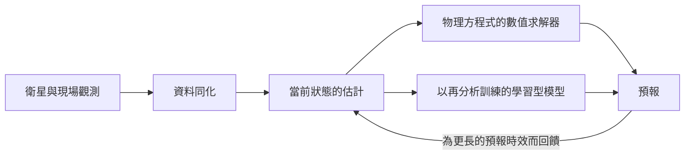

# 天氣預報與地球觀測

天氣預報與地球觀測是同一個問題的兩面：地球現在處於什麼狀態，又將如何變化？本頁涵蓋機器學習在中期天氣預報上的應用，以及在衛星與其他遙感資料判讀上的應用。減少排放是另一個主題，見[氣候與能源](../climate-energy/index.md)頁面。

## 概述

天氣預測自第一批大氣數值模式出現以來，就是一個計算問題。業務預報中心運行的是*數值天氣預報*（NWP）系統：它們把大氣表示在格點上，以物理方程式逐步向前推進，並從當前狀態的估計出發開始每次預報；這個估計由觀測結果與一段短期預報結合而成。Bauer、Thorpe 與 Brunet（2015）回顧了這些系統如何在數十年間，透過更好的模式、更多的觀測、更佳的資料同化與更多的運算而改進。

地球觀測則涵蓋問題的另一半。衛星、飛機與地面感測器測量陸地、海洋與大氣，而測量結果會被轉換為地圖，例如土地覆蓋、作物類型、洪水範圍與建築損毀。在預報方面，依據數十年的歷史天氣資料訓練的學習型模型，在許多中期預報指標上已能與最佳的 NWP 系統相當甚至超越，同時在一個加速器上約一分鐘就能完成 10 天的預報。在判讀方面，神經網路能以人工判讀無法企及的規模，對影像進行分類與分割。

## 關鍵概念

- **數值天氣預報（NWP）**：在格點上以數值方法求解大氣物理方程式的預報。它是評判 AI 預報的參照方法。
- **資料同化**：把短期預報與新的觀測結合，以估計下一次預報起始時的大氣狀態的程序。
- **再分析（reanalysis）**：以固定的預報系統配合資料同化、重跑數十年所得到的過去天氣的一致重建。ERA5（Hersbach 等人，2020）是多數學習型預報模型所採用的再分析資料。
- **預報時效與中期預報**：預報時效是預報起始時間與其所預測時間之間的間隔。中期預報大約涵蓋接下來的兩週。
- **自迴歸滾動預報**：把模型自己的輸出回饋為輸入，一次推進一個時間步，以取得更長的預報時效。
- **集合預報**：由略有不同的起始狀態產生的多組預報。合在一起，它們描述的是可能結果的範圍，而不是單一預測。
- **臨近預報**：非常短期的預報，通常以雷達或衛星資料為基礎，涵蓋接下來的數小時。
- **遙感與多光譜影像**：從遠處測量地球，通常來自衛星，使用記錄反射日光、發射熱能或雷達回波的感測器。多光譜影像記錄多個波段，而不只是可見光的顏色。

## 運作方式

兩類方法都把當前的大氣狀態轉換為未來的狀態，差別在於轉換如何計算。

在 NWP 中，轉換來自一個在超級電腦上執行的數值求解器，其成本隨解析度急遽上升。學習型預報器則以一個依歷史資料擬合的函數取代求解器。以 GraphCast 為例，它以當前狀態與六小時前的狀態（兩者皆位於 0.25 度的經緯格點上）為輸入，預測六小時後的狀態。把輸出回饋為輸入，即可得到長達 10 天的預報。其訓練誤差會在數個自迴歸步驟上取平均，這獎勵了長時間的準確度，因而有助於較長的預報時效。[^1] Pangu-Weather 則使用三維 Transformer，並為數個預報時效分別訓練模型。

地球觀測模型則處理類似影像的資料。由於標註影像的成本高昂，許多系統會先以大量未標註的資料進行自監督預訓練，例如遮住輸入的一部分再預測它（[遮罩預測](../../theory/paradigms/self-supervised/masked-prediction/index.md)）。SatMAE 把這種遮罩自編碼器方法調整到衛星影像上，在時間與光譜波段兩個方向上遮住影像區塊（Cong 等人，2022）。Prithvi 在超過一 TB 的多光譜影像上預訓練，之後再微調於數項地球觀測任務（Jakubik 等人，2023）。

## 關鍵方法

兩個里程碑式的預報系統代表了主要的做法。每個系統都有自己的頁面。

| 方法 | 發表處 | 架構 | 輸出 |
|---|---|---|---|
| [GraphCast](graphcast/index.md) | *Science*，2023 | 覆蓋全球多重網格的編碼器－處理器－解碼器圖神經網路 | 0.25° 解析度、長達 10 天的確定性預報 |
| [Pangu-Weather](pangu-weather/index.md) | *Nature*，2023 | 作用於氣壓層上的三維地球特定 Transformer，並為數個預報時效分別使用模型 | 長達一週的確定性預報；亦報告了集合預報的用途 |

同一家族的其他系統則在正文中討論：GenCast，一個會產生集合預報的機率模型（Price 等人，2024）；FourCastNet，使用自適應傅立葉神經算子（Pathak 等人，2022）；NeuralGCM，結合可微分的大氣求解器與學習型元件（Kochkov 等人，2024）；以及 Aurora，一個大型的地球系統基礎模型（Bodnar 等人，2024）。

## 相關連結

- **大腦與心智。** Clark（2013）總結了一種觀點：大腦是一台預測機器，會把感官輸入與自上而下的期待相比對，並以預測誤差來修正不一致之處。天氣預報是「從不完美的狀態估計來預測動力系統」的正式範例。這種共通的數學並不表示大腦使用類似天氣的模型，所以它是共同的問題，而非共同的機制。見[預測編碼](../../brain-mind/predictive-coding/index.md)。
- **架構。** GraphCast 依賴圖上的訊息傳遞（[圖神經網路](../../theory/models/gnn/index.md)）。Pangu-Weather 改編了視覺 Transformer，採用窗口式注意力（[視覺 Transformer](../../theory/models/transformer/vision-transformer/index.md)）。衛星模型則借用[電腦視覺](../../theory/models/computer-vision/index.md)的方法。
- **不確定性。** 描述多種結果範圍的預報，與[生成模型](../../theory/generative/index.md)及[不確定性量化與校準](../../theory/machine-learning/uncertainty-and-calibration/index.md)相關。
- **分布偏移。** 在某一時期訓練的模型，可能在另一種氣候型態下失效；衛星感測器也會隨任務與季節而改變。見[領域適應](../../theory/paradigms/transfer/domain-adaptation/index.md)。
- **科學與氣候。** 預報模型可作為昂貴模擬的快速代理；見[科學發現](../science/index.md)。排放與減緩見[氣候與能源](../climate-energy/index.md)頁面，作物製圖見[農業與食品](../agriculture/index.md)頁面。

## 應用

- **中期預報。** 學習型模型以業務預報（例如 ECMWF 的預報）作為比較對象。GraphCast 與 Pangu-Weather 都報告其確定性預報分數達到或超過業務預報，但評估資料集是作者自行選定的；各方法頁面有詳細數字。[^2]
- **熱帶氣旋與極端事件。** GraphCast 與 Pangu-Weather 都在熱帶氣旋路徑上接受評估。GraphCast 的作者另外報告，其預報對大氣河與極端高溫的預測較佳。
- **降水臨近預報。** Ravuri 等人（2021）以雷達資料訓練深度生成模型，報告其預報品質、一致性與價值均優於先前的方法。
- **洪水預報。** Nearing 等人（2024）報告，在沒有河川流量測站的流域，AI 預報能預測極端河川洪水，其可靠度與一個先進的全球洪水系統的臨近預報相近或更佳，預報時效可達五天。[^3]
- **土地覆蓋與作物。** Kussul 等人（2017）應用深度學習，從遙感資料中分類土地覆蓋與作物類型。
- **災害損毀製圖。** xBD 資料集（Gupta 等人，2019）提供災前與災後建築物的標註衛星影像，以支援災害應變中的自動損毀評估。

## 開放問題

- **不確定性。** 以均方誤差目標訓練的模型，在長預報時效上往往使預報變得模糊，從而掩蓋了各種可能結果的分散程度。GenCast 等機率模型是一種回應，但它們對罕見事件的表現仍在檢驗中。
- **極端事件。** Pangu-Weather 的預印本指出，預測的熱帶氣旋強度往往偏弱，而路徑誤差則尚屬合理。學習型模型能否可靠地預測強度，仍是未解的問題。
- **對再分析的依賴。** 模型以再分析資料訓練並以之評分，而再分析本身也是模型的產物。以再分析衡量的能力，是否能延續到業務預報，是核心問題。
- **物理一致性。** 純粹的學習型模型並不會在設計上保持物理量守恆。NeuralGCM 等混合模型是一種回應。
- **地球觀測的標註。** 災害、作物與土地利用的標註既昂貴又具有地域性。預訓練的基礎模型能減少所需標註，但必須能跨感測器、地區與季節泛化。
- **評估。** WeatherBench 2 等共用基準標準化了分數（Rasp 等人，2023），但指標與基線的選擇仍會左右結論。

[^1]: Lam 等人（2023）描述訓練時採用的誤差，是在數量逐步增加（從一步到十二步）的自迴歸步驟上取平均，並報告步數增加有助於較長預報時效的表現。
[^2]: GraphCast 的摘要報告，該系統在 1,380 個驗證目標中，有 90% 的目標顯著優於最準確的業務確定性系統。
[^3]: Nearing 等人（2024）報告的可靠度是針對最長五天的預報時效，比較對象為 Copernicus 緊急管理服務全球洪水預警系統的臨近預報。

## 參考文獻

### 開創性論文

- Bauer, P., Thorpe, A. & Brunet, G.（2015）。*The quiet revolution of numerical weather prediction*。Nature。https://doi.org/10.1038/nature14956 — 回顧數值天氣預報如何經由更好的模式、觀測、資料同化與運算而改進。
- Lam, R. 等人（2023）。*Learning skillful medium-range global weather forecasting*。Science。https://doi.org/10.1126/science.adi2336 — 介紹 GraphCast，一個能預測全球天氣長達十天的圖神經網路。
- Bi, K. 等人（2023）。*Accurate medium-range global weather forecasting with 3D neural networks*。Nature。https://doi.org/10.1038/s41586-023-06185-3 — 介紹 Pangu-Weather，一個採用階層式時間聚合的三維 Transformer 全球預報模型。
- Price, I. 等人（2024）。*Probabilistic weather forecasting with machine learning*。Nature。https://doi.org/10.1038/s41586-024-08252-9 — 介紹 GenCast，一個能產生中期預報集合的機率模型。
- Ravuri, S. 等人（2021）。*Skilful precipitation nowcasting using deep generative models of radar*。Nature。https://doi.org/10.1038/s41586-021-03854-z — 以雷達資料進行降水臨近預報的深度生成模型，並就預報品質與價值進行評估。
- Nearing, G. 等人（2024）。*Global prediction of extreme floods in ungauged watersheds*。Nature。https://doi.org/10.1038/s41586-024-07145-1 — 針對沒有河川流量測站之流域的 AI 洪水預報。
- Cong, Y. 等人（2022）。*SatMAE: Pre-training Transformers for Temporal and Multi-Spectral Satellite Imagery*。arXiv。https://arxiv.org/abs/2207.08051 — 針對衛星影像時間序列與多光譜波段的遮罩自編碼器預訓練。
- Jakubik, J. 等人（2023）。*Foundation Models for Generalist Geospatial Artificial Intelligence*。arXiv。https://arxiv.org/abs/2310.18660 — Prithvi，一個在衛星影像上預訓練、用於地球觀測任務的 Transformer。
- Kussul, N. 等人（2017）。*Deep Learning Classification of Land Cover and Crop Types Using Remote Sensing Data*。IEEE Geoscience and Remote Sensing Letters。https://doi.org/10.1109/LGRS.2017.2681128 — 應用深度網路從衛星資料中製作土地覆蓋與作物類型地圖。
- Gupta, R. 等人（2019）。*xBD: A Dataset for Assessing Building Damage from Satellite Imagery*。arXiv。https://arxiv.org/abs/1911.09296 — 災前與災後建築物的標註衛星影像。
- Kochkov, D. 等人（2024）。*Neural general circulation models for weather and climate*。Nature。https://doi.org/10.1038/s41586-024-07744-y — 結合可微分大氣求解器與機器學習元件的混合模型。

### 綜述與教科書

- Clark, A.（2013）。*Whatever next? Predictive brains, situated agents, and the future of cognitive science*。Behavioral and Brain Sciences。https://doi.org/10.1017/S0140525X12000477 — 主文，提出大腦預測感官輸入並使預測誤差最小化的觀點。

### 文章與文件

- Hersbach, H. 等人（2020）。*The ERA5 global reanalysis*。Quarterly Journal of the Royal Meteorological Society。https://doi.org/10.1002/qj.3803 — 說明 ERA5，多數學習型預報模型所訓練的再分析資料。
- Pathak, J. 等人（2022）。*FourCastNet: A Global Data-driven High-resolution Weather Model using Adaptive Fourier Neural Operators*。arXiv。https://arxiv.org/abs/2202.11214 — 使用傅立葉神經算子的全球資料驅動預報模型。
- Bodnar, C. 等人（2024）。*A Foundation Model for the Earth System*。arXiv。https://arxiv.org/abs/2405.13063 — Aurora，一個用於天氣、空氣品質與海洋預報的基礎模型。
- Rasp, S. 等人（2023）。*WeatherBench 2: A benchmark for the next generation of data-driven global weather models*。arXiv。https://arxiv.org/abs/2308.15560 — 資料驅動全球天氣模型的開放評估框架與基線。
