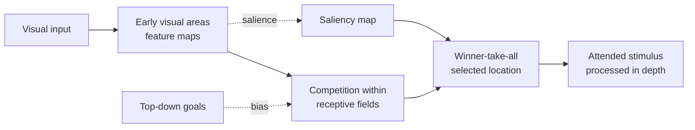

# Attention in Brains and Machines

Attention is the brain's way of choosing what to process in depth. The visual system receives far more information than it can handle, so neural resources are concentrated on some stimuli and suppressed for others. The same idea, a weighting that selects relevant inputs, is now central to transformer models, and the parallel is one of the more direct links between neuroscience and AI.

## Overview

Attention is usually described as selective processing. Some inputs are amplified, others are filtered out, and the selection can be driven by the stimulus itself or by the goals of the observer. Psychology has studied it since the early work on visual search and dichotic listening. [Cognitive Science](../cognitive-science/index.md) covers those behavioural studies; this page covers the neural mechanisms and the models that compare them with machine attention.

## Key concepts

- **Bottom-up attention**: selection driven by the stimulus, such as a bright or moving object that stands out from its surroundings.
- **Top-down attention**: selection driven by goals or expectations, such as searching for a specific object.
- **Spatial and feature attention**: attention can be directed to a location, or to a property such as colour or motion wherever it appears.
- **Gain modulation**: attention changes the strength of neural responses to attended stimuli, rather than only changing which neurons are active.
- **Attentional capture**: a salient or unexpected event can pull attention away from the current goal.

## How it works

In the visual cortex, stimuli inside a neuron's receptive field compete for representation. When more than one stimulus is present, the neuron's response is pulled toward the average of the two. Attention biases this competition toward the attended stimulus, through signals that arrive from higher areas. A separate, bottom-up route computes how different each location is from its surroundings.

Two families of models follow from this picture. Biased competition explains how top-down signals change neural responses in visual cortex. Saliency maps explain how a bottom-up signal selects locations in natural scenes.

## Key methods

Each method has its own page. This table is only a comparison.

| Method | Question it answers | Page |
|---|---|---|
| Biased competition (Desimone & Duncan, 1995) | How do top-down signals resolve competition between stimuli in the same receptive field? | [Desimone & Duncan 1995](biased-competition/index.md) |
| Saliency map (Itti, Koch & Niebur, 1998) | Which location in a natural scene should be selected from bottom-up feature contrast alone? | [Itti et al. 1998](saliency-map/index.md) |

## Attention in machines

Neural networks use the word attention for a learned weighting over inputs, and transformer models rely on it heavily. The mechanism is described on the [Transformer](../../theory/models/transformer/index.md) pages, and its variants are on [Attention Variants](../../theory/models/transformer/attention-variants/index.md). The analogy with biology is loose. A transformer weights every input token by a learned score, while a brain selects among competing signals with limited capacity. Models that select glimpses from images, such as recurrent visual attention networks, are closer to the neural case. The recurrent attention model has its own page, [Recurrent Models of Visual Attention](recurrent-visual-attention/index.md), and it is cited in the references below.

## Connections

- **Cognitive science**: the behavioural psychology of attention, including search and capture, is in [Cognitive Science](../cognitive-science/index.md).
- **Neuroscience**: the receptive fields and cortical hierarchy that competition depends on are in [Neuroscience Basics](../neuroscience/index.md).
- **NeuroAI**: attention as a shared computational principle between brains and networks is discussed on [NeuroAI](../neuroai/index.md).
- **Perception**: how attention shapes the ventral stream's responses is covered on [Perception and the Visual System](../visual-perception/index.md).

## Applications

- **Machine translation and language models**: attention lets a model relate words across a sentence, and it is the core of the transformer. See [Transformer](../../theory/models/transformer/index.md).

## Open questions

- **Is machine attention the same computation as neural attention?** The two share a weighting structure, but the mechanisms that produce the weights differ.
- **How do bottom-up and top-down signals combine?** Saliency alone does not explain goal-directed search, and goals alone do not explain attentional capture.
- **Does attention need a separate selection stage?** Some accounts place selection early, others late, and the evidence is still being sorted.

## References

### Seminal papers

- Desimone, R. & Duncan, J. (1995). Neural mechanisms of selective visual attention. *Annual Review of Neuroscience*. https://doi.org/10.1146/annurev.ne.18.030195.001205 — Proposes biased competition, in which top-down signals resolve competition between stimuli in the same receptive field.
- Itti, L., Koch, C. & Niebur, E. (1998). A model of saliency-based visual attention for rapid scene analysis. *IEEE Transactions on Pattern Analysis and Machine Intelligence*. https://doi.org/10.1109/34.730558 — A saliency-map model of bottom-up attention built from centre-surround feature contrasts.
- Vaswani, A., Shazeer, N., Parmar, N., Uszkoreit, J., Jones, L., Gomez, A. N., Kaiser, Ł. & Polosukhin, I. (2017). Attention Is All You Need. *NeurIPS*. https://arxiv.org/abs/1706.03762 — Introduces the transformer, whose attention mechanism is the machine analogue discussed on this page.
- Mnih, V., Heess, N., et al. (2014). Recurrent Models of Visual Attention. *NeurIPS*. https://arxiv.org/abs/1406.6247 — A recurrent network that selects glimpses from an image, an example of learned visual attention in a model.
- Bahdanau, D., Cho, K. & Bengio, Y. (2014). Neural Machine Translation by Jointly Learning to Align and Translate. arXiv preprint. https://arxiv.org/abs/1409.0473 — Introduces learned alignment between words in translation, an early form of attention in neural networks.

### Surveys and reviews

- Corbetta, M. & Shulman, G. L. (2002). Control of goal-directed and stimulus-driven attention in the brain. *Nature Reviews Neuroscience*. https://doi.org/10.1038/nrn755 — Distinguishes a dorsal network for goal-directed attention from a ventral network for stimulus-driven attention.
