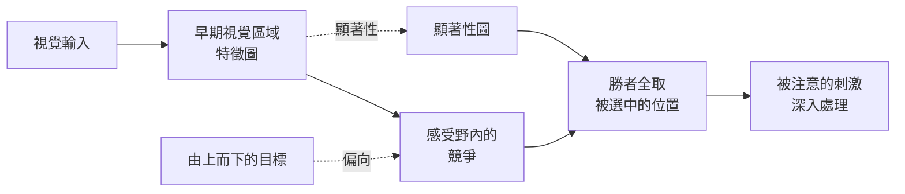

# 大腦與機器中的注意力

注意力是大腦決定哪些內容要深入處理的方式。視覺系統接收的資訊遠超過它所能處理的量，因此神經資源會集中在某些刺激上，並抑制其他刺激。同樣的想法，也就是挑選相關輸入的加權機制，如今已是 Transformer 模型的核心，這個平行關係是神經科學與 AI 之間較直接的連結之一。

## 概述

注意力通常被描述為選擇性處理：某些輸入被放大，其他的被過濾掉，而選擇可以由刺激本身驅動，也可以由觀察者的目標驅動。心理學自視覺搜尋與雙耳分聽的早期研究起，就一直在研究它。[認知科學](../cognitive-science/index.md)涵蓋那些行為研究；本頁則說明神經機制，以及將其與機器注意力比較的模型。

## 核心概念

- **由下而上的注意力（bottom-up attention）**：由刺激驅動的選擇，例如一個明亮或移動、從周圍突出的物體。
- **由上而下的注意力（top-down attention）**：由目標或期待驅動的選擇，例如搜尋某個特定物體。
- **空間注意力與特徵注意力**：注意力可以指向一個位置，也可以指向某個屬性，例如顏色或運動，無論它出現在哪裡。
- **增益調節（gain modulation）**：注意力改變神經對被注意刺激的反應強度，而不只是改變哪些神經元活化。
- **注意力捕捉（attentional capture）**：顯著或出乎意料的事件，可以把注意力從當前目標拉走。

## 運作方式

在視覺皮質中，同一個神經元感受野內的刺激會競爭表徵。當不只一個刺激存在時，神經元的反應會被拉向兩者的平均。注意力會透過來自較高區域的訊號，把這場競爭偏向被注意的刺激。另一條由下而上的路徑，則計算每個位置與其周圍有多不同。

由這幅圖景衍生出兩類模型。偏向競爭（biased competition）解釋由上而下的訊號如何改變視覺皮質中的神經反應；顯著性圖（saliency map）則解釋由下而上的訊號如何在自然場景中選出位置。

## 關鍵方法

每種方法都有自己的頁面。下表只用來比較。

| 方法 | 它回答的問題 | 頁面 |
|---|---|---|
| 偏向競爭（Desimone 與 Duncan，1995） | 由上而下的訊號如何解決同一感受野內刺激之間的競爭？ | [Desimone 與 Duncan 1995](biased-competition/index.md) |
| 顯著性圖（Itti、Koch 與 Niebur，1998） | 只靠由下而上的特徵對比，應該從自然場景中選出哪個位置？ | [Itti 等人 1998](saliency-map/index.md) |

## 機器中的注意力

神經網路用注意力一詞，指對輸入學到的加權，而 Transformer 模型大量依賴它。這個機制見 [Transformer](../../theory/models/transformer/index.md) 頁面，其變體見[注意力變體](../../theory/models/transformer/attention-variants/index.md)。與生物的類比只是鬆散的：Transformer 以學到的分數為每個詞元加權，而大腦則在有限容量下，從互相競爭的訊號中做選擇。從影像中選取注視點的模型，例如循環式視覺注意力網路，與神經的情形較為接近。循環式視覺注意力模型有自己的頁面：[循環視覺注意力模型](recurrent-visual-attention/index.md)，並列於下方參考文獻。

## 與其他主題的關聯

- **認知科學**：注意力的行為心理學，包括搜尋與捕捉，見[認知科學](../cognitive-science/index.md)。
- **神經科學**：競爭所依賴的感受野與皮質階層，見[神經科學基礎](../neuroscience/index.md)。
- **NeuroAI**：注意力作為大腦與網路共享的計算原則，見 [NeuroAI](../neuroai/index.md)。
- **知覺**：注意力如何改變腹側路徑的反應，見[知覺與視覺系統](../visual-perception/index.md)。

## 應用

- **機器翻譯與語言模型**：注意力讓模型能關聯句子中相隔很遠的詞，它是 Transformer 的核心。見 [Transformer](../../theory/models/transformer/index.md)。

## 開放問題

- **機器注意力與神經注意力是同一種計算嗎？** 兩者共享加權的結構，但產生權重的機制不同。
- **由下而上與由上而下的訊號如何結合？** 單靠顯著性無法解釋目標導向的搜尋，單靠目標也無法解釋注意力捕捉。
- **注意力是否需要獨立的選擇階段？** 有些理論把選擇放在早期，有些放在晚期，證據仍在整理中。

## 參考文獻

### 開創性論文

- Desimone, R. & Duncan, J.（1995）。Neural mechanisms of selective visual attention. *Annual Review of Neuroscience*。https://doi.org/10.1146/annurev.ne.18.030195.001205 — 提出偏向競爭，即由上而下的訊號解決同一感受野內刺激之間的競爭。
- Itti, L., Koch, C. & Niebur, E.（1998）。A model of saliency-based visual attention for rapid scene analysis. *IEEE Transactions on Pattern Analysis and Machine Intelligence*。https://doi.org/10.1109/34.730558 — 以中心-周邊特徵對比建立的由下而上注意力顯著性圖模型。
- Vaswani, A., Shazeer, N., Parmar, N., Uszkoreit, J., Jones, L., Gomez, A. N., Kaiser, Ł. & Polosukhin, I.（2017）。Attention Is All You Need. *NeurIPS*。https://arxiv.org/abs/1706.03762 — 提出 Transformer，其注意力機制是本頁所討論的機器類比。
- Mnih, V., Heess, N., 等人（2014）。Recurrent Models of Visual Attention. *NeurIPS*。https://arxiv.org/abs/1406.6247 — 從影像中循環選取注視點的網路，是學習而得的視覺注意力範例。
- Bahdanau, D., Cho, K. & Bengio, Y.（2014）。Neural Machine Translation by Jointly Learning to Align and Translate. arXiv 預印本。https://arxiv.org/abs/1409.0473 — 提出在翻譯中學習詞彙對齊，是神經網路中注意力的早期形式。

### 綜述與回顧

- Corbetta, M. & Shulman, G. L.（2002）。Control of goal-directed and stimulus-driven attention in the brain. *Nature Reviews Neuroscience*。https://doi.org/10.1038/nrn755 — 區分目標導向注意力的背側網路，與刺激驅動注意力的腹側網路。
