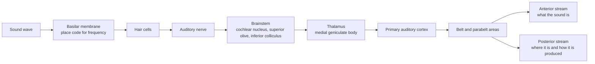

# Hearing and the Auditory System

Hearing turns pressure waves in the air into neural signals that the brain uses to recognise sounds, locate their sources and follow speech. Most of this work happens in the auditory cortex, and its organisation is the auditory counterpart of the [visual system](../visual-perception/index.md).

## Overview

A sound reaches the ear as a rapidly changing pressure signal. Unlike an image, it has no spatial layout that the receiver can take in at a glance. Its information lies in how its frequencies change over time. The auditory system has to solve three problems together: separate the mixture of sources, recognise what each source is (for example, a word), and work out where it is.

Three features set hearing apart from vision. First, frequency is laid out physically in the cochlea, so the auditory system is organised by frequency from its first stage onwards. This is called tonotopy. Second, the signal passes through a long chain of subcortical nuclei before it reaches the cortex. Third, real environments are noisy, so much of hearing consists of pulling one sound out of a background. Cherry (1953) studied this problem with two simultaneous speech signals, and the question of how listeners follow one talker in a crowd is still central to the field.[^1]

The sections below follow the path from the cochlea to the cortex, the hierarchy within the cortex, speech in noise, and the deep networks used to test these ideas. For basic anatomy, see [Neuroscience Basics](../neuroscience/index.md).

## Key concepts

- **Frequency and pitch**: the rate at which a sound wave oscillates. Perceived pitch largely follows it.
- **Tonotopy**: an orderly arrangement of neurons by their preferred frequency. It is present from the cochlea to the cortex.
- **Hair cells**: the receptors of the cochlea. Inner hair cells send most of the information to the auditory nerve. Outer hair cells amplify the mechanical response of the cochlea and sharpen its frequency tuning.
- **Spectrogram**: a representation of sound with time on one axis and frequency on the other. Many auditory models take a spectrogram-like input, because it resembles the signal the cochlea passes on.
- **Auditory cortex hierarchy**: a set of cortical areas, starting with the primary auditory cortex and surrounded by belt and parabelt regions. Responses in later areas tend to be more selective for complex sound structure.
- **Cocktail-party problem**: the problem of following one talker in a mixture of talkers and background noise.
- **Auditory streams**: two processing pathways, one anterior and one posterior, which handle what a sound is and where it is or how it is produced.

## How it works

The first stage of frequency analysis is mechanical. The basilar membrane runs along the cochlea, and its vibration peaks at a place that depends on the frequency of the sound. High frequencies peak near the base and low frequencies near the apex, so the spatial position of the peak encodes frequency. Outer hair cells add an active amplification that makes the peak sharper. Dallos (1992) reviews this active cochlea.[^2]

Hair cells convert this motion into electrical signals, and each auditory nerve fibre carries a narrow range of frequencies. The signal then passes through the cochlear nucleus and the superior olivary complex, where the two ears' signals are compared to estimate direction. It continues through the inferior colliculus and the medial geniculate body of the thalamus to the primary auditory cortex. In humans this area lies on Heschl's gyrus, on the upper surface of the temporal lobe. From there, signals reach belt and parabelt regions that surround it.

Tonotopic organisation continues into the cortex. Within primary auditory cortex, neighbouring locations prefer neighbouring frequencies, and the direction of this gradient reverses at the borders between areas. Formisano et al. (2003) mapped this pattern in humans with functional MRI, and Moerel et al. (2014) combine anatomical and functional evidence to delineate the human auditory areas.

The cortical organisation also has a functional side. Rauschecker and Scott (2009) argue, from work on non-human primates, that auditory cortex is split into an anterior pathway that identifies sounds and a posterior pathway that deals with spatial and sensorimotor information. Speech draws on both. The dual-stream model for speech, described in [Language in the Brain](../language-in-brain/index.md), extends the same idea to language.

Speech is still understood in noise, because listeners use context and follow one talker at a time. Mattys et al. (2012) review how speech recognition holds up under adverse conditions, and Mesgarani and Chang (2012) show that the cortex carries a stronger representation of the attended talker in a mixture.

## Key methods

Each method has its own page. This table is only a comparison.

| Method | What separates it | Page |
|---|---|---|
| Tonotopic mapping with fMRI (Formisano et al., 2003) | Non-invasive maps of frequency preference in human primary auditory cortex, including mirror-symmetric maps | [Formisano et al. 2003](formisano-2003/index.md) |
| Attended-speaker decoding (Mesgarani & Chang, 2012) | Reconstructs the speech a listener attends to from cortical recordings made during a two-talker mixture | [Mesgarani & Chang 2012](mesgarani-chang-2012/index.md) |
| Task-optimised deep networks (Kell et al., 2018) | Trains a network on everyday audio tasks, then tests its behaviour and its stages against human listeners and auditory cortex | [Kell et al. 2018](kell-2018/index.md) |

## Connections

- **Visual system**: both systems are hierarchies that build selectivity from local features to more complex patterns. The comparison is made in [Perception and the Visual System](../visual-perception/index.md), and the same idea of task-optimised networks is applied to hearing on the [Kell et al. 2018](kell-2018/index.md) page.
- **Speech and language**: the cortex that handles sound feeds into the language areas described in [Language in the Brain](../language-in-brain/index.md). Hickok and Poeppel (2007) describe how the two streams for speech processing are arranged in the cortex.
- **Attention**: following one talker is a case of selective attention. The mechanisms that do this, in brains and in machines, are compared in [Attention in Brains & Machines](../attention-brain-machine/index.md).
- **NeuroAI**: Kell et al. (2018) is an auditory example of the task-optimised approach discussed in [NeuroAI](../neuroai/index.md).
- **Brain-computer interfaces**: decoding speech from cortical activity, as in Mesgarani and Chang (2012), is closely related to the speech neuroprostheses discussed in [Speech Neuroprosthesis](../bci/speech-neuroprosthesis/index.md).

## Applications

- **Hearing aids and cochlear implants**: a key test of these devices is how well users understand speech in noise. Won et al. (2008) present a signal-processing method aimed at this problem for hearing-aid and cochlear-implant users.
- **Speech separation in machines**: engineers have built systems that separate a target talker from background sound. Wang and Chen (2018) survey the deep-learning approaches to this task.
- **Clinical audiology**: tests of speech in noise are a standard way to assess hearing, and the adverse-conditions research reviewed by Mattys et al. (2012) is relevant to how such tests are designed.

## Open questions

- **How much of the cortex's organisation is task-driven?** Kell and McDermott (2019) review how the tasks a network learns shape its representations. Which tasks the auditory system is optimised for is still debated.
- **How does attention select one talker?** The studies show that the attended talker dominates the cortical representation, but whether attention enhances the attended voice, suppresses the others, or both, and where in the pathway this happens, is still open.
- **How stable is the map across people?** Frequency maps differ between individuals, and the number and borders of human auditory areas are still being refined. Moerel et al. (2014) review how these areas are identified.
- **Do the two pathways in hearing mirror those in vision?** The anterior and posterior streams are supported by work in non-human primates. Their human counterparts, and how they interact during speech, remain an active research question.

[^1]: Cherry's experiments presented two speech signals at once, and different signals to the two ears, and interpreted listeners' responses statistically.
[^2]: Dallos's review describes how outer hair cells amplify the basilar membrane's response. The strength and role of this amplification in normal hearing is discussed in the review and remains an active area of research.

## References

### Seminal papers

- Cherry, E. C. (1953). Some Experiments on the Recognition of Speech, with One and with Two Ears. *The Journal of the Acoustical Society of America*. https://doi.org/10.1121/1.1907229 — Early experiments on recognising speech when two speech signals are presented together, the basis of the cocktail-party problem.
- Formisano, E., Kim, D.-S., Di Salle, F., van de Moortele, P.-F., Ugurbil, K. & Goebel, R. (2003). Mirror-Symmetric Tonotopic Maps in Human Primary Auditory Cortex. *Neuron*. https://doi.org/10.1016/S0896-6273(03)00669-X — Uses fMRI to map frequency preferences in human primary auditory cortex and reports mirror-symmetric tonotopic maps.
- Mesgarani, N. & Chang, E. F. (2012). Selective cortical representation of attended speaker in multi-talker speech perception. *Nature*. https://doi.org/10.1038/nature11020 — Records cortical activity during mixtures of talkers and shows that the attended talker dominates the representation.
- Kell, A. J. E., Yamins, D. L. K., Shook, E. N., Norman-Haignere, S. V. & McDermott, J. H. (2018). A Task-Optimized Neural Network Replicates Human Auditory Behavior, Predicts Brain Responses, and Reveals a Cortical Processing Hierarchy. *Neuron*. https://doi.org/10.1016/j.neuron.2018.03.044 — Trains a deep network on audio tasks and shows that it matches human listening, predicts auditory cortical responses and has a cortex-like hierarchy.
- Dallos, P. (1992). The active cochlea. *The Journal of Neuroscience*. https://doi.org/10.1523/JNEUROSCI.12-12-04575.1992 — Reviews the active cochlea, in which outer hair cells amplify the response and sharpen frequency tuning.

### Surveys and textbooks

- Rauschecker, J. P. & Scott, S. K. (2009). Maps and streams in the auditory cortex: nonhuman primates illuminate human speech processing. *Nature Neuroscience*. https://doi.org/10.1038/nn.2331 — Argues from primate work that auditory cortex has anterior and posterior processing streams, and relates them to human speech processing.
- Hickok, G. & Poeppel, D. (2007). The cortical organization of speech processing. *Nature Reviews Neuroscience*. https://doi.org/10.1038/nrn2113 — Proposes the dual-stream model of speech processing, with a ventral stream for comprehension and a dorsal stream for articulation.
- Moerel, M., De Martino, F. & Formisano, E. (2014). An anatomical and functional topography of human auditory cortical areas. *Frontiers in Neuroscience*. https://doi.org/10.3389/fnins.2014.00225 — Reviews how anatomical landmarks and functional maps, including tonotopy, are combined to delineate human auditory cortical areas.
- Kell, A. J. E. & McDermott, J. H. (2019). Deep neural network models of sensory systems: windows onto the role of task constraints. *Current Opinion in Neurobiology*. https://doi.org/10.1016/j.conb.2019.02.003 — Reviews how the tasks a network is trained on shape the sensory representations it learns, and what this means for using such networks as brain models.
- Mattys, S. L., Davis, M. H., Bradlow, A. R. & Scott, S. K. (2012). Speech recognition in adverse conditions: A review. *Language and Cognitive Processes*. https://doi.org/10.1080/01690965.2012.705006 — Reviews how listeners recognise speech in noise and other adverse conditions, and which processes compensate.

### Articles and documentation

- Wang, D. & Chen, J. (2018). Supervised Speech Separation Based on Deep Learning: An Overview. arXiv. https://arxiv.org/abs/1708.07524 — Surveys deep-learning methods that separate target speech from background interference, the engineering side of speech in noise.
- Won, J. H. et al. (2008). Improving performance in noise for hearing aids and cochlear implants using coherent modulation filtering. *Hearing Research*. https://doi.org/10.1016/j.heares.2008.01.009 — A signal-processing method, coherent modulation filtering, aimed at better speech performance in noise for hearing-aid and cochlear-implant users.
