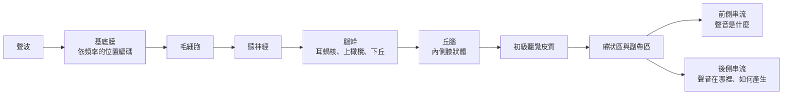

# 聽覺與聽覺系統

聽覺把空氣中的壓力波轉換為神經訊號，大腦再用這些訊號辨識聲音、定位聲源並追蹤語音。大部分的工作發生在聽覺皮質，而它的組織方式正是[視覺系統](../visual-perception/index.md)在聽覺上的對應。

## 概述

聲音抵達耳朵時，是一個快速變化的壓力訊號。它不像影像，沒有能一眼看完的空間佈局；資訊藏在頻率隨時間的變化之中。聽覺系統必須同時解決三件事：把混合的聲源分開、辨認每個聲源是什麼（例如一個字），並判斷它在哪裡。

聽覺有三個特點不同於視覺。第一，頻率在耳蝸中有實體上的排列，因此聽覺系統從第一站起就依頻率組織，這稱為音調拓撲（tonotopy）。第二，訊號在抵達皮質前，會經過一長串皮質下核團。第三，真實環境充滿噪音，大部分聽覺工作就是把某個聲音從背景中撈出來。Cherry（1953）用兩段同時出現的語音研究這個問題，而「人群中如何跟隨一位說話者」至今仍是這個領域的核心問題。[^1]

以下各節依序介紹從耳蝸到皮質的路徑、皮質內部的階層、噪音中的語音，以及近年用來檢驗這些想法的深度網路。基本的解剖結構請見[神經科學基礎](../neuroscience/index.md)。

## 核心概念

- **頻率與音高**：聲波振動的速率。感知到的音高大致跟隨它。
- **音調拓撲**：神經元依偏好頻率有序排列。從耳蝸到皮質都存在。
- **毛細胞**：耳蝸的感受器。內毛細胞把大部分資訊送進聽神經；外毛細胞放大耳蝸的機械反應，並使頻率調諧更加銳利。
- **頻譜圖**：以時間為一軸、頻率為另一軸的聲音表示法。許多聽覺模型以類似頻譜圖的輸入為起點，因為它接近耳蝸傳出的訊號。
- **聽覺皮質階層**：一組皮質區域，從初級聽覺皮質開始，周圍環繞帶狀區與副帶區。較後面的區域對複雜的聲音結構往往更具選擇性。
- **雞尾酒會問題**：在多位說話者與背景噪音的混合中，跟隨其中一位的問題。
- **聽覺串流**：兩條處理路徑，一前一後，分別負責聲音是什麼，以及聲音在哪裡或如何產生。

## 運作方式

頻率分析的第一步是機械性的。耳蝸內的基底膜沿著耳蝸延伸，其振動最大處的位置取決於聲音的頻率：高頻在靠近基部的地方振動最大，低頻在靠近頂端的地方最大，因此振動峰值的空間位置就編碼了頻率。外毛細胞加入主動放大，使振動峰更加尖銳。Dallos（1992）回顧了這個主動耳蝸的機制。[^2]

毛細胞把這種機械運動轉為電訊號，每條聽神經纖維攜帶一段狹窄的頻率範圍。訊號接著經過耳蝸核與上橄欖複合體，在那裡比較兩耳的訊號以估計聲源方向。之後經過下丘與丘腦的內側膝狀體，抵達初級聽覺皮質。在人類，這個區域位於赫氏回，在顳葉的上表面。訊號再從那裡傳到周圍的帶狀區與副帶區。

音調拓撲延續到皮質。在初級聽覺皮質內，相鄰位置偏好相鄰的頻率，而這個梯度的方向會在區域之間的邊界處反轉。Formisano 等人（2003）以功能性磁振造影在人類身上描繪了這個模式；Moerel 等人（2014）則結合解剖與功能證據，劃定人類的聽覺區域。

皮質組織也有功能面向。Rauschecker 與 Scott（2009）根據非人類靈長類的研究主張，聽覺皮質分為負責辨認聲音的前側路徑，以及處理空間與感覺運動資訊的後側路徑。語音同時仰賴兩者。語音的雙路徑模型（見[大腦中的語言](../language-in-brain/index.md)）把同樣的想法延伸到語言。

在噪音中，人們仍然聽得懂語音，因為聽者會利用上下文，並能一次跟隨一位說話者。Mattys 等人（2012）回顧了語音辨識在不利條件下如何維持，Mesgarani 與 Chang（2012）則顯示，在混合語音中，皮質對被注意說話者的表徵比較強。

## 關鍵方法

每種方法都有自己的頁面，下表僅作比較。

| 方法 | 區別之處 | 頁面 |
|---|---|---|
| 以 fMRI 進行音調拓撲定位（Formisano 等人，2003） | 以非侵入方式描繪人類初級聽覺皮質的頻率偏好，包括鏡像對稱的圖譜 | [Formisano 等人 2003](formisano-2003/index.md) |
| 注意說話者解碼（Mesgarani 與 Chang，2012） | 從雙人混合語音期間記錄的皮質訊號，重建聽者所注意的語音 | [Mesgarani 與 Chang 2012](mesgarani-chang-2012/index.md) |
| 任務最佳化深度網路（Kell 等人，2018） | 以日常聽覺任務訓練網路，再把它的行為與各階段與人類聽者及聽覺皮質相比 | [Kell 等人 2018](kell-2018/index.md) |

## 與其他主題的關聯

- **視覺系統**：兩個系統都是階層式的，從局部特徵逐步建立更複雜的選擇性。這項比較見於[知覺與視覺系統](../visual-perception/index.md)，而任務最佳化網路的想法在聽覺上的應用，則見於 [Kell 等人 2018](kell-2018/index.md) 頁面。
- **語音與語言**：處理聲音的皮質會把訊號送往[大腦中的語言](../language-in-brain/index.md)所描述的語言區域。Hickok 與 Poeppel（2007）說明了語音處理的兩條路徑在皮質中如何安排。
- **注意力**：跟隨一位說話者是選擇性注意的一個例子。大腦與機器中執行此功能的機制，見於[注意力：大腦與機器](../attention-brain-machine/index.md)。
- **NeuroAI**：Kell 等人（2018）是 [NeuroAI](../neuroai/index.md) 中所討論的任務最佳化方法的聽覺例子。
- **腦機介面**：如 Mesgarani 與 Chang（2012）所做的，從皮質活動解碼語音，與[語音神經義肢](../bci/speech-neuroprosthesis/index.md)所討論的研究密切相關。

## 應用

- **助聽器與人工電子耳**：這類裝置的一項關鍵檢驗，是使用者在噪音中聽懂語音的能力。Won 等人（2008）提出一種針對這個問題的訊號處理方法，供助聽器與人工電子耳使用者使用。
- **機器中的語音分離**：工程師已建立能從背景聲音中分離目標說話者的系統。Wang 與 Chen（2018）綜述了這項任務的深度學習方法。
- **臨床聽力學**：噪音中語音測試是評估聽力的標準方法，而 Mattys 等人（2012）回顧的不利條件研究，與這類測試的設計相關。

## 開放問題

- **皮質的組織有多少是由任務驅動的？** Kell 與 McDermott（2019）回顧了網路所學的任務如何塑造其表徵。聽覺系統究竟最佳化於哪些任務，仍有爭議。
- **注意力如何選出一位說話者？** 研究顯示，被注意的說話者在皮質表徵中佔主導地位；但注意力是增強被注意的聲音、抑制其他聲音，還是兩者兼具，以及這發生在路徑的哪個位置，仍未確定。
- **不同人之間的圖譜有多穩定？** 頻率圖譜在個體之間有所差異，而人類聽覺區域的數目與邊界仍在持續修正。Moerel 等人（2014）回顧了如何辨識這些區域。
- **聽覺的兩條路徑是否與視覺的路徑相對應？** 前側與後側串流的證據來自非人類靈長類的研究。它們在人類中的對應，以及在語音處理中如何互動，仍是活躍的研究問題。

[^1]: Cherry 的實驗同時呈現兩段語音，並把不同的訊號分別送到兩耳，並以統計方式詮釋聽者的反應。
[^2]: Dallos 的回顧描述外毛細胞如何放大基底膜的反應。這種放大在正常聽覺中的強度與作用，在該回顧中有所討論，目前仍是活躍的研究領域。

## 參考文獻

### 開創性論文

- Cherry, E. C.（1953）。Some Experiments on the Recognition of Speech, with One and with Two Ears。*The Journal of the Acoustical Society of America*。https://doi.org/10.1121/1.1907229 — 早期關於在兩段語音同時出現時如何辨識語音的實驗，是雞尾酒會問題的基礎。
- Formisano, E., Kim, D.-S., Di Salle, F., van de Moortele, P.-F., Ugurbil, K. & Goebel, R.（2003）。Mirror-Symmetric Tonotopic Maps in Human Primary Auditory Cortex。*Neuron*。https://doi.org/10.1016/S0896-6273(03)00669-X — 以 fMRI 描繪人類初級聽覺皮質，並報告鏡像對稱的音調拓撲圖。
- Mesgarani, N. & Chang, E. F.（2012）。Selective cortical representation of attended speaker in multi-talker speech perception。*Nature*。https://doi.org/10.1038/nature11020 — 記錄說話者混合期間的皮質活動，並顯示被注意的說話者在表徵中佔主導地位。
- Kell, A. J. E., Yamins, D. L. K., Shook, E. N., Norman-Haignere, S. V. & McDermott, J. H.（2018）。A Task-Optimized Neural Network Replicates Human Auditory Behavior, Predicts Brain Responses, and Reveals a Cortical Processing Hierarchy。*Neuron*。https://doi.org/10.1016/j.neuron.2018.03.044 — 以音訊任務訓練深度網路，並顯示其行為符合人類聽覺、能預測皮質反應，且具有類似皮質的階層。
- Dallos, P.（1992）。The active cochlea。*The Journal of Neuroscience*。https://doi.org/10.1523/JNEUROSCI.12-12-04575.1992 — 回顧主動耳蝸，即外毛細胞如何放大反應並使頻率調諧更加銳利。

### 綜述與教科書

- Rauschecker, J. P. & Scott, S. K.（2009）。Maps and streams in the auditory cortex: nonhuman primates illuminate human speech processing。*Nature Neuroscience*。https://doi.org/10.1038/nn.2331 — 根據靈長類研究主張，聽覺皮質具有前側與後側處理串流，並把它們與人類語音處理相連。
- Hickok, G. & Poeppel, D.（2007）。The cortical organization of speech processing。*Nature Reviews Neuroscience*。https://doi.org/10.1038/nrn2113 — 提出語音處理的雙路徑模型，腹側路徑負責理解，背側路徑負責發音。
- Moerel, M., De Martino, F. & Formisano, E.（2014）。An anatomical and functional topography of human auditory cortical areas。*Frontiers in Neuroscience*。https://doi.org/10.3389/fnins.2014.00225 — 回顧如何結合解剖標記與功能圖譜（包括音調拓撲）來劃定人類聽覺皮質區域。
- Kell, A. J. E. & McDermott, J. H.（2019）。Deep neural network models of sensory systems: windows onto the role of task constraints。*Current Opinion in Neurobiology*。https://doi.org/10.1016/j.conb.2019.02.003 — 回顧所訓練的任務如何塑造感覺網路的表徵，以及這對大腦模型意味著什麼。
- Mattys, S. L., Davis, M. H., Bradlow, A. R. & Scott, S. K.（2012）。Speech recognition in adverse conditions: A review。*Language and Cognitive Processes*。https://doi.org/10.1080/01690965.2012.705006 — 回顧聽者如何在噪音及其他不利條件下辨識語音，以及哪些過程能加以補償。

### 文章與文件

- Wang, D. & Chen, J.（2018）。Supervised Speech Separation Based on Deep Learning: An Overview。arXiv。https://arxiv.org/abs/1708.07524 — 綜述以深度學習從背景干擾中分離目標語音的方法，是噪音中語音問題的工程面向。
- Won, J. H. 等人（2008）。Improving performance in noise for hearing aids and cochlear implants using coherent modulation filtering。*Hearing Research*。https://doi.org/10.1016/j.heares.2008.01.009 — 一種名為相干調變濾波的訊號處理方法，旨在改善助聽器與人工電子耳使用者在噪音中的語音表現。
