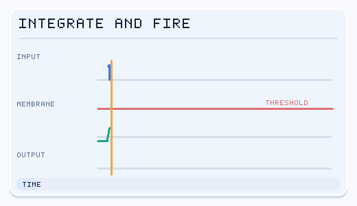

# 計算神經科學

用數學模型、模擬與資料分析，理解神經系統**如何計算**。

## Marr 的三個分析層次

David Marr（1982）在《Vision》中提出理解任何資訊處理系統的三個層次，至今仍是 AI 與神經科學共同的思考框架：

| 層次 | 問題 | 例子（視覺邊緣偵測） | AI 對應 |
|---|---|---|---|
| 計算層次 | 要解決什麼問題？為什麼？ | 找出影像中強度劇烈變化的位置 | 目標函數、損失函數 |
| 演算法／表徵層次 | 用什麼表徵與演算法？ | 高斯拉普拉斯濾波、零交叉 | 架構、學習規則 |
| 實作層次 | 物理上如何實現？ | 視網膜神經節細胞、V1 簡單細胞 | GPU、神經形態晶片 |

Richards et al.（2019, *Nature Neuroscience*）〈A deep learning framework for neuroscience〉建議用**目標函數、學習規則與架構**三要素來研究大腦，這直接借用了深度學習的觀點。

## 神經元模型

| 模型 | 複雜度 | 說明 |
|---|---|---|
| McCulloch–Pitts | 最簡 | 二元閾值單元 |
| 速率模型 | 簡單 | 輸出為放電頻率；與人工神經元相似 |
| 漏電積分發放（LIF） | 簡單 | 帶洩漏地累積輸入，達閾值即發放並重置——是 SNN 的基礎 |
| Izhikevich | 中等 | 以兩個變數重現多種放電模式 |
| Hodgkin–Huxley | 高 | 動作電位的離子通道動力學（1963 年諾貝爾獎） |
| 多室模型 | 極高 | 詳細的樹突形態 |

LIF 動力學：

*漏電整合放電（LIF）神經元的概念動畫（原創，CC BY-SA 4.0）。* 輸入事件提高膜電位，事件間電位逐漸衰減；達到閾值就產生脈衝並重置電位。這是簡化的離散時間示意，**並非真實神經元的量測結果**。

\[
\tau_m \frac{dV}{dt} = -(V - V_{rest}) + R\,I(t), \quad V \geq V_{th} \Rightarrow \text{發放脈衝}, \; V \leftarrow V_{reset}
\]

## 神經編碼與解碼

- **編碼**：刺激 → 反應。調諧曲線、感受野、線性—非線性—泊松（LNP）模型、廣義線性模型（GLM）；近年越來越多用深度網路作為編碼模型
- **解碼**：反應 → 刺激或意圖。線性與貝氏解碼器、深度網路；這是 [腦機介面](../bci/index.md) 的核心
- **群體編碼**：資訊分散在許多神經元之中
- **高效與稀疏編碼**：Olshausen & Field（1996）從自然影像學到稀疏編碼，得到類似 V1 簡單細胞的感受野——這是無監督學習解釋神經特性的經典案例

## 神經網路動力學

- **吸引子網路**：Hopfield 網路（記憶）、連續吸引子（頭方向細胞、工作記憶）
- **興奮—抑制平衡**
- **儲備池計算**（回聲狀態網路、液態狀態機）
- **神經流形與低維動力學**：高維的活動往往位於低維流形上；在認知任務上訓練 RNN 並反向分析其動力學，能提出關於前額葉皮質的假說（Mante et al., 2013；Sussillo & Barak, 2013）
- **臨界性假說**：大腦可能運作在有序與混沌的邊界附近

## 學習規則

| 規則 | 說明 |
|---|---|
| Hebb 規則 | 同時活躍的突觸會增強：\(\Delta w \propto x_{pre}\,x_{post}\) |
| Oja 規則 | 正規化的 Hebb 學習；可抽出第一主成分 |
| BCM | 使用滑動閾值的可塑性 |
| STDP | 突觸前脈衝先於突觸後則增強，反之則減弱 |
| 三因子規則 | Hebb 項 × 第三個調控訊號（例如多巴胺），把局部可塑性與獎勵連結起來 |

## 規範性模型

先推導大腦「應該」做什麼（透過最佳化某個目標），再與資料比較：高效編碼、貝氏觀察者、最佳控制、強化學習、資源理性。

## 關鍵方法

### Hodgkin–Huxley 模型（Hodgkin & Huxley, 1952）

- **問題：** 動作電位如何由跨越烏賊巨大軸突細胞膜的離子流動產生？
- **核心想法：** 細胞膜被視為一個電容，與電壓門控的鈉、鉀電導以及漏電流並聯。三個閘控變數（m、h、n）各自朝向依電壓而定的數值鬆弛，並控制電導。
- **方程式：**（採用現代的符號慣例）

\[
C\frac{dV}{dt} = I - g_{Na}\,m^3 h\,(V - E_{Na}) - g_K\,n^4\,(V - E_K) - g_L\,(V - E_L)
\]

\[
\frac{dx}{dt} = \alpha_x(V)\,(1 - x) - \beta_x(V)\,x, \qquad x \in \{m, h, n\}
\]

- **結果：** 模擬出的動作電位形狀與烏賊軸突的記錄相符，並重現了動作電位沿軸突傳播的情形。
- **限制：** 只根據單一標本、單一溫度擬合，沒有樹突結構。每個區室四個耦合方程，對大型網路計算成本高，因此上表中較簡單的 LIF 與 Izhikevich 模型才這麼常見。

### 稀疏編碼（Olshausen & Field, 1996）

- **問題：** 初級視覺皮質（V1）的神經元為何對特定位置的定向邊緣有反應？
- **核心想法：** 將自然影像小塊表示為少數基底函數的加權和，且係數稀疏。基底函數由無標籤的影像學得。
- **方程式：** 對每個影像小塊，求係數 \(a_i\) 與基底函數 \(\phi_i\)，使下式最小化：

\[
E = \Big\| I - \sum_i a_i \phi_i \Big\|^2 + \lambda \sum_i S(a_i)
\]

  其中 \(S\) 是稀疏性懲罰項，偏好只有少數係數為非零。
- **結果：** 學到的基底函數具有局部性、方向性與帶通特性，類似 V1 簡單細胞的感受野。
- **限制：** 這是線性生成模型，未涵蓋複雜細胞、時間動態與高層回饋。稀疏編碼是多種規範性解釋之一，並非 V1 的完整模型。

## 工具與資料

- 模擬器：[NEURON](https://neuron.yale.edu/)、[NEST](https://www.nest-simulator.org/)、[Brian2](https://briansimulator.org/)
- 分析工具：[MNE-Python](https://mne.tools/)（EEG/MEG）、[Nilearn](https://nilearn.github.io/)（fMRI）、[SpikeInterface](https://spikeinterface.readthedocs.io/)
- 資料標準與資料庫：[NWB](https://www.nwb.org/)、[DANDI Archive](https://dandiarchive.org/)、[OpenNeuro](https://openneuro.org/)、Allen Brain Atlas 與 Allen Brain Observatory

## 學習資源

- Dayan & Abbott，《Theoretical Neuroscience》
- Gerstner 等人，《Neuronal Dynamics》（[線上全文](https://neuronaldynamics.epfl.ch/)）
- [Neuromatch Academy 計算神經科學課程](https://compneuro.neuromatch.io/)（CC BY 4.0，強烈推薦）
- Marr，《Vision》
- Artem Kirsanov 的 YouTube 頻道（計算神經科學的視覺化講解）

## 參考文獻

### 開創性論文

- Hodgkin, A. L. & Huxley, A. F. (1952). A quantitative description of membrane current and its application to conduction and excitation in nerve. *The Journal of Physiology*. https://doi.org/10.1113/jphysiol.1952.sp004764 — 推導動作電位的四變數電導模型，是多數生物物理神經元模型的基礎。
- Izhikevich, E. M. (2003). Simple model of spiking neurons. *IEEE Transactions on Neural Networks*. https://doi.org/10.1109/TNN.2003.820440 — 雙變數模型，以低計算成本重現多種皮質發放型態。
- Olshausen, B. A. & Field, D. J. (1996). Emergence of simple-cell receptive field properties by learning a sparse code for natural images. *Nature*. https://doi.org/10.1038/381607a0 — 顯示自然影像的稀疏編碼會產生類似 V1 簡單細胞的定向局部濾波器。
- Richards, B. A. et al. (2019). A deep learning framework for neuroscience. *Nature Neuroscience*. https://doi.org/10.1038/s41593-019-0520-2 — 主張以目標函數、學習規則與架構來研究大腦。

### 綜述與教科書

- Gerstner, W., Kistler, W. M., Naud, R. & Paninski, L. (2014). *Neuronal Dynamics*. Cambridge University Press. https://neuronaldynamics.epfl.ch/ — 免費線上教科書，從單一神經元模型到網路與學習規則。
