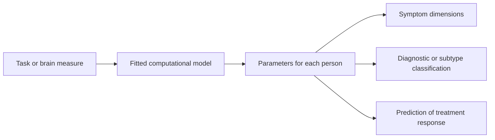

# Computational Psychiatry

Computational psychiatry applies formal models of learning, decision making and inference to psychiatric symptoms. It tries to turn symptoms into measurable quantities that can be compared across people and linked to brain mechanisms, and then to use those quantities to classify patients or to predict who will respond to a treatment.

## Overview

Psychiatric diagnosis has mostly relied on clusters of observed symptoms, such as what a clinician sees and a patient reports. Two people with the same diagnosis can have quite different symptoms, and the same symptom can arise from different causes. Computational psychiatry asks whether those causes can be described in terms of how the brain learns and decides.

The field grows from a simple idea. The algorithms of reinforcement learning and Bayesian inference describe how animals and people learn from reward and cope with uncertainty. If those algorithms describe normal behaviour well, then a change in one of their parameters, or a failure of one of their signals, might describe an illness. A 2012 review by Montague and colleagues set out the aims of the approach.[^1] Huys, Maia and Frank (2016) later framed the field as a bridge from neuroscience to clinical applications.

Three strands of work are most active. The first is computational phenotyping: fitting a model to behaviour and reading the fitted parameters as a profile of an individual. The second is the account of aberrant prediction error in psychosis, which explains some symptoms as a fault in the brain's learning and perception signals. The third is machine learning, used for diagnosis, subtyping and the prediction of treatment outcome. The clinical landscape in which these methods are applied is described in [Mental Health](../../applications/mental-health/index.md).

## Key concepts

- **Computational phenotype**: a profile of one person's behaviour in terms of the parameters of a fitted model, such as how quickly they learn from outcomes or how much they plan ahead. It is a counterpart to a symptom checklist.
- **Model-based and model-free control**: two ways of choosing actions. Model-free control stores the value of each action from past experience. Model-based control plans using a model of how actions lead to outcomes. See [Model-Based vs Model-Free Control](../decision-reward/model-based-vs-model-free/index.md).
- **Reward prediction error**: the difference between the reward received and the reward expected. It is the teaching signal of temporal-difference learning, and it is linked to dopamine neurons. See [Dopamine Reward Prediction Error](../neuroscience/dopamine-reward-prediction-error/index.md).
- **Prior and likelihood**: in Bayesian inference, the prior is the belief held before evidence arrives, and the likelihood is how well the evidence fits each hypothesis. Psychiatric accounts ask whether priors are too strong or sensory evidence is weighted too weakly.
- **Aberrant prediction error**: a prediction error that signals surprise where none should occur, or that fails to signal where it should.
- **Dimensional approach**: describing symptoms as continuous traits that cut across diagnostic categories, rather than as fixed disorders. The Research Domain Criteria framework is the best-known example.[^2]
- **Out-of-sample prediction**: testing a model on people who were not used to build it. Without this test, a model may only describe the sample it was fitted to.

## How it works

Most computational-psychiatry studies follow three steps.

1. A task or measurement records behaviour, or brain activity, from participants. The task is designed so that a model can explain their choices, for example by giving rewards that depend on earlier choices.
2. A computational model is fitted to each participant's data. Its parameters summarise the decision process. Typical parameters include a learning rate, the sensitivity to reward, the balance between model-based and model-free control, and the strength of a prior.
3. The parameters are compared between people with and without symptoms, or they are used as inputs to a classifier or predictor.

The core learning rule shows what a parameter does. After an outcome with reward $r_t$, the prediction error is

$$\delta_t = r_t + \gamma V(s_{t+1}) - V(s_t),$$

and the value estimate is updated as $V(s_t) \leftarrow V(s_t) + \alpha\,\delta_t$. The learning rate $\alpha$ sets how strongly each error changes future expectations. A person who learns slowly from rewards would show a smaller $\alpha$ than a control participant, and this difference can be recovered from the choices made.

Machine learning follows the same overall logic, but it learns the mapping from many features to outcomes rather than assuming a mechanism. Its results are judged on people the model has not seen.

## Key methods

Each method has its own page. This table is only a comparison.

| Method | What it does | Page |
|---|---|---|
| Computational phenotyping with a two-step task (Gillan et al., 2016) | Fits a hybrid model to a planning task and relates goal-directed control to a symptom dimension | [Gillan et al. 2016](gillan-2016/index.md) |
| Predictive-coding account of psychosis (Fletcher & Frith, 2008) | Explains positive symptoms as abnormal prediction and prior beliefs that resist contrary evidence | [Fletcher and Frith 2008](fletcher-frith-2008/index.md) |
| Machine learning for treatment prediction (Chekroud et al., 2016) | Trains a classifier on data from one trial and tests whether it predicts outcomes in another | [Chekroud et al. 2016](chekroud-2016/index.md) |

## Connections

- **Reinforcement learning and dopamine**: the models in this field come largely from reinforcement learning. The reward prediction error recorded from dopamine neurons, described in [Dopamine Reward Prediction Error](../neuroscience/dopamine-reward-prediction-error/index.md), is the best-known link between a computational variable and a neural signal, and it is the starting point for many accounts of learning in psychiatric disorders.
- **Decision making**: the split between goal-directed and habitual control, covered in [Model-Based vs Model-Free Control](../decision-reward/model-based-vs-model-free/index.md), gives the best-studied candidate for a compulsion-related phenotype. The wider picture of how evidence and value combine is in [Decision Making, Dopamine & Reward](../decision-reward/index.md).
- **Predictive processing**: the account of psychosis rests on the prediction-error view of perception described in [Predictive Coding & Free Energy](../predictive-coding/index.md).
- **Formal foundations**: the Bayesian models behind the predictive-processing accounts are covered in [Probabilistic & Bayesian Methods](../../theory/paradigms/probabilistic/index.md), and the reinforcement learning algorithms in [Reinforcement Learning](../../theory/paradigms/reinforcement-learning/index.md).

## Applications

- **Compulsive and habit-related problems**: measures of goal-directed control are proposed for comparing obsessive-compulsive symptoms and other compulsive behaviours. Gillan et al. (2016) is one example, with the caveat in the footnote below.[^3]
- **Psychosis**: the prediction-error account is used to interpret hallucinations and delusions and to design experiments that test them. Sterzer et al. (2018) review this work.
- **Treatment selection**: classifiers trained on pre-treatment data are tested as predictors of response to antidepressants. Chekroud et al. (2016) is an example. Dwyer, Falkai and Koutsouleris (2018) review how these methods are developed and what limits their clinical use.

## Open questions

- **Are the parameters reliable and specific?** A measure is useful for an individual only if it is stable over time and does not simply track general intelligence or attention. Test-retest reliability is an active area of study.
- **Does the model describe the mechanism?** A model can describe behaviour well without showing that the brain runs that algorithm. Adams, Huys and Roiser (2015) is an early review of the mathematical framing of this question.
- **Do prediction errors cause symptoms or follow them?** The predictive-coding account of psychosis has supporting evidence, but the direction of cause is debated. Sterzer et al. (2018) review the account and its evidence.
- **Do classifiers generalise?** A prediction made in one study can fail in another population or clinic. Bzdok and Meyer-Lindenberg (2018) discuss both the opportunities and the challenges of machine learning for precision psychiatry.
- **Can these measures enter routine care?** Most of the tools described here remain research instruments. Dwyer et al. (2018) describe the steps and the limitations that a machine learning method faces before clinical translation.

[^1]: Montague, Dolan, Friston and Dayan (2012) is cited here for the aims of the field, not for any specific result.
[^2]: The Research Domain Criteria are a research framework proposed by the US National Institute of Mental Health. They are a proposal for research organisation, not a diagnostic tool.
[^3]: Gillan et al. (2016) recruited large general-population samples online, not clinical patients. Their result concerns a symptom dimension, not a diagnosis, and it does not establish that the same deficit is the cause of compulsive disorders.

## References

### Seminal papers

- Gillan, C. M., Kosinski, M., Whelan, R., Phelps, E. A. & Daw, N. D. (2016). Characterizing a psychiatric symptom dimension related to deficits in goal-directed control. *eLife*. https://doi.org/10.7554/eLife.11305 — Links goal-directed control measured with a planning task to a dimension of compulsive behaviour and intrusive thought in general-population samples.
- Chekroud, A. M. et al. (2016). Cross-trial prediction of treatment outcome in depression: a machine learning approach. *The Lancet Psychiatry*. https://doi.org/10.1016/S2215-0366(15)00471-X — Trains a machine learning model to predict depression treatment outcome and tests it across separate trials.
- Fletcher, P. C. & Frith, C. D. (2008). Perceiving is believing: a Bayesian approach to explaining the positive symptoms of schizophrenia. *Nature Reviews Neuroscience*. https://doi.org/10.1038/nrn2536 — Argues that positive symptoms can be explained by an abnormal weighting of prior beliefs and sensory prediction errors.
- Kapur, S. (2003). Psychosis as a state of aberrant salience: a framework linking biology, phenomenology, and pharmacology in schizophrenia. *American Journal of Psychiatry*. https://doi.org/10.1176/appi.ajp.160.1.13 — An influential framework that explains psychotic symptoms through aberrant salience, linking biology, experience and drug action.
- Schultz, W., Dayan, P. & Montague, P. R. (1997). A neural substrate of prediction and reward. *Science*. https://doi.org/10.1126/science.275.5306.1593 — Shows that dopamine neuron activity signals reward prediction errors of the kind used in temporal-difference learning.

### Surveys and textbooks

- Montague, P. R., Dolan, R. J., Friston, K. J. & Dayan, P. (2012). Computational psychiatry. *Trends in Cognitive Sciences*. https://doi.org/10.1016/j.tics.2011.11.018 — Review that sets out computational psychiatry as an approach using models of learning and decision making to understand mental illness.
- Maia, T. V. & Frank, M. J. (2011). From reinforcement learning models to psychiatric and neurological disorders. *Nature Neuroscience*. https://doi.org/10.1038/nn.2723 — Early review of how reinforcement learning models can describe symptoms in psychiatric and neurological disorders.
- Huys, Q. J. M., Maia, T. V. & Frank, M. J. (2016). Computational psychiatry as a bridge from neuroscience to clinical applications. *Nature Neuroscience*. https://doi.org/10.1038/nn.4238 — Review of how computational models can connect neuroscience with clinical practice in psychiatry.
- Adams, R. A., Huys, Q. J. M. & Roiser, J. P. (2015). Computational Psychiatry: towards a mathematically informed understanding of mental illness. *Journal of Neurology, Neurosurgery & Psychiatry*. https://doi.org/10.1136/jnnp-2015-310737 — Review of how formal models can inform the understanding of mental illness.
- Sterzer, P. et al. (2018). The Predictive Coding Account of Psychosis. *Biological Psychiatry*. https://doi.org/10.1016/j.biopsych.2018.05.015 — Review of the predictive-coding account of psychotic symptoms and the evidence for it.
- Dwyer, D. B., Falkai, P. & Koutsouleris, N. (2018). Machine Learning Approaches for Clinical Psychology and Psychiatry. *Annual Review of Clinical Psychology*. https://doi.org/10.1146/annurev-clinpsy-032816-045037 — Review of machine learning methods for diagnosis, prognosis and treatment, with the limits that apply to clinical translation.

### Articles and documentation

- Insel, T. et al. (2010). Research Domain Criteria (RDoC): Toward a New Classification Framework for Research on Mental Disorders. *American Journal of Psychiatry*. https://doi.org/10.1176/appi.ajp.2010.09091379 — Proposes a research framework that organises mental disorders around dimensions of function instead of fixed diagnostic categories.
- Bzdok, D. & Meyer-Lindenberg, A. (2018). Machine Learning for Precision Psychiatry: Opportunities and Challenges. *Biological Psychiatry: Cognitive Neuroscience and Neuroimaging*. https://doi.org/10.1016/j.bpsc.2017.11.007 — Discusses how machine learning could support precision psychiatry, and the validation problems it faces.
