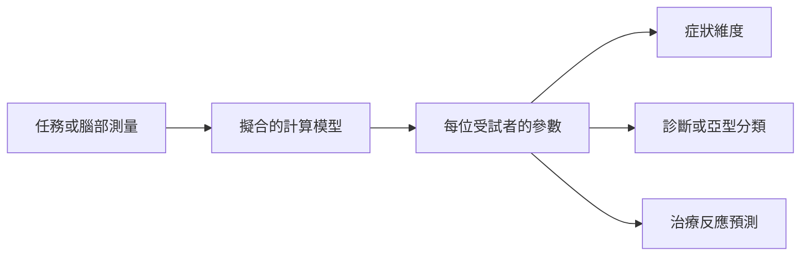

# 計算精神醫學

計算精神醫學把學習、決策與推論的形式化模型應用於精神症狀。它試圖把症狀轉化為可以測量、可以在不同人之間比較、並能與腦部機制連結的量，再利用這些量來分類病人，或預測誰會對某種治療有反應。

## 概述

精神疾病的診斷大多依賴於觀察到的症狀群，例如臨床醫師所見與病人所述。憂鬱症、焦慮症、精神病與強迫類疾患，都是由醫師看得到的東西與病人報告的內容來界定。兩位診斷相同的病人，症狀可能差異很大；同一種症狀，也可能來自不同的原因。計算精神醫學問的是：這些原因能否用大腦如何學習與決策來描述。

這個領域源自一個簡單的想法。強化學習與貝氏推論的演算法，描述了動物與人類如何從獎勵中學習，以及如何處理不確定性。如果這些演算法能很好地描述正常行為，那麼其中某個參數的改變，或其中某個訊號的失靈，或許就能描述一種疾病。Montague 及其同事在 2012 年的一篇回顧中提出了這個方法的目標。[^1] Huys、Maia 與 Frank（2016）之後把這個領域定位為連結神經科學與臨床應用的橋樑。

目前最活躍的有三條研究路線。第一是計算表型：為一套行為擬合模型，並把擬合出的參數讀作個人的側寫。第二是對精神病中異常預測誤差的解釋，它把部分症狀歸因於大腦學習與知覺訊號的失常。第三是機器學習，用於診斷、亞型分類與治療結果的預測。這些方法所應用的臨床場景，見於[心理健康](../../applications/mental-health/index.md)。

## 核心概念

- **計算表型**：以擬合模型的參數來描述一個人的行為側寫，例如他從結果中學習的速度，或他事先規劃的程度。它與症狀清單相對應。
- **有模型與無模型控制**：選擇行動的兩種方式。無模型控制從過去經驗中記下每個行動的價值；有模型控制則利用行動如何導致結果的模型來規劃。見[有模型與無模型控制](../decision-reward/model-based-vs-model-free/index.md)。
- **獎勵預測誤差**：實際獲得的獎勵與預期獎勵之間的差異。它是時序差分學習的教學訊號，並與多巴胺神經元相關。見[多巴胺的獎勵預測誤差](../neuroscience/dopamine-reward-prediction-error/index.md)。
- **先驗與概似**：在貝氏推論中，先驗是證據到來之前所持有的信念，概似則是證據與各個假設的吻合程度。精神醫學的解釋會追問：先驗是否太強，或感覺證據是否被賦予過低的權重。
- **異常預測誤差**：在不該出現驚訝時發出驚訝訊號，或在應該發出訊號時沒有發出的預測誤差。
- **維度式方法**：把症狀描述為跨越診斷類別的連續特質，而不是固定的疾病。研究領域準則（Research Domain Criteria）是最知名的例子。[^2]
- **樣本外預測**：在未用於建立模型的人身上測試模型。缺少這項測試，模型可能只描述了擬合時所用的樣本。

## 運作方式

多數計算精神醫學研究遵循三個步驟。

1. 任務或測量記錄受試者的行為，或腦部活動。任務的設計使模型能夠解釋他們的選擇，例如讓獎勵取決於先前的選擇。
2. 為每位受試者的資料擬合一個計算模型。模型的參數概括了決策歷程。典型的參數包括學習率、對獎勵的敏感度、有模型與無模型控制之間的平衡，以及先驗的強度。
3. 比較有症狀與無症狀的人之間的參數，或把參數作為分類器或預測器的輸入。

核心學習法則顯示了參數的作用。在獲得獎勵 $r_t$ 的結果之後，預測誤差為

$$\delta_t = r_t + \gamma V(s_{t+1}) - V(s_t),$$

價值估計則依 $V(s_t) \leftarrow V(s_t) + \alpha\,\delta_t$ 更新。學習率 $\alpha$ 決定每一次誤差如何強烈地改變對未來的期待。一個從獎勵中學習得很慢的人，其 $\alpha$ 會小於對照組，而這種差異可以從所做的選擇中還原出來。

機器學習遵循的大致邏輯相同，但它學習的是從許多特徵到結果的對應關係，而不預先假設機制。它的結果以模型未曾見過的人來判斷。

## 關鍵方法

每種方法都有自己的頁面。下表僅作比較。

| 方法 | 作用 | 頁面 |
|---|---|---|
| 以兩步任務進行計算表型（Gillan et al., 2016） | 把混合模型擬合到規劃任務上，並把目標導向控制與症狀維度連結起來 | [Gillan et al. 2016](gillan-2016/index.md) |
| 精神病的預測編碼解釋（Fletcher & Frith, 2008） | 把陽性症狀解釋為異常預測與抗拒反證的先驗信念 | [Fletcher and Frith 2008](fletcher-frith-2008/index.md) |
| 用於治療預測的機器學習（Chekroud et al., 2016） | 在一個試驗的資料上訓練分類器，並測試它能否預測另一個試驗的結果 | [Chekroud et al. 2016](chekroud-2016/index.md) |

## 與其他主題的關聯

- **強化學習與多巴胺**：這個領域的模型大多來自強化學習。在多巴胺神經元中記錄到的獎勵預測誤差，見於[多巴胺的獎勵預測誤差](../neuroscience/dopamine-reward-prediction-error/index.md)，是計算變數與神經訊號之間最著名的連結，也是許多精神疾病學習解釋的起點。
- **決策**：在[有模型與無模型控制](../decision-reward/model-based-vs-model-free/index.md)中討論的目標導向與習慣控制之分，為與強迫相關的表型提供了研究最充分的候選。證據與價值如何結合的較廣圖景，見於[決策、多巴胺與獎勵](../decision-reward/index.md)。
- **預測處理**：精神病的解釋建立在[預測編碼與自由能原理](../predictive-coding/index.md)所述的預測誤差知覺觀之上。
- **形式基礎**：預測處理解釋背後的貝氏模型，見於[機率圖模型與貝氏方法](../../theory/probabilistic/index.md)；強化學習的演算法見於[強化學習](../../theory/paradigms/reinforcement-learning/index.md)。

## 應用

- **強迫與習慣相關的問題**：目標導向控制的測量被提議用於比較強迫症狀與其他強迫行為。Gillan et al.（2016）是一個例子，其限制見下方註腳。[^3]
- **精神病**：預測誤差的解釋被用來詮釋幻覺與妄想，並設計實驗加以檢驗。Sterzer et al.（2018）回顧了這方面的工作。
- **治療選擇**：在治療前資料上訓練的分類器，被拿來測試其對抗憂鬱藥反應的預測能力。Chekroud et al.（2016）是一例。Dwyer、Falkai 與 Koutsouleris（2018）回顧這些方法如何發展，以及其臨床應用受到哪些限制。

## 開放問題

- **參數是否可靠且具特異性？** 一項測量只有在長時間內穩定，且不僅僅追蹤一般智力或注意力時，才對個人有用。重測信度是一個活躍的研究領域。
- **模型是否描述了機制？** 模型可以很好地描述行為，卻不能證明大腦實際執行該演算法。Adams、Huys 與 Roiser（2015）是對此問題之數學框架的早期回顧。
- **預測誤差是症狀的成因，還是症狀的結果？** 精神病的預測編碼解釋有支持證據，但因果方向仍有爭議。Sterzer et al.（2018）回顧了該解釋及其證據。
- **分類器能否推廣？** 一項研究中做出的預測，可能在另一個族群或另一家診所失效。Bzdok 與 Meyer-Lindenberg（2018）討論了機器學習用於精準精神醫學的機會與挑戰。
- **這些測量能否進入常規照護？** 這裡描述的大多數工具仍是研究工具。Dwyer et al.（2018）說明了機器學習方法在臨床轉化之前需要的步驟與限制。

[^1]: Montague、Dolan、Friston 與 Dayan（2012）在此引用，是為了說明該領域的目標，而非某項特定結果。
[^2]: 研究領域準則是美國國家心理衛生研究所提出的研究框架。它用來組織研究，而不是一套診斷工具。
[^3]: Gillan et al.（2016）招募的是大型的一般人群線上樣本，而非臨床病人。其結果涉及一個症狀維度，而非診斷，也不能確定同樣的缺陷就是強迫性疾患的成因。

## 參考文獻

### 開創性論文

- Gillan, C. M., Kosinski, M., Whelan, R., Phelps, E. A. & Daw, N. D. (2016). Characterizing a psychiatric symptom dimension related to deficits in goal-directed control. *eLife*. https://doi.org/10.7554/eLife.11305 — 在兩個一般人群樣本中，目標導向控制的缺陷與一個強迫行為與侵入性思維的維度相關。
- Chekroud, A. M. et al. (2016). Cross-trial prediction of treatment outcome in depression: a machine learning approach. *The Lancet Psychiatry*. https://doi.org/10.1016/S2215-0366(15)00471-X — 以基線資料訓練機器學習模型，並測試它能否在另一個試驗中預測憂鬱症的治療結果。
- Fletcher, P. C. & Frith, C. D. (2008). Perceiving is believing: a Bayesian approach to explaining the positive symptoms of schizophrenia. *Nature Reviews Neuroscience*. https://doi.org/10.1038/nrn2536 — 主張陽性症狀可以由先驗信念與感覺預測誤差的異常加權來解釋。
- Kapur, S. (2003). Psychosis as a state of aberrant salience: a framework linking biology, phenomenology, and pharmacology in schizophrenia. *American Journal of Psychiatry*. https://doi.org/10.1176/appi.ajp.160.1.13 — 一個有影響力的框架，以異常顯著性解釋精神病症狀，並連結生物學、經驗與藥理作用。
- Schultz, W., Dayan, P. & Montague, P. R. (1997). A neural substrate of prediction and reward. *Science*. https://doi.org/10.1126/science.275.5306.1593 — 顯示多巴胺神經元的活動反映了時序差分學習所用的獎勵預測誤差。

### 綜述與教科書

- Montague, P. R., Dolan, R. J., Friston, K. J. & Dayan, P. (2012). Computational psychiatry. *Trends in Cognitive Sciences*. https://doi.org/10.1016/j.tics.2011.11.018 — 回顧文獻，把計算精神醫學界定為以學習與決策模型理解精神疾病的研究取向。
- Maia, T. V. & Frank, M. J. (2011). From reinforcement learning models to psychiatric and neurological disorders. *Nature Neuroscience*. https://doi.org/10.1038/nn.2723 — 早期回顧，說明強化學習模型如何描述精神與神經疾患的症狀。
- Huys, Q. J. M., Maia, T. V. & Frank, M. J. (2016). Computational psychiatry as a bridge from neuroscience to clinical applications. *Nature Neuroscience*. https://doi.org/10.1038/nn.4238 — 回顧計算模型如何把神經科學與精神醫學的臨床實務連結起來。
- Adams, R. A., Huys, Q. J. M. & Roiser, J. P. (2015). Computational Psychiatry: towards a mathematically informed understanding of mental illness. *Journal of Neurology, Neurosurgery & Psychiatry*. https://doi.org/10.1136/jnnp-2015-310737 — 回顧形式模型如何有助於理解精神疾病。
- Sterzer, P. et al. (2018). The Predictive Coding Account of Psychosis. *Biological Psychiatry*. https://doi.org/10.1016/j.biopsych.2018.05.015 — 回顧精神病症狀的預測編碼解釋及其證據。
- Dwyer, D. B., Falkai, P. & Koutsouleris, N. (2018). Machine Learning Approaches for Clinical Psychology and Psychiatry. *Annual Review of Clinical Psychology*. https://doi.org/10.1146/annurev-clinpsy-032816-045037 — 回顧機器學習在診斷、預後與治療上的方法，以及臨床轉化所面對的限制。

### 文章與文件

- Insel, T. et al. (2010). Research Domain Criteria (RDoC): Toward a New Classification Framework for Research on Mental Disorders. *American Journal of Psychiatry*. https://doi.org/10.1176/appi.ajp.2010.09091379 — 提出一個研究框架，依功能維度而非固定的診斷類別來組織精神疾病。
- Bzdok, D. & Meyer-Lindenberg, A. (2018). Machine Learning for Precision Psychiatry: Opportunities and Challenges. *Biological Psychiatry: Cognitive Neuroscience and Neuroimaging*. https://doi.org/10.1016/j.bpsc.2017.11.007 — 討論機器學習如何支持精準精神醫學，以及它面對的驗證問題。
