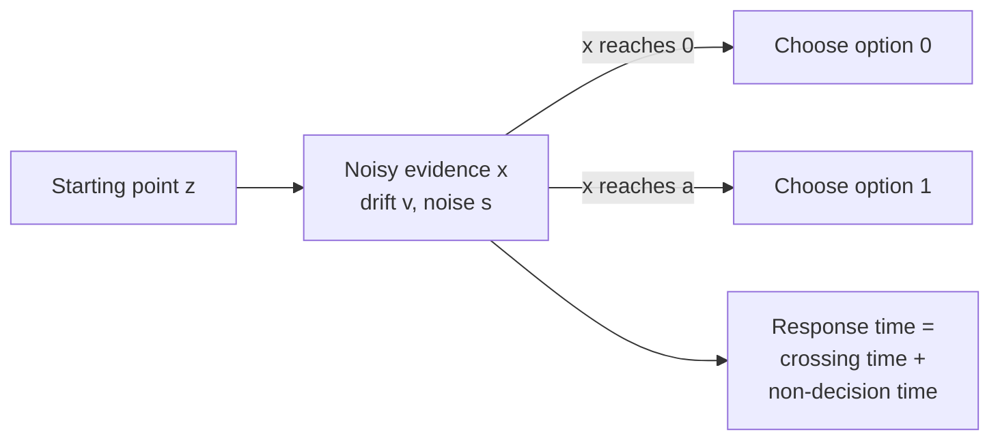

# Diffusion Decision Model

The diffusion decision model (DDM) describes a two-choice decision as noisy evidence accumulating toward one of two boundaries. It explains both the choices people make and how long they take to make them, which is why it is the standard model for response-time data in psychology and neuroscience. It is a method for turning behaviour into mechanism: each parameter corresponds to a distinct cognitive process.

This page is part of [Decision Making, Dopamine & Reward](../index.md). The parent page gives the overview; this page covers the model itself.

## Overview

Two-choice tasks produce two kinds of data: the proportion of correct answers and the distribution of response times. A model that only predicts accuracy cannot tell apart a person who is careful from one who has good information. The DDM fits both, and separates the causes of a change in behaviour into parts that can be tested.

## Key concepts

- **Drift rate**: the average rate at which evidence accumulates toward the correct option. A clearer stimulus gives a larger drift rate.
- **Boundary separation**: the distance between the two decision boundaries. Wider boundaries mean more evidence is needed before responding, which is slower and more accurate.
- **Starting point**: where accumulation begins between the boundaries. A starting point closer to one boundary is a bias toward that option.
- **Non-decision time**: the time taken by processes outside the decision itself, such as perceiving the stimulus and moving the hand.
- **Noise**: random fluctuation in the evidence, which makes the same stimulus lead to different decision times and occasional errors.

## Problem

Standard choice models predict which option a person picks but say little about timing. Two people with the same accuracy can differ in speed for very different reasons: one may be more cautious, another may be processing the stimulus more slowly. Ratcliff and McKoon (2008) present the diffusion model as a theory that predicts both accuracy and the full distribution of response times for two-choice tasks, and that ties each part of the data to a separate parameter.

## How it works

Let evidence x start at a point z between boundaries at 0 and a. In standard notation, x changes as

dx = v dt + s dW

where v is the drift rate, s the scale of the noise, and dW a small increment of a Wiener process. The decision is made when x first reaches 0 or a. The response time is the time to reach a boundary plus the non-decision time. Choice and response time together then determine the predicted data, and fitting the parameters to the observed distribution of response times is what separates the components.

The model's form is a continuous version of sequential sampling, in which evidence is gathered one sample at a time until a threshold is reached. Its continuous form makes the predicted distributions of response times analytical, which is why it can be fitted to large datasets.

## Evidence and what the parameters explain

Ratcliff and McKoon (2008) review the model's theory and the data it was fitted to. The central point is that each experimental manipulation maps onto a parameter, so the model can say *what* changed:

- **Stimulus difficulty** is best described as a change in drift rate: harder stimuli give less information per unit time.
- **Speed-accuracy instructions** are best described as a change in boundary separation: asking for speed narrows the boundaries, which shortens responses and raises errors without changing the quality of information.
- **Response bias**, such as unequal frequencies of the two options, is best described as a shift in the starting point or the drift.

Because the model makes precise predictions for the whole response-time distribution, not just the mean, it can be rejected by data. This is what separates it from descriptive accounts of response times.

## Results

The model is evaluated by fitting it to two-choice data and comparing its predicted accuracy and response-time distributions with those observed. The sources cited here support the qualitative pattern above: parameters move in the directions described when difficulty, instructions or bias change. This page does not quote numerical fits, since none are given in the sources read for it.

## Neural correspondence

The model describes behaviour, and its parameters are not directly neural quantities. Accumulation-to-bound ideas were motivated in large part by recordings from parietal cortex in monkeys performing motion discrimination, where firing rates rise toward a level before a choice. Gold and Shadlen (2007) review this line of work, which is the main reason the model is considered a candidate neural mechanism. Whether the fitted parameters map onto specific neurons is still an open research question.

## Limitations

- **Two options.** The basic model is built for two-choice tasks. Extensions to many options exist, but they are not the same model.
- **Fixed boundaries.** The basic model assumes the boundaries do not move during a trial. Some tasks suggest the boundary changes over time or with reward, which the basic model does not capture.
- **Parameters are summaries.** Fitted parameters are useful summaries of behaviour, but the step from them to specific neural populations has not been established.

## Connections

- **Decision making and reward**: the diffusion model covers evidence; learned values are a separate input. The parent page [Decision Making, Dopamine & Reward](../index.md) discusses how value can bias the starting point.
- **Model-based and model-free control**: a different question, about which controller chooses. See [Model-Based vs Model-Free Control](../model-based-vs-model-free/index.md).
- **Psychology**: the model is used in clinical and developmental research to compare groups by parameter rather than by accuracy alone. See [Psychology & AI](../../psychology/index.md).
- **Predictive coding**: accumulating evidence is one way a system could reach a decision from prediction errors. See [Predictive Coding & Free Energy](../../predictive-coding/index.md).

## Applications

- **Clinical and cognitive research**: comparing parameters between groups, such as older and younger adults, can separate slower processing from more cautious decision thresholds.
- **Human-AI interaction**: a possible use is modelling how quickly and accurately people respond to AI suggestions, to inform interfaces that avoid over-reliance. This is a proposed use, not a result from the sources cited here.

## Open questions

- **Are the parameters neural?** The fitted parameters are useful summaries, but their link to specific cortical populations is not settled.
- **How general is the model?** It was developed for two-choice tasks; extending it to many options and to value-based choice is an active area.
- **Is the boundary fixed?** Some tasks suggest the boundary changes over time or with reward, which the basic model does not capture.

## References

### Seminal papers

- Ratcliff, R. & McKoon, G. (2008). The Diffusion Decision Model: Theory and Data for Two-Choice Decision Tasks. *Neural Computation*. https://doi.org/10.1162/neco.2008.12-06-420 — Reviews the diffusion model's theory and the data it is fitted to, and explains how its parameters separate the effects of difficulty, speed-accuracy instructions and bias.
- Ratcliff, R. (1978). A theory of memory retrieval. *Psychological Review*. https://doi.org/10.1037/0033-295X.85.2.59 — An early diffusion-style account of memory retrieval, from which the decision model was later developed.
- Ratcliff, R. & Smith, P. L. (2004). A comparison of sequential sampling models for two-choice reaction time. *Psychological Review*. https://doi.org/10.1037/0033-295X.111.2.333 — Compares sequential-sampling models of two-choice reaction time, the family that includes the diffusion model.

### Surveys and reviews

- Gold, J. I. & Shadlen, M. N. (2007). The neural basis of decision making. *Annual Review of Neuroscience*. https://doi.org/10.1146/annurev.neuro.29.051605.113038 — A review of how neurons accumulate evidence toward a decision, the neural background to the diffusion models.
- Dayan, P. & Daw, N. D. (2008). Decision theory, reinforcement learning, and the brain. *Cognitive, Affective, & Behavioral Neuroscience*. https://doi.org/10.3758/CABN.8.4.429 — Reviews how decision theory and reinforcement learning models relate to choice in the brain.
