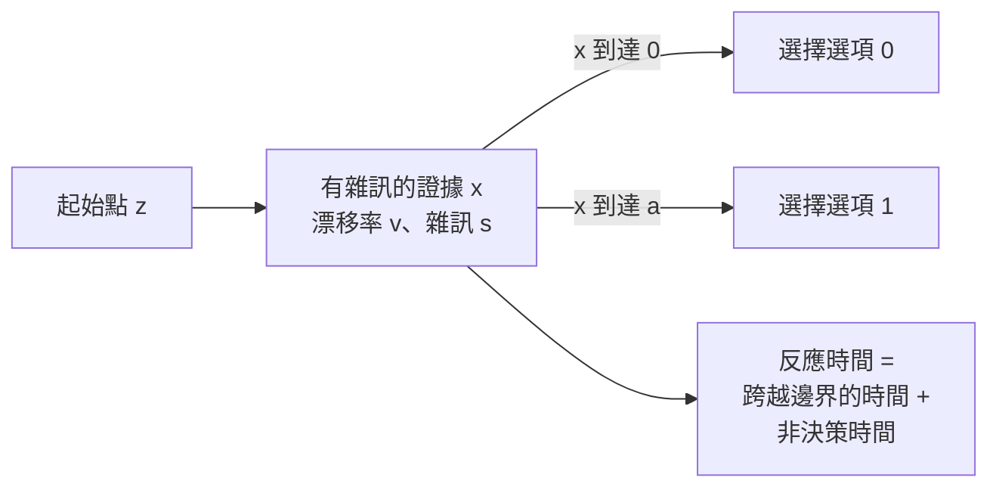

# 擴散決策模型

擴散決策模型（DDM）把二選一的決策描述為：有雜訊的證據朝兩個邊界之一累積。它同時解釋人們做出的選擇，以及做出選擇所花的時間，因此是心理學與神經科學中分析反應時間資料的標準模型。它把行為轉換成機制：每個參數都對應到一個不同的認知過程。

本頁是[決策、多巴胺與獎勵](../index.md)的子頁。上層頁面提供概述，本頁說明模型本身。

## 概述

二選一任務會產生兩種資料：正確作答的比例，以及反應時間的分布。只預測準確度的模型無法區分「謹慎的人」與「資訊品質好的人」。DDM 同時擬合兩者，並把行為改變的原因分解成可以檢驗的部分。

## 核心概念

- **漂移率（drift rate）**：證據朝正確選項累積的平均速率。刺激越清楚，漂移率越大。
- **邊界間距（boundary separation）**：兩個決策邊界之間的距離。邊界越寬，需要的證據越多，反應越慢但越準確。
- **起始點（starting point）**：在兩邊界之間累積開始的位置。起始點偏向某一邊界，即代表對該選項的偏誤。
- **非決策時間（non-decision time）**：決策本身之外的過程所花的時間，例如知覺刺激與移動手部。
- **雜訊（noise）**：證據中的隨機波動，使同一刺激產生不同的決策時間，並偶爾造成錯誤。

## 問題

標準的選擇模型能預測人們挑了哪個選項，但對時間著墨不多。兩個準確度相同的人，速度可能因為很不同的原因而有差異：一個較謹慎，另一個處理刺激的速度較慢。Ratcliff 與 McKoon（2008）把擴散模型呈現為一套理論，它能同時預測二選一任務的準確度與完整的反應時間分布，並把資料的每個部分連結到各自的參數。

## 模型如何運作

設證據 x 從位於 0 與 a 兩邊界之間的點 z 開始。以標準記號，x 的變化為

dx = v dt + s dW

其中 v 為漂移率，s 為雜訊的尺度，dW 為 Wiener 過程的一個小增量。當 x 首次到達 0 或 a 時做出決定。反應時間為到達邊界所需的時間，加上非決策時間。選擇與反應時間共同決定預測的資料，而把參數擬合到觀察到的反應時間分布，正是分離各個成分的方法。

這個模型是序列抽樣（sequential sampling）的連續版本：證據一次取一個樣本，直到達到門檻。連續形式使反應時間的預測分布可以用解析方式求得，因此能擬合大型資料集。

## 實驗證據與參數的解釋

Ratcliff 與 McKoon（2008）回顧這個模型的理論，以及它所擬合的資料。核心論點是：每一種實驗操弄都對應到一個參數，因此模型能說明「什麼」改變了：

- **刺激難度**最好被描述為漂移率的改變：較難的刺激每單位時間提供的資訊較少。
- **速度與準確度的指示**最好被描述為邊界間距的改變：要求快速作答會縮窄邊界，使反應變快、錯誤增加，而資訊品質不變。
- **反應偏誤**，例如兩個選項出現頻率不等，最好被描述為起始點或漂移率的偏移。

由於模型對整個反應時間分布（而不只是平均值）作出精確的預測，它可以被資料否證。這使它有別於只描述反應時間的敘述性理論。

## 結果

這個模型的評估方式，是把它擬合到二選一的資料，並比較它預測的準確度與反應時間分布和觀察值是否一致。本頁所引用的來源支持上述的定性模式：當難度、指示或偏誤改變時，參數朝所述方向移動。本頁不引用數值擬合結果，因為本頁所讀的來源中並未提供。

## 與神經的對應

這個模型描述的是行為，它的參數並非直接的神經量。累積至邊界的想法，很大程度上源於猴子在動作辨識任務中，頂葉皮質的記錄：在做出選擇之前，神經元的放電率會朝某個水準上升。Gold 與 Shadlen（2007）回顧了這條研究脈絡，這也是該模型被視為候選神經機制的主要原因。擬合出的參數是否對應到特定神經元，仍是開放的研究問題。

## 限制

- **只有兩個選項。**基本模型是為二選一任務而建。擴展到多個選項的版本存在，但它們已不是同一個模型。
- **邊界固定。**基本模型假設邊界在單次試次中不會移動。部分任務顯示邊界會隨時間或獎勵而改變，而基本模型無法捕捉這一點。
- **參數是摘要。**擬合出的參數是行為的有用摘要，但從它們推論到特定神經群體的步驟尚未確立。

## 與其他主題的關聯

- **決策與獎勵**：DDM 涵蓋證據，學得的價值則是另一項輸入。上層頁面[決策、多巴胺與獎勵](../index.md)討論價值如何偏移起始點。
- **有模型與無模型控制**：這是另一個問題，關於由哪個控制器做選擇。見[有模型與無模型控制](../model-based-vs-model-free/index.md)。
- **心理學**：此模型在臨床與發展研究中用於依參數而非僅依準確度比較群體。見[心理學與 AI](../../psychology/index.md)。
- **預測編碼**：累積證據是系統由預測誤差走向決定的一種方式。見[預測編碼與自由能](../../predictive-coding/index.md)。

## 應用

- **臨床與認知研究**：比較不同群體的參數，例如年長與年輕成人，可以區分較慢的處理速度與較謹慎的決策門檻。
- **人機互動**：一種可能的用途，是模擬人們對 AI 建議的反應速度與準確度，以協助設計避免過度依賴的介面。這是提出的用途，並非這裡所引用來源的結果。

## 開放問題

- **參數是神經量嗎？**擬合出的參數是有用的摘要，但它們與特定皮質群體的連結尚未確定。
- **這個模型有多普遍？**它是為二選一任務發展的；擴展到多個選項與以價值為基礎的選擇，是活躍的研究領域。
- **邊界是固定的嗎？**部分任務顯示邊界會隨時間或獎勵而改變，而基本模型無法捕捉這一點。

## 參考文獻

### 開創性論文

- Ratcliff, R. & McKoon, G.（2008）。The Diffusion Decision Model: Theory and Data for Two-Choice Decision Tasks. *Neural Computation*。https://doi.org/10.1162/neco.2008.12-06-420 — 回顧擴散模型的理論與其所擬合的資料，並說明其參數如何分開難度、速度與準確度指示及偏誤的效果。
- Ratcliff, R.（1978）。A theory of memory retrieval. *Psychological Review*。https://doi.org/10.1037/0033-295X.85.2.59 — 早期以擴散式描述記憶提取的理論，決策模型後來由此發展而來。
- Ratcliff, R. & Smith, P. L.（2004）。A comparison of sequential sampling models for two-choice reaction time. *Psychological Review*。https://doi.org/10.1037/0033-295X.111.2.333 — 比較二選一反應時間的序列抽樣模型，擴散模型屬於這一族。

### 綜述與回顧

- Gold, J. I. & Shadlen, M. N.（2007）。The neural basis of decision making. *Annual Review of Neuroscience*。https://doi.org/10.1146/annurev.neuro.29.051605.113038 — 回顧神經元如何把證據累積至決策，這是擴散模型的神經背景。
- Dayan, P. & Daw, N. D.（2008）。Decision theory, reinforcement learning, and the brain. *Cognitive, Affective, & Behavioral Neuroscience*。https://doi.org/10.3758/CABN.8.4.429 — 回顧決策理論與強化學習模型如何與大腦中的選擇相關。
