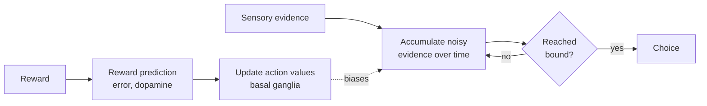

# Decision Making, Dopamine and Reward

Deciding is the point where perception and value meet action. The brain must weigh evidence, estimate what each option is likely to bring, and commit to one. Reinforcement learning, the main AI framework for choosing actions, was shaped by this neuroscience, and the two fields now test each other's models.

## Overview

A decision has two parts. The first is evidence: how much information supports each option, which is often noisy and accumulates over time. The second is value: how much each option is worth, which is learned from past outcomes. Neuroscience has studied both, and the most productive models link them through a shared learning signal, dopamine. [Cognitive Science](../cognitive-science/index.md) covers the psychology of reasoning and choice; this page focuses on the neural and computational mechanisms.

## Key concepts

- **Evidence accumulation**: the process of summing noisy sensory evidence over time until it reaches a threshold, at which point the choice is made.
- **Speed-accuracy trade-off**: waiting longer for evidence improves accuracy but delays the decision. Models describe this trade-off with a decision boundary.
- **Value**: the expected reward of an option, estimated from experience.
- **Model-free and model-based control**: model-free methods cache the value of actions from past rewards, which is cheap but slow to adapt. Model-based methods plan with a model of the environment, which is flexible but costly.
- **Reward prediction error**: the difference between the reward received and the reward expected. Dopamine neurons signal this quantity, as summarised in [Neuroscience Basics](../neuroscience/index.md).

## How it works

Two broad mechanisms explain most of the data. In perceptual decisions, evidence accumulates toward a bound, and the sensory and parietal cortex carry the running total. In value-based decisions, the basal ganglia learn which actions lead to reward, and dopamine updates those values. Many models combine the two, using accumulated evidence for quick perceptual choices and learned values for choices made from experience.

The loop in the diagram is a common shape for these theories. Learned values bias the starting point or drift of accumulation, so experience changes how quickly and accurately people decide.

## Key methods

### Diffusion decision model (Ratcliff & McKoon, 2008)

- **Problem:** Accuracy and response-time data for two-choice tasks are rich, but it has been hard to say which mechanism changes when a manipulation alters behaviour. Does difficulty change the quality of information, or does a speed-accuracy instruction change how much information is required?
- **Core idea:** Treat each decision as the accumulation of noisy evidence toward one of two boundaries. The model's parameters map onto separate processes: the drift rate (the quality of evidence), the boundary separation (how cautious the decision is), and the starting point (any bias toward one option). Fitting these parameters to the full response-time distribution separates the processes.
- **Equation or algorithm:** In standard notation, evidence x follows dx = v dt + s dW, starting at a point z between boundaries at 0 and a, where v is the drift rate, s the noise and dW a Wiener increment. The decision is made when x reaches 0 or a, and the response time is the time taken to reach it, plus a non-decision time for perception and motor processes. The paper's own parameterisation may differ in detail.
- **Results:** The paper reviews three experiments showing that stimulus difficulty changes the quality of information, that speed-accuracy instructions change how much information is needed before responding, and that stimulus proportions bias the drift rate and starting point. The abstract reports these results qualitatively.
- **Limitations:** The model assumes a particular form of noise and boundary, and fits can trade off between parameters. Its neural correspondence, for example to specific cortical populations, is an open research question rather than a settled result.

### Arbitrating between model-based and model-free control (Daw, Niv & Dayan, 2005)

- **Problem:** The brain seems to have several controllers for choosing actions, including one linked to prefrontal cortex and one to dorsolateral striatum. When they disagree, which should win?
- **Core idea:** Model-free and model-based controllers trade off simplicity against flexibility and statistical efficiency. The authors propose an uncertainty-based arbitration rule in which whichever controller is more reliable at a given moment takes control.
- **Equation or algorithm:**
  1. Maintain a model-free estimate of action values, learned from reward prediction errors.
  2. Maintain a model-based estimate, obtained by planning over a learned model of transitions and rewards.
  3. Estimate the uncertainty of each controller from its recent accuracy.
  4. Give control to the controller with lower uncertainty, so that the more reliable system dominates the choice.
- **Results:** The paper argues that this rule explains a range of experimental findings about which system dominates. The abstract reports these results qualitatively and gives no numerical fits.
- **Limitations:** The proposal is a theory of arbitration, and the evidence it accounts for comes from a limited set of experimental paradigms. How the arbitration maps onto specific brain regions is an active question, and the abstract does not settle it.

The third landmark is the dopamine reward prediction error (Schultz, Dayan & Montague, 1997), which is covered with its own key-method block on [Neuroscience Basics](../neuroscience/index.md) and is not repeated here.

## Connections

- **Neuroscience**: the basal ganglia, the dopamine reward prediction error and neuromodulation are in [Neuroscience Basics](../neuroscience/index.md).
- **Cognitive science**: reasoning and decision making, including the dual-process view, are in [Cognitive Science](../cognitive-science/index.md).
- **Psychology**: cognitive biases and the human side of choice, including how people respond to AI advice, are in [Psychology & AI](../psychology/index.md).
- **Predictive coding**: active inference treats choice as inference over preferred outcomes, a different route to decisions from value learning. See [Predictive Coding & Free Energy](../predictive-coding/index.md).
- **Reinforcement learning in AI**: the reward prediction error is the core update of temporal-difference learning, the basis of much AI research on agents. See [Reinforcement Learning](../../theory/paradigms/reinforcement-learning/index.md).

## Applications

- **Computational psychiatry**: models of learning and choice are fitted to behaviour to study conditions such as addiction and depression. These are research tools, not clinical diagnoses.
- **Human-AI decision support**: understanding how people accumulate evidence and weigh AI advice helps design interfaces that avoid over-reliance. See [Psychology & AI](../psychology/index.md).
- **AI agents**: reinforcement learning methods that learn values from reward, and planning methods that use a model, are the AI counterparts of the two controllers.

## Open questions

- **Do model-free and model-based systems really compete?** Arbitration accounts fit many results, but the systems may interact in other ways, such as one training the other.
- **How does dopamine relate to value, salience and action?** The prediction error account is strong, but dopamine may also signal motivation or novelty, and the debate continues.
- **Are drift-diffusion parameters neural quantities?** Fitted parameters are useful summaries, but mapping them onto specific neurons is still under test.
- **How well do AI agents mirror these controllers?** Current agents combine learned values and planning, but whether the trade-off works the same way is unclear.

## References

### Seminal papers

- Ratcliff, R. & McKoon, G. (2008). The Diffusion Decision Model: Theory and Data for Two-Choice Decision Tasks. *Neural Computation*. https://doi.org/10.1162/neco.2008.12-06-420 — Reviews the diffusion model and shows how its parameters separate the effects of difficulty, speed-accuracy instructions and bias.
- Daw, N. D., Niv, Y. & Dayan, P. (2005). Uncertainty-based competition between prefrontal and dorsolateral striatal systems for behavioral control. *Nature Neuroscience*. https://doi.org/10.1038/NN1560 — Proposes uncertainty-based arbitration between model-based and model-free controllers.

### Surveys and reviews

- Gold, J. I. & Shadlen, M. N. (2007). The neural basis of decision making. *Annual Review of Neuroscience*. https://doi.org/10.1146/annurev.neuro.29.051605.113038 — A review of how neurons accumulate evidence toward a decision, the framework behind the diffusion models.
