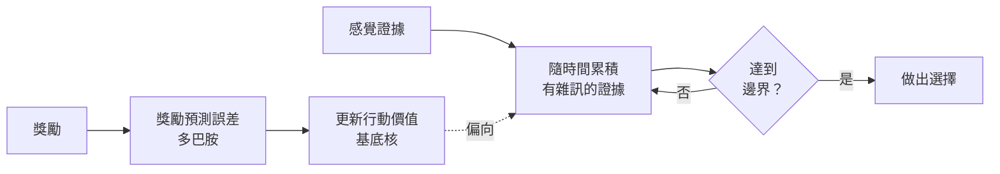

# 決策、多巴胺與獎勵

決策是知覺與價值在行動上交會的地方。大腦必須權衡證據、估計每個選項可能帶來什麼，然後承諾其中一個。強化學習是 AI 中選擇行動的主要框架，它的形成受到這門神經科學的影響，如今兩個領域正互相檢驗對方的模型。

## 概述

一個決策包含兩個部分。第一是證據：每個選項有多少資訊支持它，這些資訊通常有雜訊，並會隨時間累積。第二是價值：每個選項值多少，這是從過去結果中學來的。神經科學兩者都研究，而最有成效的模型，是透過一個共同的學習訊號（多巴胺）把兩者連起來。[認知科學](../cognitive-science/index.md)涵蓋推理與選擇的心理學；本頁聚焦於神經與計算機制。

## 核心概念

- **證據累積（evidence accumulation）**：把有雜訊的感覺證據隨時間加總，直到達到門檻，此時做出選擇。
- **速度與準確度的取捨**：等待更久的證據能提高準確度，但會延遲決定。模型以決策邊界描述這種取捨。
- **價值（value）**：某選項的預期報酬，從經驗中估計。
- **無模型與有模型控制**：無模型方法從過去的獎勵中快取行動的價值，便宜但適應慢；有模型方法使用環境的模型進行規劃，有彈性但成本高。
- **獎勵預測誤差（reward prediction error）**：實際獲得的獎勵與預期獎勵之差。多巴胺神經元會發出這個量，見[多巴胺的獎勵預測誤差](../neuroscience/dopamine-reward-prediction-error/index.zh-TW.md)。

## 運作方式

有兩種廣義的機制能解釋大多數資料。在知覺決策中，證據朝一個邊界累積，感覺與頂葉皮質承載著這個累積總和。在以價值為基礎的決策中，基底核學習哪些行動會帶來獎勵，多巴胺則更新這些價值。許多模型把兩者結合：快速的知覺選擇使用累積的證據，從經驗中做出的選擇則使用學到的價值。

圖中的迴圈是這類理論常見的形狀。學到的價值會偏移累積的起點或漂移率，因此經驗會改變人們做決定的速度與準確度。

## 關鍵方法

每個方法都有自己的頁面，此表僅作比較。

| 方法 | 它回答的問題 | 頁面 |
|---|---|---|
| 擴散決策模型（Ratcliff 與 McKoon，2008） | 難度或指示改變時，哪個過程在變：資訊品質、謹慎程度，還是偏誤？ | [擴散決策模型](diffusion-model/index.md) |
| 有模型與無模型仲裁（Daw、Niv 與 Dayan，2005） | 兩個控制器意見不合時，應由哪一個控制選擇？ | [有模型與無模型控制](model-based-vs-model-free/index.md) |

多巴胺的獎勵預測誤差（Schultz、Dayan 與 Montague，1997）是第三個里程碑，列於[多巴胺的獎勵預測誤差](../neuroscience/dopamine-reward-prediction-error/index.zh-TW.md)，此處不重複。

## 與其他主題的關聯

- **神經科學**：基底核與神經調節，見[神經科學基礎](../neuroscience/index.md)；多巴胺的獎勵預測誤差見[多巴胺的獎勵預測誤差](../neuroscience/dopamine-reward-prediction-error/index.zh-TW.md)。
- **認知科學**：推理與決策，包括雙歷程觀點，見[認知科學](../cognitive-science/index.md)。
- **心理學**：認知偏誤與人類選擇的一面，包括人們如何回應 AI 建議，見[心理學與 AI](../psychology/index.md)。
- **預測編碼**：主動推論把選擇視為對偏好結果的推論，是與價值學習不同的決策途徑。見[預測編碼與自由能](../predictive-coding/index.md)。
- **AI 中的強化學習**：獎勵預測誤差是時序差分學習的核心更新，也是 AI 中許多代理人研究的基礎。見[強化學習](../../theory/paradigms/reinforcement-learning/index.md)。

## 應用

- **計算精神醫學**：把學習與選擇的模型擬合到行為上，用以研究成癮與憂鬱等狀況。這些是研究工具，並非臨床診斷。
- **人機決策支援**：理解人們如何累積證據並權衡 AI 建議，有助於設計避免過度依賴的介面。見[心理學與 AI](../psychology/index.md)。
- **AI 代理人**：從獎勵學習價值的強化學習方法，以及使用模型的規劃方法，是上述兩種控制器在 AI 中的對應。

## 開放問題

- **無模型與有模型系統是否真的相互競爭？** 仲裁式解釋能擬合許多結果，但兩個系統也可能以其他方式互動，例如一方訓練另一方。
- **多巴胺與價值、顯著性及行動的關係為何？** 預測誤差的解釋很有力，但多巴胺也可能傳遞動機或新奇性，這場爭論仍在持續。
- **擴散決策參數是神經層級的量嗎？** 擬合出的參數是有用的摘要，但將其對應到特定神經元仍在檢驗中。
- **AI 代理人與這些控制器的對應有多相似？** 目前的代理人結合了學得的價值與規劃，但這種取捨是否以相同方式運作並不清楚。

## 參考文獻

### 開創性論文

- Ratcliff, R. & McKoon, G.（2008）。The Diffusion Decision Model: Theory and Data for Two-Choice Decision Tasks. *Neural Computation*。https://doi.org/10.1162/neco.2008.12-06-420 — 回顧擴散模型，並顯示其參數如何分開難度、速度與準確度指示及偏誤的效果。
- Daw, N. D., Niv, Y. & Dayan, P.（2005）。Uncertainty-based competition between prefrontal and dorsolateral striatal systems for behavioral control. *Nature Neuroscience*。https://doi.org/10.1038/NN1560 — 提出有模型與無模型控制器之間以不確定性為基礎的仲裁。
- Schultz, W., Dayan, P. & Montague, P. R.（1997）。A Neural Substrate of Prediction and Reward. *Science*。https://doi.org/10.1126/science.275.5306.1593 — 顯示多巴胺神經元發出獎勵預測誤差，把強化學習與大腦連結起來。

### 綜述與回顧

- Gold, J. I. & Shadlen, M. N.（2007）。The neural basis of decision making. *Annual Review of Neuroscience*。https://doi.org/10.1146/annurev.neuro.29.051605.113038 — 回顧神經元如何把證據累積至決策，這是擴散模型背後的框架。
- Dayan, P. & Daw, N. D.（2008）。Decision theory, reinforcement learning, and the brain. *Cognitive, Affective, & Behavioral Neuroscience*。https://doi.org/10.3758/CABN.8.4.429 — 回顧決策理論與強化學習模型如何與大腦中的選擇相關。
- Sutton, R. S. & Barto, A. G.（2018）。*Reinforcement Learning: An Introduction*，第二版。MIT Press。http://incompleteideas.net/book/the-book-2nd.html — 關於價值學習、時序差分方法與以模型規劃的標準教科書。
