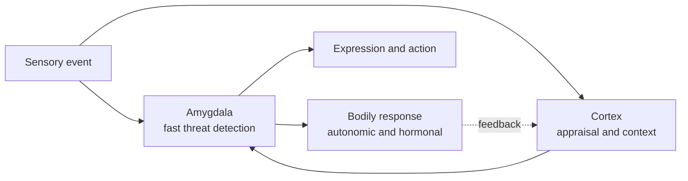

# Emotion and Affective Computing

Emotion shapes what we notice, remember and do, and it is tied closely to decision-making and social behaviour. Neuroscience has identified circuits that detect threat and reward, while psychology describes emotions along a few dimensions. Affective computing applies these ideas to machines that recognise or respond to human emotion.

## Overview

An emotion is usually described as a brief, organised response to an event that matters to the individual. It has a subjective feeling, a bodily change, an expressive part and a tendency to act. Researchers disagree about how these parts relate, and about whether emotions are a small set of discrete states or regions of a continuous space. [Cognitive Science](../cognitive-science/index.md) covers the appraisal and judgement side; this page focuses on the brain systems and on the models that describe emotional states.

## Key concepts

- **Valence and arousal**: two dimensions often used to describe emotional states. Valence runs from pleasant to unpleasant, and arousal from calm to excited.
- **Basic emotions**: a view that a small set of emotions, such as fear, anger and joy, is universal and has distinct expressions.
- **Appraisal**: the evaluation of an event in terms of its relevance and its implications for the individual, which shapes the emotion that follows.
- **Threat circuit**: a set of connected structures, including the amygdala, that detect and respond to danger.
- **Affective computing**: the study of systems that recognise, interpret or express emotion. Picard (1997) set out the field.

## How it works

Emotional responses involve several systems at once. Sensory input reaches the amygdala and related regions quickly, and a slower pathway through cortex supports the appraisal that refines the response. Autonomic and hormonal changes follow, and these feed back into how the event is experienced.

Two findings have shaped the field. One is that emotion circuits can be mapped in animals, with a clear role for the amygdala in fear conditioning. The other is that the same brain regions show up across many emotional states, which questions the idea that each emotion has its own dedicated circuit.

## Key methods

Each method has its own page. This table is only a comparison.

| Method | Question it answers | Page |
|---|---|---|
| Circumplex model of affect (Russell, 1980) | Can emotional states be placed on a few continuous dimensions such as valence and arousal? | [Russell 1980](circumplex-model/index.md) |
| Emotion circuits (LeDoux, 2000) | Which brain pathways detect threat and drive fear responses? | [LeDoux 2000](emotion-circuits/index.md) |

## Affective computing

Affective computing builds systems that recognise and respond to emotion, using facial expression, voice, physiology or text. The field draws on the dimensional and discrete models above, and it raises questions about accuracy, privacy and whether a system can be said to feel anything. Those questions are discussed on [Consciousness & Philosophy of Mind](../consciousness/index.md), and the wider ethics of AI systems are on the [Ethics](../../society/ethics/index.md) pages.

## Connections

- **Cognitive science**: appraisal and the psychology of emotional judgement are in [Cognitive Science](../cognitive-science/index.md).
- **Psychology**: emotional biases and their effect on judgement are discussed on [Psychology & AI](../psychology/index.md).
- **Neuroscience**: the amygdala and reward systems are background on [Neuroscience Basics](../neuroscience/index.md).
- **NeuroAI**: models of affect used in machines are discussed on [NeuroAI](../neuroai/index.md).

## Open questions

- **Are emotions discrete or continuous?** Both models fit some data, and the choice affects what a system should recognise.
- **Is there a dedicated circuit for each emotion?** The evidence points to shared regions for many states, which challenges simple one-to-one mappings.
- **Can affect recognition from faces and voices be trusted?** Accuracy varies across people and cultures, and the claims need careful testing.

## References

### Seminal papers

- Russell, J. A. (1980). A circumplex model of affect. *Journal of Personality and Social Psychology*. https://doi.org/10.1037/h0077714 — Proposes that emotional states can be placed on a circle defined by valence and arousal.
- LeDoux, J. E. (2000). Emotion circuits in the brain. *Annual Review of Neuroscience*. https://doi.org/10.1146/annurev.neuro.23.1.155 — Reviews the amygdala-centred circuits for fear and threat.
- Picard, R. W. (1997). *Affective Computing*. MIT Press. https://doi.org/10.7551/mitpress/1140.001.0001 — Sets out the field of systems that recognise, interpret and express emotion.

### Surveys and reviews

- Ekman, P. (1992). An argument for basic emotions. *Cognition and Emotion*. https://doi.org/10.1080/02699939208411068 — Argues for a small set of basic emotions with distinct expressions, the discrete view in the field.
- Lindquist, K. A., Wager, T. D., Kober, H., Bliss-Moreau, E. & Barrett, L. F. (2012). The brain basis of emotion: a meta-analytic review. *Behavioral and Brain Sciences*. https://doi.org/10.1017/S0140525X11000446 — A meta-analysis finding that many emotional states engage overlapping brain regions, rather than dedicated ones.
