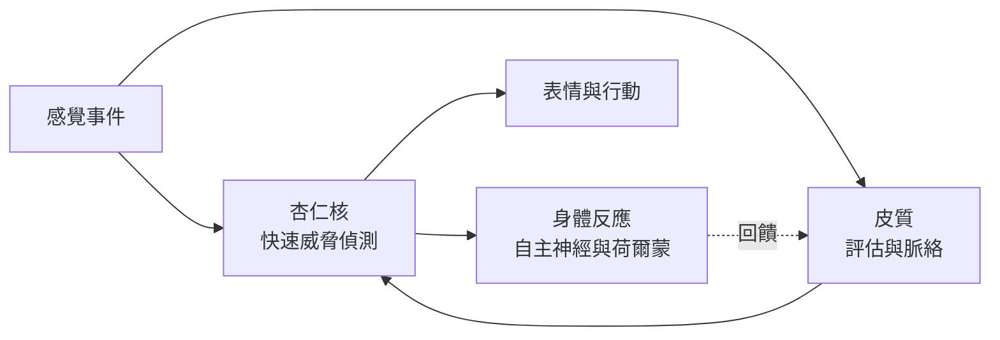

# 情緒與情感運算

情緒會影響我們注意到什麼、記住什麼、以及做什麼，並與決策與社會行為密切相關。神經科學已找出偵測威脅與獎勵的迴路，心理學則把情緒描述在少數幾個向度上。情感運算（affective computing）則把這些想法應用到能辨識或回應人類情緒的機器上。

## 概述

情緒通常被描述為對一件對個體有意義的事件，所做的短暫且有組織的反應。它包含主觀感受、身體變化、表情部分，以及行動的傾向。研究者對這些部分如何關聯、以及情緒是少數離散狀態還是連續空間中的區域，仍有分歧。[認知科學](../cognitive-science/index.md)涵蓋評估與判斷的面向；本頁聚焦於大腦系統，以及描述情緒狀態的模型。

## 核心概念

- **效價與喚起度（valence and arousal）**：描述情緒狀態常用的兩個向度。效價由愉快到不愉快，喚起度由平靜到激動。
- **基本情緒（basic emotions）**：一種觀點，認為恐懼、憤怒、喜悅等少數情緒是普遍的，並各自有明確的表情。
- **評估（appraisal）**：依事件的相關性與對個體的影響來評價事件，這會塑造隨後的情緒。
- **威脅迴路（threat circuit）**：一組相連的結構，包括杏仁核，負責偵測並回應危險。
- **情感運算（affective computing）**：研究能辨識、詮釋或表達情緒之系統的領域。Picard（1997）建立了這個領域的框架。

## 運作方式

情緒反應同時涉及多個系統。感覺輸入會快速到達杏仁核與相關區域，而經過皮質的較慢路徑則支持能精煉反應的評估。隨後出現自主神經與荷爾蒙的變化，這些變化又回饋到人們如何體驗這件事。

有兩項發現形塑了這個領域。其一是情緒迴路可以在動物身上被定位，杏仁核在恐懼制約中有明確的角色。其二是同一批腦區會出現在許多不同的情緒狀態中，這對每種情緒都有專屬迴路的簡單想法提出質疑。

## 關鍵方法

每種方法都有自己的頁面。下表只用來比較。

| 方法 | 它回答的問題 | 頁面 |
|---|---|---|
| 情感的環狀模型（Russell，1980） | 情緒狀態能否放在效價與喚起度等少數連續向度上？ | [Russell 1980](circumplex-model/index.md) |
| 情緒迴路（LeDoux，2000） | 哪些腦部路徑偵測威脅並驅動恐懼反應？ | [LeDoux 2000](emotion-circuits/index.md) |

## 情感運算

情感運算建立能透過臉部表情、聲音、生理訊號或文字辨識並回應情緒的系統。這個領域借用了上述的向度與離散模型，並提出準確度、隱私，以及機器能否被說成真的有感受等問題。這些問題在[意識與心靈哲學](../consciousness/index.md)中討論，AI 系統更廣泛的倫理見[倫理](../../society/ethics/index.md)相關頁面。

## 與其他主題的關聯

- **認知科學**：評估與情緒判斷的心理學，見[認知科學](../cognitive-science/index.md)。
- **心理學**：情緒偏誤及其對判斷的影響，見[心理學與 AI](../psychology/index.md)。
- **神經科學**：杏仁核與獎勵系統的背景，見[神經科學基礎](../neuroscience/index.md)。
- **NeuroAI**：機器中使用的情感模型，見 [NeuroAI](../neuroai/index.md)。

## 開放問題

- **情緒是離散的還是連續的？** 兩種模型都能擬合部分資料，選擇哪一種會影響系統應該辨識什麼。
- **每種情緒是否有專屬迴路？** 證據指向許多狀態共用區域，這對簡單的一對一對應提出挑戰。
- **從臉部與聲音辨識情感是否可信？** 準確度會因人與文化而異，相關主張需要審慎檢驗。

## 參考文獻

### 開創性論文

- Russell, J. A.（1980）。A circumplex model of affect. *Journal of Personality and Social Psychology*。https://doi.org/10.1037/h0077714 — 提出情緒狀態可放在由效價與喚起度界定的圓上。
- LeDoux, J. E.（2000）。Emotion circuits in the brain. *Annual Review of Neuroscience*。https://doi.org/10.1146/annurev.neuro.23.1.155 — 回顧以杏仁核為中心、負責恐懼與威脅的迴路。
- Picard, R. W.（1997）。*Affective Computing*。MIT Press。https://doi.org/10.7551/mitpress/1140.001.0001 — 建立能辨識、詮釋與表達情緒之機器系統的領域框架。

### 綜述與回顧

- Ekman, P.（1992）。An argument for basic emotions. *Cognition and Emotion*。https://doi.org/10.1080/02699939208411068 — 主張存在一小組各自有明確表情的基本情緒，是離散觀點的代表。
- Lindquist, K. A., Wager, T. D., Kober, H., Bliss-Moreau, E. & Barrett, L. F.（2012）。The brain basis of emotion: a meta-analytic review. *Behavioral and Brain Sciences*。https://doi.org/10.1017/S0140525X11000446 — 後設分析顯示，許多情緒狀態共用重疊的腦區，而非專屬區域。
