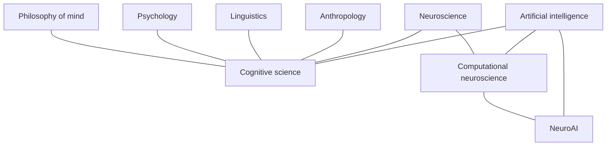

# Brain & Mind

AI has been entangled with brain science, cognitive science and psychology from the start: the first artificial neuron was proposed by a neurophysiologist and a logician; backpropagation was popularised by a cognitive psychologist (Rumelhart); and the temporal-difference error of reinforcement learning turned up in dopamine neurons. This section covers the foundations of these fields and their two-way relationship with AI.

## How the fields relate

Cognitive science emerged from the 1950s "cognitive revolution" and is traditionally described as six disciplines (Miller, 2003): psychology, linguistics, neuroscience, computer science, anthropology and philosophy.

## Pages

| Page | Focus |
|---|---|
| [Neuroscience Basics](neuroscience/index.md) | Neurons, synapses, brain regions, methods |
| [Computational Neuroscience](computational-neuroscience/index.md) | Neuron models, neural coding, Marr's levels |
| [NeuroAI](neuroai/index.md) | Deep networks as brain models, brain-inspired AI, credit assignment |
| [Spiking Networks & Neuromorphic Computing](snn-neuromorphic/index.md) | SNNs, STDP, Loihi, TrueNorth, low-power AI |
| [Memory & Learning in the Brain](memory-learning/index.md) | Hippocampus, synaptic plasticity, complementary learning systems, forgetting |
| [Cognitive Science](cognitive-science/index.md) | Perception, attention, language, reasoning, predictive processing |
| [Cognitive Architectures](cognitive-architectures/index.md) | ACT-R, Soar, global workspace, LLM-agent architectures |
| [Psychology & AI](psychology/index.md) | Cognitive biases, dual-process theory, development, machine psychology |
| [Consciousness & Philosophy of Mind](consciousness/index.md) | Theories of consciousness, could AI be conscious, the Chinese room |
| [Brain-Computer Interfaces](bci/index.md) | Invasive and non-invasive BCIs, decoding language and images from brain activity |
| [Language in the Brain](language-in-brain/index.md) | Dual-stream speech processing, the language network, language models predicting brain responses |
| [Perception & the Visual System](visual-perception/index.md) | Receptive fields, the ventral stream, CNNs as models of vision |

## Two-way influence at a glance

| Direction | Examples |
|---|---|
| Brain → AI | Artificial neurons; CNNs (visual cortex); reinforcement learning (animal learning); experience replay (hippocampal replay); neuromorphic chips; attention (as a concept); continual-learning methods inspired by synaptic consolidation |
| AI → brain science | CNNs as models of visual cortex; LLMs as models of language areas; TD learning explaining dopamine; deep learning for neuroimaging analysis, pose tracking (DeepLabCut), spike sorting and connectome reconstruction |
| AI → psychology | LLMs simulating participants; computational psychiatry; automated assessment; conversational interventions |
| Psychology → AI | Cognitive-bias research used to evaluate LLMs; developmental psychology inspiring curricula; theory-of-mind tests; human-factors research on trust and reliance |
