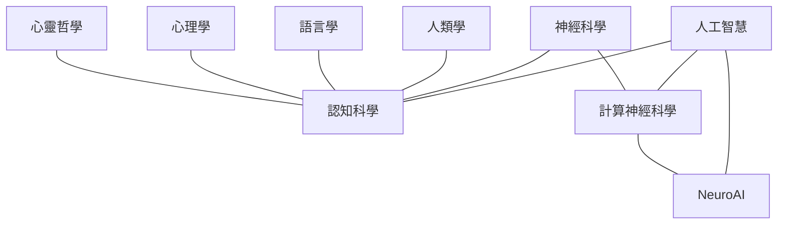

# 腦與心智

AI 從一開始就與腦科學、認知科學、心理學交織在一起：第一個人工神經元模型由神經生理學家提出，反向傳播的推廣者 Rumelhart 是認知心理學家，強化學習的 TD 誤差在多巴胺神經元中被找到。這一區整理這些領域的基礎知識，以及它們與 AI 的雙向關係。

## 領域關係

認知科學在 1950 年代「認知革命」中誕生，傳統上由六個學科組成（Miller, 2003）：心理學、語言學、神經科學、電腦科學、人類學、哲學。

## 頁面導覽

| 頁面 | 重點 |
|---|---|
| [神經科學基礎](neuroscience/index.md) | 神經元、突觸、腦區、研究方法 |
| [計算神經科學](computational-neuroscience/index.md) | 神經元模型、神經編碼、Marr 三層次 |
| [NeuroAI](neuroai/index.md) | 深度網路作為大腦模型、大腦啟發的 AI、信用分配 |
| [脈衝神經網路與神經形態運算](snn-neuromorphic/index.md) | SNN、STDP、Loihi、TrueNorth、低功耗 AI |
| [記憶與學習的神經機制](memory-learning/index.md) | 海馬迴、突觸可塑性、互補學習系統、災難性遺忘 |
| [認知科學](cognitive-science/index.md) | 知覺、注意、語言、推理、預測處理 |
| [認知架構](cognitive-architectures/index.md) | ACT-R、Soar、全域工作空間、LLM 代理人架構 |
| [心理學與 AI](psychology/index.md) | 認知偏誤、雙歷程理論、心智理論測驗、發展心理學、機器心理學 |
| [意識與心靈哲學](consciousness/index.md) | 意識理論、AI 能否有意識、中文房間 |
| [腦機介面與神經解碼](bci/index.md) | 侵入式與非侵入式 BCI、從腦活動解碼語言與影像 |
| [大腦中的語言](language-in-brain/index.md) | 雙路徑語音處理、語言網路、預測大腦反應的語言模型 |
| [預測編碼與自由能](predictive-coding/index.md) | 預測誤差、階層式模型、類反向傳播學習、自由能原理 |
| [決策、多巴胺與獎勵](decision-reward/index.md) | 證據累積、有模型與無模型控制、獎勵預測誤差 |
| [知覺與視覺系統](visual-perception/index.md) | 感受野、腹側路徑、作為視覺模型的 CNN |
| [注意力：大腦與機器](attention-brain-machine/index.md) | 偏向競爭、顯著性圖、由上而下控制、機器中的注意力 |

## 雙向關係一覽

| 方向 | 例子 |
|---|---|
| 腦 → AI | 人工神經元、CNN（視覺皮質）、強化學習（動物學習）、注意力（概念）、經驗回放（海馬迴重播）、Dropout（部分受神經元隨機性啟發）、神經形態晶片 |
| AI → 腦 | 用 CNN 預測視覺皮質、用 LLM 預測語言區、TD 學習解釋多巴胺、用深度學習分析神經影像與行為影片（DeepLabCut）、自動重建連結體 |
| AI → 心理學 | LLM 模擬受試者、計算精神醫學、心理測驗自動化、對話式心理介入 |
| 心理學 → AI | 認知偏誤研究用於評估 LLM、發展心理學啟發課程學習、心智理論測驗 |
