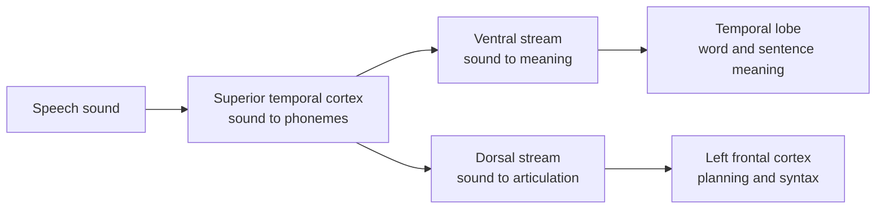

# Language in the Brain

Language is the human ability that large language models most resemble, so it is the domain where the comparison between brains and AI is most direct. Neuroscience asks where and how the brain processes speech and text, and AI researchers now ask which model features predict the brain's responses to them.

## Overview

Understanding a sentence requires several steps in quick succession: hearing or reading the words, recognising them, combining them into a structure, working out the meaning in context, and then planning a reply. Each step can be disrupted separately after brain injury, which is why aphasia has been a source of evidence about the brain's language system since the 19th century. [Cognitive Science](../cognitive-science/index.md) covers the broader psychology of language; this page focuses on the neural machinery and on the recent work that compares it with language models.

## Key concepts

- **Broca's and Wernicke's areas**: classical regions in the left frontal lobe (speech production and syntax) and left temporal lobe (comprehension). Their roles are now understood as part of a wider network rather than as isolated centres.
- **Dual-stream model**: a view in which speech is processed along a ventral stream that maps sound to meaning, and a dorsal stream that maps sound to articulation (Hickok & Poeppel, 2007).
- **Language network**: a set of left-lateralised frontal and temporal regions that respond to language. Fedorenko et al. (2010) introduced the individual-level localiser used to find it in each person.
- **Predictive processing**: the brain anticipates upcoming words, and the mismatch between prediction and input is the signal that drives comprehension.
- **Contextual embedding**: a representation of a word that depends on the words around it. Transformer language models produce such embeddings, and they are the basis for most brain-model comparisons.

## How it works

Speech is a continuous acoustic signal, and the brain must segment it into words and phonemes before anything else can happen. The dual-stream model describes where this processing happens. Hickok and Poeppel (2007) propose that a bilateral ventral stream supports comprehension, while a left-dominant dorsal stream links acoustic speech to frontal articulatory networks.

Two findings have shaped the modern picture. First, the language network can be identified in each person's fMRI data by contrasting sentences with non-word strings. Fedorenko et al. (2010) developed this individual-level localiser. Second, a person can lose much of their language ability and still reason and solve problems. Fedorenko and Varley (2016) argue from neuroimaging and patient studies that language and thought are separable, so models of thinking should not assume that language is the thing doing the thinking.

## Key methods

Each method has its own page. This table is only a comparison.

| Method | Question it answers | Page |
|---|---|---|
| Dual-stream model (Hickok & Poeppel, 2007) | Which regions handle sound-to-meaning and sound-to-articulation, and which stream is active for a given task? | [Hickok & Poeppel 2007](hickok-poeppel-2007/index.md) |
| Transformer models and brain responses to sentences (Schrimpf et al., 2021) | Which properties of a language model predict its fit to brain responses to sentences? | [Schrimpf et al. 2021](schrimpf-2021/index.md) |
| Contextual embeddings during listening (Goldstein et al., 2022) | Do GPT-2's prediction and embedding computations line up with ECoG responses during a real podcast? | [Goldstein et al. 2022](goldstein-2022/index.md) |

## Connections

- **Cognitive science**: the psychology of language acquisition, parsing and pragmatics is in [Cognitive Science](../cognitive-science/index.md), which this page builds on.
- **Neuroscience**: cortical regions, recording methods and the auditory pathway are summarised in [Neuroscience Basics](../neuroscience/index.md).
- **NeuroAI**: using language models as models of the language cortex is discussed on [NeuroAI](../neuroai/index.md).
- **Language models**: the model families compared with the brain are on [Large Language Models](../../theory/models/llm/index.md) and [Transformer](../../theory/models/transformer/index.md).
- **Brain-computer interfaces**: decoding language from neural activity is covered in [Brain-Computer Interfaces](../bci/index.md).

## Applications

- **Presurgical language mapping**: fMRI and ECoG are used to locate language regions before neurosurgery, to lower the risk of losing speech.
- **Aphasia assessment**: language tests and imaging help clinicians classify the type of language impairment after stroke, and guide rehabilitation.
- **Speech decoding**: brain signals decoded into text or speech for people who cannot speak. See [Brain-Computer Interfaces](../bci/index.md).

## Open questions

- **Are the similarities mechanistic?** Models and brains predict the same words, but whether the internal computations match is unresolved. Correlation of representations does not establish mechanism.
- **Does language ability imply thinking?** Patient evidence suggests the two can come apart, but the results depend on how each is measured.
- **How far does brain fit depend on the benchmark?** Scores are relative to noise ceilings and datasets, so comparisons across studies need care.
- **Do models without language training show the same fit?** The role of training data versus architecture is still being tested.

## References

### Seminal papers

- Hickok, G. & Poeppel, D. (2007). The cortical organization of speech processing. *Nature Reviews Neuroscience*. https://doi.org/10.1038/nrn2113 — Proposes the dual-stream model of speech processing, with a ventral stream for comprehension and a dorsal stream for articulation.
- Fedorenko, E., Hsieh, P.-J., Nieto-Castañón, A., Whitfield-Gabrieli, S. & Kanwisher, N. (2010). New method for fMRI investigations of language: defining ROIs functionally in individual subjects. *Journal of Neurophysiology*. https://doi.org/10.1152/jn.00032.2010 — The individual-level localiser that identifies each person's language network.

### Surveys and reviews

- Fedorenko, E. & Varley, R. (2016). Language and thought are not the same thing: evidence from neuroimaging and neurological patients. *Annals of the New York Academy of Sciences*. https://doi.org/10.1111/nyas.13046 — Reviews neuroimaging and patient evidence that language and thought are separable.

### Articles and primary research

- Schrimpf, M., Blank, I. A., Tuckute, G., Kauf, C., Hosseini, E. A., Kanwisher, N., Tenenbaum, J. B. & Fedorenko, E. (2021). The neural architecture of language: Integrative modeling converges on predictive processing. *PNAS*. https://doi.org/10.1073/pnas.2105646118 — Shows that the best transformer models predict nearly all explainable variance in neural responses to sentences.
- Goldstein, A., Zada, Z., Buchnik, E., Schain, M., Price, A., et al. (2022). Shared computational principles for language processing in humans and deep language models. *Nature Neuroscience*. https://doi.org/10.1038/s41593-022-01026-4 — Compares human ECoG responses with GPT-2 on prediction, surprise and contextual embeddings during a podcast.
- Caucheteux, C. & King, J.-R. (2022). Brains and algorithms partially converge in natural language processing. *Communications Biology*. https://doi.org/10.1038/s42003-022-03036-1 — Compares language-model representations with brain recordings, and reports partial convergence between the two.
