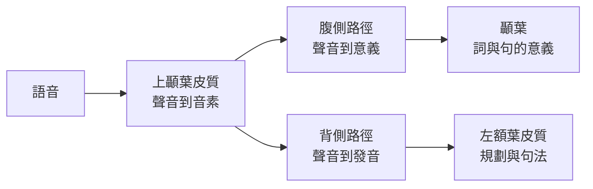

# 大腦中的語言

語言是大型語言模型最接近的人類能力，因此它是大腦與 AI 比較最直接的領域。神經科學追問大腦在何處、以何種方式處理語音與文字；AI 研究者則追問，模型的哪些特徵能預測大腦對這些語言的反應。

## 概述

理解一句話需要幾個步驟快速接續：聽到或看到文字、辨識詞彙、組合成結構、結合語境推出意義，然後規劃回應。每一步都可能在腦部受傷後單獨受損，這也是失語症自 19 世紀以來一直是大腦語言系統證據來源的原因。[認知科學](../cognitive-science/index.md)涵蓋語言的整體心理學；本頁聚焦於神經機制，以及近年將其與語言模型比較的研究。

## 核心概念

- **Broca 區與 Wernicke 區**：左額葉（語音產生與句法）與左顳葉（理解）的經典區域。如今它們被理解為更大網路的一部分，而非獨立的中心。
- **雙路徑模型（dual-stream model）**：一種觀點，認為語音沿腹側路徑處理，從聲音對應到意義；另沿背側路徑處理，從聲音對應到發音（Hickok 與 Poeppel，2007）。
- **語言網路（language network）**：一組左側化的額葉與顳葉區域，對語言有反應。Fedorenko 等人（2010）提出了在個人層級找出此網路的定位方法。
- **預測處理（predictive processing）**：大腦會預期接下來的詞，而預測與輸入之間的落差，就是驅動理解的訊號。
- **語境嵌入（contextual embedding）**：依周圍詞語而變化的詞彙表徵。Transformer 語言模型會產生這種嵌入，也是多數腦與模型比較研究的基礎。

## 運作方式

語音是連續的聲學訊號，大腦必須先把它切分成詞與音素，才能進行後續處理。雙路徑模型描述了這些處理發生的位置。Hickok 與 Poeppel（2007）提出，一條大致雙側的腹側路徑支持理解，而一條以左側為主的背側路徑，則把聲學語音連到額葉的發音網路。

有兩項發現形塑了現代的圖像。第一，每個人的語言網路可以透過對比句子與非詞字串，在 fMRI 資料中找出來。Fedorenko 等人（2010）提出了這種個人層級的定位方法。第二，一個人即使大部分語言能力喪失，仍然能推理與解決問題。Fedorenko 與 Varley（2016）從神經影像與患者研究出發，主張語言與思考可以分離，因此思考模型不應預設語言就是進行思考的東西。

## 關鍵方法

每種方法都有自己的頁面。下表只用來比較。

| 方法 | 它回答的問題 | 頁面 |
|---|---|---|
| 雙路徑模型（Hickok 與 Poeppel，2007） | 哪些區域處理從聲音到意義、從聲音到發音的對應，而某項任務會啟動哪條路徑？ | [Hickok 與 Poeppel 2007](hickok-poeppel-2007/index.md) |
| 語言模型與句子上的大腦反應（Schrimpf 等人，2021） | 語言模型的哪些性質能預測它與句子上大腦反應的吻合程度？ | [Schrimpf 等人 2021](schrimpf-2021/index.md) |
| 聆聽時的語境嵌入（Goldstein 等人，2022） | 在真實的 podcast 聆聽中，GPT-2 的預測與嵌入計算是否與 ECoG 反應吻合？ | [Goldstein 等人 2022](goldstein-2022/index.md) |

## 與其他主題的關聯

- **認知科學**：語言習得、剖析與語用的心理學，見[認知科學](../cognitive-science/index.md)，本頁建立於其上。
- **神經科學**：皮質區域、記錄方法與聽覺路徑，摘要於[神經科學基礎](../neuroscience/index.md)。
- **NeuroAI**：把語言模型當作語言皮質的模型，見 [NeuroAI](../neuroai/index.md)。
- **語言模型**：被拿來與大腦比較的模型家族，見[大型語言模型](../../theory/models/llm/index.md)與 [Transformer](../../theory/models/transformer/index.md)。
- **腦機介面**：從神經活動解碼語言，見[腦機介面與神經解碼](../bci/index.md)。

## 應用

- **術前語言定位**：在神經外科手術前，以 fMRI 與 ECoG 找出語言區，降低失去說話能力的風險。
- **失語症評估**：語言測驗與影像協助臨床醫師在中風後區分語言障礙的類型，並指引復健。
- **語音解碼**：將腦訊號解碼成文字或語音，協助無法說話的人。見[腦機介面與神經解碼](../bci/index.md)。

## 開放問題

- **這些相似是機制性的嗎？** 模型與大腦預測相同的詞，但它們的內部運算是否相符仍未解決。表徵的相關不足以證明機制。
- **語言能力是否意味著會思考？** 患者證據顯示兩者可以分離，但結果取決於各自的測量方式。
- **大腦擬合度在多大程度上取決於基準？** 分數是相對於雜訊上限與資料集而言的，跨研究比較需要謹慎。
- **沒有語言訓練的模型是否會有相同的擬合？** 訓練資料與架構各自的角色仍在檢驗中。

## 參考文獻

### 開創性論文

- Hickok, G. & Poeppel, D.（2007）。The cortical organization of speech processing. *Nature Reviews Neuroscience*。https://doi.org/10.1038/nrn2113 — 提出語音處理的雙路徑模型：腹側路徑負責理解，背側路徑負責發音。
- Fedorenko, E., Hsieh, P.-J., Nieto-Castañón, A., Whitfield-Gabrieli, S. & Kanwisher, N.（2010）。New method for fMRI investigations of language: defining ROIs functionally in individual subjects. *Journal of Neurophysiology*。https://pmc.ncbi.nlm.nih.gov/articles/PMC2934923 — 在個人層級定位語言網路的方法。

### 綜述與回顧

- Fedorenko, E. & Varley, R.（2016）。Language and thought are not the same thing: evidence from neuroimaging and neurological patients. *Annals of the New York Academy of Sciences*。https://discovery.ucl.ac.uk/id/eprint/1489434/ — 回顧神經影像與患者證據，論證語言與思考可以分離。

### 文章與原始研究

- Schrimpf, M., Blank, I. A., Tuckute, G., Kauf, C., Hosseini, E. A., Kanwisher, N., Tenenbaum, J. B. & Fedorenko, E.（2021）。The neural architecture of language: Integrative modeling converges on predictive processing. *PNAS*。https://doi.org/10.1073/pnas.2105646118 — 顯示效能最強的 Transformer 模型能預測句子神經反應中幾乎全部的可解釋變異。
- Goldstein, A., Zada, Z., Buchnik, E., Schain, M., Price, A., 等人（2022）。Shared computational principles for language processing in humans and deep language models. *Nature Neuroscience*。https://doi.org/10.1038/s41593-022-01026-4 — 比較人類皮質腦電圖與 GPT-2 在預測、驚訝與語境嵌入上的反應，材料為一段 podcast。
- Caucheteux, C. & King, J.-R.（2022）。Brains and algorithms partially converge in natural language processing. *Communications Biology*。https://doi.org/10.1038/s42003-022-03036-1 — 比較語言模型表徵與大腦記錄，並報告兩者部分趨同。
