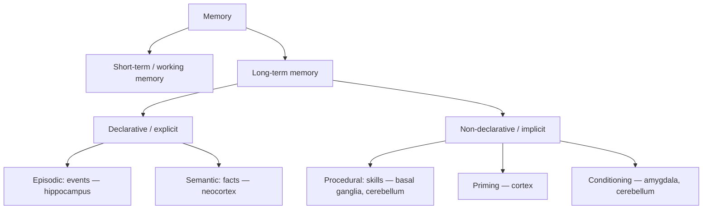

---
aliases:
  - 記憶與學習的神經機制
  - 神經記憶
  - 海馬迴與記憶
---

# Memory & Learning in the Brain

## Kinds of memory

| Memory system | Brain basis | AI counterpart |
|---|---|---|
| Working memory | Prefrontal and parietal persistent activity; limited capacity (~4 chunks, Cowan 2001) | Context window, recurrent state |
| Episodic | Hippocampus, binding "what–where–when" | Episodic buffers, retrieval-augmented memory, conversation logs |
| Semantic | Distributed neocortex, anterior temporal lobe hub | Model weights, knowledge graphs |
| Procedural | Basal ganglia, cerebellum, motor cortex | Policies, tool/skill libraries |

## Patient H.M.

After bilateral removal of medial temporal lobes in 1953 to treat epilepsy, Henry Molaison could no longer form new episodic memories, yet he could learn new motor skills (mirror drawing) without remembering practising. Brenda Milner's studies established that memory has multiple systems and that the hippocampus is essential for forming declarative memories.

## Synaptic plasticity

- **Long-term potentiation (LTP)** (Bliss & Lømo, 1973) and **long-term depression (LTD)**: persistent strengthening or weakening of synapses
- **NMDA receptors** act as coincidence detectors — they open only when presynaptic glutamate arrives *and* the postsynaptic neuron is depolarised — a molecular Hebbian rule
- **Early vs late LTP**: protein synthesis is needed for lasting changes; **synaptic tagging and capture** explains how weak and strong events interact
- **Structural plasticity**: dendritic spines grow and retract; some persist for months
- **Homeostatic plasticity** (synaptic scaling) keeps activity in range — akin to normalisation layers
- **Engram cells**: memories can be reactivated by optogenetically stimulating the neurons active during learning (Tonegawa lab; Liu et al., 2012)

## Consolidation and replay

- **Systems consolidation**: memories initially depend on the hippocampus and gradually become cortical
- **Sharp-wave ripples**: during rest and slow-wave sleep, hippocampal place cells **replay** recent experiences in compressed time, sometimes in reverse and sometimes as novel trajectories (Wilson & McNaughton, 1994; Foster & Wilson, 2006)
- Disrupting ripples impairs learning; enhancing them can improve it
- **Sleep**: slow oscillations, spindles and ripples coordinate hippocampal–cortical dialogue; the synaptic-homeostasis hypothesis proposes sleep downscales synapses

### Complementary learning systems (CLS)

McClelland, McNaughton & O'Reilly (1995) explained *why* two systems exist:

- The **hippocampus** learns quickly with sparse, pattern-separated codes, storing individual episodes without interference
- The **neocortex** learns slowly with overlapping, distributed codes, extracting statistical structure
- Fast learning in the cortex would cause **catastrophic interference**; instead, the hippocampus **interleaves** replay of old and new memories to train the cortex

This is the conceptual root of **experience replay** in deep RL and of replay-based [continual learning](../../theory/paradigms/continual/index.md). Kumaran, Hassabis & McClelland (2016) updated the theory for the deep-learning era.

## Forgetting is a feature

- Ebbinghaus's forgetting curve (1885): rapid early loss, then levelling off
- **Spacing effect** and **testing effect**: distributed practice and retrieval practice greatly improve retention — the basis of spaced-repetition software (Anki, SuperMemo), which uses models of memory decay
- Forgetting may aid generalisation and avoid overfitting to outdated information (Richards & Frankland, 2017, "The persistence and transience of memory")
- **Reconsolidation**: retrieved memories become labile and can be updated — memory is reconstructive, not a recording (Bartlett; Loftus's misinformation studies)

## Pattern separation and completion

- **Dentate gyrus** performs pattern separation (making similar inputs distinct)
- **CA3** recurrent collaterals perform pattern completion (retrieving a whole memory from a cue) — a Hopfield-like **autoassociative memory**
- Modern Hopfield networks connect this to Transformer attention (see [Transformers](../../theory/models/transformer/index.md))

## Memory in AI systems: design lessons

| Brain lesson | AI design |
|---|---|
| Separate fast episodic and slow semantic stores | RAG / external memory + model weights |
| Replay prevents interference | Replay buffers, rehearsal in continual learning |
| Consolidate what matters | Summarise and distil agent memories; prioritised replay |
| Retrieval is cue-dependent and reconstructive | Retrieval quality depends on query formulation; generated "memories" can be wrong |
| Forgetting is useful | Memory decay, recency weighting, pruning stale knowledge |
| Working memory is limited and actively maintained | Context management, scratchpads, task decomposition |

## Key methods

### Patients with medial temporal lobe lesions (Scoville & Milner, 1957)

- **Problem:** which brain structures are needed to form new long-term memories?
- **Core idea:** study patients whose bilateral medial temporal lobe removal left a known lesion, and test what they can and cannot remember. Patient H.M. is the best-known case.
- **Equation or algorithm:** none. The method is a lesion study with memory tests.
- **Results:** the patients showed anterograde amnesia for new declarative material, while immediate memory and older memories were relatively spared.
- **Limitations:** a small number of patients, and surgical lesions that could not be controlled exactly. The study shows that the structures are necessary, not how they store memories.

### Long-term potentiation (Bliss & Lømo, 1973)

- **Problem:** is there a lasting physical change at synapses that could store memories?
- **Core idea:** a brief high-frequency stimulus to the perforant path of anaesthetised rabbits made the responses of dentate gyrus cells stay enhanced for a long time.
- **Algorithm:**
    1. Record baseline responses to low-frequency test pulses.
    2. Deliver a brief high-frequency train of stimuli.
    3. Keep testing and track the response amplitude over time.
- **Results:** the enhancement lasted far longer than the stimulus itself, which is the first report of long-term potentiation.
- **Limitations:** the experiments were in anaesthetised animals, and the link to learning was an inference. Later work linked LTP to NMDA receptors and postsynaptic calcium, which the paper did not examine.

### Complementary learning systems (McClelland, McNaughton & O'Reilly, 1995)

- **Problem:** why does the brain need both a hippocampus and a neocortex, and why does fast learning in one network erase earlier learning?
- **Core idea:** the hippocampus stores new items quickly with sparse codes, while the neocortex learns slowly with overlapping codes. Replay of stored patterns interleaves old and new items during cortical training.
- **Algorithm:** in connectionist simulations, a fast learner stores new items, and an interleaved training schedule of old and new items trains the slow learner.
- **Results:** sequential training erased earlier items (catastrophic interference), while interleaved training avoided it.
- **Limitations:** the theory is conceptual and rests on simulations. Kumaran et al. (2016) revisit it in light of deep learning and replay.

## Resources

- Squire & Kandel, *Memory: From Mind to Molecules*
- Eichenbaum, *The Cognitive Neuroscience of Memory*
- McClelland, McNaughton & O'Reilly (1995), *Psychological Review*
- Kumaran, Hassabis & McClelland (2016), "What learning systems do intelligent agents need?", *Trends in Cognitive Sciences*
- Buzsáki, *The Brain from Inside Out*

## References

### Seminal papers

- Scoville, W. B. & Milner, B. (1957). Loss of recent memory after bilateral hippocampal lesions. *Journal of Neurology, Neurosurgery & Psychiatry*. https://doi.org/10.1136/jnnp.20.1.11 — Reports the patients with bilateral medial temporal lobe lesions, including H.M., that established the role of these structures in new memories.
- Bliss, T. V. P. & Lømo, T. (1973). Long-lasting potentiation of synaptic transmission in the dentate area of the anaesthetized rabbit following stimulation of the perforant path. *The Journal of Physiology*. https://doi.org/10.1113/jphysiol.1973.sp010273 — The first report of long-lasting potentiation, the synaptic change that many memory models build on.
- McClelland, J. L., McNaughton, B. L. & O'Reilly, R. C. (1995). Why there are complementary learning systems in the hippocampus and neocortex. *Psychological Review*. https://doi.org/10.1037/0033-295X.102.3.419 — The original complementary learning systems theory, with simulations of interference and interleaved learning.

### Surveys and textbooks

- Kumaran, D., Hassabis, D. & McClelland, J. L. (2016). What learning systems do intelligent agents need? Complementary learning systems theory updated. *Trends in Cognitive Sciences*. https://doi.org/10.1016/j.tics.2016.05.004 — Revisits the theory in light of deep learning, replay and the roles of the two systems.
- Richards, B. A. & Frankland, P. W. (2017). The persistence and transience of memory. *Neuron*. https://doi.org/10.1016/j.neuron.2017.04.037 — Argues that forgetting supports generalisation, and that memory should be seen as a balance of persistence and transience.
