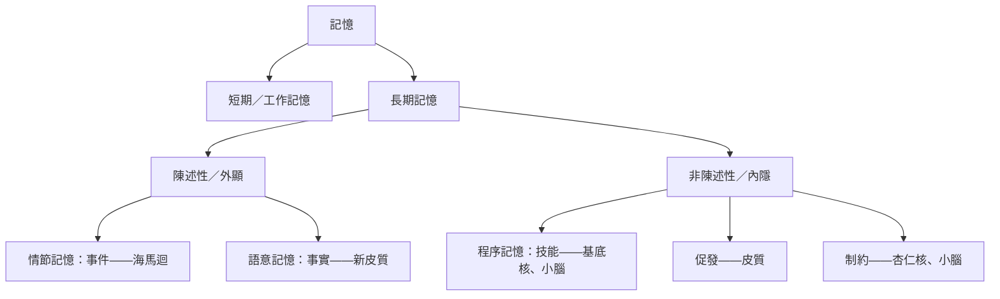

# 記憶與學習的神經機制

## 記憶的種類

| 記憶系統 | 大腦基礎 | AI 對應 |
|---|---|---|
| 工作記憶 | 前額葉與頂葉的持續活動；容量有限（約 4 個組塊，Cowan 2001） | 上下文視窗、遞迴狀態 |
| 情節記憶 | 海馬迴，綁定「什麼—哪裡—何時」 | 情節緩衝、檢索增強記憶、對話紀錄 |
| 語意記憶 | 分散的新皮質，前顳葉樞紐 | 模型權重、知識圖譜 |
| 程序記憶 | 基底核、小腦、運動皮質 | 策略、工具／技能庫 |

## 病人 H.M.

1953 年為治療癲癇切除雙側內側顳葉後，Henry Molaison 再也無法形成新的情節記憶，卻能學會新的運動技能（鏡像描圖），即使不記得自己練習過。Brenda Milner 的研究確立了記憶有多個系統，而海馬迴是形成陳述性記憶的關鍵。

## 突觸可塑性

- **長期增益（LTP）**（Bliss & Lømo, 1973）與**長期抑制（LTD）**：突觸持久的增強或減弱
- **NMDA 受體**是巧合偵測器——只有在突觸前釋放麩胺酸*且*突觸後神經元去極化時才打開——分子層級的 Hebb 規則
- **早期 vs 晚期 LTP**：持久改變需要蛋白質合成；**突觸標記與捕獲**解釋強弱事件如何互動
- **結構可塑性**：樹突棘會長出與縮回，有些可維持數月
- **恆定可塑性**（突觸縮放）讓活動維持在範圍內——類似正規化層
- **記憶痕跡細胞（engram）**：用光遺傳學刺激學習時活躍的神經元，可以重新喚起記憶（利根川實驗室；Liu et al., 2012）

## 鞏固與重播

- **系統鞏固**：記憶一開始依賴海馬迴，逐漸轉為依賴皮質
- **尖波漣波（sharp-wave ripples）**：休息與慢波睡眠時，海馬迴位置細胞以壓縮的時間**重播**最近的經驗，有時倒著播、有時產生新的路徑（Wilson & McNaughton, 1994；Foster & Wilson, 2006）
- 干擾漣波會損害學習；增強則可能改善
- **睡眠**：慢振盪、紡錘波與漣波協調海馬迴—皮質對話；突觸恆定假說認為睡眠會縮減突觸強度

### 互補學習系統（CLS）

McClelland、McNaughton 與 O'Reilly（1995）解釋了*為什麼*需要兩個系統：

- **海馬迴**用稀疏、模式分離的編碼快速學習，儲存個別情節而不互相干擾
- **新皮質**用重疊、分散的編碼緩慢學習，萃取統計結構
- 若皮質學得太快，會產生**災難性干擾**；因此由海馬迴**交錯重播**新舊記憶來訓練皮質

這是深度強化學習中**經驗重播**、以及重播式[持續學習](../../foundations/paradigms/continual/index.md)的概念根源。Kumaran、Hassabis 與 McClelland（2016）為深度學習時代更新了這個理論。

## 遺忘是一種功能

- Ebbinghaus 遺忘曲線（1885）：一開始快速流失，之後趨緩
- **間隔效應**與**測驗效應**：分散練習與提取練習大幅改善保留——間隔重複軟體（Anki、SuperMemo）就是以記憶衰退模型為基礎
- 遺忘可能幫助泛化，避免過度擬合過時資訊（Richards & Frankland, 2017〈The persistence and transience of memory〉）
- **再鞏固**：被提取的記憶會變得不穩定而可被更新——記憶是重建，不是錄影（Bartlett；Loftus 的錯誤訊息研究）

## 模式分離與模式完成

- **齒狀回**做模式分離（讓相似的輸入變得不同）
- **CA3** 的遞迴側枝做模式完成（從線索取回完整記憶）——類 Hopfield 的**自聯想記憶**
- 現代 Hopfield 網路把這點和 Transformer 的注意力連在一起（見 [Transformer](../../models/transformer/index.md)）

## 給 AI 系統的記憶設計啟示

| 大腦的啟示 | AI 設計 |
|---|---|
| 分離快速的情節儲存與緩慢的語意儲存 | RAG／外部記憶＋模型權重 |
| 重播防止干擾 | 重播緩衝區、持續學習中的複習 |
| 鞏固重要的東西 | 摘要與蒸餾代理人的記憶；優先重播 |
| 提取依賴線索且是重建的 | 檢索品質取決於查詢寫法；生成的「記憶」可能是錯的 |
| 遺忘有用 | 記憶衰減、近期加權、修剪過時知識 |
| 工作記憶有限且需主動維持 | 上下文管理、草稿區、任務拆解 |

## 學習資源

- Squire & Kandel,《Memory: From Mind to Molecules》
- Eichenbaum,《The Cognitive Neuroscience of Memory》
- McClelland, McNaughton & O'Reilly (1995), *Psychological Review*
- Kumaran, Hassabis & McClelland (2016), *Trends in Cognitive Sciences*
- Buzsáki,《The Brain from Inside Out》
