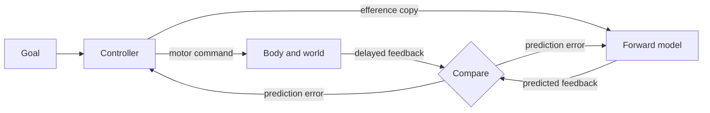

# Motor Control and the Cerebellum

Motor control is how the nervous system turns intentions into coordinated movement. Its central difficulty is that feedback arrives late and with noise, so the brain has to predict the consequences of its own commands. The cerebellum and the motor cortex are the two parts of the brain most closely tied to this problem.

## Overview

Reaching for a cup looks simple, but it requires the brain to plan a path, send coordinated commands to many muscles, and correct the movement as it unfolds. Sensory information about where the hand actually is comes back too slowly to correct a fast movement on its own. Motor control theory therefore stresses prediction. The brain keeps a model of the body and of the task, uses it to anticipate the sensory result of a command, and compares that prediction with what arrives.

Four strands of work organise the field, and this page covers each of them: internal models and forward prediction, cerebellar supervised learning in the tradition of Marr, Albus and Ito, optimal feedback control, and the population dynamics of the motor cortex. The anatomy of these regions is summarised in [Neuroscience Basics](../neuroscience/index.md). The same ideas connect to the prediction-error view of the cortex in [Predictive Coding and the Free-Energy Principle](../predictive-coding/index.md), and to robotics and model-based reinforcement learning, which reuse them as engineering tools.

## Key concepts

- **Forward model**: an internal model that predicts the sensory consequences of a motor command, given the current state of the body. It can run ahead of slow feedback.
- **Inverse model**: a model that goes the other way, mapping a desired movement or goal to the command that would produce it.
- **Efference copy**: a copy of the outgoing motor command, sent to the prediction system so that predicted and actual feedback can be compared.
- **Prediction error**: the difference between predicted and actual sensory feedback. It is used to correct the current movement and to update the model.
- **Climbing fibre and parallel fibre**: the two main inputs to a cerebellar Purkinje cell. Climbing fibres from the inferior olive are proposed to carry teaching or error signals, and parallel fibres carry a context signal from granule cells.
- **Optimal feedback control**: choosing feedback commands that minimise a cost accumulated over the movement, where the cost states what the movement must achieve and what it should not waste.
- **Neural population**: the joint activity of many neurons at once, treated as a single vector whose path through time can be analysed.

## How it works

Control theory describes a loop. A controller issues a command, the body and environment (the plant) produce a result, sensors report that result with delay and noise, and the controller corrects. A forward model lets the brain use a prediction in place of waiting for the report. If the model predicts the state after a command, the difference between that prediction and the delayed feedback is the error that drives both correction and learning.

In symbols, with state $s_t$ and command $u_t$, a forward model gives a prediction $\hat{s}_{t+1} = f(s_t, u_t)$, and the error used to update it is $e_t = s_{t+1} - \hat{s}_{t+1}$. Wolpert, Miall and Kawato (1998) review evidence that the cerebellum contributes such internal models, both forward and inverse, to movement.

Three methods explain how the pieces could be learned and used.

1. **Cerebellar supervised learning.** Marr (1969) and Albus (1971) proposed that the cerebellar cortex learns movements from error signals carried by climbing fibres. Ito's experiments later showed that paired activity in climbing and parallel fibres persistently weakens the parallel-fibre synapses onto Purkinje cells, a process called long-term depression.[^1] This gives the cerebellum a simple supervised learning rule. See [Memory & Learning in the Brain](../memory-learning/index.md) for the wider context of synaptic plasticity.
2. **Optimal feedback control.** Todorov and Jordan (2002) argued that coordinated movement can be described as a feedback controller that minimises a task cost. Because the cost penalises only errors that matter to the task, the controller can allow variability in dimensions that do not matter, and correct it in those that do.
3. **Motor cortex population dynamics.** Churchland et al. (2012) analysed the joint activity of many motor cortex neurons during reaching. They found that population activity follows structured trajectories that the paper describes in terms of dynamics, instead of being explained neuron by neuron.

## Key methods

Each method has its own page. This table is only a comparison.

| Method | What separates it | Page |
|---|---|---|
| Cerebellar supervised learning (Marr, Albus, Ito) | Climbing fibres give a teaching signal that weakens parallel-fibre synapses | [Marr, Albus and Ito](marr-albus-ito/index.md) |
| Optimal feedback control (Todorov & Jordan, 2002) | Feedback commands are chosen to minimise a task cost, with variability allowed where it does not matter | [Todorov and Jordan 2002](todorov-jordan-2002/index.md) |
| Population dynamics (Churchland et al., 2012) | Motor cortex is analysed as a dynamical system whose state is the population response | [Churchland et al. 2012](churchland-2012/index.md) |

## Connections

- **Brain and cognition**: the cerebellum's role in timing and prediction links to the broader prediction-error account in [Predictive Coding](../predictive-coding/index.md). The learning rule of cerebellar synapses is one case of the plasticity covered in [Memory & Learning in the Brain](../memory-learning/index.md).
- **Model-based control**: choosing actions by planning over a learned model parallels the model-based controller in [Model-Based vs Model-Free Control](../decision-reward/model-based-vs-model-free/index.md).
- **NeuroAI**: recurrent networks trained to produce reaching movements can show population dynamics resembling motor cortex, which connects this page to [NeuroAI](../neuroai/index.md). The recurrent architecture itself is described in [Recurrent Neural Networks](../../theory/models/rnn/index.md).
- **Brain-computer interfaces**: decoders that read motor cortex activity to drive a robotic arm rely on the same population view. See [Brain-Computer Interfaces & Neural Decoding](../bci/index.md) and [Reach and Grasp with a Neurally Controlled Arm](../bci/neural-reach-and-grasp/index.md).

## Applications

- **Robotics**: forward and inverse models, and optimal control, are standard tools for arm control and legged locomotion. Motor neuroscience has informed these tools for decades; see [Robotics](../../applications/robotics/index.md).
- **Model-based reinforcement learning**: agents that learn a world model and plan with it apply the forward-model idea directly. Hafner et al. (2019) learn a latent model from images and improve behaviour by imagining trajectories in it. See [Model-Based Reinforcement Learning](../../theory/paradigms/reinforcement-learning/model-based-rl/index.md) and [World Models & Embodied AI](../../theory/models/world-models/index.md).
- **Clinical neurology**: damage to the cerebellum typically causes incoordination of movement (ataxia), which is consistent with its role in predictive timing.

## Open questions

- **Does cerebellar learning follow the Marr–Albus–Ito rule?** Dean et al. (2009) argue that the cerebellar microcircuit behaves as an adaptive filter, but the exact mapping from climbing-fibre signals to learning is still being tested.
- **Do motor cortex dynamics come from the circuit itself or from input?** Churchland et al. (2012) describe structure in population activity, but separating intrinsic dynamics from sensory feedback and descending input is hard.
- **Does the brain implement optimal control, or only approximate it?** The framework explains much of human movement, but the cost functions are modelling choices and the neural implementation remains open. Scott (2004) reviews the case for and against.
- **How are forward models learned and combined with feedback?** Shadmehr, Smith and Krakauer (2010) review how error correction, sensory prediction and adaptation interact, but a single account has not been agreed.

## References

### Seminal papers

- Marr, D. (1969). A theory of cerebellar cortex. *The Journal of Physiology*. https://doi.org/10.1113/jphysiol.1969.sp008820 — Proposes that climbing-fibre input from the inferior olive teaches Purkinje cells to produce learned movements.
- Albus, J. S. (1971). A theory of cerebellar function. *Mathematical Biosciences*. https://doi.org/10.1016/0025-5564(71)90051-4 — A companion theory of cerebellar learning, in which climbing fibres supply the teaching signal for the cerebellar cortex.
- Kawato, M., Furukawa, K. & Suzuki, R. (1987). A hierarchical neural-network model for control and learning of voluntary movement. *Biological Cybernetics*. https://doi.org/10.1007/BF00364149 — A hierarchical network that learns a feedforward controller from feedback error, an early computational model of internal-model learning.
- Todorov, E. & Jordan, M. I. (2002). Optimal feedback control as a theory of motor coordination. *Nature Neuroscience*. https://doi.org/10.1038/nn963 — Argues that coordinated movement follows from feedback control that minimises a task-specific cost.
- Churchland, M. M., Cunningham, J. P., Kaufman, M. T., Foster, J. D., Nuyujukian, P., Ryu, S. I. et al. (2012). Neural population dynamics during reaching. *Nature*. https://doi.org/10.1038/nature11129 — Analyses motor cortex activity during reaching at the population level, and describes it as structured dynamics.

### Surveys and textbooks

- Wolpert, D. M., Miall, R. C. & Kawato, M. (1998). Internal models in the cerebellum. *Trends in Cognitive Sciences*. https://doi.org/10.1016/S1364-6613(98)01221-2 — Reviews evidence and theory that the cerebellum learns forward and inverse internal models for movement.
- Wolpert, D. M. & Ghahramani, Z. (2000). Computational principles of movement neuroscience. *Nature Neuroscience*. https://doi.org/10.1038/81497 — A short review of how computational ideas such as internal models and optimal control explain movement.
- Shadmehr, R., Smith, M. A. & Krakauer, J. W. (2010). Error correction, sensory prediction, and adaptation in motor control. *Annual Review of Neuroscience*. https://doi.org/10.1146/annurev-neuro-060909-153135 — Reviews how the brain uses noisy, delayed feedback, forward models and adaptation to control movement.
- Scott, S. H. (2004). Optimal feedback control and the neural basis of volitional motor control. *Nature Reviews Neuroscience*. https://doi.org/10.1038/nrn1427 — Reviews the optimal feedback control framework and its neural interpretation for volitional movement.
- Shenoy, K. V., Sahani, M. & Churchland, M. M. (2013). Cortical control of arm movements: a dynamical systems perspective. *Annual Review of Neuroscience*. https://doi.org/10.1146/annurev-neuro-062111-150509 — Reviews the case for treating motor cortex as a dynamical system rather than a set of tuned neurons.
- Ito, M. (2001). Cerebellar long-term depression: characterization, signal transduction, and functional roles. *Physiological Reviews*. https://doi.org/10.1152/physrev.2001.81.3.1143 — Reviews the physiology of long-term depression at cerebellar Purkinje cell synapses and its proposed functions.
- Dean, P., Porrill, J., Ekerot, C.-F. & Jörntell, H. (2009). The cerebellar microcircuit as an adaptive filter: experimental and computational evidence. *Nature Reviews Neuroscience*. https://doi.org/10.1038/nrn2756 — Reviews experimental and computational evidence that the cerebellar microcircuit acts as an adaptive filter.

### Articles and documentation

- Hafner, D., Lillicrap, T., Ba, J. & Norouzi, M. (2019). Dream to Control: Learning Behaviors by Latent Imagination. arXiv. https://arxiv.org/abs/1912.01603 — Learns a world model from images and trains control behaviour by imagining trajectories inside it, a model-based use of the forward-model idea.

[^1]: Ito's review describes the induction of long-term depression when climbing-fibre and parallel-fibre inputs to a Purkinje cell are repeatedly paired. The mechanism and its functional role are discussed in the review, and remain debated.
