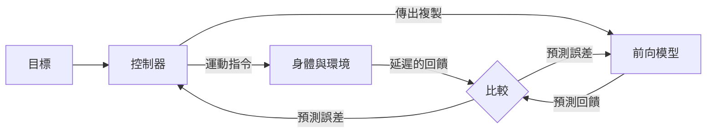

# 運動控制與小腦

運動控制是神經系統把意圖轉化為協調動作的過程。它的核心難題在於回饋來得慢而且帶有雜訊，因此大腦必須預測自己指令的後果。小腦與運動皮質是與這個問題關係最密切的兩個腦區。

## 概述

伸手去拿杯子看似簡單，實際上大腦必須規劃路徑、把協調的指令送到許多肌肉，並在動作進行中不斷修正。關於手現在位在哪裡的感覺資訊回來得太慢，無法單靠它修正快速的動作。因此運動控制理論強調預測：大腦保有一個關於身體與任務的模型，用它預期指令會產生的感覺結果，再把預測與實際回來的訊號加以比較。

本領域的研究可以整理為四條脈絡，本頁逐一介紹：內部模型與前向預測、Marr、Albus 與 Ito 所代表的小腦監督學習、最優回饋控制，以及運動皮質的群體動態。這些腦區的解剖學請見[神經科學基礎](../neuroscience/index.md)。同一組概念也與[預測編碼與自由能原理](../predictive-coding/index.md)中的預測誤差觀點相連，並被機器人學與基於模型的強化學習當作工程工具使用。

## 核心概念

- **前向模型**：一種內部模型，依據身體目前的狀態，預測運動指令會產生的感覺後果。它可以先於較慢的回饋而運作。
- **反向模型**：方向相反的模型，把想達到的動作或目標映射到能產生它的指令。
- **傳出複製**：運動指令的副本，送給預測系統，使預測回饋與實際回饋可以互相比較。
- **預測誤差**：預測的感覺回饋與實際感覺回饋之間的差異。它既用來修正目前的動作，也用來更新模型。
- **攀爬纖維與平行纖維**：浦金埃氏細胞（Purkinje cell）的兩種主要輸入。來自下橄欖核的攀爬纖維被認為攜帶教學或誤差訊號，平行纖維則攜帶來自顆粒細胞的脈絡訊號。
- **最優回饋控制**：選擇能使整段動作累積成本最小的回饋指令。成本定義了動作要達成什麼，以及不應浪費什麼。
- **神經群體**：許多神經元同時的活動，被視為一個向量，可以分析它隨時間的路徑。

## 運作方式

控制理論描述的是一個迴路：控制器發出指令，身體與環境（受控對象）產生結果，感測器以延遲與雜訊回報結果，控制器據此修正。加入前向模型後，大腦可以用預測取代等待回報。若模型預測了指令之後的狀態，那麼預測與延遲回饋之間的差異，就是驅動修正與學習的誤差。

以符號表示，設狀態為 $s_t$、指令為 $u_t$，前向模型給出預測 $\hat{s}_{t+1} = f(s_t, u_t)$，用來更新模型的誤差為 $e_t = s_{t+1} - \hat{s}_{t+1}$。Wolpert、Miall 與 Kawato（1998）綜述了小腦貢獻前向與反向內部模型的證據。

有三種方法解釋這些部分如何學習與運用。

1. **小腦監督學習。** Marr（1969）與 Albus（1971）提出，小腦皮質從攀爬纖維攜帶的誤差訊號學習動作。Ito 後來的實驗顯示，攀爬纖維與平行纖維同時活動會使平行纖維到浦金埃氏細胞的突觸持續減弱，這個過程稱為長期抑制。[^1] 因此小腦擁有一條簡單的監督學習規則。突觸可塑性的更廣泛脈絡見[記憶與學習的神經機制](../memory-learning/index.md)。
2. **最優回饋控制。** Todorov 與 Jordan（2002）主張，協調的動作可以描述為一個使任務成本最小的回饋控制器。由於成本只懲罰與任務有關的誤差，控制器可以容許與任務無關的維度存在變異，而在與任務有關的維度上加以修正。
3. **運動皮質的群體動態。** Churchland 等人（2012）分析了伸手動作期間許多運動皮質神經元的共同活動。他們發現群體活動遵循結構化的路徑，論文以動力系統來描述這些路徑，而不是逐一神經元解釋。

## 關鍵方法

每個方法都有自己的頁面，此表只作比較。

| 方法 | 區別所在 | 頁面 |
|---|---|---|
| 小腦監督學習（Marr、Albus、Ito） | 攀爬纖維提供教學訊號，使平行纖維的突觸減弱 | [Marr、Albus 與 Ito](marr-albus-ito/index.md) |
| 最優回饋控制（Todorov 與 Jordan，2002） | 回饋指令以最小化任務成本選出，並在變異無關緊要的地方容許變異 | [Todorov 與 Jordan 2002](todorov-jordan-2002/index.md) |
| 群體動態（Churchland 等人，2012） | 把運動皮質視為一個動力系統，其狀態就是群體的反應 | [Churchland 等人 2012](churchland-2012/index.md) |

## 與其他主題的關聯

- **腦與認知**：小腦在計時與預測上的角色，與[預測編碼與自由能原理](../predictive-coding/index.md)中更廣的預測誤差觀點相連。小腦突觸的學習規則，則是[記憶與學習的神經機制](../memory-learning/index.md)所述可塑性的一個例子。
- **有模型控制**：透過規劃一個學到的模型來選擇動作，與[有模型與無模型控制](../decision-reward/model-based-vs-model-free/index.md)中的有模型控制器相呼應。
- **NeuroAI**：被訓練來產生伸手動作的循環網路，可以呈現與運動皮質群體動態相似的模式，這使本頁與[NeuroAI：大腦與 AI 的雙向啟發](../neuroai/index.md)相連。循環網路本身的架構見[循環神經網路](../../theory/models/rnn/index.md)。
- **腦機介面**：讀取運動皮質活動以驅動機械手臂的解碼器，依賴的是同一種群體觀點。見[腦機介面與神經解碼](../bci/index.md)與[以神經控制的手臂進行伸手與抓取（Hochberg 等人，2012）](../bci/neural-reach-and-grasp/index.md)。

## 應用

- **機器人學**：前向與反向模型以及最優控制，是手臂控制與足式移動的標準工具。運動神經科學數十年來一直為這些工具提供靈感，見[機器人](../../applications/robotics/index.md)。
- **基於模型的強化學習**：學習世界模型並用它規劃的智慧體，直接應用了前向模型的想法。Hafner 等人（2019）從影像學習潛在模型，並透過在模型中想像軌跡來改進行為。見[基於模型的強化學習](../../theory/paradigms/reinforcement-learning/model-based-rl/index.md)與[世界模型與具身智慧](../../theory/models/world-models/index.md)。
- **臨床神經學**：小腦受損通常造成動作不協調（共濟失調），這與它在預測性計時中的角色相符。

## 開放問題

- **小腦學習是否遵循 Marr–Albus–Ito 規則？** Dean 等人（2009）認為小腦微迴路的行為像適應性濾波器，但從攀爬纖維訊號到學習的確切對應仍在檢驗之中。
- **運動皮質的動態來自迴路本身，還是來自輸入？** Churchland 等人（2012）描述了群體活動中的結構，但要把內在動態與感覺回饋和來自上游的輸入區分開來並不容易。
- **大腦實施的是最優控制，還是只是近似？** 此框架解釋了人類動作的大部分現象，但成本函數是建模的選擇，神經實現仍未確定。Scott（2004）綜述了正反兩面的論點。
- **前向模型如何學習，又如何與回饋結合？** Shadmehr、Smith 與 Krakauer（2010）綜述了誤差修正、感覺預測與適應如何互動，但尚無一致的單一解釋。

[^1]: Ito 的綜述描述了當攀爬纖維與平行纖維對浦金埃氏細胞的輸入反覆同時出現時，所誘發的長期抑制。綜述討論了其訊號機制與功能角色，更廣的解釋仍有爭議。

## 參考文獻

### 開創性論文

- Marr, D.（1969）。A theory of cerebellar cortex. *The Journal of Physiology*。https://doi.org/10.1113/jphysiol.1969.sp008820 — 提出來自下橄欖核的攀爬纖維輸入教導浦金埃氏細胞學習動作，並指出另一種輸入形式負責姿勢。
- Albus, J. S.（1971）。A theory of cerebellar function. *Mathematical Biosciences*。https://doi.org/10.1016/0025-5564(71)90051-4 — 與 Marr 相呼應的小腦學習理論，其中攀爬纖維提供小腦皮質的教學訊號。
- Kawato, M.、Furukawa, K. 與 Suzuki, R.（1987）。A hierarchical neural-network model for control and learning of voluntary movement. *Biological Cybernetics*。https://doi.org/10.1007/BF00364149 — 一個階層式網路，從回饋誤差學習前饋控制器，是早期的內部模型學習計算模型。
- Todorov, E. 與 Jordan, M. I.（2002）。Optimal feedback control as a theory of motor coordination. *Nature Neuroscience*。https://doi.org/10.1038/nn963 — 主張協調動作源自以任務特定成本為目標的回饋控制。
- Churchland, M. M.、Cunningham, J. P.、Kaufman, M. T.、Foster, J. D.、Nuyujukian, P.、Ryu, S. I. 等人（2012）。Neural population dynamics during reaching. *Nature*。https://doi.org/10.1038/nature11129 — 以群體層次分析伸手期間的運動皮質活動，並將其描述為結構化的動態。

### 綜述與教科書

- Wolpert, D. M.、Miall, R. C. 與 Kawato, M.（1998）。Internal models in the cerebellum. *Trends in Cognitive Sciences*。https://doi.org/10.1016/S1364-6613(98)01221-2 — 綜述小腦學習前向與反向內部模型運動的證據與理論。
- Wolpert, D. M. 與 Ghahramani, Z.（2000）。Computational principles of movement neuroscience. *Nature Neuroscience*。https://doi.org/10.1038/81497 — 簡短綜述運動的計算原理，包括內部模型與最優控制。
- Shadmehr, R.、Smith, M. A. 與 Krakauer, J. W.（2010）。Error correction, sensory prediction, and adaptation in motor control. *Annual Review of Neuroscience*。https://doi.org/10.1146/annurev-neuro-060909-153135 — 綜述大腦如何利用有雜訊且延遲的回饋、前向模型與適應來控制動作。
- Scott, S. H.（2004）。Optimal feedback control and the neural basis of volitional motor control. *Nature Reviews Neuroscience*。https://doi.org/10.1038/nrn1427 — 綜述最優回饋控制框架及其對自主運動的神經解釋。
- Shenoy, K. V.、Sahani, M. 與 Churchland, M. M.（2013）。Cortical control of arm movements: a dynamical systems perspective. *Annual Review of Neuroscience*。https://doi.org/10.1146/annurev-neuro-062111-150509 — 綜述把運動皮質視為動力系統而非一組調諧神經元的理由。
- Ito, M.（2001）。Cerebellar long-term depression: characterization, signal transduction, and functional roles. *Physiological Reviews*。https://doi.org/10.1152/physrev.2001.81.3.1143 — 綜述小腦浦金埃氏細胞突觸長期抑制的生理學及其被提出的功能。
- Dean, P.、Porrill, J.、Ekerot, C.-F. 與 Jörntell, H.（2009）。The cerebellar microcircuit as an adaptive filter: experimental and computational evidence. *Nature Reviews Neuroscience*。https://doi.org/10.1038/nrn2756 — 綜述小腦微迴路作為適應性濾波器的實驗與計算證據。

### 文章與文件

- Hafner, D.、Lillicrap, T.、Ba, J. 與 Norouzi, M.（2019）。Dream to Control: Learning Behaviors by Latent Imagination. arXiv。https://arxiv.org/abs/1912.01603 — 從影像學習世界模型，並在模型中想像軌跡來訓練控制行為，是前向模型想法的有模型應用。
