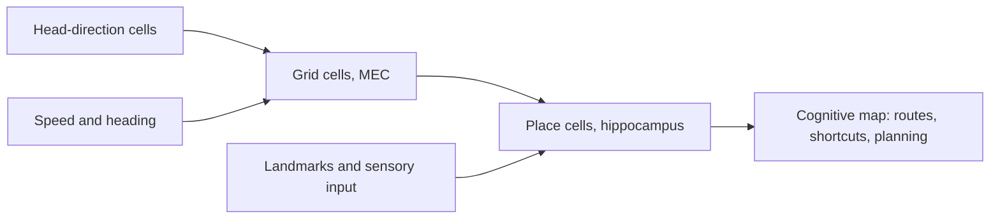

# Spatial Navigation and Cognitive Maps

Animals and people keep track of where they are and how to reach where they want to go. Neurons in the hippocampus and the neighbouring entorhinal cortex encode position, heading and distance. The idea that these codes form an internal map, a *cognitive map*, links spatial navigation to memory and planning.

## Overview

To reach a goal, an animal needs three things: its own location, the location of the goal, and a route between them. In the 1940s, Edward Tolman argued that rats in mazes learn more than chains of turns. They seemed to acquire a map-like knowledge of the layout, which let them take routes they had not travelled before (Tolman, 1948). The idea was debated at the time and remains central to the field.

Neural evidence followed in the 1970s. O'Keefe and Dostrovsky (1971) recorded single neurons in the hippocampus of freely moving rats and found cells that were active when the animal was in a particular place. Further cell types came later. Head-direction cells signal the direction the head is pointing (Taube et al., 1990). Grid cells in the entorhinal cortex fire at many places that form a regular lattice across the environment (Hafting et al., 2005). Together these cells form a spatial code that is studied in detail today. The hippocampus's role in memory is covered in [Memory & Learning in the Brain](../memory-learning/index.md).

## Key concepts

- **Place cell**: a hippocampal neuron that fires in a restricted part of an environment, called its place field.
- **Grid cell**: an entorhinal neuron whose firing fields repeat at the points of a regular, roughly triangular lattice that covers the environment.
- **Head-direction cell**: a neuron that fires when the animal's head points in a particular direction, whatever its location.
- **Path integration**: estimating one's position by accumulating self-motion signals, such as speed and heading, from a known starting point, without relying on landmarks.
- **Cognitive map**: an internal representation of the relations among places, which can be used to plan new routes and shortcuts. Behrens et al. (2018) use the term more broadly, for any structured knowledge of how states relate.
- **Successor representation**: a code that describes each state by the future states it is expected to lead to, weighted by how soon they arrive (Dayan, 1993). It is a map-like code that is useful for reinforcement learning.

## How it works

The spatial code in the medial temporal lobe is built in layers. Head-direction cells supply the animal's heading. Grid cells in the medial entorhinal cortex (MEC) combine heading and speed. Many models propose that this combination performs path integration, which keeps an estimate of location up to date as the animal moves (McNaughton et al., 2006). Place cells in the hippocampus receive grid-cell input together with sensory information, especially landmarks, which anchors each place field to the environment.

The successor representation offers a second route to map-like knowledge. Under a policy $\pi$, the matrix $M(s, s')$ gives the expected discounted number of future visits to state $s'$ when starting from state $s$:

$$
M(s, s') = \mathbb{E}\left[\sum_{t=0}^{\infty} \gamma^{t}\,\mathbf{1}[s_t = s'] \;\middle|\; s_0 = s\right]
$$

The value of a state is then a weighted sum over the rewards $R(s')$ of the states it leads to, $V(s) = \sum_{s'} M(s, s')\,R(s')$. Because $M$ does not depend on the reward, a change in reward can be absorbed by updating $R$ alone. Stachenfeld et al. (2017) proposed that hippocampal place fields can be understood as this kind of predictive map. Momennejad et al. (2017) reported that human choices in a sequential task are consistent with successor-based learning.

Grid-like units can also arise in artificial systems. Cueva and Wei (2018) and Banino et al. (2018) trained recurrent networks on localisation and navigation tasks and found hidden units with grid-like firing. The result is discussed on the [Grid-Like Units](../neuroai/grid-like-units/index.md) page.

## Key methods

Each method has its own page. This table is only a comparison.

| Method | What separates it | Page |
|---|---|---|
| Place cells (O'Keefe & Dostrovsky, 1971) | The first single-cell evidence that hippocampal neurons encode location | [Place Cells](place-cells/index.md) |
| Grid cells (Hafting et al., 2005) | Entorhinal cells whose several firing fields form a regular lattice over the enclosure | [Grid Cells](grid-cells/index.md) |
| Grid-like units in a navigating network (Banino et al., 2018) | A grid-like code appears in an artificial agent trained to navigate, instead of being recorded in animals | [Grid-Like Units](../neuroai/grid-like-units/index.md) |
| Tolman–Eichenbaum Machine (Whittington et al., 2020) | One model in which spatial and non-spatial relational memory share a hippocampal–entorhinal architecture | [Tolman–Eichenbaum Machine](tolman-eichenbaum-machine/index.md) |

## Connections

- **Memory**: the hippocampus was first studied as a memory system, and the evidence that it is needed for new memories is in [Memory & Learning in the Brain](../memory-learning/index.md) and [Patients with medial temporal lobe lesions](../memory-learning/medial-temporal-lesions/index.md). Place cells connect that evidence to space.
- **Replay**: place cells replay recent trajectories during rest and sleep, as described in [Sleep, Replay and Memory Consolidation](../sleep-and-consolidation/index.md).
- **Decisions and planning**: a map of how a task is structured supports model-based choice (see [Model-Based vs Model-Free Control](../decision-reward/model-based-vs-model-free/index.md)). The successor representation is a cheaper, partly model-free alternative. Russek et al. (2017) argue that predictive representations can link the two families of control.
- **NeuroAI**: grid-like units are a clear case of a network used as a model of the brain. See [NeuroAI](../neuroai/index.md).

## Applications

- **Robot localisation and mapping**: robots solve the same problem with simultaneous localisation and mapping (SLAM), covered under [Robotics](../../applications/robotics/index.md). Kanitscheider and Fiete (2016) trained recurrent networks on SLAM-like 2D navigation tasks, and their hidden units showed several properties of hippocampal place cells.
- **Reinforcement learning**: an agent that stores a successor representation can revalue its options quickly when rewards change, because the structure of the environment is stored apart from the reward. Gershman (2018) reviews the computational logic and the evidence for it in neural data.
- **Human navigation research**: Epstein et al. (2017) review evidence for cognitive maps in humans and ask how far the idea reaches beyond navigation.

## Open questions

- **Is the cognitive map only spatial?** Behrens et al. (2018) and Bellmund et al. (2018) argue that the same coding principles may organise abstract, non-spatial knowledge. The evidence for this is still developing.
- **Where do grid codes come from?** Trained networks develop grid-like units, but the result depends on the architecture, training objective and environment. Whether the learned codes share the features that produce grid cells in the brain is still under study.
- **Are predictive maps and spatial maps the same thing?** Stachenfeld et al. (2017) propose that they are, but testing this directly is difficult.
- **How are cues and self-motion combined?** Landmarks and path integration can disagree. How the brain resolves such conflicts is an active question.

## References

### Seminal papers

- Tolman, E. C. (1948). Cognitive maps in rats and men. *Psychological Review*. https://doi.org/10.1037/h0061626 — Argues that rats in mazes acquire a map-like knowledge of the environment, which lets them take routes they have not travelled before.
- O'Keefe, J. & Dostrovsky, J. (1971). The hippocampus as a spatial map. Preliminary evidence from unit activity in the freely-moving rat. *Brain Research*. https://doi.org/10.1016/0006-8993(71)90358-1 — Reports hippocampal units in freely moving rats that fire when the animal is in a particular place.
- Taube, J. S., Muller, R. U. & Ranck, J. B. (1990). Head-direction cells recorded from the postsubiculum in freely moving rats. I. Description and quantitative analysis. *Journal of Neuroscience*. https://doi.org/10.1523/JNEUROSCI.10-02-00420.1990 — Describes neurons in the rat postsubiculum whose firing depends on the direction the head points, not on location or behaviour.
- Hafting, T. et al. (2005). Microstructure of a spatial map in the entorhinal cortex. *Nature*. https://doi.org/10.1038/nature03721 — Reports grid cells in the medial entorhinal cortex, whose firing fields form a regular triangular lattice across an open enclosure.
- Dayan, P. (1993). Improving generalization for temporal difference learning: the successor representation. *Neural Computation*. https://doi.org/10.1162/neco.1993.5.4.613 — Introduces the successor representation, a state code learned with temporal-difference methods and illustrated on a navigation task.
- Stachenfeld, K. L., Botvinick, M. M. & Gershman, S. J. (2017). The hippocampus as a predictive map. *Nature Neuroscience*. https://doi.org/10.1038/nn.4650 — Proposes that hippocampal place fields can be understood as a successor-like predictive map of the environment.
- Momennejad, I. et al. (2017). The successor representation in human reinforcement learning. *Nature Human Behaviour*. https://doi.org/10.1038/s41562-017-0180-8 — Compares successor-based and model-based predictions with human choices in a sequential decision task.
- Cueva, C. J. & Wei, X.-X. (2018). Emergence of grid-like representations by training recurrent neural networks to perform spatial localization. arXiv. https://arxiv.org/abs/1803.07770 — Shows that recurrent networks trained for spatial localisation develop grid-like tuning, a result that runs in parallel with Banino et al. (2018).
- Banino, A. et al. (2018). Vector-based navigation using grid-like representations in artificial agents. *Nature*. https://doi.org/10.1038/s41586-018-0102-6 — Shows that grid-like units emerge in a recurrent agent trained to navigate, and help it navigate by vectors.
- Whittington, J. C. R. et al. (2020). The Tolman-Eichenbaum Machine: Unifying space and relational memory through generalization in the hippocampal formation. *Cell*. https://doi.org/10.1016/j.cell.2020.10.024 — Proposes one model in which entorhinal and hippocampal codes support both spatial and relational memory through generalisation.
- Kanitscheider, I. & Fiete, I. (2016). Training recurrent networks to generate hypotheses about how the brain solves hard navigation problems. arXiv. https://arxiv.org/abs/1609.09059 — Trains recurrent networks on SLAM-like navigation tasks and finds hidden units with place-cell-like properties.

### Surveys and textbooks

- Moser, E. I., Kropff, E. & Moser, M.-B. (2008). Place cells, grid cells, and the brain's spatial representation system. *Annual Review of Neuroscience*. https://doi.org/10.1146/annurev.neuro.31.061307.090723 — Reviews place, grid and related cells in the entorhinal–hippocampal system and how they may support spatial representation.
- McNaughton, B. L. et al. (2006). Path integration and the neural basis of the 'cognitive map'. *Nature Reviews Neuroscience*. https://doi.org/10.1038/nrn1932 — Reviews how self-motion signals can be integrated to maintain a cognitive map in the hippocampal formation.
- Epstein, R. A. et al. (2017). The cognitive map in humans: spatial navigation and beyond. *Nature Neuroscience*. https://doi.org/10.1038/nn.4656 — Reviews evidence for cognitive maps in humans and asks how far the idea extends beyond spatial navigation.
- Behrens, T. E. J. et al. (2018). What Is a Cognitive Map? Organizing Knowledge for Flexible Behavior. *Neuron*. https://doi.org/10.1016/j.neuron.2018.10.002 — Argues that cognitive maps organise knowledge in general, not only space, and reviews the supporting evidence.
- Bellmund, J. L. S. et al. (2018). Navigating cognition: Spatial codes for human thinking. *Science*. https://doi.org/10.1126/science.aat6766 — Reviews how spatial codes may support non-spatial thinking, combining cognitive science and neuroscience.
- Gershman, S. J. (2018). The successor representation: its computational logic and neural substrates. *Journal of Neuroscience*. https://doi.org/10.1523/JNEUROSCI.0151-18.2018 — Reviews the successor representation as a computational tool and the neural data that bear on it.
- Russek, E. M. et al. (2017). Predictive representations can link model-based reinforcement learning to model-free mechanisms. *PLOS Computational Biology*. https://doi.org/10.1371/journal.pcbi.1005768 — Proposes that successor-like predictive representations connect model-based and model-free control.
