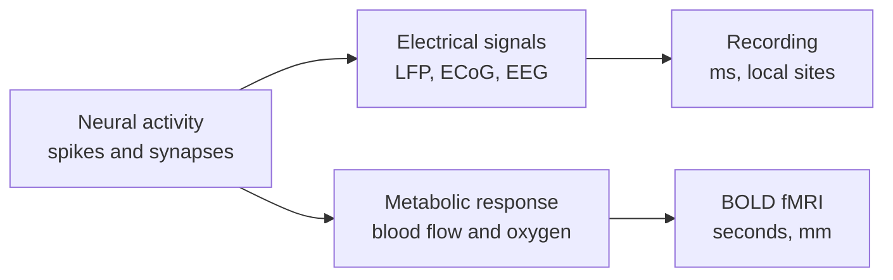

# Neuroimaging and Recording Methods

Every claim about the brain rests on a measurement, and each measurement sees a different slice of neural activity. Functional MRI tracks blood oxygenation with good spatial detail but slow timing. Electrophysiology records electrical activity with fine temporal detail but from few sites. Knowing what each method actually measures is necessary for reading the results on the rest of this section.

## Overview

The brain does not report its activity directly. Neurons fire, consume oxygen, change local electrical fields and send blood flow to the active regions, and each of these can be measured. Methods differ in which of these signals they capture, how precisely they locate it in space and time, and how invasive they are. [Neuroscience Basics](../neuroscience/index.md) covers the cells and regions that these methods study; this page covers how the signals are obtained and what they can and cannot tell us.

## Key concepts

- **BOLD signal**: the blood-oxygen-level-dependent contrast in fMRI. It reflects changes in deoxygenated haemoglobin, which follow neural activity with a delay of seconds.
- **Spatial and temporal resolution**: fMRI resolves millimetres but only seconds, while electrophysiology resolves milliseconds but only at the sites it samples.
- **Local field potential (LFP)**: a slow electrical signal produced mainly by synaptic activity around a recording electrode, distinct from the spikes of individual neurons.
- **Electrocorticography (ECoG)**: recordings from electrodes placed on the cortical surface, usually during clinical care, with better signal quality than scalp EEG.
- **Invasiveness**: how much a method requires surgery or implantation. The trade-off between invasiveness and signal quality shapes which methods are used with people.

## How it works

Each method reads a different link in the chain from neurons to measurement. Blood-based methods read the metabolic response, electrical methods read the currents, and both depend on how these currents and metabolic changes relate to spiking.

One open question sits behind much of the interpretation. The BOLD signal is a measure of the brain's blood supply, so inferring neural activity from it requires an account of how the two are coupled.

## Key methods

Each method has its own page. This table is only a comparison.

| Method | What it measures | Page |
|---|---|---|
| BOLD fMRI (Ogawa et al., 1990) | Changes in blood oxygenation that follow neural activity | [Ogawa et al. 1990](bold-fmri/index.md) |
| Simultaneous fMRI and electrophysiology (Logothetis et al., 2001) | Whether the BOLD signal tracks spiking or synaptic activity | [Logothetis et al. 2001](fmri-electrophysiology/index.md) |

## Connections

- **Brain-computer interfaces**: how these signals are decoded to control devices or communicate is on [Brain-Computer Interfaces](../bci/index.md), which compares the recording modalities in a table.
- **Language**: fMRI and ECoG studies of speech and sentence processing are on [Language in the Brain](../language-in-brain/index.md).
- **Perception**: how recording methods found receptive fields in visual cortex is on [Perception and the Visual System](../visual-perception/index.md).
- **Neuroscience background**: the cell types and regions behind the signals are on [Neuroscience Basics](../neuroscience/index.md).

## Applications

- **Presurgical mapping**: fMRI and ECoG locate language and motor regions before neurosurgery, so that resection can avoid them.

## Open questions

- **What does the BOLD signal really reflect?** Its relation to spiking and to synaptic input is still debated, and it limits the inferences drawn from fMRI.
- **Can non-invasive methods reach the resolution of implants?** Scalp EEG and fMRI remain much coarser than intracortical recordings, and the gap is an active area.

## References

### Seminal papers

- Ogawa, S., Lee, T.-M., Kay, A. R. & Tank, D. W. (1990). Brain magnetic resonance imaging with contrast dependent on blood oxygenation. *Proceedings of the National Academy of Sciences*. https://pmc.ncbi.nlm.nih.gov/articles/PMC55275 — Shows that magnetic resonance contrast depends on blood oxygenation, the basis of BOLD fMRI.
- Logothetis, N. K., Pauls, J., Augath, M., Trinath, T. & Oeltermann, A. (2001). Neurophysiological investigation of the basis of the fMRI signal. *Nature*. https://doi.org/10.1038/35084005 — Records electrical activity and fMRI together, and relates the BOLD signal to local field potentials and spiking.
- Fedorenko, E., Hsieh, P.-J., Nieto-Castañón, A., Whitfield-Gabrieli, S. & Kanwisher, N. (2010). New method for fMRI investigations of language: defining ROIs functionally in individual subjects. *Journal of Neurophysiology*. https://pmc.ncbi.nlm.nih.gov/articles/PMC2934923 — A fMRI method that defines each person's regions functionally, with a worked application to language.

### Articles and primary research

- Goldstein, A., Zada, Z., Buchnik, E., Schain, M., Price, A., et al. (2022). Shared computational principles for language processing in humans and deep language models. *Nature Neuroscience*. https://doi.org/10.1038/s41593-022-01026-4 — Uses electrocorticography recorded during a podcast, a clinical-grade electrical method.
- Schrimpf, M., Blank, I. A., Tuckute, G., Kauf, C., Hosseini, E. A., Kanwisher, N., Tenenbaum, J. B. & Fedorenko, E. (2021). The neural architecture of language: Integrative modeling converges on predictive processing. *PNAS*. https://doi.org/10.1073/pnas.2105646118 — Combines fMRI and ECoG recordings of sentence responses in one comparison.
