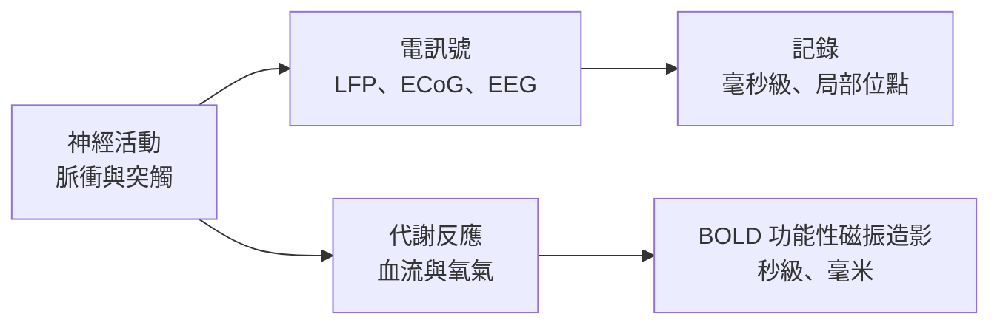

# 神經影像與記錄方法

關於大腦的每一個主張都建立在某種測量之上，而每種測量只看見神經活動的一部分。功能性磁振造影追蹤血液含氧量，空間細節良好，但時間上很慢。電生理記錄電活動，時間細節精細，但只來自少數取樣位置。理解每種方法實際測量什麼，是讀懂本區其餘結果的必要前提。

## 概述

大腦不會直接報告其活動。神經元放電、消耗氧氣、改變局部電場，並把血流送往活躍的區域，這些都可以被測量。各種方法的差異，在於它們擷取哪一種訊號、能以多高的精度定位於空間與時間，以及侵入程度有多高。[神經科學基礎](../neuroscience/index.md)涵蓋這些方法所研究的細胞與區域；本頁則說明如何取得這些訊號，以及它們能告訴我們什麼、不能告訴我們什麼。

## 核心概念

- **BOLD 訊號**：功能性磁振造影中的血氧水平依賴對比。它反映去氧血紅素的變化，這些變化在神經活動之後數秒才出現。
- **空間與時間解析度**：功能性磁振造影能解析到毫米，但只到秒；電生理則能解析到毫秒，但僅限於取樣的位置。
- **局部場電位（LFP）**：主要由電極周圍突觸活動產生的慢速電訊號，與個別神經元的脈衝不同。
- **皮質腦電圖（ECoG）**：電極放在皮質表面所做的記錄，通常在臨床照護中進行，訊號品質優於頭皮腦電圖。
- **侵入性**：一種方法需要多少手術或植入。侵入性與訊號品質之間的取捨，決定了哪些方法能用於人類。

## 運作方式

每種方法讀取從神經元到測量結果之間的不同環節。血液相關的方法讀取代謝反應，電方法讀取電流，兩者都依賴這些電流與代謝變化如何與脈衝相關。

許多解釋背後都有一個未解的問題。BOLD 訊號是對大腦血液供應的測量，因此要從它推論神經活動，需要說明兩者如何耦合。

## 關鍵方法

每種方法都有自己的頁面。下表只用來比較。

| 方法 | 它測量什麼 | 頁面 |
|---|---|---|
| BOLD 功能性磁振造影（Ogawa 等人，1990） | 神經活動後隨之變化的血氧含量 | [Ogawa 等人 1990](bold-fmri/index.md) |
| 功能性磁振造影與電生理同步記錄（Logothetis 等人，2001） | BOLD 訊號追蹤的是脈衝還是突觸活動 | [Logothetis 等人 2001](fmri-electrophysiology/index.md) |

## 與其他主題的關聯

- **腦機介面**：如何解碼這些訊號以控制裝置或溝通，見[腦機介面與神經解碼](../bci/index.md)，該頁以表格比較了各種記錄模式。
- **語言**：關於語音與句子處理的功能性磁振造影與 ECoG 研究，見[大腦中的語言](../language-in-brain/index.md)。
- **知覺**：記錄方法如何在視覺皮質中發現感受野，見[知覺與視覺系統](../visual-perception/index.md)。
- **神經科學背景**：訊號背後的細胞與區域，見[神經科學基礎](../neuroscience/index.md)。

## 應用

- **術前定位**：功能性磁振造影與 ECoG 在神經外科手術前定位語言與運動區，使切除時能避開它們。

## 開放問題

- **BOLD 訊號究竟反映什麼？** 它與脈衝及突觸輸入的關係仍有爭議，這限制了從功能性磁振造影所能做的推論。
- **非侵入式方法能否達到植入式的解析度？** 頭皮腦電圖與功能性磁振造影仍遠比皮質內記錄粗糙，這個差距是活躍的研究領域。

## 參考文獻

### 開創性論文

- Ogawa, S., Lee, T.-M., Kay, A. R. & Tank, D. W.（1990）。Brain magnetic resonance imaging with contrast dependent on blood oxygenation. *Proceedings of the National Academy of Sciences*。https://doi.org/10.1073/pnas.87.24.9868 — 顯示磁共振對比取決於血氧含量，是 BOLD 功能性磁振造影的基礎。
- Logothetis, N. K., Pauls, J., Augath, M., Trinath, T. & Oeltermann, A.（2001）。Neurophysiological investigation of the basis of the fMRI signal. *Nature*。https://doi.org/10.1038/35084005 — 把 BOLD 訊號與同一批動物中記錄的局部場電位及脈衝相關聯。
- Fedorenko, E., Hsieh, P.-J., Nieto-Castañón, A., Whitfield-Gabrieli, S. & Kanwisher, N.（2010）。New method for fMRI investigations of language: defining ROIs functionally in individual subjects. *Journal of Neurophysiology*。https://doi.org/10.1152/jn.00032.2010 — 在個人層級以功能定義腦區的功能性磁振造影方法。

### 文章與原始研究

- Goldstein, A., Zada, Z., Buchnik, E., Schain, M., Price, A., 等人（2022）。Shared computational principles for language processing in humans and deep language models. *Nature Neuroscience*。https://doi.org/10.1038/s41593-022-01026-4 — 使用臨床等級的皮質腦電圖，這是比基於血液的訊號更直接的電方法。
- Schrimpf, M., Blank, I. A., Tuckute, G., Kauf, C., Hosseini, E. A., Kanwisher, N., Tenenbaum, J. B. & Fedorenko, E.（2021）。The neural architecture of language: Integrative modeling converges on predictive processing. *PNAS*。https://doi.org/10.1073/pnas.2105646118 — 在同一比較中結合功能性磁振造影與 ECoG 對句子的反應。
