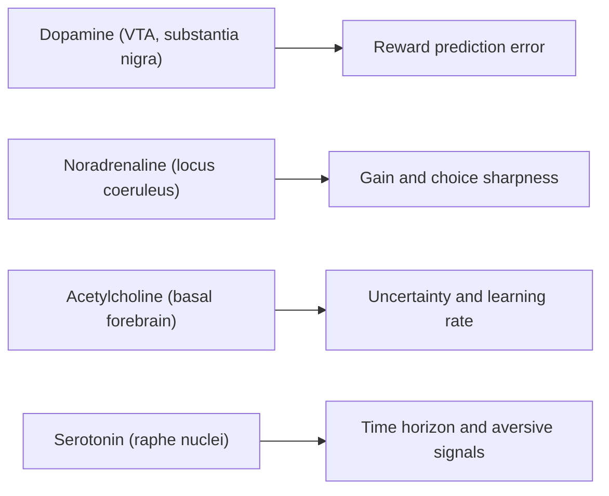

# Neuromodulation Beyond Dopamine

Neuromodulators are chemical signals, such as acetylcholine, noradrenaline and serotonin, that change how whole circuits respond and learn, rather than carrying a specific message from one neuron to another. Dopamine is the best studied of them. The other systems appear to report quantities that matter for learning, namely how uncertain the situation is, how aroused the animal is and how fast it should update its beliefs. These proposals have inspired ideas for meta-learning and adaptive optimisers in AI.

## Overview

Most neurons communicate through fast, point-to-point synapses. Neuromodulatory systems work differently. A small group of neurons in a brainstem or basal forebrain nucleus sends axons to large parts of the brain, releases a transmitter, and acts through receptors that change the excitability and plasticity of the neurons nearby. The effect is broad, and it usually unfolds more slowly than synaptic transmission.

Four systems are usually discussed together. Dopamine arises mainly in the ventral tegmental area and the substantia nigra. Noradrenaline comes from the locus coeruleus, a small nucleus in the brainstem. Serotonin comes from the raphe nuclei. Acetylcholine comes from the basal forebrain, including the nucleus basalis and the medial septum. [Neuroscience Basics](../neuroscience/index.md) introduces them and their general functions.

The central question is what these systems compute. Dopamine has been linked to the reward prediction error, as described in [Decision Making, Dopamine and Reward](../decision-reward/index.md) and in the [dopamine reward prediction error](../neuroscience/dopamine-reward-prediction-error/index.md) page. The other systems are proposed to report higher-level variables: how uncertain the current situation is, how aroused or engaged the animal should be, and how far ahead outcomes matter. These variables set how the brain should learn and attend, rather than what it learns, which is why such systems are often called meta-level signals.

Three landmark accounts organise the field, and each has its own page. Doya (2002) proposed that four neuromodulators regulate the meta-parameters of reinforcement learning. Yu and Dayan (2005) proposed that acetylcholine and noradrenaline signal two kinds of uncertainty. Aston-Jones and Cohen (2005) proposed that the phasic and tonic activity of the locus coeruleus trades exploitation against exploration.

## Key concepts

- **Neuromodulator**: a substance that changes the gain, firing threshold or plasticity of many neurons at once, rather than driving a specific target.
- **Tonic and phasic activity**: a sustained background level of firing, compared with brief bursts that follow events. The locus coeruleus is described in both modes.
- **Expected and unexpected uncertainty**: expected uncertainty is noise or unreliability that is already known to be present in a context. Unexpected uncertainty is a sudden change that breaks what was predicted.
- **Adaptive gain**: a change in how strongly a circuit responds to its inputs, without changing the inputs themselves.
- **Meta-parameters**: the settings of a learning algorithm that control how it learns, such as the learning rate, the discount factor and the inverse temperature of the action-selection rule.
- **Inverse temperature**: in a softmax policy, the parameter that sets how strongly choices favour the highest-valued option. A low value gives more random, exploratory choices.

## How it works

Neuromodulatory neurons fire either at a steady tonic rate or in brief phasic bursts. Their projections are diffuse, and their receptors often act slowly. The net effect is to shift the operating point of the circuits they reach. A simple picture is that a meta-level variable, such as uncertainty, utility or time horizon, is reflected in the level of a neuromodulator, and that level then sets a parameter of the local circuit.

The reinforcement-learning view makes the link precise. A value estimate $V$ is updated by a temporal-difference error $\delta_t = r_t + \gamma V(s_{t+1}) - V(s_t)$, using the learning rate $\alpha$ in the update $V(s_t) \leftarrow V(s_t) + \alpha\,\delta_t$. Actions are chosen with a softmax rule, $P(a \mid s) \propto \exp(\beta\,Q(s,a))$, where $\beta$ is the inverse temperature. Here $\gamma$ is the discount factor, which sets how much future reward counts. Doya (2002) proposed that dopamine carries the error $\delta_t$ itself, while serotonin, acetylcholine and noradrenaline regulate $\gamma$, $\alpha$ and $\beta$ respectively. This mapping is a hypothesis about function, not a measured fact, and its details are discussed on the [Doya 2002](doya-2002/index.md) page.

## Key methods

Each method has its own page. This table is only a comparison.

| Method | What it proposes | Page |
|---|---|---|
| Meta-parameter mapping (Doya, 2002) | Four neuromodulators regulate the four meta-parameters of reinforcement learning | [Doya 2002](doya-2002/index.md) |
| Expected and unexpected uncertainty (Yu & Dayan, 2005) | Acetylcholine signals expected uncertainty, noradrenaline signals unexpected uncertainty, and both shape attention | [Yu and Dayan 2005](yu-dayan-2005/index.md) |
| Adaptive gain (Aston-Jones & Cohen, 2005) | Phasic and tonic locus coeruleus activity trades exploitation against exploration | [Aston-Jones and Cohen 2005](aston-jones-cohen-2005/index.md) |

The first account concerns learning speed and time horizons. The second concerns uncertainty and attention. The third concerns arousal and the choice between staying with a task and searching for another. They are complementary rather than rival accounts, although they assign some functions differently.

## Connections

- **Decision making and reward**: the reward signal discussed in [Decision Making, Dopamine and Reward](../decision-reward/index.md) is the one neuromodulator with the most detailed account. The other systems set the conditions under which that signal is used.
- **Attention**: the uncertainty accounts link neuromodulation to the allocation of attention, which is treated in [Attention in Brains & Machines](../attention-brain-machine/index.md).
- **Memory and plasticity**: acetylcholine is thought to influence whether the hippocampus favours encoding of new information or retrieval of old, as discussed in [Memory & Learning in the Brain](../memory-learning/index.md).
- **Predictive coding**: some accounts describe attention as adjusting the precision of prediction errors. This resembles the role of expected uncertainty, and the link is explored in [Predictive Coding & Free Energy](../predictive-coding/index.md).
- **Emotion**: serotonin's proposed role in aversive processing connects to [Emotion & Affective Computing](../emotion/index.md).
- **Exploration in AI**: the locus coeruleus account of exploration parallels the exploration strategies in [Exploration in Reinforcement Learning](../../theory/paradigms/reinforcement-learning/exploration/index.md).

## Applications

- **Meta-learning**: an agent that adapts its own meta-parameters during learning applies the idea of neuromodulators as meta-level controllers. Schweighofer and Doya (2003) studied this in reinforcement learning. See [Meta-Learning](../../theory/paradigms/meta-learning/index.md).
- **Adaptive optimisers**: Adam (Kingma and Ba, 2014) sets a separate step size for each parameter from running statistics of its gradients. It is not derived from neuromodulation, but it shares the principle that the learning rate should depend on the state of learning. See [Adaptive Optimisers](../../theory/optimization/adaptive/index.md).
- **Learned plasticity**: Najarro and Risi (2020) searched for Hebbian learning rules that let networks organise their own weights during an agent's lifetime. This learns the plasticity rule itself, which is close to the idea that neuromodulators gate plasticity.
- **Uncertainty in machine learning**: the distinction between expected and unexpected uncertainty is a useful vocabulary for [Uncertainty and Calibration](../../theory/machine-learning/uncertainty-and-calibration/index.md), particularly for detecting distribution shift.
- **Computational psychiatry**: models that describe serotonin and dopamine as distinct controllers are used to interpret how drugs that act on these systems change decisions. See [Mental Health](../../applications/mental-health/index.md).

## Open questions

- **What does serotonin do?** Doya's mapping gives it the time horizon. Other proposals link it to aversive processing and behavioural inhibition, and Dayan and Huys (2009) argue for a role in aversive control.[^1] The evidence is mixed, and the scope of this topic assigns serotonin to uncertainty, arousal and learning rate, which remain weakly supported.
- **Do neuromodulators implement meta-parameters, or only correlate with them?** Measuring a neuromodulator's level in a region is different from showing that it causes a change in a computational parameter.
- **How can expected and unexpected uncertainty be separated in data?** The distinction is clear in models but hard to read from recordings, where both signals may change together.
- **Should AI meta-learning copy biology?** Learned plasticity rules can work without any neuromodulator, so the value of the analogy is an empirical question.

[^1]: Dayan and Huys (2009) discuss serotonin in terms of aversive processing and note that its statistics differ from those of dopamine. The page does not claim a single accepted role for serotonin.

## References

### Seminal papers

- Doya, K. (2002). Metalearning and neuromodulation. *Neural Networks*. https://doi.org/10.1016/S0893-6080(02)00044-8 — Proposes that dopamine, serotonin, noradrenaline and acetylcholine regulate the error signal and the main meta-parameters of reinforcement learning.
- Yu, A. J. & Dayan, P. (2005). Uncertainty, neuromodulation, and attention. *Neuron*. https://doi.org/10.1016/j.neuron.2005.04.026 — Proposes that acetylcholine and noradrenaline signal expected and unexpected uncertainty, and that both shape the allocation of attention.
- Aston-Jones, G. & Cohen, J. D. (2005). An integrative theory of locus coeruleus-norepinephrine function: adaptive gain and optimal performance. *Annual Review of Neuroscience*. https://doi.org/10.1146/annurev.neuro.28.061604.135709 — Reviews monkey recordings and models showing phasic and tonic locus coeruleus modes that trade exploitation against exploration.
- Schultz, W., Dayan, P. & Montague, P. R. (1997). A Neural Substrate of Prediction and Reward. *Science*. https://doi.org/10.1126/science.275.5306.1593 — Shows that dopamine neurons signal reward prediction errors, the signal that the other neuromodulators are compared against.
- Schweighofer, N. & Doya, K. (2003). Meta-learning in Reinforcement Learning. *Neural Networks*. https://doi.org/10.1016/S0893-6080(02)00228-9 — Studies how the meta-parameters of a reinforcement learner can be adapted during learning, building on the neuromodulatory view.
- Kingma, D. P. & Ba, J. (2014). Adam: A Method for Stochastic Optimization. *arXiv*. https://arxiv.org/abs/1412.6980 — Introduces Adam, an optimiser that adapts the step size of each parameter from running gradient statistics.

### Surveys and textbooks

- Dayan, P. & Huys, Q. J. M. (2009). Serotonin in Affective Control. *Annual Review of Neuroscience*. https://doi.org/10.1146/annurev.neuro.051508.135607 — Reviews serotonin's role in appetitive and aversive control, and why it may only partly mirror dopamine.
- Doya, K. (2008). Modulators of decision making. *Nature Neuroscience*. https://doi.org/10.1038/nn2077 — Reviews how neuromodulators shape decisions and relates them to reinforcement-learning parameters.
- Hasselmo, M. E. (2006). The role of acetylcholine in learning and memory. *Current Opinion in Neurobiology*. https://doi.org/10.1016/j.conb.2006.09.002 — Reviews acetylcholine's proposed effects on encoding and retrieval in the hippocampus and cortex.
- Sara, S. J. (2009). The locus coeruleus and noradrenergic modulation of cognition. *Nature Reviews Neuroscience*. https://doi.org/10.1038/nrn2573 — Reviews how the locus coeruleus and noradrenaline influence attention, memory and cognitive control.
- Bouret, S. & Sara, S. J. (2005). Network reset: a simplified overarching theory of locus coeruleus noradrenaline function. *Trends in Neurosciences*. https://doi.org/10.1016/j.tins.2005.09.002 — Proposes that bursts of locus coeruleus activity reset cortical networks after salient events.

### Articles and documentation

- Najarro, E. & Risi, S. (2020). Meta-Learning through Hebbian Plasticity in Random Networks. *arXiv*. https://arxiv.org/abs/2007.02686 — Searches for Hebbian learning rules that let agents adapt their own networks over their lifetime, a machine analogue of learned plasticity.
