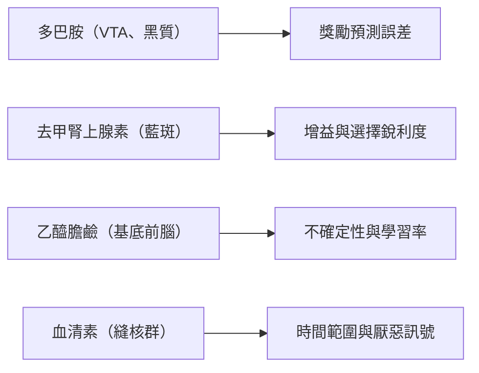

# 多巴胺之外的神經調節

神經調節物質是一類化學訊號，例如乙醯膽鹼、去甲腎上腺素與血清素。它們改變的是整個迴路如何反應與學習，而不是從一個神經元傳遞特定訊息到另一個神經元。多巴胺是研究最多的一種。其他系統似乎也回報對學習很重要的量：情境有多不確定、動物有多興奮，以及大腦應該多快更新信念。這些主張已為 AI 中的元學習與適應性最佳化器提供了想法。

## 概述

多數神經元透過快速、點對點的突觸溝通。神經調節系統的運作方式不同。腦幹或基底前腦的一小群神經元把軸突送到大片腦區，釋放傳遞物質，並透過受體改變附近神經元的興奮性與可塑性。它的作用範圍廣，而且通常比突觸傳遞來得慢。

通常會把四個系統放在一起討論。多巴胺主要來自腹側被蓋區與黑質。去甲腎上腺素來自藍斑，這是腦幹中一個很小的核團。血清素來自縫核群。乙醯膽鹼來自基底前腦，包括基底核與內側隔核。[神經科學基礎](../neuroscience/index.md)介紹了它們以及一般功能。

這個領域的核心問題是這些系統在計算什麼。多巴胺與獎勵預測誤差有關，見[決策、多巴胺與獎勵](../decision-reward/index.md)以及[多巴胺獎勵預測誤差](../neuroscience/dopamine-reward-prediction-error/index.md)頁面。其他系統被認為回報較高層次的變數：目前情境的不確定程度、應有的喚起或投入程度，以及結果在多遠的時間範圍內重要。這些變數決定大腦應該如何學習與注意，而不是學習什麼內容，因此這類系統常被稱為元層次的訊號。

三個里程碑式的理論組織了這個領域，每個理論各有一頁。Doya（2002）提出四種神經調節物質調節強化學習的元參數。Yu 與 Dayan（2005）提出乙醯膽鹼與去甲腎上腺素分別訊號兩種不確定性。Aston-Jones 與 Cohen（2005）提出藍斑的相位與緊張性活動，會在利用與探索之間取捨。

## 核心概念

- **神經調節物質**：一種會同時改變許多神經元的增益、放電閾值或可塑性的物質，而不是驅動某個特定目標。
- **緊張性與相位性活動**：持續的背景放電水準，與隨事件出現的短暫爆發相對。藍斑同時以兩種模式被描述。
- **預期與非預期不確定性**：預期不確定性是情境中已知存在的雜訊或不可靠性。非預期不確定性則是打破既有預測的突然變化。
- **適應性增益**：迴路對輸入的反應強弱改變，但輸入本身沒有改變。
- **元參數**：學習演算法中控制它如何學習的設定，例如學習率、折扣因子與行動選擇規則的逆溫度。
- **逆溫度**：在 softmax 策略中，決定選擇是否強烈偏向價值最高選項的參數。數值低時，選擇更隨機、更偏向探索。

## 運作方式

神經調節神經元通常以穩定的緊張性速率放電，或以短暫的相位性爆發放電。它們的投射範圍廣，受體作用常較慢。整體效果是移動它們所作用迴路的運作點。一個簡單的圖像是：情境不確定性、效用或時間範圍等元層次變數會反映在神經調節物質的濃度上，而這個濃度再設定局部迴路的一個參數。

強化學習的觀點讓這個連結變得精確。價值估計 $V$ 以時序差分誤差 $\delta_t = r_t + \gamma V(s_{t+1}) - V(s_t)$ 更新，更新式為 $V(s_t) \leftarrow V(s_t) + \alpha\,\delta_t$，其中 $\alpha$ 是學習率。行動則以 softmax 規則選擇，$P(a \mid s) \propto \exp(\beta\,Q(s,a))$，其中 $\beta$ 是逆溫度。$\gamma$ 是折扣因子，決定未來獎勵的分量。Doya（2002）提出多巴胺攜帶的是誤差 $\delta_t$ 本身，而血清素、乙醯膽鹼與去甲腎上腺素分別調節 $\gamma$、$\alpha$ 與 $\beta$。這個對應是關於功能的假說，不是已測得的事實，其細節見 [Doya 2002](doya-2002/index.md)頁面。

## 關鍵方法

每個方法都有自己的頁面。下表只做比較。

| 方法 | 主張 | 頁面 |
|---|---|---|
| 元參數對應（Doya，2002） | 四種神經調節物質分別調節強化學習的四個元參數 | [Doya 2002](doya-2002/index.md) |
| 預期與非預期不確定性（Yu 與 Dayan，2005） | 乙醯膽鹼訊號預期不確定性，去甲腎上腺素訊號非預期不確定性，兩者都會塑造注意力 | [Yu 與 Dayan 2005](yu-dayan-2005/index.md) |
| 適應性增益（Aston-Jones 與 Cohen，2005） | 藍斑的相位與緊張性活動，在利用與探索之間取捨 | [Aston-Jones 與 Cohen 2005](aston-jones-cohen-2005/index.md) |

第一個理論關心學習速度與時間範圍。第二個關心不確定性與注意力。第三個關心喚起程度，以及留在目前任務或尋找其他任務之間的選擇。它們是互補的理論，而非彼此對立，但在某些功能的分配上意見不同。

## 與其他主題的關聯

- **決策與獎勵**：[決策、多巴胺與獎勵](../decision-reward/index.md)中討論的獎勵訊號，是細節最多的神經調節物質理論。其他系統則設定使用該訊號的條件。
- **注意力**：不確定性理論把神經調節與注意力的分配聯繫起來，相關內容見[注意力：大腦與機器](../attention-brain-machine/index.md)。
- **記憶與可塑性**：乙醯膽鹼被認為會影響海馬迴偏向編碼新資訊，還是偏向提取舊記憶，見[大腦中的記憶與學習](../memory-learning/index.md)。
- **預測編碼**：有些理論把注意力描述為調整預測誤差的精確度。這與預期不確定性的角色相似，此連結在[預測編碼與自由能](../predictive-coding/index.md)中探討。
- **情緒**：血清素在厭惡處理中的角色與此相關，見[情緒與情感運算](../emotion/index.md)。
- **AI 中的探索**：藍斑的探索理論與[強化學習中的探索](../../theory/paradigms/reinforcement-learning/exploration/index.md)中的探索策略相呼應。

## 應用

- **元學習**：能調整自身元參數的代理人，運用了神經調節物質作為元層次控制器的想法。Schweighofer 與 Doya（2003）在強化學習中研究了這件事。見[元學習](../../theory/paradigms/meta-learning/index.md)。
- **適應性最佳化器**：Adam（Kingma 與 Ba，2014）根據梯度的滾動統計，為每個參數設定各自的步長。它並非由神經調節推導而來，但與「學習率應依學習狀態而定」的原則相同。見[適應性最佳化器](../../theory/optimization/adaptive/index.md)。
- **學習得來的可塑性**：Najarro 與 Risi（2020）搜尋赫布學習規則，讓網路在代理人的一生中自行組織權重。這是學習可塑性規則本身，接近「神經調節物質調控可塑性」的想法。
- **機器學習中的不確定性**：預期與非預期不確定性的區分，是[不確定性與校準](../../theory/machine-learning/uncertainty-and-calibration/index.md)的一套有用詞彙，特別是在偵測分布偏移時。
- **計算精神醫學**：把血清素與多巴胺描述為不同控制器的模型，被用來解釋作用於這些系統的藥物如何改變決策。見[心理健康](../../applications/mental-health/index.md)。

## 開放問題

- **血清素做什麼？** Doya 的對應把時間範圍交給血清素。其他主張則把它與厭惡處理及行為抑制連在一起，Dayan 與 Huys（2009）主張它與厭惡控制有關。[^1] 證據仍然分歧，而本主題的範圍把血清素歸於不確定性、喚起與學習率，這些角色的支持證據都還很薄弱。
- **神經調節物質是在實作元參數，還是只與元參數相關？** 測量某個腦區中神經調節物質的濃度，與證明它因果地改變某個計算參數，是不同的工作。
- **如何在資料中分開預期與非預期不確定性？** 這個區分在模型中很清楚，但從記錄中難以讀出，因為兩種訊號可能同時改變。
- **AI 的元學習應該模仿生物嗎？** 學得的可塑性規則不需要任何神經調節物質也能運作，因此這個類比的價值是一個實證問題。

## 參考文獻

### 開創性論文

- Doya, K.（2002）。Metalearning and neuromodulation。*Neural Networks*。https://doi.org/10.1016/S0893-6080(02)00044-8 — 提出多巴胺、血清素、去甲腎上腺素與乙醯膽鹼分別調節強化學習的誤差訊號與主要元參數。
- Yu, A. J. 與 Dayan, P.（2005）。Uncertainty, neuromodulation, and attention。*Neuron*。https://doi.org/10.1016/j.neuron.2005.04.026 — 提出乙醯膽鹼與去甲腎上腺素分別訊號預期與非預期不確定性，並塑造注意力的分配。
- Aston-Jones, G. 與 Cohen, J. D.（2005）。An integrative theory of locus coeruleus-norepinephrine function: adaptive gain and optimal performance。*Annual Review of Neuroscience*。https://doi.org/10.1146/annurev.neuro.28.061604.135709 — 整理猴子的記錄與模型，說明藍斑的相位與緊張性模式如何在利用與探索之間取捨。
- Schultz, W.、Dayan, P. 與 Montague, P. R.（1997）。A Neural Substrate of Prediction and Reward。*Science*。https://doi.org/10.1126/science.275.5306.1593 — 顯示多巴胺神經元訊號獎勵預測誤差，這是其他神經調節物質的比較基準。
- Schweighofer, N. 與 Doya, K.（2003）。Meta-learning in Reinforcement Learning。*Neural Networks*。https://doi.org/10.1016/S0893-6080(02)00228-9 — 研究強化學習者的元參數如何在學習過程中被調整，延續神經調節的觀點。
- Kingma, D. P. 與 Ba, J.（2014）。Adam: A Method for Stochastic Optimization。*arXiv*。https://arxiv.org/abs/1412.6980 — 提出 Adam，一種根據梯度滾動統計為每個參數調整步長的最佳化器。

### 綜述與教科書

- Dayan, P. 與 Huys, Q. J. M.（2009）。Serotonin in Affective Control。*Annual Review of Neuroscience*。https://doi.org/10.1146/annurev.neuro.051508.135607 — 回顧血清素在趨近與厭惡控制中的角色，以及它為何可能只部分反映多巴胺。
- Doya, K.（2008）。Modulators of decision making。*Nature Neuroscience*。https://doi.org/10.1038/nn2077 — 回顧神經調節物質如何影響決策，並把它們與強化學習參數連結起來。
- Hasselmo, M. E.（2006）。The role of acetylcholine in learning and memory。*Current Opinion in Neurobiology*。https://doi.org/10.1016/j.conb.2006.09.002 — 回顧乙醯膽鹼在海馬迴與皮質中對編碼與提取的可能作用。
- Sara, S. J.（2009）。The locus coeruleus and noradrenergic modulation of cognition。*Nature Reviews Neuroscience*。https://doi.org/10.1038/nrn2573 — 回顧藍斑與去甲腎上腺素如何影響注意、記憶與認知控制。
- Bouret, S. 與 Sara, S. J.（2005）。Network reset: a simplified overarching theory of locus coeruleus noradrenaline function。*Trends in Neurosciences*。https://doi.org/10.1016/j.tins.2005.09.002 — 主張藍斑在顯著事件後的爆發活動會重設皮質網路。

### 文章與文件

- Najarro, E. 與 Risi, S.（2020）。Meta-Learning through Hebbian Plasticity in Random Networks。*arXiv*。https://arxiv.org/abs/2007.02686 — 搜尋赫布學習規則，讓代理人在一生中調整自己的網路，是學習可塑性的機器版本。

[^1]: Dayan 與 Huys（2009）認為，血清素的計算角色與厭惡處理有關，而且因為懲罰與獎勵在本質上不對稱，其統計特性與多巴胺不同。這個觀點與 Doya 把血清素對應到折扣因子的主張相競爭。
