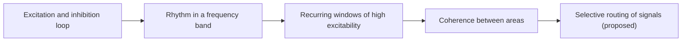

# Neural Oscillations and Synchrony

Neural oscillations are rhythmic fluctuations in the activity of neuronal populations, and synchrony is the coordination of those rhythms across neurons and brain regions. Many researchers think the rhythms help the brain select, route and bind information, although this remains debated. The same ideas raise a question for AI: whether artificial networks need anything like rhythms at all.

## Overview

Recordings from the scalp (EEG) and from inside the brain (local field potentials, LFP; see [Neuroimaging & Recording Methods](../neuroimaging-methods/index.md)) show rhythms at many frequencies. The rhythms change with behaviour and sleep state. A slow rhythm dominates deep sleep, while faster rhythms appear during attention and memory tasks. Buzsáki and Draguhn (2004) point out that cortical network oscillations span about five orders of magnitude in frequency and are preserved across mammals, which suggests that they are functionally relevant rather than a by-product of wiring.

The central question is whether oscillations are a by-product of neural activity, like the vibration of a bridge, or part of how the brain computes. The field spans frequency bands, phase coding, communication through coherence and theta–gamma coupling, and three landmark methods are listed under Key methods.

## Key concepts

- **Frequency band**: rhythms are grouped into conventional bands. Delta covers roughly 1 to 4 Hz, theta about 4 to 8 Hz, alpha 8 to 12 Hz, beta 13 to 30 Hz and gamma roughly 30 to 100 Hz. The boundaries vary between labs. Canolty and colleagues (2006) define theta as 4 to 8 Hz and high gamma as 80 to 150 Hz, while Tort and colleagues (2009) use theta at 4 to 12 Hz and gamma at 30 to 100 Hz.
- **Phase**: the position of a signal within its cycle, from 0 to 360 degrees.
- **Amplitude envelope**: how strong a rhythm is at each moment, regardless of its phase.
- **Synchrony and coherence**: synchrony is a consistent timing relation between two signals. Coherence is a normalised measure of that consistency in a frequency band, running from 0 (no relation) to 1 (a fixed relation).
- **Cross-frequency coupling**: a dependence between the phase of a slow rhythm and the amplitude of a fast one. [Phase-amplitude coupling](phase-amplitude-coupling/index.md) describes the measure.
- **Phase precession**: the systematic shift of a place cell's spikes to earlier theta phases as an animal crosses the cell's place field. O'Keefe and Recce (1993) reported it. See [Place cells](../navigation-cognitive-maps/place-cells/index.md).

## How it works

Rhythms arise from the interaction of excitation and inhibition. Wang (2010) reviews how synaptic inhibition plays a fundamental role in generating them, either in networks of inhibitory interneurons or in a loop between excitatory and inhibitory cells. Buzsáki and Wang (2012) argue that gamma rhythms are closely tied to perisomatic inhibition, and that they are short-lived and emerge from coordinated excitation and inhibition.

A single neuron fires irregularly, so a rhythm is a property of the population rather than of one cell. Wang (2010) describes how theory has gone beyond simple coupled-oscillator models to reconcile irregular single-cell firing with rhythmic field potentials.

The simplest mathematical model of synchrony is a set of coupled phase oscillators. In the Kuramoto model, each oscillator $i$ has a natural frequency $\omega_i$ and a phase $\theta_i$:

$$\dot{\theta}_i = \omega_i + \frac{K}{N}\sum_{j=1}^{N}\sin(\theta_j - \theta_i).$$

When the coupling strength $K$ is large enough, a fraction of the oscillators lock together. Strogatz (2000) reviews this transition.

The diagram shows the argument that links rhythm to communication. The last two steps are a proposal rather than an established fact.

## Key methods

Three landmark methods are compared here. Each has its own page.

| Method | What it adds | Page |
|---|---|---|
| Communication through coherence (Fries, 2005) | A signal passes between areas when the receiving area is in a favourable phase, so coherence between areas could control routing | [Communication through coherence](communication-through-coherence/index.md) |
| Phase-amplitude coupling (Tort et al., 2010) | A modulation index that measures how strongly a slow phase modulates a fast amplitude | [Phase-amplitude coupling](phase-amplitude-coupling/index.md) |
| Coupled oscillatory RNN (Rusch & Mishra, 2021) | An artificial recurrent network whose hidden units are discretised, damped and forced oscillators | [Coupled oscillatory RNN](coupled-oscillatory-rnn/index.md) |

## Connections

**Memory.** Theta–gamma coupling is one of the most studied rhythmic signatures of memory. Lisman and Jensen (2013) propose that each theta cycle contains a sequence of gamma subcycles, each representing an item. Tort and colleagues (2009) recorded rats learning item–context associations and found that theta–gamma coupling in hippocampal region CA3 strengthened during learning and tracked accuracy. Fell and Axmacher (2011) review phase synchronisation as a general mechanism in memory processes, and Colgin (2016) reviews the rhythms of the hippocampal network. The rhythms of sleep, including slow oscillations and ripples, are covered in [Sleep, Replay & Memory Consolidation](../sleep-and-consolidation/index.md). Sustained activity in working memory is covered in [Working Memory & Executive Function](../working-memory-executive-function/index.md). The synaptic changes behind memory are described in [Long-Term Potentiation](../memory-learning/long-term-potentiation/index.md).

**Attention.** Fries and colleagues (2001) recorded neurons in macaque area V4. They found that attention to a stimulus increased gamma-band synchronisation among the neurons that responded to it, and reduced low-frequency synchronisation. This is a rhythm-level account of the process described in [Biased Competition](../attention-brain-machine/biased-competition/index.md). Wang (2010) reviews the evidence that long-distance coherence supports attention and working memory.

**Navigation.** The hippocampal theta rhythm is tied to movement, and the phase at which place cells fire carries information about position (O'Keefe & Recce, 1993). See [Spatial Navigation & Cognitive Maps](../navigation-cognitive-maps/index.md).

**Recording.** Most rhythm evidence comes from LFP and EEG, which sum many cells. See [fMRI and Electrophysiology](../neuroimaging-methods/fmri-electrophysiology/index.md).

**Clinical.** Wang (2010) discusses abnormal neural synchronisation as relevant to disorders such as schizophrenia and autism.

**Artificial networks.** Standard feed-forward networks and transformers have no intrinsic rhythm. Transformers do use sinusoidal functions of position for their positional encodings (Vaswani et al., 2017), but these are fixed inputs, not dynamics (see [positional encodings](../../theory/models/transformer/positional-encodings/index.md)). Oscillation-like dynamics appear where a network has internal state that evolves over time. The coupled oscillatory RNN builds its units from damped oscillators. [State-space models](../../theory/models/ssm/index.md) can parameterise recurrence with complex-valued dynamics, which also produce oscillatory modes. Spiking networks use spike timing relative to an oscillation as a code, which is described in [Spiking Networks & Neuromorphic Computing](../snn-neuromorphic/index.md). These analogies concern mechanisms, such as coupling, damping and phase-based gating. They do not show that rhythms emerge in trained networks.

## Applications

- **Clinical EEG.** Reading rhythms from the scalp is a routine clinical tool, for example for sleep staging. The rhythms that define sleep stages are described in [Sleep, Replay & Memory Consolidation](../sleep-and-consolidation/index.md).
- **Brain–computer interfaces.** Rhythmic signals recorded from cortex are among the inputs that some interfaces use. See [Brain-Computer Interfaces](../bci/index.md).
- **Neuromorphic hardware.** Event-driven hardware can use spike timing and phase-based codes, which gives the oscillation idea a practical role outside biology. See [Spiking Networks & Neuromorphic Computing](../snn-neuromorphic/index.md).
- **Electrophysiology.** Coherence and phase–amplitude coupling are standard analysis tools, which is why the measurement issues discussed on the method pages matter in practice.

## Open questions

- **Are oscillations causal?** Wang (2010) notes that the computational functions of synchronous oscillations are still debated. Many results are correlational, so direct manipulation of rhythms is needed to test them.
- **Does coherence route information?** Coherence may cause selective communication, or it may only reflect communication that happens for other reasons. [Communication through coherence](communication-through-coherence/index.md) sets out the competing readings.
- **How much coupling is real?** Cross-frequency coupling can arise from waveform shape and filtering, so surrogate controls are required. See [Phase-amplitude coupling](phase-amplitude-coupling/index.md).
- **Do theta cycles carry several items?** Lisman and Jensen (2013) propose that they do. Testing this requires recordings that resolve individual items within a single sequence.
- **Is there a useful artificial analogue?** Oscillator-based recurrent networks show good gradient stability on benchmarks. Whether rhythm-like dynamics matter beyond that remains open.

## References

### Seminal papers

- Lisman, J. E. & Jensen, O. (2013). The theta-gamma neural code. *Neuron*. https://doi.org/10.1016/j.neuron.2013.03.007 — Proposes that gamma subcycles within each theta cycle represent successive items, as a neural code for sequences.
- Fries, P. (2005). A mechanism for cognitive dynamics: neuronal communication through neuronal coherence. *Trends in Cognitive Sciences*. https://doi.org/10.1016/j.tics.2005.08.011 — Proposes that neuronal groups communicate most effectively when their rhythms are coherent and the receiving group is in a favourable phase.
- Fries, P., Reynolds, J. H., Rorie, A. E. & Desimone, R. (2001). Modulation of oscillatory neuronal synchronization by selective visual attention. *Science*. https://doi.org/10.1126/science.1055465 — Recordings from macaque area V4 showing that attention changes gamma and low-frequency synchrony among neurons.
- Canolty, R. T. et al. (2006). High gamma power is phase-locked to theta oscillations in human neocortex. *Science*. https://doi.org/10.1126/science.1128115 — Human electrocorticogram recordings in which theta phase modulates high-gamma power.
- O'Keefe, J. & Recce, M. L. (1993). Phase relationship between hippocampal place units and the EEG theta rhythm. *Hippocampus*. https://doi.org/10.1002/hipo.450030307 — Shows that place-cell spikes shift to earlier theta phases as a rat crosses a place field.
- Tort, A. B. L. et al. (2010). Measuring phase-amplitude coupling between neuronal oscillations of different frequencies. *Journal of Neurophysiology*. https://doi.org/10.1152/jn.00106.2010 — Introduces the modulation index for phase-amplitude coupling and compares it with other coupling measures.
- Vaswani, A. et al. (2017). Attention Is All You Need. arXiv. https://arxiv.org/abs/1706.03762 — Introduces the Transformer, whose positional encodings are built from sinusoids.

### Surveys and textbooks

- Buzsáki, G. & Draguhn, A. (2004). Neuronal oscillations in cortical networks. *Science*. https://doi.org/10.1126/science.1099745 — Review of cortical network oscillations across frequencies and of their proposed roles in selecting input and linking neurons.
- Buzsáki, G. (2006). *Rhythms of the Brain*. Oxford University Press. https://doi.org/10.1093/acprof:oso/9780195301069.001.0001 — Book-length treatment of brain rhythms, from cellular mechanisms to behaviour.
- Wang, X.-J. (2010). Neurophysiological and computational principles of cortical rhythms in cognition. *Physiological Reviews*. https://doi.org/10.1152/physrev.00035.2008 — Review of gamma and theta rhythms and their mechanisms, including long-distance coherence in cognition.
- Buzsáki, G. & Wang, X.-J. (2012). Mechanisms of gamma oscillations. *Annual Review of Neuroscience*. https://doi.org/10.1146/annurev-neuro-062111-150444 — Reviews the cellular and synaptic mechanisms behind gamma rhythms and the open questions about them.
- Fries, P. (2015). Rhythms for cognition: communication through coherence. *Neuron*. https://doi.org/10.1016/j.neuron.2015.09.034 — Later review by the same author that updates the communication-through-coherence argument.
- Fell, J. & Axmacher, N. (2011). The role of phase synchronization in memory processes. *Nature Reviews Neuroscience*. https://doi.org/10.1038/nrn2979 — Reviews how phase synchronisation relates to memory processes.
- Colgin, L. L. (2016). Rhythms of the hippocampal network. *Nature Reviews Neuroscience*. https://doi.org/10.1038/nrn.2016.21 — Reviews the rhythms of hippocampal circuits and their links to memory and navigation.
- Strogatz, S. H. (2000). From Kuramoto to Crawford: exploring the onset of synchronization in populations of coupled oscillators. *Physica D*. https://doi.org/10.1016/S0167-2789(00)00094-4 — Reviews the Kuramoto model of coupled oscillators and the onset of synchrony.
