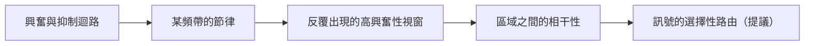

# 神經振盪與同步

神經振盪是神經元群體活動中的節律性起伏，同步則是這些節律在神經元與腦區之間的協調。許多研究者認為，這些節律幫助大腦選擇、路由並綁定資訊，不過這仍有爭議。同樣的想法也對 AI 提出問題：人工網路是否需要某種類似節律的機制。

## 概述

頭皮記錄（EEG）與腦內記錄（局部場電位，LFP；見[神經影像與記錄方法](../neuroimaging-methods/index.md)）都顯示，大腦活動含有多種頻率的節律。這些節律會隨行為與睡眠狀態改變：深睡時以慢節律為主，注意與記憶任務中則出現較快的節律。Buzsáki 與 Draguhn（2004）指出，皮質網路振盪的頻率橫跨約五個數量級，而且在哺乳類之間保留下來，這顯示它們具有功能上的意義，而不只是接線的副產物。

核心問題是：振盪究竟是神經活動的副產物，像橋樑的振動一樣，還是大腦運算方式的一部分。這個領域涵蓋頻帶與其相關性、相位編碼、透過相干性的通訊，以及 θ–γ 耦合。三種代表性方法列在「關鍵方法」一節，各有獨立的頁面。

## 核心概念

- **頻帶**：節律通常依習慣分為幾個頻帶。δ 約為 1 到 4 Hz，θ 約為 4 到 8 Hz，α 為 8 到 12 Hz，β 為 13 到 30 Hz，γ 約為 30 到 100 Hz。各實驗室對邊界的定義不一。Canolty 等人（2006）把 θ 定義為 4 到 8 Hz，高 γ 為 80 到 150 Hz；Tort 等人（2009）則用 θ 為 4 到 12 Hz、γ 為 30 到 100 Hz。
- **相位**：訊號在其週期中的位置，從 0 度到 360 度。
- **振幅包絡**：在每個時刻節律的強度，不論其相位為何。
- **同步與相干性**：同步是兩個訊號之間穩定的時序關係。相干性是該關係在某個頻帶中的標準化量測，數值從 0（無關聯）到 1（固定關係）。
- **跨頻耦合**：慢節律的相位與快節律的振幅之間的依賴關係。[相位-振幅耦合](phase-amplitude-coupling/index.md)一頁說明其量測方法。
- **相位前進**：當動物穿越某個位置細胞的位置野時，該細胞的放電會系統性地移到較早的 θ 相位。O'Keefe 與 Recce（1993）報告了這一現象。見[位置細胞](../navigation-cognitive-maps/place-cells/index.md)。

## 運作方式

節律來自興奮與抑制的交互作用。Wang（2010）回顧了突觸抑制如何在產生節律中扮演根本角色，無論是在抑制性中間神經元網路中，或是在興奮與抑制的迴路中。Buzsáki 與 Wang（2012）主張，γ 節律與胞體周圍的抑制密切相關，而且它們持續時間短，是興奮與抑制協調互動的結果。

單一神經元的放電是不規則的，因此節律是群體的性質，而非單一細胞的性質。Wang（2010）描述理論如何超越簡單的耦合振子模型，以調和不規則的單細胞放電與有節律的場電位。

同步最簡單的數學模型是一組耦合的相位振子。在 Kuramoto 模型中，每個振子 $i$ 有自然頻率 $\omega_i$ 與相位 $\theta_i$：

$$\dot{\theta}_i = \omega_i + \frac{K}{N}\sum_{j=1}^{N}\sin(\theta_j - \theta_i).$$

當耦合強度 $K$ 夠大時，一部分振子會鎖相在一起。Strogatz（2000）回顧了這個轉變。

下圖說明連結節律與通訊的論證。最後兩步是一項提議，而非已確立的事實。

## 關鍵方法

這裡比較三種代表性方法，每種各有獨立頁面。

| 方法 | 新增的內容 | 頁面 |
|---|---|---|
| 透過相干性的通訊（Fries，2005） | 當接收區處於有利相位時，訊號才會在區域之間傳遞，因此區域間的相干性可能控制路由 | [透過相干性的通訊](communication-through-coherence/index.md) |
| 相位-振幅耦合（Tort 等人，2010） | 以調變指數量測慢相位調變快振幅的強度 | [相位-振幅耦合](phase-amplitude-coupling/index.md) |
| 耦合振盪 RNN（Rusch 與 Mishra，2021） | 一種人工循環網路，其隱藏單元是離散化的阻尼受迫振子 | [耦合振盪 RNN](coupled-oscillatory-rnn/index.md) |

## 與其他主題的關聯

**記憶。** θ–γ 耦合是記憶最受研究的節律特徵之一。Lisman 與 Jensen（2013）提出，每個 θ 週期含有一串 γ 子週期，每個子週期代表一個項目。Tort 等人（2009）記錄大鼠學習項目與情境的關聯，發現海馬迴 CA3 區的 θ–γ 耦合在學習期間增強，並與正確率同步變化。Fell 與 Axmacher（2011）綜述相位同步在記憶歷程中的一般角色，Colgin（2016）則綜述海馬迴網路的節律。睡眠中的節律，包括慢振盪與漣波，見[睡眠、重播與記憶鞏固](../sleep-and-consolidation/index.md)。工作記憶中的持續活動見[工作記憶與執行功能](../working-memory-executive-function/index.md)。記憶背後的突觸變化見[長期增益](../memory-learning/long-term-potentiation/index.md)。

**注意。** Fries 與同事（2001）記錄了獼猴 V4 區的神經元。他們發現，注意某刺激時，對該刺激有反應的神經元之間，γ 頻段的同步增強，低頻同步則減弱。這是[偏向競爭](../attention-brain-machine/biased-competition/index.md)歷程在節律層次上的解釋。Wang（2010）綜述了長距離相干性支持注意與工作記憶的證據。

**導航。** 海馬迴的 θ 節律與移動有關，位置細胞放電的相位則攜帶位置資訊（O'Keefe 與 Recce，1993）。見[空間導航與認知地圖](../navigation-cognitive-maps/index.md)。

**記錄。** 多數節律證據來自 LFP 與 EEG，它們加總了許多細胞的活動。見[fMRI 與電生理](../neuroimaging-methods/fmri-electrophysiology/index.md)。

**臨床。** Wang（2010）討論異常的神經同步與精神分裂症、自閉症等疾病的關係。

**人工網路。** 標準的前饋網路與 Transformer 本身沒有內在節律。Transformer 確實使用正弦函數作為位置編碼（Vaswani 等人，2017），但這些是固定的輸入，而非動力學（見[位置編碼](../../theory/models/transformer/positional-encodings/index.md)）。當網路具有隨時間演化的內部狀態時，類似振盪的動力學便會出現。耦合振盪 RNN 以阻尼振子作為單元。[狀態空間模型](../../theory/models/ssm/index.md)可以用複數值動力學參數化循環，這同樣會產生振盪模態。脈衝神經網路則把脈衝時序相對於振盪的關係當作編碼，見[脈衝神經網路與神經形態運算](../snn-neuromorphic/index.md)。這些類比談的是機制，例如耦合、阻尼與基於相位的門控，並不表示訓練後的網路會自發出現節律。

## 應用

- **臨床 EEG。** 從頭皮讀取節律是常規的臨床工具，例如用於睡眠分期。定義睡眠階段的節律見[睡眠、重播與記憶鞏固](../sleep-and-consolidation/index.md)。
- **腦機介面。** 從皮質記錄到的節律訊號，是某些介面使用的輸入之一。見[腦機介面](../bci/index.md)。
- **神經形態硬體。** 事件驅動的硬體可以使用脈衝時序與基於相位的編碼，讓振盪的概念在生物學之外也有實際用途。見[脈衝神經網路與神經形態運算](../snn-neuromorphic/index.md)。
- **電生理學。** 相干性與相位-振幅耦合是標準的分析工具，因此方法頁所討論的量測問題在實務上很重要。

## 開放問題

- **振盪是否具有因果性？** Wang（2010）指出，同步振盪的計算功能仍有爭議。許多結果屬於相關性，因此需要直接操控節律來檢驗。
- **相干性是否在路由資訊？** 相干性可能造成選擇性通訊，也可能只是反映因其他原因發生的通訊。[透過相干性的通訊](communication-through-coherence/index.md)一頁列出了相互競爭的解讀。
- **耦合有多少是真實的？** 跨頻耦合可能來自波形形狀與濾波，因此需要替代資料控制。見[相位-振幅耦合](phase-amplitude-coupling/index.md)。
- **一個 θ 週期是否承載多個項目？** Lisman 與 Jensen（2013）提出了這個可能性。要檢驗它，需要能解析單一序列中個別項目的記錄。
- **是否存在有用的人工類比？** 基於振盪的循環網路在基準測試上顯示良好的梯度穩定性。但節律式動力學是否在此之外仍有作用，尚待確定。

## 參考文獻

### 開創性論文

- Lisman, J. E. & Jensen, O. (2013). The theta-gamma neural code. *Neuron*. https://doi.org/10.1016/j.neuron.2013.03.007 — 提出每個 θ 週期內的 γ 子週期代表連續項目，作為序列的神經編碼。
- Fries, P. (2005). A mechanism for cognitive dynamics: neuronal communication through neuronal coherence. *Trends in Cognitive Sciences*. https://doi.org/10.1016/j.tics.2005.08.011 — 提出當神經元群體的節律相干、且接收群體處於有利相位時，它們的通訊最有效。
- Fries, P., Reynolds, J. H., Rorie, A. E. & Desimone, R. (2001). Modulation of oscillatory neuronal synchronization by selective visual attention. *Science*. https://doi.org/10.1126/science.1055465 — 獼猴 V4 區的記錄，顯示注意會改變神經元之間的 γ 與低頻同步。
- Canolty, R. T. 等人 (2006). High gamma power is phase-locked to theta oscillations in human neocortex. *Science*. https://doi.org/10.1126/science.1128115 — 人類的皮質電圖記錄，顯示 θ 相位調變高 γ 功率。
- O'Keefe, J. & Recce, M. L. (1993). Phase relationship between hippocampal place units and the EEG theta rhythm. *Hippocampus*. https://doi.org/10.1002/hipo.450030307 — 顯示大鼠穿越位置野時，位置細胞的脈衝會移到較早的 θ 相位。
- Tort, A. B. L. 等人 (2010). Measuring phase-amplitude coupling between neuronal oscillations of different frequencies. *Journal of Neurophysiology*. https://doi.org/10.1152/jn.00106.2010 — 提出調變指數作為相位-振幅耦合的量測，並與其他耦合量測比較。
- Vaswani, A. 等人 (2017). Attention Is All You Need. arXiv. https://arxiv.org/abs/1706.03762 — 提出 Transformer 架構，其位置編碼以正弦函數構成。

### 綜述與教科書

- Buzsáki, G. & Draguhn, A. (2004). Neuronal oscillations in cortical networks. *Science*. https://doi.org/10.1126/science.1099745 — 綜述跨頻率的皮質網路振盪，以及它們被提出的選擇輸入與連結神經元的功能。
- Buzsáki, G. (2006). *Rhythms of the Brain*. Oxford University Press. https://doi.org/10.1093/acprof:oso/9780195301069.001.0001 — 全書篇幅討論腦節律，從細胞機制到行為。
- Wang, X.-J. (2010). Neurophysiological and computational principles of cortical rhythms in cognition. *Physiological Reviews*. https://doi.org/10.1152/physrev.00035.2008 — 綜述 γ 與 θ 節律及其機制，包括認知中的長距離相干性。
- Buzsáki, G. & Wang, X.-J. (2012). Mechanisms of gamma oscillations. *Annual Review of Neuroscience*. https://doi.org/10.1146/annurev-neuro-062111-150444 — 綜述 γ 節律背後的細胞與突觸機制，以及相關的未解問題。
- Fries, P. (2015). Rhythms for cognition: communication through coherence. *Neuron*. https://doi.org/10.1016/j.neuron.2015.09.034 — 同一作者的後續綜述，更新了透過相干性通訊的論證。
- Fell, J. & Axmacher, N. (2011). The role of phase synchronization in memory processes. *Nature Reviews Neuroscience*. https://doi.org/10.1038/nrn2979 — 綜述相位同步與記憶歷程的關係。
- Colgin, L. L. (2016). Rhythms of the hippocampal network. *Nature Reviews Neuroscience*. https://doi.org/10.1038/nrn.2016.21 — 綜述海馬迴迴路的節律，以及它們與記憶和導航的關係。
- Strogatz, S. H. (2000). From Kuramoto to Crawford: exploring the onset of synchronization in populations of coupled oscillators. *Physica D*. https://doi.org/10.1016/S0167-2789(00)00094-4 — 綜述 Kuramoto 模型與同步的出現。
