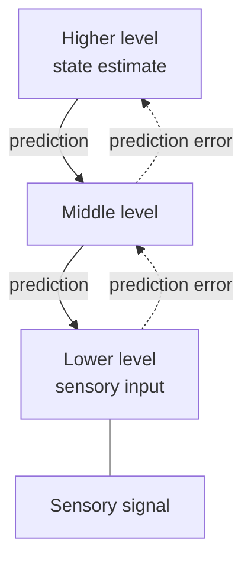

# Predictive Coding and the Free-Energy Principle

Predictive coding proposes that the brain is a prediction machine. Instead of passing raw sensory data upward, each level of the cortex sends its best guess to the level below and only the mismatch, the prediction error, moves up. The idea is one of the most influential frameworks in theoretical neuroscience, and it has a close relative in machine learning.

## Overview

The brain receives an incoming stream of signals with no labels and must make sense of it. One way to do this is to build a model of the causes of the signals and use it to predict what comes next. Predictive coding says the cortex does exactly that, in a hierarchy: higher areas predict the activity of lower ones, and the residual error is what gets passed forward. [Cognitive Science](../cognitive-science/index.md) summarises the psychology of this idea, and this page covers the mechanism, the key papers, and the links to AI.

## Key concepts

- **Prediction error**: the difference between the signal a level receives and the signal it predicted. Errors are what carry information upward.
- **Hierarchical generative model**: a stack of levels, where each level generates predictions for the one beneath it. Perception is inference over this model.
- **Free energy**: a quantity from statistics that upper-bounds surprise. Minimising it approximates Bayesian inference. The free-energy principle (Friston) proposes that self-organising systems, including brains, act to minimise it.
- **Precision**: the confidence assigned to a prediction error. Weighting errors by precision decides which signals get through, and is one proposed account of attention.
- **Active inference**: when the model acts on the world, changing sensory input so that predictions come true. Action and perception then serve the same goal.

## How it works

The cortex is modelled as levels that exchange two kinds of signal. Feedback connections carry predictions downward, and feedforward connections carry the residual errors upward. Learning adjusts the model so that future errors shrink.

Three ideas follow from this structure:

1. **Perception as explanation**: a percept is the best explanation of the input under the current model, not a copy of the input.
2. **Learning from mismatch**: when predictions fail, the model changes. A well-learned input should produce little error, which is one proposed reading of repetition suppression.
3. **Attention as weighting**: raising the precision of an error signal lets it dominate the update, which gives a natural account of why unexpected events capture attention.

The same logic appears in reinforcement learning. Dopamine neurons respond to reward prediction errors, as summarised in [Neuroscience Basics](../neuroscience/index.md), so a prediction-error signal is already known in one neuromodulatory system.

## Key methods

### Predictive coding in visual cortex (Rao & Ballard, 1999)

- **Problem:** Why do neurons in visual cortex show extra-classical receptive-field effects, such as responses that depend on the wider surround of a stimulus, and what is the computational role of the feedback connections that carry them?
- **Core idea:** Propose that feedback from a higher area carries predictions of lower-level activity, and feedforward connections carry the residual errors. A hierarchical network trained on natural images then learns its own feature detectors, and the error-carrying neurons show the surround effects.
- **Equation or algorithm:**
  1. Build a hierarchical network where each level holds an estimate of the input and sends a prediction to the level below.
  2. Compute the residual error at each level, the difference between the level's input and its prediction.
  3. Send the errors upward, and update each level's estimate so that its prediction reduces the error.
  4. Train the connection weights on natural image patches, so that the network learns a set of features.
- **Results:** The abstract reports that the trained network developed simple-cell-like receptive fields, and that a subset of the error-carrying neurons showed endstopping and other extra-classical receptive-field effects. The results are qualitative; the abstract gives no numerical measure of fit to the neural data.
- **Limitations:** The model is a proof of principle, not a fit to recorded neurons. The paper suggests that surround effects may come from cortico-cortical feedback, and testing that required later experiments.

### Predictive coding can approximate backpropagation (Whittington & Bogacz, 2017)

- **Problem:** Backpropagation is an effective learning algorithm, but its weight updates depend on information from distant neurons, which a real synapse cannot access.
- **Core idea:** Show that a predictive coding network, which has explicit prediction-error nodes, can learn supervised tasks using only local Hebbian plasticity, meaning each synaptic change depends only on the two neurons it connects.
- **Equation or algorithm:**
  1. Clamp the input and output layers, and let the hidden activity settle so that the prediction errors are minimised.
  2. Update each synapse using only the activity of its two connected neurons and the local prediction error.
  3. Repeat over training examples; for suitable parameter settings the weight changes match those of backpropagation.
- **Results:** The authors show that with suitable parameters the weight updates converge to those of backpropagation, and that the network performs much like a standard network on MNIST digit recognition under those conditions.
- **Limitations:** The match depends on parameter choices, and the authors argue that the brain probably does not implement backpropagation exactly, because real data has noise at several levels. The result is a mechanism that approximates the algorithm, not evidence that the cortex implements it.

## Connections

- **Cognitive science**: the psychology of predictive processing, including the free-energy and Bayesian framing, is in [Cognitive Science](../cognitive-science/index.md).
- **Neuroscience**: the dopamine reward prediction error is a prediction-error signal in a different system; see [Neuroscience Basics](../neuroscience/index.md).
- **NeuroAI**: predictive-coding networks are a candidate biologically plausible alternative to backpropagation, and self-supervised predictive objectives in AI resemble the same idea. See [NeuroAI](../neuroai/index.md).
- **Perception**: the hierarchy of visual areas is discussed in [Perception and the Visual System](../visual-perception/index.md).
- **Language**: word-by-word prediction in the language network is covered in [Language in the Brain](../language-in-brain/index.md).

## Applications

- **Anomaly detection**: systems that flag inputs with large prediction errors are used to find unusual events in sensor data, such as equipment faults and fraud. The principle is the same as the brain account, though the systems are engineered rather than modelled on cortex.
- **Machine learning research**: predictive-coding networks are studied as local, biologically plausible learning rules. Their practical benefit at scale is still an open research question.
- **Computational psychiatry**: some researchers model symptoms as abnormal weighting of prediction errors. These accounts are hypotheses under test, not established diagnoses.

## Open questions

- **Does the cortex implement predictive coding?** Hierarchical prediction fits much data, but the specific circuit implementation, with separate error and prediction populations, is still being tested.
- **Can predictive-coding networks match backpropagation at scale?** Results on small benchmarks are encouraging; results on large deep networks are not established.
- **Is the free-energy principle falsifiable?** Critics argue it is so general that it is hard to test, while supporters see it as a unifying framework. The debate is over what a testable prediction would be.
- **How are precision and attention related?** Precision weighting offers an account of attention, but it needs direct neural evidence to separate it from other mechanisms.

## References

### Seminal papers

- Rao, R. P. N. & Ballard, D. H. (1999). Predictive coding in the visual cortex: a functional interpretation of some extra-classical receptive-field effects. *Nature Neuroscience*. https://doi.org/10.1038/4580 — Proposes that feedback carries predictions and feedforward connections carry errors, and that a hierarchical network trained on natural images reproduces several surround effects.
- Friston, K. (2010). The free-energy principle: a unified brain theory? *Nature Reviews Neuroscience*. https://doi.org/10.1038/nrn2787 — Proposes that brains minimise prediction error, a unifying framework for perception, action and learning. (Reference reused from the Neuroscience Basics page; not re-checked for this page.)
- Whittington, J. C. R. & Bogacz, R. (2017). An Approximation of the Error Backpropagation Algorithm in a Predictive Coding Network with Local Hebbian Synaptic Plasticity. *Neural Computation*. https://doi.org/10.1162/NECO_a_00949 — Shows that predictive coding with local plasticity can approximate backpropagation under suitable parameters.

### Surveys and reviews

- Clark, A. (2013). Whatever next? Predictive brains, situated agents, and the future of cognitive science. *Behavioral and Brain Sciences*. https://doi.org/10.1017/S0140525X12000477 — A review of predictive processing as a unifying framework for perception, action and cognition. (Reference reused from the Cognitive Science page; not re-checked for this page.)
- Keller, G. B. & Mrsic-Flogel, T. D. (2018). Predictive Processing: A Canonical Cortical Computation. *Neuron*. https://doi.org/10.1016/j.neuron.2018.10.003 — A review arguing that predictive processing is a repeated circuit-level computation across cortex, and discussing how it could be tested.
